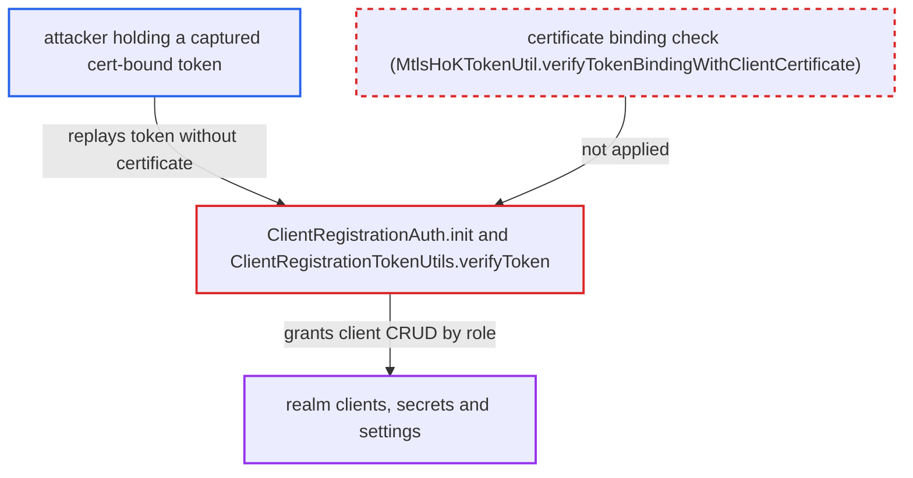

# Client registration API accepts cert-bound admin access tokens without verifying the certificate binding

| Field | Value |
|---|---|
| ID | `find_01PVYNrTUsczLDsBXbQGRjKS` |
| Severity | **Critical** |
| Status | open |
| CWE | CWE-294 — Authentication bypass by capture-replay |
| Created | 2026-10-27T22:01:13.481443Z |
| Claude Security | https://claude.ai/security/findings/find_01PVYNrTUsczLDsBXbQGRjKS |

## Description

Someone who has captured a certificate-bound admin access token can replay it, without the TLS client certificate, against the client registration API. They can then read, create, change or delete clients in that realm. The token must carry `realm-management` roles such as `manage-clients`, `create-client` or `view-clients`. `ClientRegistrationTokenUtils.verifyToken` never checks the `cnf.x5t#S256` certificate binding.

1. **attacker** obtains a captured access token. The token was issued to a client with certificate-bound tokens enabled, and its user holds `manage-clients`, `create-client` or `view-clients` on `realm-management`. ([`services/src/main/java/org/keycloak/protocol/oidc/grants/OAuth2GrantTypeBase.java:207-223`](https://github.com/cx-benchmark/keycloak/blob/1d7be35d0764060a8143fc74b0aabf2442743be4/services/src/main/java/org/keycloak/protocol/oidc/grants/OAuth2GrantTypeBase.java#L207-L223))
2. **attacker** sends the token as `Authorization: Bearer` to `/realms/{realm}/clients-registrations/default`. No TLS client key or certificate is presented, and GET, POST, PUT and DELETE are all possible. ([`services/src/main/java/org/keycloak/services/clientregistration/ClientRegistrationAuth.java:100-130`](https://github.com/cx-benchmark/keycloak/blob/1d7be35d0764060a8143fc74b0aabf2442743be4/services/src/main/java/org/keycloak/services/clientregistration/ClientRegistrationAuth.java#L100-L130))
3. **the handler `ClientRegistrationAuth.init()`** parses the header and passes the token to `verifyToken`. The verified token then drives the `requireCreate`, `requireView`, `requireUpdate` and `requireDelete` checks. ([`services/src/main/java/org/keycloak/services/clientregistration/ClientRegistrationAuth.java:100-130`](https://github.com/cx-benchmark/keycloak/blob/1d7be35d0764060a8143fc74b0aabf2442743be4/services/src/main/java/org/keycloak/services/clientregistration/ClientRegistrationAuth.java#L100-L130))
4. **the verifier `ClientRegistrationTokenUtils.verifyToken`** accepts the token without checking its certificate binding. It checks issuer, lifetime, revocation and signature. It accepts `typ: Bearer`, which cert-bound tokens keep. It ignores `cnf.x5t#S256` and never calls `isUseMtlsHokToken()` or `MtlsHoKTokenUtil.verifyTokenBindingWithClientCertificate`. ([`services/src/main/java/org/keycloak/services/clientregistration/ClientRegistrationTokenUtils.java:93-127`](https://github.com/cx-benchmark/keycloak/blob/1d7be35d0764060a8143fc74b0aabf2442743be4/services/src/main/java/org/keycloak/services/clientregistration/ClientRegistrationTokenUtils.java#L93-L127))
5. **the handler `ClientRegistrationAuth`** grants client create, read, update and delete through `hasRole`. The roles carried in the token decide what the attacker may do. ([`services/src/main/java/org/keycloak/services/clientregistration/ClientRegistrationAuth.java:100-130`](https://github.com/cx-benchmark/keycloak/blob/1d7be35d0764060a8143fc74b0aabf2442743be4/services/src/main/java/org/keycloak/services/clientregistration/ClientRegistrationAuth.java#L100-L130))

## Assessment

The attacker needs a captured access token. The token must come from a client with certificate-bound tokens enabled, and its user must hold `manage-clients`, `create-client` or `view-clients` on `realm-management`. An automation client that manages clients is one example. No TLS client key is needed. The endpoint is reachable from the internet according to the report's threat model. The report notes that DPoP-bound tokens carry `typ: DPoP` and are rejected by the type check, but mTLS-bound tokens keep `typ: Bearer` and pass. Fixing only the shared `verifyIdentityToken` would leave this endpoint open, because it uses its own verifier.

Impact: With a replayed `manage-clients` token the attacker can read every client representation, including client secrets via GET. They can create new confidential clients, change redirect URIs or enable service accounts on existing clients, or delete clients. This is limited to the realm the token was issued for and to the roles in the stolen token.

## Recommendation

`ClientRegistrationTokenUtils.verifyToken` treats every `Bearer`-typed access token as an unbound credential. It never checks `cnf.x5t#S256` against the request's TLS client certificate. It also does not require a binding when the `azp` client has certificate-bound tokens enabled.

Fix criteria: A `Bearer` access token carrying `cnf.x5t#S256`, or issued to a client with `isUseMtlsHokToken()` enabled, is rejected by client-registration authentication unless the request's TLS client certificate hashes to the token's thumbprint. The check reuses `MtlsHoKTokenUtil.verifyTokenBindingWithClientCertificate`. Replaying such a token without a client certificate against `/realms/{realm}/clients-registrations/default` with GET and POST returns 401. The same token sent with the bound certificate still succeeds.

## Evidence

**https://github.com/cx-benchmark/keycloak**

- [`services/src/main/java/org/keycloak/services/clientregistration/ClientRegistrationTokenUtils.java:93-127`](https://github.com/cx-benchmark/keycloak/blob/1d7be35d0764060a8143fc74b0aabf2442743be4/services/src/main/java/org/keycloak/services/clientregistration/ClientRegistrationTokenUtils.java#L93-L127)
- [`services/src/main/java/org/keycloak/services/clientregistration/ClientRegistrationAuth.java:100-130`](https://github.com/cx-benchmark/keycloak/blob/1d7be35d0764060a8143fc74b0aabf2442743be4/services/src/main/java/org/keycloak/services/clientregistration/ClientRegistrationAuth.java#L100-L130)
- [`services/src/main/java/org/keycloak/services/util/MtlsHoKTokenUtil.java:76-114`](https://github.com/cx-benchmark/keycloak/blob/1d7be35d0764060a8143fc74b0aabf2442743be4/services/src/main/java/org/keycloak/services/util/MtlsHoKTokenUtil.java#L76-L114)
- [`services/src/main/java/org/keycloak/protocol/oidc/grants/OAuth2GrantTypeBase.java:207-223`](https://github.com/cx-benchmark/keycloak/blob/1d7be35d0764060a8143fc74b0aabf2442743be4/services/src/main/java/org/keycloak/protocol/oidc/grants/OAuth2GrantTypeBase.java#L207-L223)

