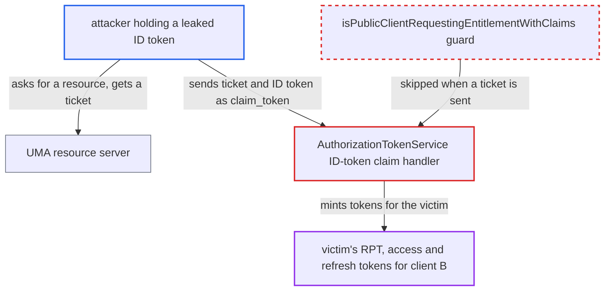

# Public client can turn a leaked ID token into access and refresh tokens via UMA grant

| Field | Value |
|---|---|
| ID | `find_019KGfW2yDA2u2zp6hg62ifV` |
| Severity | **Critical** |
| Status | open |
| CWE | CWE-287 — Improper Authentication |
| Created | 2026-10-27T21:55:08.017378Z |
| Claude Security | https://claude.ai/security/findings/find_019KGfW2yDA2u2zp6hg62ifV |

## Description

Anyone holding an unexpired ID token for a user and a public client can turn it into access and refresh tokens for that user, which stay valid as long as the user's SSO session. The attacker needs only the token, the client id and a permission ticket, which UMA resource servers give to any caller. `AuthorizationTokenService` accepts the ID token as proof of identity, and the public-client guard `isPublicClientRequestingEntitlementWithClaims` is skipped whenever a `ticket` is sent.

1. **Attacker** obtains an unexpired ID token of victim U issued to public client B. The report's examples are a party that B forwarded the token to as identity proof, or a front-channel or log leak. The ID token lifetime equals the access-token lifespan, 5 minutes by default.
2. **Attacker** requests a resource at a UMA resource server and receives a `ticket`. The resource server puts the ticket in the 401 `WWW-Authenticate` challenge for any caller.
3. **Attacker** POSTs `grant_type=urn:ietf:params:oauth:grant-type:uma-ticket` with `client_id=B`, the `ticket` and the ID token as `claim_token` to the token endpoint. `claim_token_format` defaults to the ID-token format, and with no bearer header `checkClient()` runs and the claim token becomes the subject token. ([`services/src/main/java/org/keycloak/protocol/oidc/grants/PermissionGrantType.java:94-108`](https://github.com/cx-benchmark/keycloak/blob/1d7be35d0764060a8143fc74b0aabf2442743be4/services/src/main/java/org/keycloak/protocol/oidc/grants/PermissionGrantType.java#L94-L108))
4. **`ClientIdAndSecretAuthenticator`** authenticates the public client on `client_id` alone. No secret is required, so the later check that `azp` equals the calling client proves nothing about who is calling. ([`services/src/main/java/org/keycloak/authentication/authenticators/client/ClientIdAndSecretAuthenticator.java:129-133`](https://github.com/cx-benchmark/keycloak/blob/1d7be35d0764060a8143fc74b0aabf2442743be4/services/src/main/java/org/keycloak/authentication/authenticators/client/ClientIdAndSecretAuthenticator.java#L129-L133))
5. **the ID-token handler in `AuthorizationTokenService`** accepts the ID token after checking only its signature, `azp` and `exp`. The guard `isPublicClientRequestingEntitlementWithClaims` refuses `claim_token` from public clients only when `ticket` is null, so the attacker's valid ticket bypasses it. ([`services/src/main/java/org/keycloak/authorization/authorization/AuthorizationTokenService.java:295-297`](https://github.com/cx-benchmark/keycloak/blob/1d7be35d0764060a8143fc74b0aabf2442743be4/services/src/main/java/org/keycloak/authorization/authorization/AuthorizationTokenService.java#L295-L297))
6. **`KeycloakIdentity`** looks up the victim's user session by `sid` and mints an access token for the `azp` client. The ticket check `verifyPermissionTicket` looks only at signature and lifetime, not at who presents the ticket. ([`services/src/main/java/org/keycloak/authorization/common/KeycloakIdentity.java:139-161`](https://github.com/cx-benchmark/keycloak/blob/1d7be35d0764060a8143fc74b0aabf2442743be4/services/src/main/java/org/keycloak/authorization/common/KeycloakIdentity.java#L139-L161))
7. **`AuthorizationTokenService`** signs an RPT for client B and issues a refresh token `issuedFor` B. This happens when any permission in the ticket evaluates as granted for the victim. The refresh token is issued because `useRefreshToken` defaults to true. ([`services/src/main/java/org/keycloak/authorization/authorization/AuthorizationTokenService.java:339-390`](https://github.com/cx-benchmark/keycloak/blob/1d7be35d0764060a8143fc74b0aabf2442743be4/services/src/main/java/org/keycloak/authorization/authorization/AuthorizationTokenService.java#L339-L390))
8. **Attacker** redeems the refresh token with `grant_type=refresh_token&client_id=B`. `TokenManager.validateToken` only requires B's client session and a matching `issuedFor`, so each refresh gives normal access tokens for B. ([`services/src/main/java/org/keycloak/protocol/oidc/TokenManager.java:236-260`](https://github.com/cx-benchmark/keycloak/blob/1d7be35d0764060a8143fc74b0aabf2442743be4/services/src/main/java/org/keycloak/protocol/oidc/TokenManager.java#L236-L260))

## Assessment

The attacker needs an unexpired ID token for victim U, issued to a public client B, while U's SSO session is still alive. The report gives these ways to get one: a party B forwarded the token to as identity proof, or a front-channel or log leak. The attacker needs no account or credential, because the token endpoint is reachable from the internet and a public client authenticates with `client_id` alone. The attacker also needs a permission `ticket`, which UMA resource servers hand to any caller. The attack works only if some permission in the ticket evaluates as granted for the victim.

Impact: The attacker gets signed access and refresh tokens for the victim, issued for client B, with the victim's roles and B's scopes and audiences. That includes the Account API when the victim has account roles. Refreshing keeps the access going and also keeps the victim's SSO session alive. The limits are B's scope and the session's maximum lifetime.

## Recommendation

(1) The ID-token claim format relies on `azp` equalling the authenticated client as its only binding. For public clients, which authenticate with `client_id` alone, that binding is empty, so an ID token works as a bearer credential for minting access and refresh tokens.

Fix criteria: An ID token is accepted as the requesting-party identity only from a client that authenticated with a credential, or no access or refresh token is ever issued from it to a public client. A public client sending `claim_token=<ID token>` with a valid `ticket` gets an error and no `access_token` or `refresh_token`.

(2) `isPublicClientRequestingEntitlementWithClaims` exempts requests that carry a ticket, even though resource servers hand tickets to any caller. The public-client restriction on `claim_token` can therefore be bypassed.

Fix criteria: The restriction on public clients supplying an ID token as `claim_token` holds whether or not a permission ticket is present. A request sent with `ticket` and one sent without it are both refused.

## Evidence

**https://github.com/cx-benchmark/keycloak**

- [`services/src/main/java/org/keycloak/authorization/authorization/AuthorizationTokenService.java:146-184`](https://github.com/cx-benchmark/keycloak/blob/1d7be35d0764060a8143fc74b0aabf2442743be4/services/src/main/java/org/keycloak/authorization/authorization/AuthorizationTokenService.java#L146-L184)
- [`services/src/main/java/org/keycloak/authorization/authorization/AuthorizationTokenService.java:295-297`](https://github.com/cx-benchmark/keycloak/blob/1d7be35d0764060a8143fc74b0aabf2442743be4/services/src/main/java/org/keycloak/authorization/authorization/AuthorizationTokenService.java#L295-L297)
- [`services/src/main/java/org/keycloak/protocol/oidc/grants/PermissionGrantType.java:94-108`](https://github.com/cx-benchmark/keycloak/blob/1d7be35d0764060a8143fc74b0aabf2442743be4/services/src/main/java/org/keycloak/protocol/oidc/grants/PermissionGrantType.java#L94-L108)
- [`services/src/main/java/org/keycloak/authentication/authenticators/client/ClientIdAndSecretAuthenticator.java:129-133`](https://github.com/cx-benchmark/keycloak/blob/1d7be35d0764060a8143fc74b0aabf2442743be4/services/src/main/java/org/keycloak/authentication/authenticators/client/ClientIdAndSecretAuthenticator.java#L129-L133)
- [`services/src/main/java/org/keycloak/authorization/common/KeycloakIdentity.java:139-161`](https://github.com/cx-benchmark/keycloak/blob/1d7be35d0764060a8143fc74b0aabf2442743be4/services/src/main/java/org/keycloak/authorization/common/KeycloakIdentity.java#L139-L161)
- [`services/src/main/java/org/keycloak/authorization/authorization/AuthorizationTokenService.java:339-390`](https://github.com/cx-benchmark/keycloak/blob/1d7be35d0764060a8143fc74b0aabf2442743be4/services/src/main/java/org/keycloak/authorization/authorization/AuthorizationTokenService.java#L339-L390)
- [`services/src/main/java/org/keycloak/protocol/oidc/TokenManager.java:236-260`](https://github.com/cx-benchmark/keycloak/blob/1d7be35d0764060a8143fc74b0aabf2442743be4/services/src/main/java/org/keycloak/protocol/oidc/TokenManager.java#L236-L260)
- [`services/src/main/java/org/keycloak/authorization/authorization/AuthorizationTokenService.java:775-792`](https://github.com/cx-benchmark/keycloak/blob/1d7be35d0764060a8143fc74b0aabf2442743be4/services/src/main/java/org/keycloak/authorization/authorization/AuthorizationTokenService.java#L775-L792)

