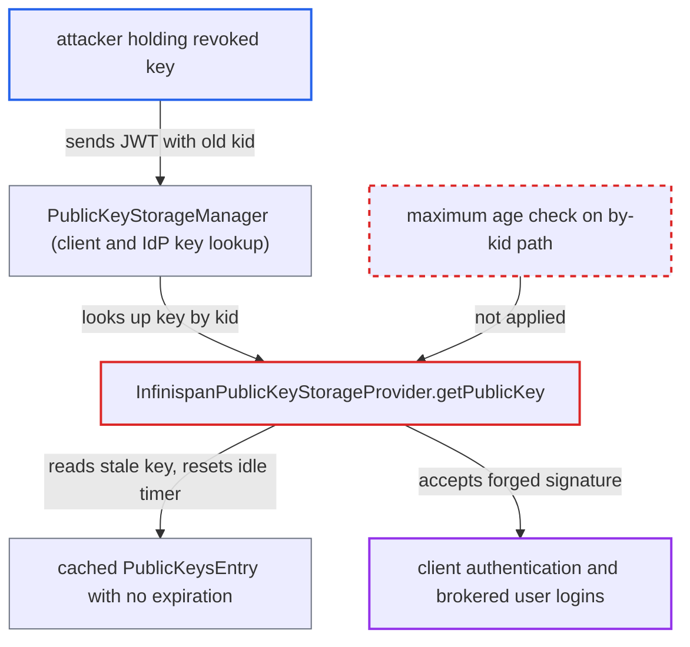

# Public key cache serves revoked JWKS keys by kid indefinitely with no maximum age

| Field | Value |
|---|---|
| ID | `find_013EcY8vnQ8kHiCEKXaRwi9E` |
| Severity | **Critical** |
| Status | open |
| CWE | CWE-324 — Use of revoked key |
| Created | 2026-10-27T21:55:07.952378Z |
| Claude Security | https://claude.ai/security/findings/find_013EcY8vnQ8kHiCEKXaRwi9E |

## Description

Someone who holds a leaked signing key can keep authenticating after the key owner revokes it. They can act as a confidential client, or log in as brokered users through a brokered OIDC identity provider. It needs a previously stolen `private_key_jwt` client key or IdP token-signing key, and the owner must have already removed it from its JWKS. `InfinispanPublicKeyStorageProvider.getPublicKey` returns the cached key whenever the `kid` is found, with no maximum age.

1. **attacker** obtains a signing key of a client or brokered OIDC identity provider. This is the precondition. The report does not say how the key leaks.
2. **key owner** removes the leaked key from its published JWKS. This is the standard remediation after a key leak, but Keycloak already has the old key cached and does not see the change.
3. **attacker** sends JWTs signed with the revoked key and its old `kid`. The JWTs go to the token endpoint for client authentication, or they are forged ID tokens used to complete broker logins. Both routes resolve keys through `PublicKeyStorageManager`. ([`services/src/main/java/org/keycloak/keys/loader/PublicKeyStorageManager.java:52-96`](https://github.com/cx-benchmark/keycloak/blob/1d7be35d0764060a8143fc74b0aabf2442743be4/services/src/main/java/org/keycloak/keys/loader/PublicKeyStorageManager.java#L52-L96))
4. **the method `getPublicKey`** returns the cached key without asking the loader. The loader is only consulted when the entry is expired or the `kid` is missing. Entries built from a JWKS have no expiration, so `isExpired` is always false and `maxCacheTime` is applied only in `getKeys`. ([`model/infinispan/src/main/java/org/keycloak/keys/infinispan/InfinispanPublicKeyStorageProvider.java:134-160`](https://github.com/cx-benchmark/keycloak/blob/1d7be35d0764060a8143fc74b0aabf2442743be4/model/infinispan/src/main/java/org/keycloak/keys/infinispan/InfinispanPublicKeyStorageProvider.java#L134-L160))
5. **the cache entry** stays alive as long as the attacker keeps using it. `WrapperCallable.call` stores the entry with no lifespan. The `keys` cache only has a `maxIdle` of 3600s, and each lookup resets it. ([`model/infinispan/src/main/java/org/keycloak/spi/infinispan/impl/embedded/CacheConfigurator.java:618-622`](https://github.com/cx-benchmark/keycloak/blob/1d7be35d0764060a8143fc74b0aabf2442743be4/model/infinispan/src/main/java/org/keycloak/spi/infinispan/impl/embedded/CacheConfigurator.java#L618-L622))
6. **Keycloak** accepts the signature from the revoked key. This continues until an administrator updates the client or identity provider, or clears the keys cache. A legitimate request with a new `kid` that reaches the same node also forces a refetch. ([`model/infinispan/src/main/java/org/keycloak/keys/infinispan/InfinispanPublicKeyStorageProvider.java:294-316`](https://github.com/cx-benchmark/keycloak/blob/1d7be35d0764060a8143fc74b0aabf2442743be4/model/infinispan/src/main/java/org/keycloak/keys/infinispan/InfinispanPublicKeyStorageProvider.java#L294-L316))

## Assessment

The attacker has already obtained a client's `private_key_jwt` signing key or a brokered OIDC identity provider's token-signing key. The key owner notices and removes the key from its JWKS. The attacker then keeps presenting the old `kid`. They can do this at the token endpoint for client authentication, or in broker ID-token and JWT-authorization-grant verification. Acceptance continues while the old `kid` keeps being presented. It ends only when an administrator updates or clears the cache, or when a legitimate request with a new `kid` hits the same node.

Impact: Signatures from a key the owner has revoked stay trusted. The attacker can authenticate as the confidential client and obtain its tokens and grants. For a brokered IdP key, the attacker can mint ID tokens that log in as arbitrary brokered users. The code bounds this only by the idle timer, which the attacker's own use resets, and by manual administrator action.

## Recommendation

Cached JWKS entries have no upper bound on age for by-`kid` lookups. `maxCacheTime` is applied only in `getKeys`, so a key removed upstream is never noticed while its `kid` keeps being used.

Fix criteria: Every cached public-key entry has a maximum age. After it, a by-`kid` lookup refetches the JWKS, respecting `minTimeBetweenRequests`, before trusting the key, whether or not the `kid` is present. `maxCacheTime` or a dedicated bound applies to `getPublicKey` and `getFirstPublicKey` as it does to `getKeys`. A test confirms that a key removed from a client or IdP JWKS is rejected after at most that bound, even under continuous use of the old `kid`.

## Evidence

**https://github.com/cx-benchmark/keycloak**

- [`model/infinispan/src/main/java/org/keycloak/keys/infinispan/InfinispanPublicKeyStorageProvider.java:134-160`](https://github.com/cx-benchmark/keycloak/blob/1d7be35d0764060a8143fc74b0aabf2442743be4/model/infinispan/src/main/java/org/keycloak/keys/infinispan/InfinispanPublicKeyStorageProvider.java#L134-L160)
- [`model/infinispan/src/main/java/org/keycloak/keys/infinispan/InfinispanPublicKeyStorageProvider.java:204-242`](https://github.com/cx-benchmark/keycloak/blob/1d7be35d0764060a8143fc74b0aabf2442743be4/model/infinispan/src/main/java/org/keycloak/keys/infinispan/InfinispanPublicKeyStorageProvider.java#L204-L242)
- [`model/infinispan/src/main/java/org/keycloak/keys/infinispan/InfinispanPublicKeyStorageProvider.java:294-316`](https://github.com/cx-benchmark/keycloak/blob/1d7be35d0764060a8143fc74b0aabf2442743be4/model/infinispan/src/main/java/org/keycloak/keys/infinispan/InfinispanPublicKeyStorageProvider.java#L294-L316)
- [`model/infinispan/src/main/java/org/keycloak/spi/infinispan/impl/embedded/CacheConfigurator.java:618-622`](https://github.com/cx-benchmark/keycloak/blob/1d7be35d0764060a8143fc74b0aabf2442743be4/model/infinispan/src/main/java/org/keycloak/spi/infinispan/impl/embedded/CacheConfigurator.java#L618-L622)
- [`services/src/main/java/org/keycloak/keys/loader/PublicKeyStorageManager.java:52-96`](https://github.com/cx-benchmark/keycloak/blob/1d7be35d0764060a8143fc74b0aabf2442743be4/services/src/main/java/org/keycloak/keys/loader/PublicKeyStorageManager.java#L52-L96)
- [`core/src/main/java/org/keycloak/util/JWKSUtils.java:92`](https://github.com/cx-benchmark/keycloak/blob/1d7be35d0764060a8143fc74b0aabf2442743be4/core/src/main/java/org/keycloak/util/JWKSUtils.java#L92)

