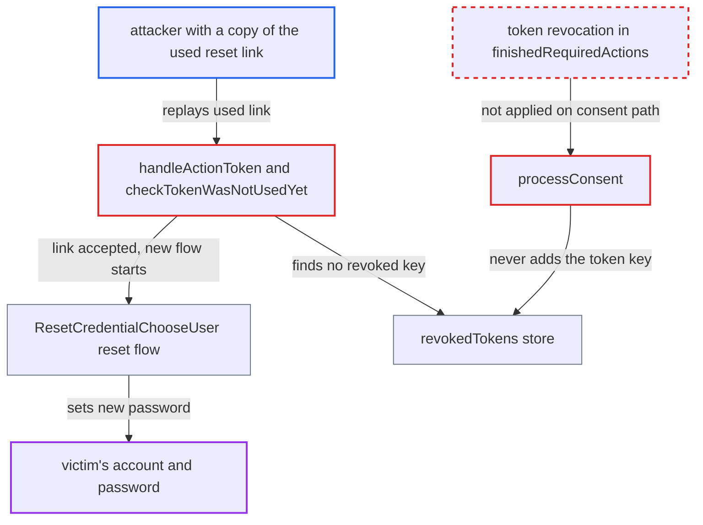

# Reset-credentials action token stays reusable when login finishes on the consent screen

| Field | Value |
|---|---|
| ID | `find_01QXz9q1z4QeuMbTQTaurrds` |
| Severity | **Critical** |
| Status | open |
| CWE | CWE-613 — Insufficient Session Expiration |
| Created | 2026-10-27T21:30:28.397225Z |
| Claude Security | https://claude.ai/security/findings/find_01QXz9q1z4QeuMbTQTaurrds |

## Description

An unauthenticated attacker who holds a victim's reset-credentials link can reuse it after the victim has already used it. They set a new password and take over the account, and the real user is locked out. This works only when the client behind the link requires consent and the victim's reset ended on the consent screen, and only until the token expires (5 minutes by default). The cause is that `processConsent` finishes the login without revoking the token, which only `finishedRequiredActions` does.

1. **the handler `handleActionToken`** accepts the reset link and only notes the token for later revocation. For a non-repeatable token it checks `revokedTokens()` and stores the key in the auth-session note `INVALIDATE_ACTION_TOKEN`, but does not revoke it yet. ([`services/src/main/java/org/keycloak/services/resources/LoginActionsService.java:710-713`](https://github.com/cx-benchmark/keycloak/blob/1d7be35d0764060a8143fc74b0aabf2442743be4/services/src/main/java/org/keycloak/services/resources/LoginActionsService.java#L710-L713))
2. **the reset flow in `AuthenticationProcessor`** puts the client's scopes into the session. `authenticationComplete` calls `setClientScopesInSession`, so a consent-required client gets a non-empty consent list and the consent page can render. ([`services/src/main/java/org/keycloak/authentication/AuthenticationProcessor.java:1237-1249`](https://github.com/cx-benchmark/keycloak/blob/1d7be35d0764060a8143fc74b0aabf2442743be4/services/src/main/java/org/keycloak/authentication/AuthenticationProcessor.java#L1237-L1249))
3. **the victim** sets a new password on the `UPDATE_PASSWORD` page. The password is stored in this request, and `processRequireAction` then calls `nextActionAfterAuthentication`. ([`services/src/main/java/org/keycloak/services/resources/LoginActionsService.java:1257-1263`](https://github.com/cx-benchmark/keycloak/blob/1d7be35d0764060a8143fc74b0aabf2442743be4/services/src/main/java/org/keycloak/services/resources/LoginActionsService.java#L1257-L1263))
4. **the method `actionRequired`** returns the OAuth grant page instead of continuing. This happens when the token's client needs consent and the user has not approved every displayed scope, so `finishedRequiredActions` is never reached. ([`services/src/main/java/org/keycloak/services/managers/AuthenticationManager.java:1226-1246`](https://github.com/cx-benchmark/keycloak/blob/1d7be35d0764060a8143fc74b0aabf2442743be4/services/src/main/java/org/keycloak/services/managers/AuthenticationManager.java#L1226-L1246))
5. **the handler `processConsent`** completes the login without revoking the token. It calls `attachSession` and `redirectAfterSuccessfulFlow` and never consumes `INVALIDATE_ACTION_TOKEN`. The token is also left unrevoked if the user cancels consent or abandons the page, because only `finishedRequiredActions` writes to `revokedTokens()`. ([`services/src/main/java/org/keycloak/services/resources/LoginActionsService.java:1131-1133`](https://github.com/cx-benchmark/keycloak/blob/1d7be35d0764060a8143fc74b0aabf2442743be4/services/src/main/java/org/keycloak/services/resources/LoginActionsService.java#L1131-L1133))
6. **the attacker** replays the same link in their own browser. `checkTokenWasNotUsedYet` rejects only keys present in `revokedTokens()`, and this key was never added, so the replay passes. ([`services/src/main/java/org/keycloak/services/resources/LoginActionsServiceChecks.java:291-295`](https://github.com/cx-benchmark/keycloak/blob/1d7be35d0764060a8143fc74b0aabf2442743be4/services/src/main/java/org/keycloak/services/resources/LoginActionsServiceChecks.java#L291-L295))
7. **the authenticator `ResetCredentialChooseUser`** picks the victim from the token and lets the attacker set a password. It takes the user from `ACTION_TOKEN_USER_ID` with no further proof, `ResetCredentialEmail` skips likewise, and `ResetPassword` asks for a new password. ([`services/src/main/java/org/keycloak/authentication/authenticators/resetcred/ResetCredentialChooseUser.java:74-81`](https://github.com/cx-benchmark/keycloak/blob/1d7be35d0764060a8143fc74b0aabf2442743be4/services/src/main/java/org/keycloak/authentication/authenticators/resetcred/ResetCredentialChooseUser.java#L74-L81))

## Assessment

The attacker is remote and unauthenticated. They need a copy of the victim's reset-credentials link, for example from a forwarded or shared mailbox, a mail-gateway log or browser history. The token's client must require consent, and the victim's reset must have ended on the consent screen. That happens on a first login, with `prompt=consent`, with an always-consent scope, or when a new scope was added. The attacker opens `/realms/{realm}/login-actions/action-token?key=<token>` within the token lifetime. The lifetime is 5 minutes by default (`accessCodeLifespanUserAction`) or the realm's configured reset-credentials lifespan. The same bypass also ignores `END_AFTER_REQUIRED_ACTIONS`. Admin `execute-actions` tokens are not affected by default, because their handler never fills the session's client scopes, so no consent page is shown and `finishedRequiredActions` runs.

Impact: The attacker sets the victim's password and logs in as them. They can read the user's data and act as the user, and the real user is locked out. The reach is limited to the token's user and the token's lifetime.

## Recommendation

(1) `processConsent` turns the authentication session into a user session without the post-login bookkeeping in `finishedRequiredActions`. So it does not revoke the token in `INVALIDATE_ACTION_TOKEN` and does not honour `END_AFTER_REQUIRED_ACTIONS`.

Fix criteria: Every path that turns an authentication session into a user session revokes the token named by `INVALIDATE_ACTION_TOKEN` and honours `END_AFTER_REQUIRED_ACTIONS`. This includes consent completion and device-verification completion. To verify, complete a reset-credentials link for a user of a consent-required client who has not consented yet, then replay the link from another browser. The replay is rejected with the used/expired action error.

(2) Single use is enforced only when the flow completes. A reset whose password change is committed before the consent screen, or that is abandoned at consent, leaves the token valid.

Fix criteria: Once the protected action has been performed (the new password is stored), the token is unusable whatever happens afterwards: consent granted, denied or abandoned. Replaying a reset-credentials token after its password update fails.

## Evidence

**https://github.com/cx-benchmark/keycloak**

- [`services/src/main/java/org/keycloak/services/resources/LoginActionsService.java:1131-1133`](https://github.com/cx-benchmark/keycloak/blob/1d7be35d0764060a8143fc74b0aabf2442743be4/services/src/main/java/org/keycloak/services/resources/LoginActionsService.java#L1131-L1133)
- [`services/src/main/java/org/keycloak/services/resources/LoginActionsService.java:710-713`](https://github.com/cx-benchmark/keycloak/blob/1d7be35d0764060a8143fc74b0aabf2442743be4/services/src/main/java/org/keycloak/services/resources/LoginActionsService.java#L710-L713)
- [`services/src/main/java/org/keycloak/services/managers/AuthenticationManager.java:1091-1107`](https://github.com/cx-benchmark/keycloak/blob/1d7be35d0764060a8143fc74b0aabf2442743be4/services/src/main/java/org/keycloak/services/managers/AuthenticationManager.java#L1091-L1107)
- [`services/src/main/java/org/keycloak/services/managers/AuthenticationManager.java:1226-1246`](https://github.com/cx-benchmark/keycloak/blob/1d7be35d0764060a8143fc74b0aabf2442743be4/services/src/main/java/org/keycloak/services/managers/AuthenticationManager.java#L1226-L1246)
- [`services/src/main/java/org/keycloak/services/resources/LoginActionsService.java:1257-1263`](https://github.com/cx-benchmark/keycloak/blob/1d7be35d0764060a8143fc74b0aabf2442743be4/services/src/main/java/org/keycloak/services/resources/LoginActionsService.java#L1257-L1263)
- [`services/src/main/java/org/keycloak/authentication/AuthenticationProcessor.java:1237-1249`](https://github.com/cx-benchmark/keycloak/blob/1d7be35d0764060a8143fc74b0aabf2442743be4/services/src/main/java/org/keycloak/authentication/AuthenticationProcessor.java#L1237-L1249)
- [`services/src/main/java/org/keycloak/authentication/authenticators/resetcred/ResetCredentialChooseUser.java:74-81`](https://github.com/cx-benchmark/keycloak/blob/1d7be35d0764060a8143fc74b0aabf2442743be4/services/src/main/java/org/keycloak/authentication/authenticators/resetcred/ResetCredentialChooseUser.java#L74-L81)
- [`services/src/main/java/org/keycloak/services/resources/LoginActionsServiceChecks.java:291-295`](https://github.com/cx-benchmark/keycloak/blob/1d7be35d0764060a8143fc74b0aabf2442743be4/services/src/main/java/org/keycloak/services/resources/LoginActionsServiceChecks.java#L291-L295)

