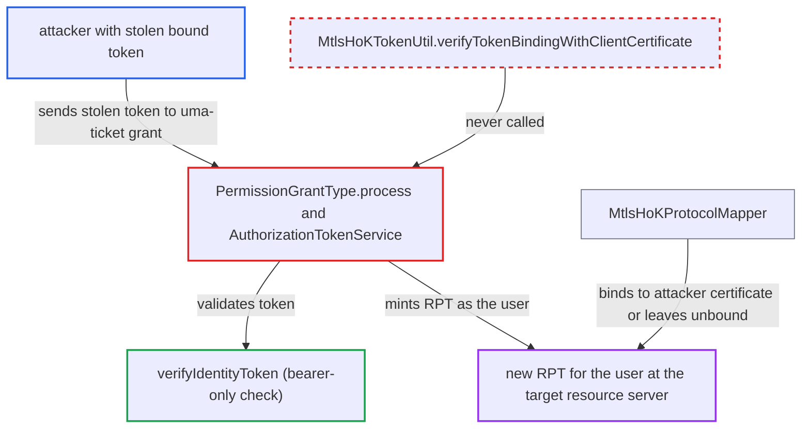

# UMA grant accepts certificate-bound access tokens without the client certificate and re-mints them unbound

| Field | Value |
|---|---|
| ID | `find_015XXF1HwGgXiXf8RevBgNej` |
| Severity | **Critical** |
| Status | open |
| CWE | CWE-287 — Improper Authentication |
| Created | 2026-10-27T21:53:45.506140Z |
| Claude Security | https://claude.ai/security/findings/find_015XXF1HwGgXiXf8RevBgNej |

## Description

Someone who has stolen a certificate-bound access token can use Keycloak's UMA grant to get a fresh token for the same user at a target resource server, without holding the client's certificate or private key. The new token is either unbound or bound to the attacker's own certificate. The UMA grant code in `PermissionGrantType.process` and `AuthorizationTokenService` accepts the token without calling `MtlsHoKTokenUtil.verifyTokenBindingWithClientCertificate`.

1. **attacker** obtains a certificate-bound access token of user U. The token was issued to client B and carries `cnf.x5t#S256`. The attacker took it, for example, from a resource server log or a compromised downstream API, and does not have B's private key.
2. **attacker** posts a `uma-ticket` request to the token endpoint. The request has `grant_type=uma-ticket` and an `audience` naming a resource server with a permission granted to U. The stolen token goes in `Authorization: Bearer`, or in `subject_token`. The attacker may also present their own TLS client certificate. ([`services/src/main/java/org/keycloak/protocol/oidc/grants/PermissionGrantType.java:58-83`](https://github.com/cx-benchmark/keycloak/blob/1d7be35d0764060a8143fc74b0aabf2442743be4/services/src/main/java/org/keycloak/protocol/oidc/grants/PermissionGrantType.java#L58-L83))
3. **the handler `PermissionGrantType.process`** accepts the presented token as the caller's identity. The handler validates it with `Tokens.getAccessToken(session)` and never checks the certificate binding. ([`services/src/main/java/org/keycloak/protocol/oidc/grants/PermissionGrantType.java:58-83`](https://github.com/cx-benchmark/keycloak/blob/1d7be35d0764060a8143fc74b0aabf2442743be4/services/src/main/java/org/keycloak/protocol/oidc/grants/PermissionGrantType.java#L58-L83))
4. **the JWT claim-format handler in `AuthorizationTokenService`** accepts the `subject_token` the same way. It validates the token with `Tokens.getAccessToken(subjectToken, session)`, again with no certificate-binding check. ([`services/src/main/java/org/keycloak/authorization/authorization/AuthorizationTokenService.java:137-144`](https://github.com/cx-benchmark/keycloak/blob/1d7be35d0764060a8143fc74b0aabf2442743be4/services/src/main/java/org/keycloak/authorization/authorization/AuthorizationTokenService.java#L137-L144))
5. **`verifyIdentityToken`** passes the stolen token as a plain bearer token. It checks signature, lifetime, type, revocation, DPoP and session validity. It never checks the mTLS certificate binding. ([`services/src/main/java/org/keycloak/services/managers/AuthenticationManager.java:1553-1651`](https://github.com/cx-benchmark/keycloak/blob/1d7be35d0764060a8143fc74b0aabf2442743be4/services/src/main/java/org/keycloak/services/managers/AuthenticationManager.java#L1553-L1651))
6. **`createAuthorizationResponse`** mints a new RPT for the user at the target resource server. The token's `cnf` is not carried over. The transient `MtlsHoKProtocolMapper` binds the new token to the certificate of the current request if the target client uses HoK tokens, and otherwise leaves it unbound. ([`services/src/main/java/org/keycloak/authorization/authorization/AuthorizationTokenService.java:366-397`](https://github.com/cx-benchmark/keycloak/blob/1d7be35d0764060a8143fc74b0aabf2442743be4/services/src/main/java/org/keycloak/authorization/authorization/AuthorizationTokenService.java#L366-L397))
7. **`MtlsHoKTokenUtil`** sets `cnf` from the certificate in the current request. It does not compare that certificate with the binding of the presented token, so the attacker's own certificate can end up bound to the new token. ([`services/src/main/java/org/keycloak/services/util/MtlsHoKTokenUtil.java:202-209`](https://github.com/cx-benchmark/keycloak/blob/1d7be35d0764060a8143fc74b0aabf2442743be4/services/src/main/java/org/keycloak/services/util/MtlsHoKTokenUtil.java#L202-L209))

## Assessment

The attacker needs a certificate-bound access token of a user U, issued to a client B that uses `isUseMtlsHokToken()`. They do not need B's private key or any login. They send a request to the token endpoint, which is reachable from the unauthenticated internet. The request has `grant_type=uma-ticket` and an `audience` naming a resource server with a permission granted to U. The stolen token goes in the bearer header, or is passed as `subject_token`. The attacker may also present their own TLS client certificate.

Impact: The attacker gets a signed token for the victim, with the victim's roles, claims and permissions, for the target resource server. They can use it as a bearer token or from their own TLS identity. This lets them impersonate the user at resource servers reachable through the grant. It is limited to resource servers whose policies grant the victim something, and to the session lifetime.

## Recommendation

(1) The UMA grant accepts a certificate-bound access token, on both the bearer path and the `subject_token` path, without checking that the presenter holds the certificate named in `cnf.x5t#S256`.

Fix criteria: When the presented access token carries a certificate thumbprint, or its `azp` client requires HoK tokens, the grant verifies the binding against the request's client certificate. It rejects the request on a mismatch or a missing certificate, as `UserInfoEndpoint` and `StandardTokenExchangeProvider` do. Test: presenting a bound token without the matching certificate returns an error and no RPT.

(2) The RPT and refresh token the grant mints are not constrained to the key of the input token. The transient HoK mapper binds them to whatever certificate the current request presents.

Fix criteria: A token derived from a sender-constrained input either keeps the input's `cnf` or is refused. The output is never bound to a different certificate unless the presenter proves possession of the input's certificate. Test: an RPT derived from a bound token never carries a different `x5t#S256` and is never unbound.

## Evidence

**https://github.com/cx-benchmark/keycloak**

- [`services/src/main/java/org/keycloak/protocol/oidc/grants/PermissionGrantType.java:58-83`](https://github.com/cx-benchmark/keycloak/blob/1d7be35d0764060a8143fc74b0aabf2442743be4/services/src/main/java/org/keycloak/protocol/oidc/grants/PermissionGrantType.java#L58-L83)
- [`services/src/main/java/org/keycloak/authorization/authorization/AuthorizationTokenService.java:137-144`](https://github.com/cx-benchmark/keycloak/blob/1d7be35d0764060a8143fc74b0aabf2442743be4/services/src/main/java/org/keycloak/authorization/authorization/AuthorizationTokenService.java#L137-L144)
- [`services/src/main/java/org/keycloak/services/managers/AuthenticationManager.java:1553-1651`](https://github.com/cx-benchmark/keycloak/blob/1d7be35d0764060a8143fc74b0aabf2442743be4/services/src/main/java/org/keycloak/services/managers/AuthenticationManager.java#L1553-L1651)
- [`services/src/main/java/org/keycloak/authorization/authorization/AuthorizationTokenService.java:366-397`](https://github.com/cx-benchmark/keycloak/blob/1d7be35d0764060a8143fc74b0aabf2442743be4/services/src/main/java/org/keycloak/authorization/authorization/AuthorizationTokenService.java#L366-L397)
- [`services/src/main/java/org/keycloak/services/util/MtlsHoKTokenUtil.java:202-209`](https://github.com/cx-benchmark/keycloak/blob/1d7be35d0764060a8143fc74b0aabf2442743be4/services/src/main/java/org/keycloak/services/util/MtlsHoKTokenUtil.java#L202-L209)
- [`services/src/main/java/org/keycloak/protocol/oidc/tokenexchange/StandardTokenExchangeProvider.java:176-191`](https://github.com/cx-benchmark/keycloak/blob/1d7be35d0764060a8143fc74b0aabf2442743be4/services/src/main/java/org/keycloak/protocol/oidc/tokenexchange/StandardTokenExchangeProvider.java#L176-L191)
- [`services/src/main/java/org/keycloak/protocol/oidc/endpoints/UserInfoEndpoint.java:282-290`](https://github.com/cx-benchmark/keycloak/blob/1d7be35d0764060a8143fc74b0aabf2442743be4/services/src/main/java/org/keycloak/protocol/oidc/endpoints/UserInfoEndpoint.java#L282-L290)

