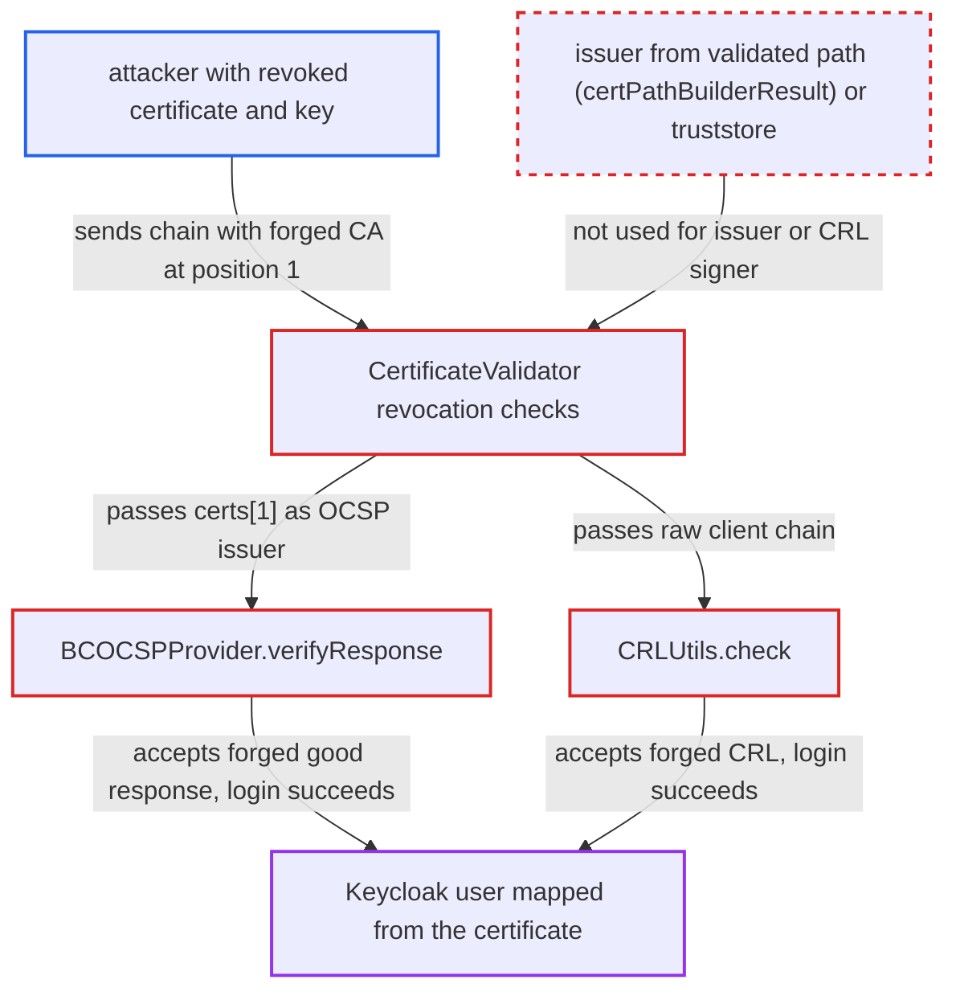

# X.509 revocation checks trust issuer/CRL signer from client-presented chain

| Field | Value |
|---|---|
| ID | `find_01GM4k6NhQe6mHRZPwE65wKj` |
| Severity | **Critical** |
| Status | open |
| CWE | CWE-299 — Improper Certificate Revocation Check |
| Created | 2026-10-27T21:26:05.528086Z |
| Claude Security | https://claude.ai/security/findings/find_01GM4k6NhQe6mHRZPwE65wKj |

## Description

An attacker who holds the private key of a certificate that was revoked (a stolen smart card, for example) can still log in to Keycloak as the user that certificate maps to. That user could be an administrator. It works when CRL or OCSP checking is enabled. `CertificateValidator.checkRevocationUsingOCSP` and `CRLUtils.check` take the revocation signer from the client-sent chain, so the client controls the key that authenticates revocation data.

1. **attacker** connects to the login or direct-grant endpoint with a forged chain. The chain is `[revokedLeaf, forgedCAWithRealIssuerDN]`, and Keycloak reads it unchanged from `SSLSession.getPeerCertificates()`, so every certificate after the first is chosen by the client. ([`quarkus/runtime/src/main/java/org/keycloak/quarkus/runtime/integration/resteasy/QuarkusHttpRequest.java:133-153`](https://github.com/cx-benchmark/keycloak/blob/1d7be35d0764060a8143fc74b0aabf2442743be4/quarkus/runtime/src/main/java/org/keycloak/quarkus/runtime/integration/resteasy/QuarkusHttpRequest.java#L133-L153))
2. **`verifyCertificateTrust`** validates trust and ignores the extra certificate. It adds the client certificates as untrusted intermediates, builds the path from the leaf to the real CA, and disables PKIX revocation with `setRevocationEnabled(false)`. This means the later manual revocation check is the only revocation enforcement. ([`services/src/main/java/org/keycloak/authentication/authenticators/x509/CertificateValidator.java:752-783`](https://github.com/cx-benchmark/keycloak/blob/1d7be35d0764060a8143fc74b0aabf2442743be4/services/src/main/java/org/keycloak/authentication/authenticators/x509/CertificateValidator.java#L752-L783))
3. **`X509ClientCertificateAuthenticator`** runs the validation chain ending in `checkRevocationStatus()`. The direct-grant authenticator `ValidateX509CertificateUsername` does the same. After the checks pass, `certs[0]` is mapped to a user. ([`services/src/main/java/org/keycloak/authentication/authenticators/x509/X509ClientCertificateAuthenticator.java:99-108`](https://github.com/cx-benchmark/keycloak/blob/1d7be35d0764060a8143fc74b0aabf2442743be4/services/src/main/java/org/keycloak/authentication/authenticators/x509/X509ClientCertificateAuthenticator.java#L99-L108))
4. **`checkRevocationStatus()`** passes the raw `_certChain` to the CRL and OCSP checks. It ignores the verified path that `validateTrust()` stored in `certPathBuilderResult`. ([`services/src/main/java/org/keycloak/authentication/authenticators/x509/CertificateValidator.java:908-922`](https://github.com/cx-benchmark/keycloak/blob/1d7be35d0764060a8143fc74b0aabf2442743be4/services/src/main/java/org/keycloak/authentication/authenticators/x509/CertificateValidator.java#L908-L922))
5. **`checkRevocationUsingOCSP`** takes `certs[1]` as the issuer for the OCSP request. Nothing checks that this certificate signed `certs[0]`, so the forged certificate defines the CertID. ([`services/src/main/java/org/keycloak/authentication/authenticators/x509/CertificateValidator.java:828-845`](https://github.com/cx-benchmark/keycloak/blob/1d7be35d0764060a8143fc74b0aabf2442743be4/services/src/main/java/org/keycloak/authentication/authenticators/x509/CertificateValidator.java#L828-L845))
6. **`BCOCSPProvider.verifyResponse`** accepts the forged certificate as the response signer. `signingCert.equals(issuerCertificate)` is true for the caller-supplied issuer, so a `good` response signed with the attacker's key is accepted. ([`crypto/default/src/main/java/org/keycloak/crypto/def/BCOCSPProvider.java:202-232`](https://github.com/cx-benchmark/keycloak/blob/1d7be35d0764060a8143fc74b0aabf2442743be4/crypto/default/src/main/java/org/keycloak/crypto/def/BCOCSPProvider.java#L202-L232))
7. **`CRLUtils.check`** verifies the CRL with the forged certificate when CRL checking is used. It picks the first chain certificate whose subject matches the CRL issuer name, so a forged empty CRL signed with the attacker's key passes. ([`services/src/main/java/org/keycloak/utils/CRLUtils.java:62-80`](https://github.com/cx-benchmark/keycloak/blob/1d7be35d0764060a8143fc74b0aabf2442743be4/services/src/main/java/org/keycloak/utils/CRLUtils.java#L62-L80))
8. **attacker** is authenticated as the user mapped from the revoked certificate. The revocation check reports the certificate as not revoked, so login proceeds.

## Assessment

The attacker holds the private key of a certificate the trusted CA issued and later revoked. They connect to the internet-facing login or direct-grant endpoint with the chain `[revokedLeaf, forgedCAWithRealIssuerDN]`, and CRL or OCSP checking must be enabled. For OCSP there are two ways in. In the first, the attacker tampers with Keycloak's outbound plaintext OCSP or CRL fetch, which is usually an `http://` AIA or CDP URL, and returns a `good` response signed with the forged key. In the second, `ocsp-fail-open` is enabled. The forged issuer then makes the real responder answer unknown or unauthorized for a CertID it does not recognise, and Keycloak continues. That second case needs no network position. The report does not give a default for `ocsp-fail-open`.

Impact: The attacker authenticates as whichever Keycloak user the revoked certificate maps to, possibly an administrator, and gets that user's sessions, tokens and data. The reach is limited to accounts for which the attacker holds a revoked certificate and its key. The OCSP path has no availability impact.

## Recommendation

(1) `CertificateValidator.checkRevocationUsingOCSP` takes the OCSP issuer from `certs[1]` of the unauthenticated client chain. `BCOCSPProvider` and `BCFIPSOCSPProvider` then trust that certificate both as the CertID issuer and as the response signer.

Fix criteria: The OCSP issuer comes from the PKIX-validated path (`certPathBuilderResult`: the certificate after the leaf in the built path, or the trust anchor) or from the truststore with signature verification. It is confirmed to have signed `certs[0]`. Presenting `[revokedLeaf, forgedIssuerWithSameDN]` with a forged `good` OCSP response signed by the forged key causes authentication to be rejected.

(2) `checkRevocationStatusUsingCRL` passes the raw client chain to `CRLUtils.check`, which picks the CRL-verifying certificate by subject-name match from that chain. A client-supplied certificate can therefore authenticate a CRL.

Fix criteria: The CRL signature is verified only with a certificate from the validated certification path or the truststore, never with a certificate from the client-presented chain. A forged empty CRL signed by a client-supplied certificate with the issuer's DN is rejected and does not let a revoked leaf authenticate.

## Evidence

**https://github.com/cx-benchmark/keycloak**

- [`services/src/main/java/org/keycloak/authentication/authenticators/x509/CertificateValidator.java:828-845`](https://github.com/cx-benchmark/keycloak/blob/1d7be35d0764060a8143fc74b0aabf2442743be4/services/src/main/java/org/keycloak/authentication/authenticators/x509/CertificateValidator.java#L828-L845)
- [`crypto/default/src/main/java/org/keycloak/crypto/def/BCOCSPProvider.java:202-232`](https://github.com/cx-benchmark/keycloak/blob/1d7be35d0764060a8143fc74b0aabf2442743be4/crypto/default/src/main/java/org/keycloak/crypto/def/BCOCSPProvider.java#L202-L232)
- [`services/src/main/java/org/keycloak/authentication/authenticators/x509/CertificateValidator.java:908-922`](https://github.com/cx-benchmark/keycloak/blob/1d7be35d0764060a8143fc74b0aabf2442743be4/services/src/main/java/org/keycloak/authentication/authenticators/x509/CertificateValidator.java#L908-L922)
- [`services/src/main/java/org/keycloak/utils/CRLUtils.java:62-80`](https://github.com/cx-benchmark/keycloak/blob/1d7be35d0764060a8143fc74b0aabf2442743be4/services/src/main/java/org/keycloak/utils/CRLUtils.java#L62-L80)
- [`services/src/main/java/org/keycloak/authentication/authenticators/x509/CertificateValidator.java:752-783`](https://github.com/cx-benchmark/keycloak/blob/1d7be35d0764060a8143fc74b0aabf2442743be4/services/src/main/java/org/keycloak/authentication/authenticators/x509/CertificateValidator.java#L752-L783)
- [`quarkus/runtime/src/main/java/org/keycloak/quarkus/runtime/integration/resteasy/QuarkusHttpRequest.java:133-153`](https://github.com/cx-benchmark/keycloak/blob/1d7be35d0764060a8143fc74b0aabf2442743be4/quarkus/runtime/src/main/java/org/keycloak/quarkus/runtime/integration/resteasy/QuarkusHttpRequest.java#L133-L153)
- [`services/src/main/java/org/keycloak/authentication/authenticators/x509/X509ClientCertificateAuthenticator.java:99-108`](https://github.com/cx-benchmark/keycloak/blob/1d7be35d0764060a8143fc74b0aabf2442743be4/services/src/main/java/org/keycloak/authentication/authenticators/x509/X509ClientCertificateAuthenticator.java#L99-L108)

