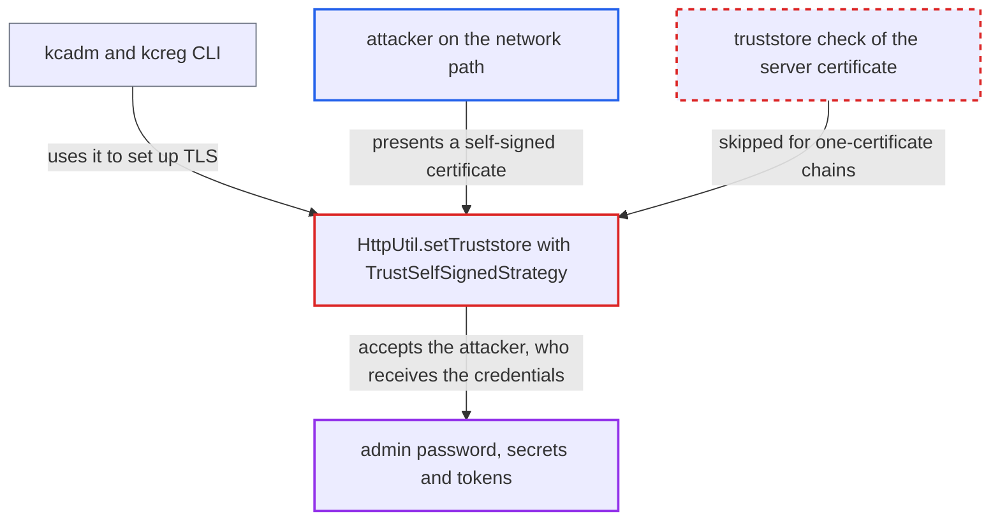

# Admin CLI truststore trusts any self-signed certificate via TrustSelfSignedStrategy

| Field | Value |
|---|---|
| ID | `find_015X8wupYun88DG2UsDLgtzR` |
| Severity | **High** |
| Status | open |
| CWE | CWE-295 — Improper Certificate Validation |
| Created | 2026-10-27T22:08:29.038087Z |
| Claude Security | https://claude.ai/security/findings/find_015X8wupYun88DG2UsDLgtzR |

## Description

An attacker on the network path between an administrator and the Keycloak server can pose as the server and capture the admin password, client secret or signed-JWT assertion, plus later tokens. The attacker needs no credentials, but the administrator must have configured a truststore for `kcadm.sh` or `kcreg.sh`. `HttpUtil.setTruststore` adds `TrustSelfSignedStrategy`, so any self-signed certificate is accepted without a truststore check.

1. **administrator** configures a truststore for the CLI. This is the documented setup for servers whose certificate is not issued by a CA the JVM trusts, done with `kcadm.sh config truststore <file>` or `--truststore`. ([`integration/client-cli/admin-cli/src/main/java/org/keycloak/client/cli/common/BaseAuthOptionsCmd.java:161-193`](https://github.com/cx-benchmark/keycloak/blob/1d7be35d0764060a8143fc74b0aabf2442743be4/integration/client-cli/admin-cli/src/main/java/org/keycloak/client/cli/common/BaseAuthOptionsCmd.java#L161-L193))
2. **the method `setupTruststore`** calls `HttpUtil.setTruststore` for https server URLs. That method builds the SSL context with `loadTrustMaterial(file, password, TrustSelfSignedStrategy.INSTANCE)` and installs it as the client's only `SSLConnectionSocketFactory`. ([`integration/client-cli/admin-cli/src/main/java/org/keycloak/client/cli/util/HttpUtil.java:270-279`](https://github.com/cx-benchmark/keycloak/blob/1d7be35d0764060a8143fc74b0aabf2442743be4/integration/client-cli/admin-cli/src/main/java/org/keycloak/client/cli/util/HttpUtil.java#L270-L279))
3. **attacker** intercepts the connection and presents a self-signed certificate. The attacker mints a certificate whose SAN matches the server hostname, for example `kc.example`, so the `DefaultHostnameVerifier` check passes too.
4. **the strategy `TrustSelfSignedStrategy`** accepts the certificate without consulting the truststore. `isTrusted` returns `chain.length == 1`, and `checkServerTrusted` calls the truststore-backed trust manager only when the strategy returns false. ([`integration/client-cli/admin-cli/src/main/java/org/keycloak/client/cli/util/HttpUtil.java:270-279`](https://github.com/cx-benchmark/keycloak/blob/1d7be35d0764060a8143fc74b0aabf2442743be4/integration/client-cli/admin-cli/src/main/java/org/keycloak/client/cli/util/HttpUtil.java#L270-L279))
5. **the CLI** sends the admin credentials to the attacker's server. The token request carries the admin password, client secret or signed-JWT assertion, and the returned access and refresh tokens come back over the same connection. ([`integration/client-cli/admin-cli/src/main/java/org/keycloak/client/cli/util/AuthUtil.java:117-131`](https://github.com/cx-benchmark/keycloak/blob/1d7be35d0764060a8143fc74b0aabf2442743be4/integration/client-cli/admin-cli/src/main/java/org/keycloak/client/cli/util/AuthUtil.java#L117-L131))
6. **attacker** reads and alters later admin requests. Every later bearer-token admin request and response uses the same accepted connection.

## Assessment

The attacker sits on the network path between an administrator's workstation and the Keycloak server, or can redirect DNS or traffic for the server hostname. The attacker holds no credentials. The administrator has configured a truststore, as the documentation advises, and runs `kcadm.sh config credentials` or any later command against an https server. No other action is needed beyond normal CLI use. The report states that the behaviour was checked in the bytecode of `httpclient` 4.5.14 and `httpcore` 4.4.16, as managed by the Quarkus BOM.

Impact: The attacker captures the realm administrator's password, client secret or signed-JWT assertion and the issued access and refresh tokens. The attacker can also alter every admin request and response in transit. With master-realm admin credentials this means full compromise of the Keycloak deployment, including realms, users, client secrets and signing-key configuration. Destructive admin calls with a stolen token can also affect availability.

## Recommendation

`HttpUtil.setTruststore` combines the operator's truststore with `TrustSelfSignedStrategy`. Trust is therefore not limited to the certificates in the truststore, and any single-certificate chain is accepted.

Fix criteria: With a truststore configured, the TLS client accepts a server certificate only if it chains to an anchor in that truststore, with no extra self-signed or any-chain strategy. Connecting `kcadm` or `kcreg` with a truststore that lacks a given self-signed server certificate is rejected at the handshake. A certificate that is in the truststore is still accepted. Relaxed validation stays reachable only through the explicit `--insecure` option.

## Evidence

**https://github.com/cx-benchmark/keycloak**

- [`integration/client-cli/admin-cli/src/main/java/org/keycloak/client/cli/util/HttpUtil.java:270-279`](https://github.com/cx-benchmark/keycloak/blob/1d7be35d0764060a8143fc74b0aabf2442743be4/integration/client-cli/admin-cli/src/main/java/org/keycloak/client/cli/util/HttpUtil.java#L270-L279)
- [`integration/client-cli/admin-cli/src/main/java/org/keycloak/client/cli/common/BaseAuthOptionsCmd.java:161-193`](https://github.com/cx-benchmark/keycloak/blob/1d7be35d0764060a8143fc74b0aabf2442743be4/integration/client-cli/admin-cli/src/main/java/org/keycloak/client/cli/common/BaseAuthOptionsCmd.java#L161-L193)
- [`integration/client-cli/admin-cli/src/main/java/org/keycloak/client/cli/common/BaseConfigCredentialsCmd.java:172-183`](https://github.com/cx-benchmark/keycloak/blob/1d7be35d0764060a8143fc74b0aabf2442743be4/integration/client-cli/admin-cli/src/main/java/org/keycloak/client/cli/common/BaseConfigCredentialsCmd.java#L172-L183)
- [`integration/client-cli/admin-cli/src/main/java/org/keycloak/client/cli/util/AuthUtil.java:117-131`](https://github.com/cx-benchmark/keycloak/blob/1d7be35d0764060a8143fc74b0aabf2442743be4/integration/client-cli/admin-cli/src/main/java/org/keycloak/client/cli/util/AuthUtil.java#L117-L131)
- [`docs/documentation/server_admin/topics/admin-cli.adoc:72-87`](https://github.com/cx-benchmark/keycloak/blob/1d7be35d0764060a8143fc74b0aabf2442743be4/docs/documentation/server_admin/topics/admin-cli.adoc#L72-L87)

