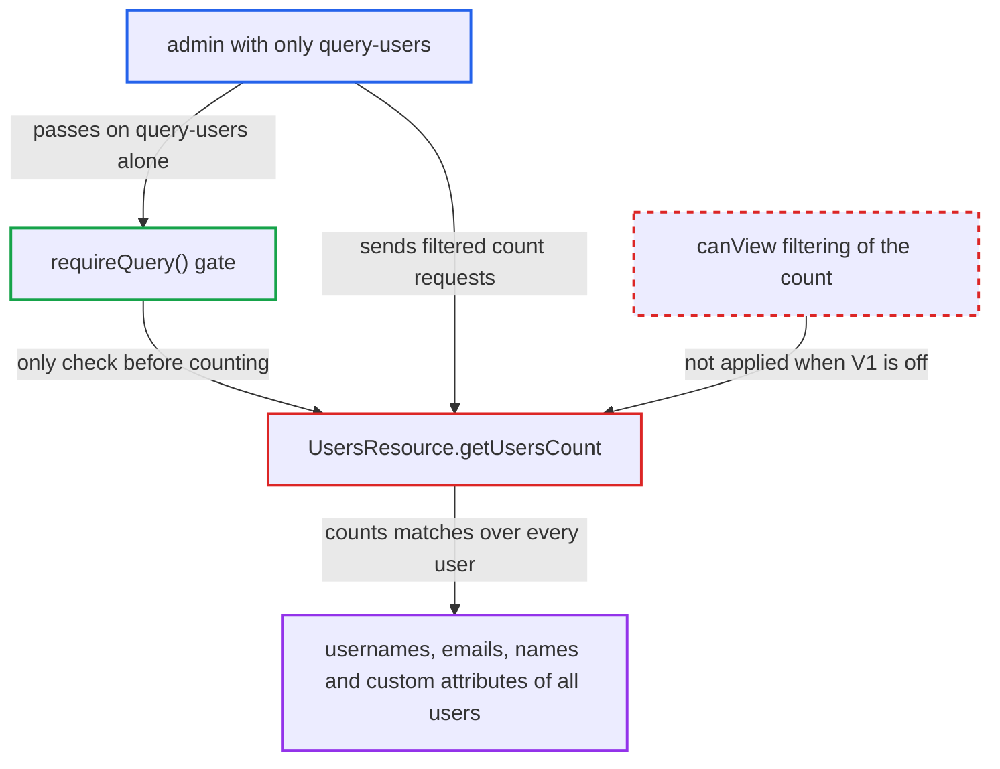

# Admin users/count returns unfiltered counts to query-only admins, enabling a user-attribute oracle

| Field | Value |
|---|---|
| ID | `find_0149gDsdG62nehZoUZkCK4Bz` |
| Severity | **High** |
| Status | open |
| CWE | CWE-862 — Missing Authorization |
| Created | 2026-10-27T22:10:19.289345Z |
| Claude Security | https://claude.ai/security/findings/find_0149gDsdG62nehZoUZkCK4Bz |

## Description

An admin who holds only the `query-users` role can learn which usernames, emails, names and custom attribute values exist in the realm, although that role is documented as not allowing users to be viewed. The attacker needs an admin login with `query-users` but not `view-users` or `manage-users`, in a realm without Admin Permissions enabled (the default). `UsersResource.getUsersCount` checks only `requireQuery()` and then returns an unrestricted count when `canView()` is false.

1. **query-only admin** sends a count request with filters. The request is `GET /admin/realms/R/users/count` with parameters such as `username`, `email`, `firstName`, `search`, or `q=ssn:12` with `exact=false`. ([`services/src/main/java/org/keycloak/services/resources/admin/UsersResource.java:439-453`](https://github.com/cx-benchmark/keycloak/blob/1d7be35d0764060a8143fc74b0aabf2442743be4/services/src/main/java/org/keycloak/services/resources/admin/UsersResource.java#L439-L453))
2. **the handler `getUsersCount`** accepts the caller on the `query-users` role alone. `requireQuery()` is the only gate, and `canQuery()` passes on `query-users` alone, so the caller does not need the right to view users. ([`services/src/main/java/org/keycloak/services/resources/admin/fgap/UserPermissionsV2.java:48-76`](https://github.com/cx-benchmark/keycloak/blob/1d7be35d0764060a8143fc74b0aabf2442743be4/services/src/main/java/org/keycloak/services/resources/admin/fgap/UserPermissionsV2.java#L48-L76))
3. **the handler `getUsersCount`** calls the unrestricted count when `canView()` is false. This holds in the `search` branch, in the field and attribute branch, and in the branch with no criteria, because the deprecated V1 feature `ADMIN_FINE_GRAINED_AUTHZ` is off by default. ([`services/src/main/java/org/keycloak/services/resources/admin/UsersResource.java:466-476`](https://github.com/cx-benchmark/keycloak/blob/1d7be35d0764060a8143fc74b0aabf2442743be4/services/src/main/java/org/keycloak/services/resources/admin/UsersResource.java#L466-L476))
4. **the storage layer** adds no per-user filter to the count query. `PartialEvaluator.getPredicates` returns an empty list when evaluation is skipped, and it is skipped whenever admin permissions are disabled for the realm. ([`server-spi-private/src/main/java/org/keycloak/authorization/fgap/evaluation/partial/PartialEvaluator.java:57-67`](https://github.com/cx-benchmark/keycloak/blob/1d7be35d0764060a8143fc74b0aabf2442743be4/server-spi-private/src/main/java/org/keycloak/authorization/fgap/evaluation/partial/PartialEvaluator.java#L57-L67))
5. **`JpaUserProvider`** turns the caller's filters into database predicates. `username` and `email` become `LIKE '%v%'` without escaping `%` or `_`, and `firstName` and `lastName` use lower-cased `LIKE`. A custom attribute matches exactly by default, or by substring with `exact=false`. ([`model/jpa/src/main/java/org/keycloak/models/jpa/JpaUserProvider.java:1286-1356`](https://github.com/cx-benchmark/keycloak/blob/1d7be35d0764060a8143fc74b0aabf2442743be4/model/jpa/src/main/java/org/keycloak/models/jpa/JpaUserProvider.java#L1286-L1356))
6. **query-only admin** repeats the request with varied substrings and reads each count. A count above zero means some user matches, so the counts rebuild usernames, emails and attribute values one piece at a time.

## Assessment

The attacker is an authenticated admin of realm `R`, or a master-realm admin whose only right over the realm is `{realm}-realm/query-users`. The admin holds `query-users` but not `view-users` or `manage-users`. The realm does not have Admin Permissions enabled, which is the default. No victim action is needed, and the report names no network restriction on the Admin API. The `search`, `username`, `email`, `firstName`, `lastName` and `q=` parameters all work as entry points, as does a request with no criteria.

Impact: The admin can test any username, email, name or custom attribute pattern against every user in the realm. That lets the admin list accounts and rebuild personal data and attribute values one substring at a time. The access is read-only, with no write or availability effect.

## Recommendation

`UsersResource.getUsersCount` falls back to an unrestricted count whenever `canView()` is false and the deprecated V1 feature is off. In realms without Admin Permissions nothing at storage level filters the count, so a query-only admin gets real counts over all users.

Fix criteria: An admin for whom `canView()` is false gets a count limited to the users they may view, which is `0` when admin permissions are disabled. This matches `GET /users` and `OrganizationMemberResource.count()`. A `query-users`-only admin, and a master admin with only `R-realm/query-users`, get `0` for every parameter combination: `search`, `username`, `email`, `firstName`, `lastName`, `q=`, `exact`, and none. Admins with `view-users` still get their correct counts.

## Evidence

**https://github.com/cx-benchmark/keycloak**

- [`services/src/main/java/org/keycloak/services/resources/admin/UsersResource.java:466-476`](https://github.com/cx-benchmark/keycloak/blob/1d7be35d0764060a8143fc74b0aabf2442743be4/services/src/main/java/org/keycloak/services/resources/admin/UsersResource.java#L466-L476)
- [`services/src/main/java/org/keycloak/services/resources/admin/UsersResource.java:510-532`](https://github.com/cx-benchmark/keycloak/blob/1d7be35d0764060a8143fc74b0aabf2442743be4/services/src/main/java/org/keycloak/services/resources/admin/UsersResource.java#L510-L532)
- [`services/src/main/java/org/keycloak/services/resources/admin/UsersResource.java:439-453`](https://github.com/cx-benchmark/keycloak/blob/1d7be35d0764060a8143fc74b0aabf2442743be4/services/src/main/java/org/keycloak/services/resources/admin/UsersResource.java#L439-L453)
- [`services/src/main/java/org/keycloak/services/resources/admin/fgap/UserPermissionsV2.java:48-76`](https://github.com/cx-benchmark/keycloak/blob/1d7be35d0764060a8143fc74b0aabf2442743be4/services/src/main/java/org/keycloak/services/resources/admin/fgap/UserPermissionsV2.java#L48-L76)
- [`services/src/main/java/org/keycloak/organization/admin/resource/OrganizationMemberResource.java:414-419`](https://github.com/cx-benchmark/keycloak/blob/1d7be35d0764060a8143fc74b0aabf2442743be4/services/src/main/java/org/keycloak/organization/admin/resource/OrganizationMemberResource.java#L414-L419)
- [`services/src/main/java/org/keycloak/services/resources/admin/UsersResource.java:579-585`](https://github.com/cx-benchmark/keycloak/blob/1d7be35d0764060a8143fc74b0aabf2442743be4/services/src/main/java/org/keycloak/services/resources/admin/UsersResource.java#L579-L585)
- [`model/jpa/src/main/java/org/keycloak/models/jpa/JpaUserProvider.java:850-864`](https://github.com/cx-benchmark/keycloak/blob/1d7be35d0764060a8143fc74b0aabf2442743be4/model/jpa/src/main/java/org/keycloak/models/jpa/JpaUserProvider.java#L850-L864)
- [`server-spi-private/src/main/java/org/keycloak/authorization/fgap/evaluation/partial/PartialEvaluator.java:57-67`](https://github.com/cx-benchmark/keycloak/blob/1d7be35d0764060a8143fc74b0aabf2442743be4/server-spi-private/src/main/java/org/keycloak/authorization/fgap/evaluation/partial/PartialEvaluator.java#L57-L67)
- [`server-spi-private/src/main/java/org/keycloak/authorization/fgap/AdminPermissionsSchema.java:633-649`](https://github.com/cx-benchmark/keycloak/blob/1d7be35d0764060a8143fc74b0aabf2442743be4/server-spi-private/src/main/java/org/keycloak/authorization/fgap/AdminPermissionsSchema.java#L633-L649)
- [`model/jpa/src/main/java/org/keycloak/models/jpa/JpaUserProvider.java:1286-1356`](https://github.com/cx-benchmark/keycloak/blob/1d7be35d0764060a8143fc74b0aabf2442743be4/model/jpa/src/main/java/org/keycloak/models/jpa/JpaUserProvider.java#L1286-L1356)
- [`docs/documentation/server_admin/topics/admin-console-permissions/fine-grain-v2.adoc:454-455`](https://github.com/cx-benchmark/keycloak/blob/1d7be35d0764060a8143fc74b0aabf2442743be4/docs/documentation/server_admin/topics/admin-console-permissions/fine-grain-v2.adoc#L454-L455)

