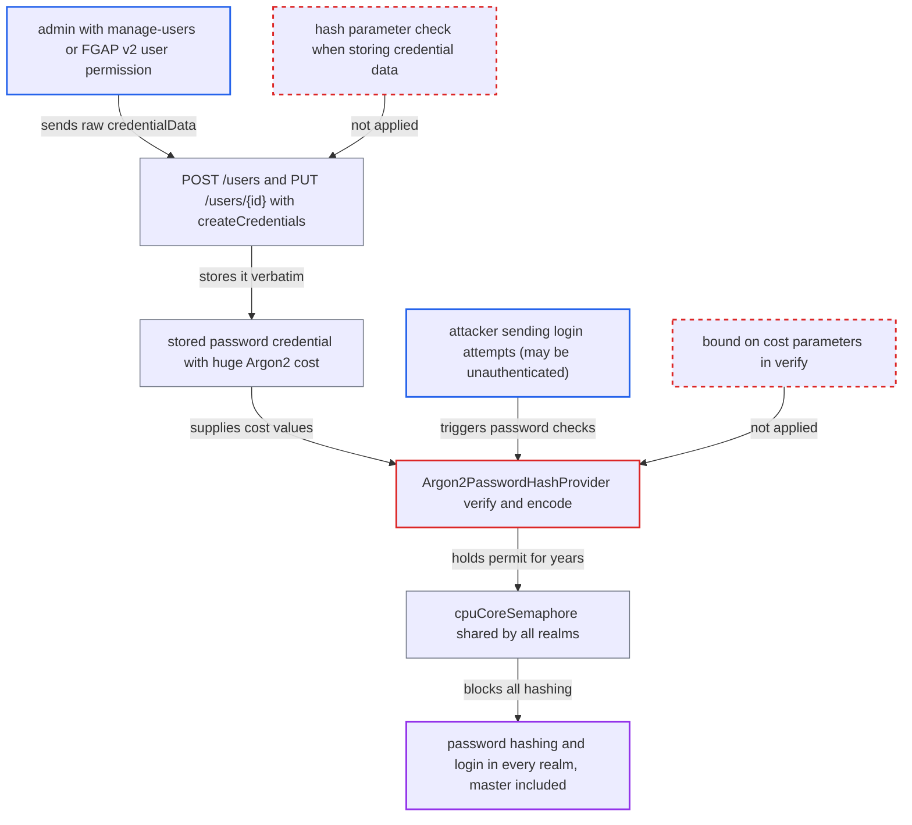

# Argon2 verify runs stored, unbounded cost parameters while holding a process-wide hashing permit

| Field | Value |
|---|---|
| ID | `find_016BuC2sqpeYGanCKw4BHQ9r` |
| Severity | **High** |
| Status | open |
| CWE | CWE-770 — Uncontrolled resource consumption |
| Created | 2026-10-27T21:50:53.165165Z |
| Claude Security | https://claude.ai/security/findings/find_016BuC2sqpeYGanCKw4BHQ9r |

## Description

An admin who can manage one user can make a Keycloak node stop checking passwords for every realm, including `master`. The admin stores a password credential with a huge Argon2 cost, and then `cpuCores` login attempts for that user (which anyone can send) pin all hashing permits. The cause is that `Argon2PasswordHashProvider.verify()` trusts the stored cost parameters and the admin API stores them unchecked.

1. **admin with `manage-users` or FGAP v2 manage/reset-password on one user** sends a password credential with raw `credentialData` and no `value` to `POST /users` or `PUT /users/{id}`. The credential names `argon2` with `hashIterations` 2147483647 and a `memory` of 7168; the endpoint needs only `requireManage(user)` and, for password credentials, `requireResetPassword(user)`. ([`services/src/main/java/org/keycloak/services/resources/admin/UserResource.java:236-241`](https://github.com/cx-benchmark/keycloak/blob/1d7be35d0764060a8143fc74b0aabf2442743be4/services/src/main/java/org/keycloak/services/resources/admin/UserResource.java#L236-L241))
2. **`RepresentationToModel.createCredentials()`** passes the raw credential data on to the credential provider without checking it. A credential with no `value` is copied as it is by `toModel(cred)`, and nothing checks the hash parameters. ([`server-spi-private/src/main/java/org/keycloak/models/utils/RepresentationToModel.java:858-885`](https://github.com/cx-benchmark/keycloak/blob/1d7be35d0764060a8143fc74b0aabf2442743be4/server-spi-private/src/main/java/org/keycloak/models/utils/RepresentationToModel.java#L858-L885))
3. **`PasswordCredentialProvider.createCredential`** stores the oversized parameters unchanged. The model is saved verbatim through `createStoredCredential` or `updateStoredCredential`, so the value stays after a restart. ([`model/storage/src/main/java/org/keycloak/credential/UserCredentialManager.java:262-271`](https://github.com/cx-benchmark/keycloak/blob/1d7be35d0764060a8143fc74b0aabf2442743be4/model/storage/src/main/java/org/keycloak/credential/UserCredentialManager.java#L262-L271))
4. **attacker, who may be unauthenticated** submits `cpuCores` concurrent login attempts for that username. Anyone who submits a username and password on the login form reaches `credentialManager().isValid(...)`. ([`services/src/main/java/org/keycloak/authentication/authenticators/browser/AbstractUsernameFormAuthenticator.java:218-233`](https://github.com/cx-benchmark/keycloak/blob/1d7be35d0764060a8143fc74b0aabf2442743be4/services/src/main/java/org/keycloak/authentication/authenticators/browser/AbstractUsernameFormAuthenticator.java#L218-L233))
5. **`PasswordCredentialProvider.isValid()`** picks the hash provider named in the stored credential and calls `verify()`. Failed logins are recorded only after `verify` returns, so brute-force lockout never triggers while it hangs. ([`services/src/main/java/org/keycloak/credential/PasswordCredentialProvider.java:228-252`](https://github.com/cx-benchmark/keycloak/blob/1d7be35d0764060a8143fc74b0aabf2442743be4/services/src/main/java/org/keycloak/credential/PasswordCredentialProvider.java#L228-L252))
6. **`Argon2PasswordHashProvider.verify()`** reads memory, parallelism, hashLength and iterations from the stored credential and passes them to `encode()`. No upper bound and no comparison with the server's configured values. ([`crypto/default/src/main/java/org/keycloak/crypto/hash/Argon2PasswordHashProvider.java:90-105`](https://github.com/cx-benchmark/keycloak/blob/1d7be35d0764060a8143fc74b0aabf2442743be4/crypto/default/src/main/java/org/keycloak/crypto/hash/Argon2PasswordHashProvider.java#L90-L105))
7. **`encode()`** takes a permit from `cpuCoreSemaphore` with an untimed `acquire()` and runs `Argon2BytesGenerator` with the stored values. The permit is released only after the hash finishes, which takes about 2^31 passes over 7 MB, and nothing interrupts it. ([`crypto/default/src/main/java/org/keycloak/crypto/hash/Argon2PasswordHashProvider.java:113-144`](https://github.com/cx-benchmark/keycloak/blob/1d7be35d0764060a8143fc74b0aabf2442743be4/crypto/default/src/main/java/org/keycloak/crypto/hash/Argon2PasswordHashProvider.java#L113-L144))
8. **every other Argon2 hash or verify on the node** blocks forever in `acquire()`. The semaphore is shared by all realms in the JVM, so logins, `dummyHash()` for unknown users, password resets and admin password sets all hang. ([`crypto/default/src/main/java/org/keycloak/crypto/hash/Argon2PasswordHashProviderFactory.java:63-64`](https://github.com/cx-benchmark/keycloak/blob/1d7be35d0764060a8143fc74b0aabf2442743be4/crypto/default/src/main/java/org/keycloak/crypto/hash/Argon2PasswordHashProviderFactory.java#L63-L64))

## Assessment

The attacker first needs an admin who can manage one user. That means `manage-users` in a realm, or, under FGAP v2, manage or reset-password permission on a single user. The admin sends a credential with raw `credentialData` to `POST /users` or `PUT /users/{id}`. The credential names `argon2` with `hashIterations` of 2147483647. Then they, or anyone who knows the username, even without logging in, send `cpuCores` concurrent login attempts for that user. No special setting is needed. Argon2 is the default provider when FIPS is off (`order()` 300). The stored credential stays after a restart, so the attack can be repeated. A very large `memory` value, for example several GB, is a weaker variant that drives heap exhaustion. The report assumes the shipped `bcprov-jdk18on` checks only lower bounds, as the local bcprov 1.77 does, but that library is not in the checkout.

Impact: The attacker can stop all Argon2 password logins, `dummyHash()` calls, password resets and admin password sets on the node, in every realm including `master`. Blocked requests also hold worker threads and CPU cores. Service is lost until restart, and it can be triggered again. No data is disclosed or modified.

## Recommendation

(1) `Argon2PasswordHashProvider.verify()` passes the stored cost parameters unbounded to `encode()`, which runs them while holding a permit of the process-wide `cpuCoreSemaphore`. One stored record can therefore control the CPU time and memory of the shared hashing pool.

Fix criteria: Verification runs only with parameters inside a server-enforced envelope. Iterations, memory and hashLength are no larger than the configured values or a fixed ceiling, and parallelism is bounded. A credential outside the envelope fails fast without taking a permit or allocating memory. To check: store a credential with `hashIterations` 2147483647, and separately one with a multi-GB `memory`. Login attempts must return promptly, and logins in other realms must keep working.

(2) `RepresentationToModel.createCredentials()` and `PasswordCredentialProvider.createCredential(..., PasswordCredentialModel)` store admin-supplied password `credentialData` verbatim, without checking the algorithm's cost parameters.

Fix criteria: Creating or importing a user through the admin API rejects, or normalises, password credential data whose hash parameters exceed the server-side limits for the named algorithm. To check: the same oversized `credentialData` sent in `POST` or `PUT /users` is refused with a 4xx response, and nothing is stored.

## Evidence

**https://github.com/cx-benchmark/keycloak**

- [`crypto/default/src/main/java/org/keycloak/crypto/hash/Argon2PasswordHashProvider.java:90-105`](https://github.com/cx-benchmark/keycloak/blob/1d7be35d0764060a8143fc74b0aabf2442743be4/crypto/default/src/main/java/org/keycloak/crypto/hash/Argon2PasswordHashProvider.java#L90-L105)
- [`crypto/default/src/main/java/org/keycloak/crypto/hash/Argon2PasswordHashProvider.java:113-144`](https://github.com/cx-benchmark/keycloak/blob/1d7be35d0764060a8143fc74b0aabf2442743be4/crypto/default/src/main/java/org/keycloak/crypto/hash/Argon2PasswordHashProvider.java#L113-L144)
- [`crypto/default/src/main/java/org/keycloak/crypto/hash/Argon2PasswordHashProvider.java:69-75`](https://github.com/cx-benchmark/keycloak/blob/1d7be35d0764060a8143fc74b0aabf2442743be4/crypto/default/src/main/java/org/keycloak/crypto/hash/Argon2PasswordHashProvider.java#L69-L75)
- [`crypto/default/src/main/java/org/keycloak/crypto/hash/Argon2PasswordHashProviderFactory.java:63-64`](https://github.com/cx-benchmark/keycloak/blob/1d7be35d0764060a8143fc74b0aabf2442743be4/crypto/default/src/main/java/org/keycloak/crypto/hash/Argon2PasswordHashProviderFactory.java#L63-L64)
- [`server-spi-private/src/main/java/org/keycloak/models/utils/RepresentationToModel.java:858-885`](https://github.com/cx-benchmark/keycloak/blob/1d7be35d0764060a8143fc74b0aabf2442743be4/server-spi-private/src/main/java/org/keycloak/models/utils/RepresentationToModel.java#L858-L885)
- [`services/src/main/java/org/keycloak/services/resources/admin/UserResource.java:236-241`](https://github.com/cx-benchmark/keycloak/blob/1d7be35d0764060a8143fc74b0aabf2442743be4/services/src/main/java/org/keycloak/services/resources/admin/UserResource.java#L236-L241)
- [`model/storage/src/main/java/org/keycloak/credential/UserCredentialManager.java:262-271`](https://github.com/cx-benchmark/keycloak/blob/1d7be35d0764060a8143fc74b0aabf2442743be4/model/storage/src/main/java/org/keycloak/credential/UserCredentialManager.java#L262-L271)
- [`services/src/main/java/org/keycloak/credential/PasswordCredentialProvider.java:228-252`](https://github.com/cx-benchmark/keycloak/blob/1d7be35d0764060a8143fc74b0aabf2442743be4/services/src/main/java/org/keycloak/credential/PasswordCredentialProvider.java#L228-L252)
- [`services/src/main/java/org/keycloak/authentication/authenticators/browser/AbstractUsernameFormAuthenticator.java:218-233`](https://github.com/cx-benchmark/keycloak/blob/1d7be35d0764060a8143fc74b0aabf2442743be4/services/src/main/java/org/keycloak/authentication/authenticators/browser/AbstractUsernameFormAuthenticator.java#L218-L233)
- [`services/src/main/java/org/keycloak/authentication/authenticators/util/AuthenticatorUtils.java:76-86`](https://github.com/cx-benchmark/keycloak/blob/1d7be35d0764060a8143fc74b0aabf2442743be4/services/src/main/java/org/keycloak/authentication/authenticators/util/AuthenticatorUtils.java#L76-L86)

