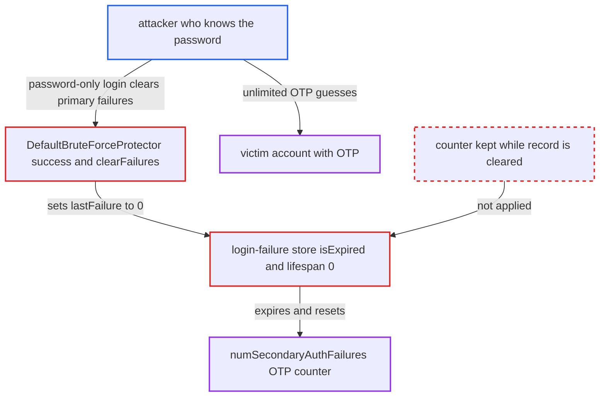

# Clearing primary login failures expires the record, discarding the OTP secondary-failure lockout counter

| Field | Value |
|---|---|
| ID | `find_01BuVRacnZ8zqK5Jg3ZiQhA2` |
| Severity | **High** |
| Status | open |
| CWE | CWE-307 — Improper Restriction of Excessive Authentication Attempts |
| Created | 2026-10-27T21:56:46.284568Z |
| Claude Security | https://claude.ai/security/findings/find_01BuVRacnZ8zqK5Jg3ZiQhA2 |

## Description

An attacker who already knows a user's password can keep guessing that user's OTP code without ever being permanently locked out. This needs a realm with `maxSecondaryAuthFailures` above 0 and some password-only login path for the OTP-enrolled user. The cause is that clearing primary failures sets `lastFailure` to 0, and the stores then treat the record as expired and drop the OTP counter `numSecondaryAuthFailures`.

1. **attacker** sends up to N-1 wrong OTP codes for the victim. Each wrong code raises `numSecondaryAuthFailures`, and the permanent lockout only fires once it exceeds `maxSecondaryAuthFailures`. ([`services/src/main/java/org/keycloak/services/managers/DefaultBruteForceProtector.java:146-155`](https://github.com/cx-benchmark/keycloak/blob/1d7be35d0764060a8143fc74b0aabf2442743be4/services/src/main/java/org/keycloak/services/managers/DefaultBruteForceProtector.java#L146-L155))
2. **attacker** completes one password-only login as the victim. This works where the realm offers the user a login without OTP, such as step-up LoA level 1, a client flow override or conditional OTP skip rules. ([`services/src/main/java/org/keycloak/services/managers/AuthenticationManager.java:1766-1781`](https://github.com/cx-benchmark/keycloak/blob/1d7be35d0764060a8143fc74b0aabf2442743be4/services/src/main/java/org/keycloak/services/managers/AuthenticationManager.java#L1766-L1781))
3. **`DefaultBruteForceProtector.success()`** calls `clearFailures()` because the success did not use the `otp` category. `clearFailures()` is meant to keep the OTP counter, but it sets `lastFailure` to 0. ([`services/src/main/java/org/keycloak/services/managers/DefaultBruteForceProtector.java:211-225`](https://github.com/cx-benchmark/keycloak/blob/1d7be35d0764060a8143fc74b0aabf2442743be4/services/src/main/java/org/keycloak/services/managers/DefaultBruteForceProtector.java#L211-L225))
4. **the login-failure store** treats the record with `lastFailure == 0` as expired. In the default JPA store `isExpired()` returns true, so `getUserLoginFailure()` returns `null`. The Infinispan providers give such entries lifespan 0, and the expiration query deletes them. ([`model/jpa/src/main/java/org/keycloak/loginfailures/jpa/JpaUserLoginFailureProvider.java:76-84`](https://github.com/cx-benchmark/keycloak/blob/1d7be35d0764060a8143fc74b0aabf2442743be4/model/jpa/src/main/java/org/keycloak/loginfailures/jpa/JpaUserLoginFailureProvider.java#L76-L84))
5. **`addUserLoginFailure()`** finds the existing row expired and calls `clearPrimaryAndSecondaryAuthFailures()` on the next failure. This resets the OTP counter to 0 before the new failure is counted. ([`model/jpa/src/main/java/org/keycloak/loginfailures/jpa/JpaUserLoginFailureProvider.java:94-121`](https://github.com/cx-benchmark/keycloak/blob/1d7be35d0764060a8143fc74b0aabf2442743be4/model/jpa/src/main/java/org/keycloak/loginfailures/jpa/JpaUserLoginFailureProvider.java#L94-L121))
6. **attacker** repeats the cycle of wrong OTPs and one password-only login. The OTP counter never reaches the threshold, so guessing is unbounded, at about one guess per second.

## Assessment

The attacker knows the victim's password but not the OTP. The realm has brute-force detection on with `maxSecondaryAuthFailures` above 0. The victim is enrolled in OTP and has some password-only login path, for example step-up LoA level 1, a client flow override or conditional OTP skip rules. The attacker sends up to N-1 wrong OTPs, then makes one password-only login, and repeats this. The flaw is present in the default `login-failures:v2` JPA store. It is also present in the deprecated `login-failures:v1` in-memory provider and in the remote provider.

Impact: The OTP lockout stops working, so the attacker can guess OTP codes continuously. A 6-digit TOTP is expected to fall within days. The attacker then gets a fully second-factor-authenticated session as the victim, with read and write access to what that account and its OTP-protected clients allow. The report says there is no availability impact.

## Recommendation

(1) `JpaUserLoginFailureProvider.isExpired()`, the JPA expiration queries and `SessionTimeouts.getLoginFailuresLifespanMs()` treat `lastFailure == 0` as an obsolete record. A record that still has a non-zero `numSecondaryAuthFailures` is therefore expired or deleted.

Fix criteria: A login-failure record with `numSecondaryAuthFailures > 0` stays retrievable after `clearFailures()` in every store: JPA, embedded Infinispan and remote Infinispan. It expires only once both counters are cleared or the realm policy allows. After N-1 OTP failures, a password-only success and one more OTP failure, `getNumSecondaryAuthFailures()` equals N. The permanent lockout fires at the configured threshold.

(2) `addUserLoginFailure()` in the JPA provider calls `clearPrimaryAndSecondaryAuthFailures()` on any existing row it judges expired. This wipes the secondary counter whenever the primary state was reset.

Fix criteria: Re-creating or reusing an existing login-failure row does not reset the secondary counter, unless the record's secondary state has itself legitimately expired. The same sequence gives the same result in the default `login-failures:v2` configuration.

## Evidence

**https://github.com/cx-benchmark/keycloak**

- [`model/jpa/src/main/java/org/keycloak/loginfailures/jpa/JpaUserLoginFailureProvider.java:76-84`](https://github.com/cx-benchmark/keycloak/blob/1d7be35d0764060a8143fc74b0aabf2442743be4/model/jpa/src/main/java/org/keycloak/loginfailures/jpa/JpaUserLoginFailureProvider.java#L76-L84)
- [`model/jpa/src/main/java/org/keycloak/loginfailures/jpa/JpaUserLoginFailureProvider.java:94-121`](https://github.com/cx-benchmark/keycloak/blob/1d7be35d0764060a8143fc74b0aabf2442743be4/model/jpa/src/main/java/org/keycloak/loginfailures/jpa/JpaUserLoginFailureProvider.java#L94-L121)
- [`model/jpa/src/main/java/org/keycloak/loginfailures/jpa/LoginFailureEntity.java:46-53`](https://github.com/cx-benchmark/keycloak/blob/1d7be35d0764060a8143fc74b0aabf2442743be4/model/jpa/src/main/java/org/keycloak/loginfailures/jpa/LoginFailureEntity.java#L46-L53)
- [`model/jpa/src/main/java/org/keycloak/loginfailures/jpa/LoginFailureExpirationAction.java:37-55`](https://github.com/cx-benchmark/keycloak/blob/1d7be35d0764060a8143fc74b0aabf2442743be4/model/jpa/src/main/java/org/keycloak/loginfailures/jpa/LoginFailureExpirationAction.java#L37-L55)
- [`model/infinispan/src/main/java/org/keycloak/models/sessions/infinispan/util/SessionTimeouts.java:211-224`](https://github.com/cx-benchmark/keycloak/blob/1d7be35d0764060a8143fc74b0aabf2442743be4/model/infinispan/src/main/java/org/keycloak/models/sessions/infinispan/util/SessionTimeouts.java#L211-L224)
- [`model/infinispan/src/main/java/org/keycloak/models/sessions/infinispan/changes/InfinispanChangesUtils.java:193-200`](https://github.com/cx-benchmark/keycloak/blob/1d7be35d0764060a8143fc74b0aabf2442743be4/model/infinispan/src/main/java/org/keycloak/models/sessions/infinispan/changes/InfinispanChangesUtils.java#L193-L200)
- [`services/src/main/java/org/keycloak/services/managers/DefaultBruteForceProtector.java:211-225`](https://github.com/cx-benchmark/keycloak/blob/1d7be35d0764060a8143fc74b0aabf2442743be4/services/src/main/java/org/keycloak/services/managers/DefaultBruteForceProtector.java#L211-L225)
- [`services/src/main/java/org/keycloak/services/managers/DefaultBruteForceProtector.java:146-155`](https://github.com/cx-benchmark/keycloak/blob/1d7be35d0764060a8143fc74b0aabf2442743be4/services/src/main/java/org/keycloak/services/managers/DefaultBruteForceProtector.java#L146-L155)
- [`model/jpa/src/main/java/org/keycloak/loginfailures/jpa/UserLoginFailureAdapter.java:98-110`](https://github.com/cx-benchmark/keycloak/blob/1d7be35d0764060a8143fc74b0aabf2442743be4/model/jpa/src/main/java/org/keycloak/loginfailures/jpa/UserLoginFailureAdapter.java#L98-L110)
- [`services/src/main/java/org/keycloak/services/managers/AuthenticationManager.java:1766-1781`](https://github.com/cx-benchmark/keycloak/blob/1d7be35d0764060a8143fc74b0aabf2442743be4/services/src/main/java/org/keycloak/services/managers/AuthenticationManager.java#L1766-L1781)
- [`common/src/main/java/org/keycloak/common/Profile.java:133-134`](https://github.com/cx-benchmark/keycloak/blob/1d7be35d0764060a8143fc74b0aabf2442743be4/common/src/main/java/org/keycloak/common/Profile.java#L133-L134)

