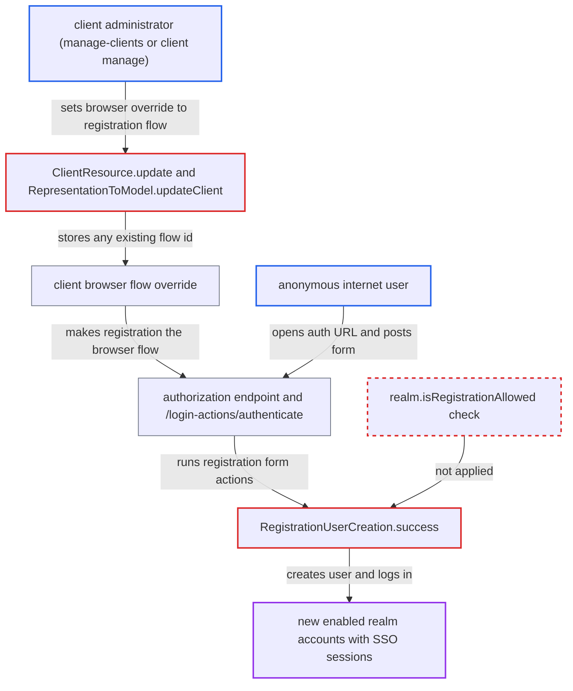

# Client browser-flow override to registration flow bypasses realm registrationAllowed and lets anyone self-register

| Field | Value |
|---|---|
| ID | `find_019xQECdhvfxbwPWBDrrLXhX` |
| Severity | **High** |
| Status | open |
| CWE | CWE-863 — Authorization bypass |
| Created | 2026-10-27T22:08:28.981826Z |
| Claude Security | https://claude.ai/security/findings/find_019xQECdhvfxbwPWBDrrLXhX |

## Description

A delegated client administrator can switch on anonymous self-registration for a whole realm even though the realm administrator turned it off. After that, any internet user can create enabled accounts that get SSO sessions. The attacker needs `manage-clients` or a per-client `manage` permission. The cause is that `RegistrationUserCreation` creates users without checking `realm.isRegistrationAllowed()`.

1. **client administrator** sends an update for one client with the registration flow as its browser override. `ClientResource.update` only requires `requireConfigure`, which in the default FGAP v2 means `manage-clients` or a per-client `manage` permission. ([`services/src/main/java/org/keycloak/services/resources/admin/ClientResource.java:163-169`](https://github.com/cx-benchmark/keycloak/blob/1d7be35d0764060a8143fc74b0aabf2442743be4/services/src/main/java/org/keycloak/services/resources/admin/ClientResource.java#L163-L169))
2. **`RepresentationToModel.updateClient`** stores the flow id as `authenticationFlowBindingOverrides.browser`. It only checks that a flow with that id exists in the realm, and the built-in `registration` flow passes. ([`server-spi-private/src/main/java/org/keycloak/models/utils/RepresentationToModel.java:481-493`](https://github.com/cx-benchmark/keycloak/blob/1d7be35d0764060a8143fc74b0aabf2442743be4/server-spi-private/src/main/java/org/keycloak/models/utils/RepresentationToModel.java#L481-L493))
3. **anonymous internet user** opens the client's `/protocol/openid-connect/auth` URL and receives the registration form. The authorization request runs the client's resolved browser flow, so the registration page is shown even though `realm.isRegistrationAllowed()` is false. ([`services/src/main/java/org/keycloak/protocol/AuthorizationEndpointBase.java:109-165`](https://github.com/cx-benchmark/keycloak/blob/1d7be35d0764060a8143fc74b0aabf2442743be4/services/src/main/java/org/keycloak/protocol/AuthorizationEndpointBase.java#L109-L165))
4. **anonymous internet user** posts the filled-in form to `/login-actions/authenticate` with the page's `session_code`, `execution` and `tab_id`. The form's own action URL points to `/login-actions/registration`, which would refuse it, but session codes are not tied to a flow path, so `/login-actions/authenticate` accepts them. ([`services/src/main/java/org/keycloak/services/resources/SessionCodeChecks.java:312-341`](https://github.com/cx-benchmark/keycloak/blob/1d7be35d0764060a8143fc74b0aabf2442743be4/services/src/main/java/org/keycloak/services/resources/SessionCodeChecks.java#L312-L341))
5. **`FormAuthenticationFlow`** calls `success()` on the registration form actions. This runs `registration-user-creation` and `registration-password-action`, so the account is created. ([`services/src/main/java/org/keycloak/authentication/FormAuthenticationFlow.java:181-266`](https://github.com/cx-benchmark/keycloak/blob/1d7be35d0764060a8143fc74b0aabf2442743be4/services/src/main/java/org/keycloak/authentication/FormAuthenticationFlow.java#L181-L266))
6. **`RegistrationUserCreation.success`** creates and enables the user and logs it in. It never consults `realm.isRegistrationAllowed()`, so the realm policy is not applied on this path. ([`services/src/main/java/org/keycloak/authentication/forms/RegistrationUserCreation.java:138-185`](https://github.com/cx-benchmark/keycloak/blob/1d7be35d0764060a8143fc74b0aabf2442743be4/services/src/main/java/org/keycloak/authentication/forms/RegistrationUserCreation.java#L138-L185))

## Assessment

The attacker is a delegated client administrator of a realm where the realm admin has turned off the User registration switch (off by default). They hold `manage-clients`, or an FGAP v2 `manage` permission on a single client. They send `PUT /admin/realms/{realm}/clients/{id}` with `authenticationFlowBindingOverrides.browser` set to the id of the realm `registration` flow. That id is listed by `GET /authentication/flows`, which `query-clients` allows. The admin console also offers `registration` in its browser override selector, so no crafted API call is needed. After that, the administrator or any anonymous internet user can run the registration flow through the client. No victim action is needed.

Impact: Anyone on the internet can create fully enabled accounts with a password they choose. The accounts get the realm default role, default groups and default required actions. They are logged in with an SSO session that works at every client of the realm. A client-scoped admin without `manage-users` can thus override the realm policy. Read access is limited to what a default realm user may read, and the report finds no availability impact.

## Recommendation

(1) The registration form actions in `RegistrationUserCreation` create and enable a user without checking `realm.isRegistrationAllowed()`. The policy is enforced only at the `/login-actions/registration` and authorization endpoint entry points.

Fix criteria: User creation through the registration flow is refused whenever registration is not allowed for the realm, whichever endpoint or flow binding ran it. The organization-invitation exception still applies. Test: with `registrationAllowed=false`, a client whose browser override is the registration flow must not create a user when the form is POSTed to `/login-actions/authenticate`. The `REGISTER` event must not be emitted and no `UserEntity` must be persisted.

(2) `RepresentationToModel.updateClient` and `createClient` accept any realm flow id as a `browser` or `direct_grant` binding override. A client admin can therefore bind flows never meant for authentication (registration, reset credentials, first broker login, client authentication, SAML ECP, docker HTTP-Basic) and change realm-wide security behaviour with a client-scoped permission.

Fix criteria: A binding override can only reference flows valid for that binding. These are top-level `basic-flow` flows that are not the realm's registration, reset-credentials, first-broker-login, client-authentication, docker or SAML-ECP flows. Alternatively, setting an override requires realm-level authentication-management privilege. Test: an update carrying the registration flow id as `browser` override is rejected with 400 or 403 for a `manage-clients` or FGAP-manage admin. Existing invalid overrides are ignored by `AuthenticationFlowResolver`, which uses the realm default flow instead.

## Evidence

**https://github.com/cx-benchmark/keycloak**

- [`services/src/main/java/org/keycloak/authentication/forms/RegistrationUserCreation.java:138-185`](https://github.com/cx-benchmark/keycloak/blob/1d7be35d0764060a8143fc74b0aabf2442743be4/services/src/main/java/org/keycloak/authentication/forms/RegistrationUserCreation.java#L138-L185)
- [`services/src/main/java/org/keycloak/services/resources/LoginActionsService.java:328-356`](https://github.com/cx-benchmark/keycloak/blob/1d7be35d0764060a8143fc74b0aabf2442743be4/services/src/main/java/org/keycloak/services/resources/LoginActionsService.java#L328-L356)
- [`server-spi-private/src/main/java/org/keycloak/models/utils/AuthenticationFlowResolver.java:36-98`](https://github.com/cx-benchmark/keycloak/blob/1d7be35d0764060a8143fc74b0aabf2442743be4/server-spi-private/src/main/java/org/keycloak/models/utils/AuthenticationFlowResolver.java#L36-L98)
- [`server-spi-private/src/main/java/org/keycloak/models/utils/RepresentationToModel.java:481-493`](https://github.com/cx-benchmark/keycloak/blob/1d7be35d0764060a8143fc74b0aabf2442743be4/server-spi-private/src/main/java/org/keycloak/models/utils/RepresentationToModel.java#L481-L493)
- [`services/src/main/java/org/keycloak/services/resources/admin/ClientResource.java:163-169`](https://github.com/cx-benchmark/keycloak/blob/1d7be35d0764060a8143fc74b0aabf2442743be4/services/src/main/java/org/keycloak/services/resources/admin/ClientResource.java#L163-L169)
- [`services/src/main/java/org/keycloak/services/resources/admin/fgap/ClientPermissionsV2.java:51-72`](https://github.com/cx-benchmark/keycloak/blob/1d7be35d0764060a8143fc74b0aabf2442743be4/services/src/main/java/org/keycloak/services/resources/admin/fgap/ClientPermissionsV2.java#L51-L72)
- [`services/src/main/java/org/keycloak/authentication/AuthenticationProcessor.java:1055-1095`](https://github.com/cx-benchmark/keycloak/blob/1d7be35d0764060a8143fc74b0aabf2442743be4/services/src/main/java/org/keycloak/authentication/AuthenticationProcessor.java#L1055-L1095)
- [`services/src/main/java/org/keycloak/services/resources/SessionCodeChecks.java:312-341`](https://github.com/cx-benchmark/keycloak/blob/1d7be35d0764060a8143fc74b0aabf2442743be4/services/src/main/java/org/keycloak/services/resources/SessionCodeChecks.java#L312-L341)
- [`services/src/main/java/org/keycloak/authentication/DefaultAuthenticationFlow.java:152-163`](https://github.com/cx-benchmark/keycloak/blob/1d7be35d0764060a8143fc74b0aabf2442743be4/services/src/main/java/org/keycloak/authentication/DefaultAuthenticationFlow.java#L152-L163)
- [`services/src/main/java/org/keycloak/authentication/FormAuthenticationFlow.java:181-266`](https://github.com/cx-benchmark/keycloak/blob/1d7be35d0764060a8143fc74b0aabf2442743be4/services/src/main/java/org/keycloak/authentication/FormAuthenticationFlow.java#L181-L266)
- [`services/src/main/java/org/keycloak/protocol/AuthorizationEndpointBase.java:109-165`](https://github.com/cx-benchmark/keycloak/blob/1d7be35d0764060a8143fc74b0aabf2442743be4/services/src/main/java/org/keycloak/protocol/AuthorizationEndpointBase.java#L109-L165)
- [`services/src/main/java/org/keycloak/protocol/oidc/endpoints/AuthorizationEndpoint.java:229-269`](https://github.com/cx-benchmark/keycloak/blob/1d7be35d0764060a8143fc74b0aabf2442743be4/services/src/main/java/org/keycloak/protocol/oidc/endpoints/AuthorizationEndpoint.java#L229-L269)
- [`server-spi-private/src/main/java/org/keycloak/models/utils/DefaultAuthenticationFlows.java:82-127`](https://github.com/cx-benchmark/keycloak/blob/1d7be35d0764060a8143fc74b0aabf2442743be4/server-spi-private/src/main/java/org/keycloak/models/utils/DefaultAuthenticationFlows.java#L82-L127)
- [`model/jpa/src/main/java/org/keycloak/models/jpa/JpaUserProvider.java:123-157`](https://github.com/cx-benchmark/keycloak/blob/1d7be35d0764060a8143fc74b0aabf2442743be4/model/jpa/src/main/java/org/keycloak/models/jpa/JpaUserProvider.java#L123-L157)
- [`docs/documentation/server_admin/topics/users/con-user-registration.adoc:17-23`](https://github.com/cx-benchmark/keycloak/blob/1d7be35d0764060a8143fc74b0aabf2442743be4/docs/documentation/server_admin/topics/users/con-user-registration.adoc#L17-L23)
- [`js/apps/admin-ui/src/clients/advanced/AuthenticationOverrides.tsx:28-37`](https://github.com/cx-benchmark/keycloak/blob/1d7be35d0764060a8143fc74b0aabf2442743be4/js/apps/admin-ui/src/clients/advanced/AuthenticationOverrides.tsx#L28-L37)

