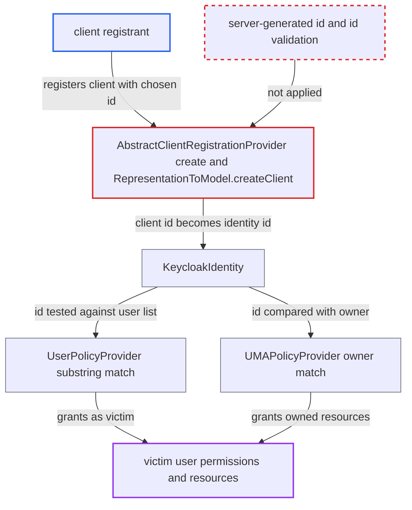

# Client registrant chooses internal client id that becomes the authorization identity id

| Field | Value |
|---|---|
| ID | `find_01Ar7aafvBky7VRTuUucue8v` |
| Severity | **High** |
| Status | open |
| CWE | CWE-639 — Authorization bypass |
| Created | 2026-10-27T22:37:01.749873Z |
| Claude Security | https://claude.ai/security/findings/find_01Ar7aafvBky7VRTuUucue8v |

## Description

A client registrant who is not an admin can act as another user inside Keycloak's authorization services. The same flaw lets them match every user policy in the realm. They need an initial access token, a bearer token with the `create-client` role, or anonymous access from a host the Trusted Hosts policy admits. The cause is that registration keeps the caller's `id` as the client's internal id, and `KeycloakIdentity` then uses it as the identity id.

1. **registrant** posts a client to the `default` registration endpoint with a chosen `id`. The `ClientRepresentation` sets `id` to a victim user's id, or to a short string such as `-`. It also sets `serviceAccountsEnabled` and `authorizationServicesEnabled` to true. ([`services/src/main/java/org/keycloak/services/clientregistration/AbstractClientRegistrationProvider.java:107-132`](https://github.com/cx-benchmark/keycloak/blob/1d7be35d0764060a8143fc74b0aabf2442743be4/services/src/main/java/org/keycloak/services/clientregistration/AbstractClientRegistrationProvider.java#L107-L132))
2. **`RepresentationToModel.createClient`** stores the client under the caller-supplied id. It calls `realm.addClient(rep.getId(), rep.getClientId())` whenever an `id` is present, and the caller's role is not considered. ([`server-spi-private/src/main/java/org/keycloak/models/utils/RepresentationToModel.java:369`](https://github.com/cx-benchmark/keycloak/blob/1d7be35d0764060a8143fc74b0aabf2442743be4/server-spi-private/src/main/java/org/keycloak/models/utils/RepresentationToModel.java#L369))
3. **`JpaRealmProvider.addClient`** accepts the id without further checks. It checks only that the id is at most 36 characters, with no format check and no comparison against existing user ids. ([`model/jpa/src/main/java/org/keycloak/models/jpa/JpaRealmProvider.java:944-961`](https://github.com/cx-benchmark/keycloak/blob/1d7be35d0764060a8143fc74b0aabf2442743be4/model/jpa/src/main/java/org/keycloak/models/jpa/JpaRealmProvider.java#L944-L961))
4. **registrant** obtains a client_credentials token for the new client. The token belongs to a service account, and it then either requests an RPT with `grant_type=uma-ticket` and an `audience` naming a resource server, or calls the Admin REST API. ([`services/src/main/java/org/keycloak/authorization/authorization/AuthorizationTokenService.java:138-140`](https://github.com/cx-benchmark/keycloak/blob/1d7be35d0764060a8143fc74b0aabf2442743be4/services/src/main/java/org/keycloak/authorization/authorization/AuthorizationTokenService.java#L138-L140))
5. **`KeycloakIdentity`** reports the client's internal id as the identity id. For service-account tokens the id is `clientModel.getId()`, so it lands in the same namespace as user ids. ([`services/src/main/java/org/keycloak/authorization/common/KeycloakIdentity.java:170-187`](https://github.com/cx-benchmark/keycloak/blob/1d7be35d0764060a8143fc74b0aabf2442743be4/services/src/main/java/org/keycloak/authorization/common/KeycloakIdentity.java#L170-L187))
6. **`UserPolicyProvider`** grants access because the identity id is found in the policy's user list. It uses a substring test on the JSON array string, so an exact victim id matches, and so does `-` or `[`, which every serialized list contains. ([`authz/policy/common/src/main/java/org/keycloak/authorization/policy/provider/user/UserPolicyProvider.java:57-58`](https://github.com/cx-benchmark/keycloak/blob/1d7be35d0764060a8143fc74b0aabf2442743be4/authz/policy/common/src/main/java/org/keycloak/authorization/policy/provider/user/UserPolicyProvider.java#L57-L58))
7. **`UMAPolicyProvider` and `RolePolicyProvider`** treat the client as the victim user. `UMAPolicyProvider` grants when the resource owner equals the identity id, and `RolePolicyProvider` with fetch-roles looks the id up as a user id to load that user's roles. ([`authz/policy/common/src/main/java/org/keycloak/authorization/policy/provider/permission/UMAPolicyProvider.java:43-46`](https://github.com/cx-benchmark/keycloak/blob/1d7be35d0764060a8143fc74b0aabf2442743be4/authz/policy/common/src/main/java/org/keycloak/authorization/policy/provider/permission/UMAPolicyProvider.java#L43-L46))

## Assessment

The attacker is a dynamic-client-registration registrant. That means an initial access token holder, a holder of a bearer token with only the `create-client` realm-management role, or an anonymous caller from a host the realm's anonymous Trusted Hosts policy admits. They post to `/realms/{realm}/clients-registrations/default`. The registration policies never look at `id`. A second way in is the admin API path `ClientsResource.createClientModel`, which also honours `id` for anyone with `manage-clients`, or with FGAP v2 `manage` on clients. With a victim's user id the attacker matches exactly. A victim id can be learned from the `sub` of any token the victim has been issued. With `-` or `[` no victim id is needed, because the substring test matches every user policy. No victim action is needed. With FGAP v2 enabled (`realm.isAdminPermissionsEnabled()`), the attacker can also call the Admin REST API with the service-account token and inherit the victim admin's permissions.

Impact: The attacker inherits what user, UMA-owner, group and role policies grant in the realm. That includes RPTs for other users' and other resource servers' protected resources. With FGAP v2 it also includes the impersonated admin's permissions, such as managing users and resetting passwords, which allows takeover of realm accounts. This is limited to what those policies grant within the realm. Deleting the client later also removes the FGAP permissions scoped to the victim user id.

## Recommendation

(1) Client registration and the admin create path accept a caller-supplied internal client `id`, and `RepresentationToModel.createClient` stores it. A non-admin registrant can therefore pick a security-relevant identifier.

Fix criteria: Clients created through the registration endpoints (initial access token, `create-client` bearer, anonymous) get a server-generated internal id whatever `id` the request carries. Caller-supplied ids are accepted only in realm import and admin flows. Even there they must be in UUID format and are rejected if they collide with an existing user id. Registering with `"id":"-"` or a user's UUID yields a client whose `getId()` is a fresh UUID.

(2) `KeycloakIdentity` puts client identities and user identities in one id namespace. `UserPolicyProvider` tests membership by substring on a serialized list, so an identity id equal to or contained in a user id string is treated as that user.

Fix criteria: Policy providers compare identity ids by exact element membership on a parsed list. They do not grant a client identity what is granted to a user id. Service-account and client identity ids are type-qualified or otherwise cannot equal a user id. The owner checks in `UMAPolicyProvider` and `Permissions.all` compare owner type as well as id. A service-account identity whose client id equals a user's id or `-` is denied by user policies naming that user.

## Evidence

**https://github.com/cx-benchmark/keycloak**

- [`services/src/main/java/org/keycloak/services/clientregistration/AbstractClientRegistrationProvider.java:107-132`](https://github.com/cx-benchmark/keycloak/blob/1d7be35d0764060a8143fc74b0aabf2442743be4/services/src/main/java/org/keycloak/services/clientregistration/AbstractClientRegistrationProvider.java#L107-L132)
- [`server-spi-private/src/main/java/org/keycloak/models/utils/RepresentationToModel.java:369`](https://github.com/cx-benchmark/keycloak/blob/1d7be35d0764060a8143fc74b0aabf2442743be4/server-spi-private/src/main/java/org/keycloak/models/utils/RepresentationToModel.java#L369)
- [`services/src/main/java/org/keycloak/authorization/common/KeycloakIdentity.java:170-187`](https://github.com/cx-benchmark/keycloak/blob/1d7be35d0764060a8143fc74b0aabf2442743be4/services/src/main/java/org/keycloak/authorization/common/KeycloakIdentity.java#L170-L187)
- [`services/src/main/java/org/keycloak/authorization/common/KeycloakIdentity.java:262-275`](https://github.com/cx-benchmark/keycloak/blob/1d7be35d0764060a8143fc74b0aabf2442743be4/services/src/main/java/org/keycloak/authorization/common/KeycloakIdentity.java#L262-L275)
- [`authz/policy/common/src/main/java/org/keycloak/authorization/policy/provider/user/UserPolicyProvider.java:57-58`](https://github.com/cx-benchmark/keycloak/blob/1d7be35d0764060a8143fc74b0aabf2442743be4/authz/policy/common/src/main/java/org/keycloak/authorization/policy/provider/user/UserPolicyProvider.java#L57-L58)
- [`authz/policy/common/src/main/java/org/keycloak/authorization/policy/provider/permission/UMAPolicyProvider.java:43-46`](https://github.com/cx-benchmark/keycloak/blob/1d7be35d0764060a8143fc74b0aabf2442743be4/authz/policy/common/src/main/java/org/keycloak/authorization/policy/provider/permission/UMAPolicyProvider.java#L43-L46)
- [`authz/policy/common/src/main/java/org/keycloak/authorization/policy/provider/role/RolePolicyProvider.java:114-116`](https://github.com/cx-benchmark/keycloak/blob/1d7be35d0764060a8143fc74b0aabf2442743be4/authz/policy/common/src/main/java/org/keycloak/authorization/policy/provider/role/RolePolicyProvider.java#L114-L116)
- [`services/src/main/java/org/keycloak/services/resources/admin/fgap/MgmtPermissions.java:106-109`](https://github.com/cx-benchmark/keycloak/blob/1d7be35d0764060a8143fc74b0aabf2442743be4/services/src/main/java/org/keycloak/services/resources/admin/fgap/MgmtPermissions.java#L106-L109)
- [`services/src/main/java/org/keycloak/authorization/authorization/AuthorizationTokenService.java:138-140`](https://github.com/cx-benchmark/keycloak/blob/1d7be35d0764060a8143fc74b0aabf2442743be4/services/src/main/java/org/keycloak/authorization/authorization/AuthorizationTokenService.java#L138-L140)
- [`model/jpa/src/main/java/org/keycloak/models/jpa/JpaRealmProvider.java:944-961`](https://github.com/cx-benchmark/keycloak/blob/1d7be35d0764060a8143fc74b0aabf2442743be4/model/jpa/src/main/java/org/keycloak/models/jpa/JpaRealmProvider.java#L944-L961)
- [`services/src/main/java/org/keycloak/services/clientregistration/ClientRegistrationAuth.java:162-200`](https://github.com/cx-benchmark/keycloak/blob/1d7be35d0764060a8143fc74b0aabf2442743be4/services/src/main/java/org/keycloak/services/clientregistration/ClientRegistrationAuth.java#L162-L200)
- [`services/src/main/java/org/keycloak/services/resources/admin/ClientsResource.java:218-233`](https://github.com/cx-benchmark/keycloak/blob/1d7be35d0764060a8143fc74b0aabf2442743be4/services/src/main/java/org/keycloak/services/resources/admin/ClientsResource.java#L218-L233)
- [`server-spi-private/src/main/java/org/keycloak/authorization/fgap/AdminPermissionsSchema.java:499-534`](https://github.com/cx-benchmark/keycloak/blob/1d7be35d0764060a8143fc74b0aabf2442743be4/server-spi-private/src/main/java/org/keycloak/authorization/fgap/AdminPermissionsSchema.java#L499-L534)

