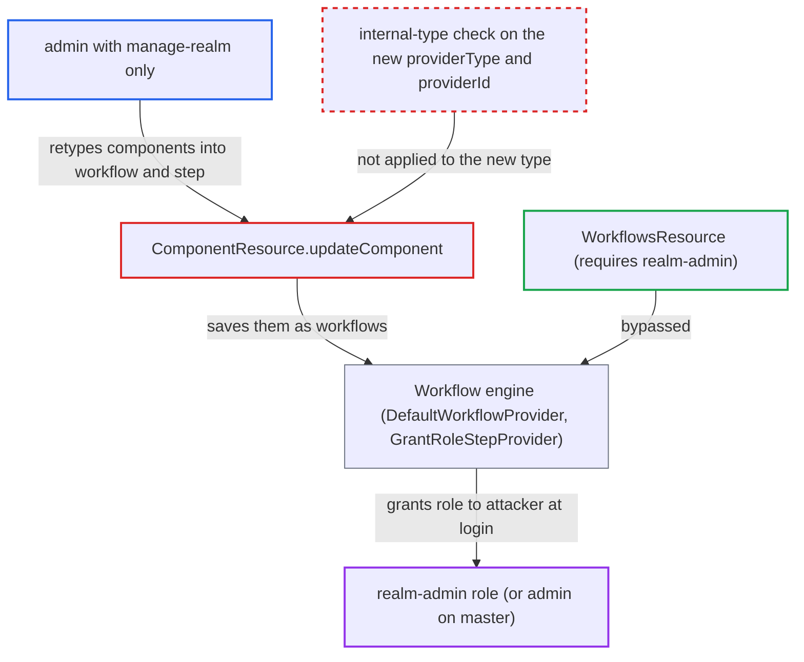

# Component update can retype a component into an internal workflow, bypassing realm-admin requirement

| Field | Value |
|---|---|
| ID | `find_01F61RCvvCynvS6wVU21qi1V` |
| Severity | **High** |
| Status | open |
| CWE | CWE-863 — Improper Authorization |
| Created | 2026-10-27T21:26:11.450552Z |
| Claude Security | https://claude.ai/security/findings/find_01F61RCvvCynvS6wVU21qi1V |

## Description

An admin who holds only `manage-realm` can give themselves `realm-admin` in their realm, or the `admin` role on `master`. They do this by retyping ordinary components into internal workflow components through the component API. The cause is `updateComponent` in `ComponentResource`. It checks only the stored component's type and never checks the new `providerType`, `providerId` or `parentId` from the request body.

1. **attacker with `manage-realm`** creates two components of a permitted type through `POST /admin/realms/X/components`. The report's example uses `org.keycloak.keys.KeyProvider` with `hmac-generated`. The first holds workflow config (`name`, `enabled`, `supports=USERS`, `on=user-authenticated`). The second holds step config (`role=realm-management/realm-admin`, `priority=1`). ([`services/src/main/java/org/keycloak/services/resources/admin/ComponentResource.java:150-155`](https://github.com/cx-benchmark/keycloak/blob/1d7be35d0764060a8143fc74b0aabf2442743be4/services/src/main/java/org/keycloak/services/resources/admin/ComponentResource.java#L150-L155))
2. **`ComponentResource.updateComponent`** accepts a `PUT /components/{id}` that changes the component's type. `rejectInternalComponent` runs only on the stored model's type, so the old permitted type passes and the new internal type in the body is never checked. ([`services/src/main/java/org/keycloak/services/resources/admin/ComponentResource.java:189-217`](https://github.com/cx-benchmark/keycloak/blob/1d7be35d0764060a8143fc74b0aabf2442743be4/services/src/main/java/org/keycloak/services/resources/admin/ComponentResource.java#L189-L217))
3. **`RepresentationToModel.updateComponent`** copies `providerType`, `providerId` and `parentId` from the request into the model. It copies each value whenever it is non-null, and the config stored at creation is kept. ([`server-spi-private/src/main/java/org/keycloak/models/utils/RepresentationToModel.java:1207-1230`](https://github.com/cx-benchmark/keycloak/blob/1d7be35d0764060a8143fc74b0aabf2442743be4/server-spi-private/src/main/java/org/keycloak/models/utils/RepresentationToModel.java#L1207-L1230))
4. **`RealmAdapter.updateComponent`** saves the retyped component. It calls only the new factory's `validateConfiguration`, which is a no-op for the workflow factories. ([`model/jpa/src/main/java/org/keycloak/models/jpa/RealmAdapter.java:2224-2239`](https://github.com/cx-benchmark/keycloak/blob/1d7be35d0764060a8143fc74b0aabf2442743be4/model/jpa/src/main/java/org/keycloak/models/jpa/RealmAdapter.java#L2224-L2239))
5. **attacker** retypes the first component to `org.keycloak.models.workflow.WorkflowProvider` with `providerId=default` and `parentId` set to the realm id. `DefaultWorkflowProvider.getWorkflows` finds workflows only by this type and parent, so the engine now treats it as a workflow. ([`model/jpa/src/main/java/org/keycloak/models/workflow/DefaultWorkflowProvider.java:137-140`](https://github.com/cx-benchmark/keycloak/blob/1d7be35d0764060a8143fc74b0aabf2442743be4/model/jpa/src/main/java/org/keycloak/models/workflow/DefaultWorkflowProvider.java#L137-L140))
6. **attacker** retypes the second component to `WorkflowStepProvider` with `providerId=grant-role` and `parentId` set to the workflow's id. `Workflow.getSteps` lists child components of that type, so the component becomes a step of the workflow. ([`server-spi-private/src/main/java/org/keycloak/models/workflow/Workflow.java:142-145`](https://github.com/cx-benchmark/keycloak/blob/1d7be35d0764060a8143fc74b0aabf2442743be4/server-spi-private/src/main/java/org/keycloak/models/workflow/Workflow.java#L142-L145))
7. **attacker** logs in to the realm. The global workflow listener fires `user-authenticated`. The workflow's config (`on=user-authenticated`, no conditions) matches every login. ([`model/jpa/src/main/java/org/keycloak/models/workflow/EventBasedWorkflow.java:42-48`](https://github.com/cx-benchmark/keycloak/blob/1d7be35d0764060a8143fc74b0aabf2442743be4/model/jpa/src/main/java/org/keycloak/models/workflow/EventBasedWorkflow.java#L42-L48))
8. **`GrantRoleStepProvider`** grants the configured role to the logging-in user. The step runs as the system with no admin permission check, so `user.grantRole(role)` grants `realm-management/realm-admin`. ([`services/src/main/java/org/keycloak/models/workflow/GrantRoleStepProvider.java:19-22`](https://github.com/cx-benchmark/keycloak/blob/1d7be35d0764060a8143fc74b0aabf2442743be4/services/src/main/java/org/keycloak/models/workflow/GrantRoleStepProvider.java#L19-L22))

## Assessment

The attacker is an authenticated admin with `manage-realm` on a realm and network access to the Admin API. They need no other privilege and no victim action. The `WORKFLOWS` feature is `Type.DEFAULT`, so it is on in a stock deployment, including the global workflow event listener and the `user-authenticated` event provider. On `master`, the same steps lead to the `admin` role.

Impact: The attacker gains `realm-admin` in the realm, or the `admin` role on `master`. That gives full control of the realm's identity data, secrets and configuration. Workflows can also delete or disable users, join groups and remove attributes, so the attacker can author arbitrary workflows.

## Recommendation

(1) `updateComponent` checks the internal-component restriction only against the stored model. It then lets the request change `providerType`, `providerId` and `parentId`, so the restriction enforced on `create` is bypassed on update.

Fix criteria: The component endpoint can never produce a component whose resulting `providerType` or `providerId` is internal. It either rejects updates that change `providerType`, `providerId` or `parentId`, or re-runs `rejectInternalComponent` on the resulting values before saving. A `manage-realm` admin who PUTs `providerType=org.keycloak.models.workflow.WorkflowProvider` (or `WorkflowStepProvider`) onto an existing component gets 403 and the stored type is unchanged. `getWorkflows()` never lists such a component.

(2) The workflow engine runs any component with the right provider type and parent as a legitimate workflow. Steps such as `grant-role` act with system privileges, and nothing records who authored them.

Fix criteria: Workflow components are executable only when created through the workflow API, for example by validating or marking them on creation. Alternatively, the workflow factories' `validateConfiguration` refuses components not created via `WorkflowProvider`. A retyped component is ignored by the engine.

## Evidence

**https://github.com/cx-benchmark/keycloak**

- [`services/src/main/java/org/keycloak/services/resources/admin/ComponentResource.java:189-217`](https://github.com/cx-benchmark/keycloak/blob/1d7be35d0764060a8143fc74b0aabf2442743be4/services/src/main/java/org/keycloak/services/resources/admin/ComponentResource.java#L189-L217)
- [`server-spi-private/src/main/java/org/keycloak/models/utils/RepresentationToModel.java:1207-1230`](https://github.com/cx-benchmark/keycloak/blob/1d7be35d0764060a8143fc74b0aabf2442743be4/server-spi-private/src/main/java/org/keycloak/models/utils/RepresentationToModel.java#L1207-L1230)
- [`services/src/main/java/org/keycloak/services/resources/admin/ComponentResource.java:150-155`](https://github.com/cx-benchmark/keycloak/blob/1d7be35d0764060a8143fc74b0aabf2442743be4/services/src/main/java/org/keycloak/services/resources/admin/ComponentResource.java#L150-L155)
- [`model/jpa/src/main/java/org/keycloak/models/jpa/RealmAdapter.java:2224-2239`](https://github.com/cx-benchmark/keycloak/blob/1d7be35d0764060a8143fc74b0aabf2442743be4/model/jpa/src/main/java/org/keycloak/models/jpa/RealmAdapter.java#L2224-L2239)
- [`model/jpa/src/main/java/org/keycloak/models/workflow/DefaultWorkflowProvider.java:137-140`](https://github.com/cx-benchmark/keycloak/blob/1d7be35d0764060a8143fc74b0aabf2442743be4/model/jpa/src/main/java/org/keycloak/models/workflow/DefaultWorkflowProvider.java#L137-L140)
- [`model/jpa/src/main/java/org/keycloak/models/workflow/EventBasedWorkflow.java:42-48`](https://github.com/cx-benchmark/keycloak/blob/1d7be35d0764060a8143fc74b0aabf2442743be4/model/jpa/src/main/java/org/keycloak/models/workflow/EventBasedWorkflow.java#L42-L48)
- [`server-spi-private/src/main/java/org/keycloak/models/workflow/Workflow.java:142-145`](https://github.com/cx-benchmark/keycloak/blob/1d7be35d0764060a8143fc74b0aabf2442743be4/server-spi-private/src/main/java/org/keycloak/models/workflow/Workflow.java#L142-L145)
- [`services/src/main/java/org/keycloak/models/workflow/RoleBasedStepProvider.java:29-60`](https://github.com/cx-benchmark/keycloak/blob/1d7be35d0764060a8143fc74b0aabf2442743be4/services/src/main/java/org/keycloak/models/workflow/RoleBasedStepProvider.java#L29-L60)
- [`services/src/main/java/org/keycloak/models/workflow/GrantRoleStepProvider.java:19-22`](https://github.com/cx-benchmark/keycloak/blob/1d7be35d0764060a8143fc74b0aabf2442743be4/services/src/main/java/org/keycloak/models/workflow/GrantRoleStepProvider.java#L19-L22)
- [`services/src/main/java/org/keycloak/models/workflow/WorkflowsEventListenerFactory.java:54-57`](https://github.com/cx-benchmark/keycloak/blob/1d7be35d0764060a8143fc74b0aabf2442743be4/services/src/main/java/org/keycloak/models/workflow/WorkflowsEventListenerFactory.java#L54-L57)
- [`services/src/main/java/org/keycloak/workflow/admin/resource/WorkflowsResource.java:54-58`](https://github.com/cx-benchmark/keycloak/blob/1d7be35d0764060a8143fc74b0aabf2442743be4/services/src/main/java/org/keycloak/workflow/admin/resource/WorkflowsResource.java#L54-L58)
- [`common/src/main/java/org/keycloak/common/Profile.java:175`](https://github.com/cx-benchmark/keycloak/blob/1d7be35d0764060a8143fc74b0aabf2442743be4/common/src/main/java/org/keycloak/common/Profile.java#L175)

