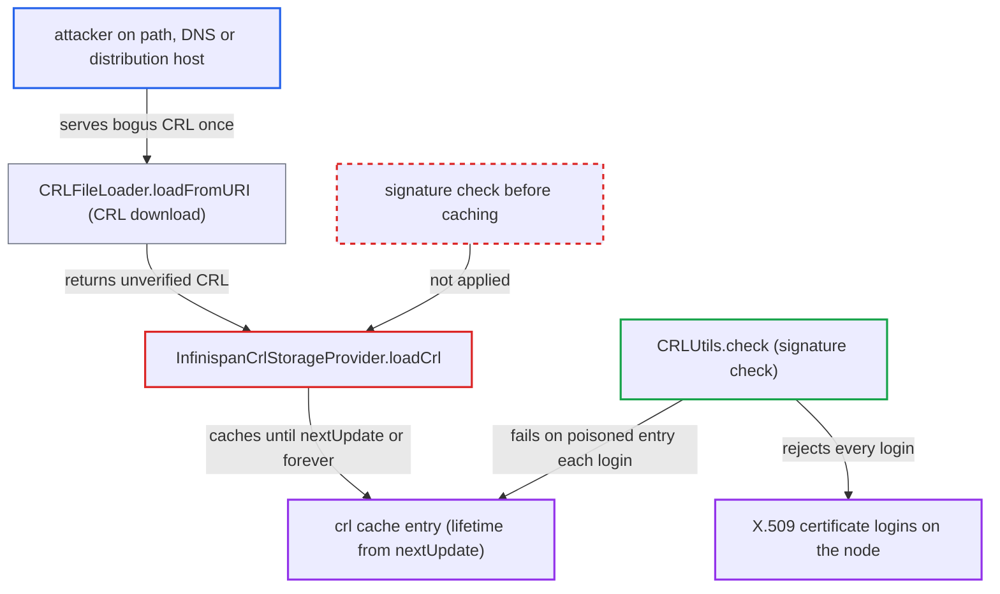

# CRL cache stores unverified CRL for attacker-chosen lifetime, enabling persistent X.509 login denial

| Field | Value |
|---|---|
| ID | `find_01V4oweaUPZi6FtAx4RpBT3h` |
| Severity | **High** |
| Status | open |
| CWE | CWE-349 — Cache poisoning |
| Created | 2026-10-27T21:51:57.855228Z |
| Claude Security | https://claude.ai/security/findings/find_01V4oweaUPZi6FtAx4RpBT3h |

## Description

Someone who can alter a single CRL download can make X.509 certificate login fail on a Keycloak node until an administrator clears the cache or restarts the node. A forged CRL cannot grant access, so only availability of certificate login and the cached revocation data are affected. The attacker needs an on-path position, DNS control or a compromised distribution host for one fetch. `InfinispanCrlStorageProvider.loadCrl` caches the CRL unverified and takes its lifetime from the CRL's own `nextUpdate`.

1. **attacker** answers one CRL download with a bogus CRL. The loader fetches the CRL over whatever scheme the configured path or the certificate's distribution point names, typically plain `http://`, so an on-path attacker, DNS control or a compromised host can alter the response. ([`services/src/main/java/org/keycloak/authentication/authenticators/x509/CertificateValidator.java:340-400`](https://github.com/cx-benchmark/keycloak/blob/1d7be35d0764060a8143fc74b0aabf2442743be4/services/src/main/java/org/keycloak/authentication/authenticators/x509/CertificateValidator.java#L340-L400))
2. **the method `loadCrl`** stores the downloaded CRL in the `crl` cache without checking its signature. No check that a trusted issuer signed the CRL happens before the `put`. ([`model/infinispan/src/main/java/org/keycloak/crl/infinispan/InfinispanCrlStorageProvider.java:103-118`](https://github.com/cx-benchmark/keycloak/blob/1d7be35d0764060a8143fc74b0aabf2442743be4/model/infinispan/src/main/java/org/keycloak/crl/infinispan/InfinispanCrlStorageProvider.java#L103-L118))
3. **the method `getLifespan`** sets the entry's lifetime from the CRL's own `nextUpdate`. With the default `cacheTime=-1` there is no server-side cap, so a far-future `nextUpdate` keeps the entry for decades, and a missing `nextUpdate` stores it with no expiry. ([`model/infinispan/src/main/java/org/keycloak/crl/infinispan/InfinispanCrlStorageProvider.java:120-137`](https://github.com/cx-benchmark/keycloak/blob/1d7be35d0764060a8143fc74b0aabf2442743be4/model/infinispan/src/main/java/org/keycloak/crl/infinispan/InfinispanCrlStorageProvider.java#L120-L137))
4. **the method `get()`** returns the poisoned cached CRL on every later call. While `nextUpdate` is in the future, `reloadCrl` is never reached, so the CRL is not fetched again. ([`model/infinispan/src/main/java/org/keycloak/crl/infinispan/InfinispanCrlStorageProvider.java:49-59`](https://github.com/cx-benchmark/keycloak/blob/1d7be35d0764060a8143fc74b0aabf2442743be4/model/infinispan/src/main/java/org/keycloak/crl/infinispan/InfinispanCrlStorageProvider.java#L49-L59))
5. **the method `CRLUtils.check`** fails the signature check on each X.509 login and throws `GeneralSecurityException`. This is the first place the signature is verified. `X509ClientCertificateAuthenticator` treats the failure as a certificate validation failure and rejects the login. ([`services/src/main/java/org/keycloak/utils/CRLUtils.java:60-90`](https://github.com/cx-benchmark/keycloak/blob/1d7be35d0764060a8143fc74b0aabf2442743be4/services/src/main/java/org/keycloak/utils/CRLUtils.java#L60-L90))

## Assessment

The attacker needs no Keycloak account or privileges and no victim action. They must be on the network path between Keycloak and the CRL distribution point, or control that host or its DNS, for one fetch. The fetch happens when the cache is empty or expired and a legitimate X.509 login triggers `loadFromURI`. Alternatively, the attacker alters the response the loader gets from the configured path or the certificate's distribution point. The `crl` cache is local to each node, so every node is poisoned separately.

Impact: Every X.509 login on the poisoned node that uses that CRL path is rejected, until an administrator calls the admin `clear-crl-cache` endpoint or restarts the node. The cached revocation data is also replaced with the attacker's. A forged CRL cannot grant access or disclose data, because the signature check still runs on each login.

## Recommendation

(1) The CRL cache accepts unauthenticated network content into a trusted store and lets that content set its own retention, so a one-time interception persists.

Fix criteria: A CRL is cached only after its signature is verified against a trusted issuer (the CA chain or truststore). At minimum, an unverified CRL's retention is bounded by a short server-side maximum that ignores `nextUpdate`. Serving a forged CRL once does not make X.509 logins fail beyond the next refresh interval. A CRL without `nextUpdate` is not cached indefinitely.

(2) When `CRLUtils.check` fails verification, it does not evict or refresh the cache entry, so the bad entry is reused on every login.

Fix criteria: A cached CRL that fails signature verification has its cache entry invalidated, subject to `minTimeBetweenRequests`. After one failed check, the next login triggers a reload from the configured source.

## Evidence

**https://github.com/cx-benchmark/keycloak**

- [`model/infinispan/src/main/java/org/keycloak/crl/infinispan/InfinispanCrlStorageProvider.java:103-118`](https://github.com/cx-benchmark/keycloak/blob/1d7be35d0764060a8143fc74b0aabf2442743be4/model/infinispan/src/main/java/org/keycloak/crl/infinispan/InfinispanCrlStorageProvider.java#L103-L118)
- [`model/infinispan/src/main/java/org/keycloak/crl/infinispan/InfinispanCrlStorageProvider.java:120-137`](https://github.com/cx-benchmark/keycloak/blob/1d7be35d0764060a8143fc74b0aabf2442743be4/model/infinispan/src/main/java/org/keycloak/crl/infinispan/InfinispanCrlStorageProvider.java#L120-L137)
- [`model/infinispan/src/main/java/org/keycloak/crl/infinispan/InfinispanCrlStorageProvider.java:49-59`](https://github.com/cx-benchmark/keycloak/blob/1d7be35d0764060a8143fc74b0aabf2442743be4/model/infinispan/src/main/java/org/keycloak/crl/infinispan/InfinispanCrlStorageProvider.java#L49-L59)
- [`services/src/main/java/org/keycloak/authentication/authenticators/x509/CertificateValidator.java:340-400`](https://github.com/cx-benchmark/keycloak/blob/1d7be35d0764060a8143fc74b0aabf2442743be4/services/src/main/java/org/keycloak/authentication/authenticators/x509/CertificateValidator.java#L340-L400)
- [`services/src/main/java/org/keycloak/utils/CRLUtils.java:60-90`](https://github.com/cx-benchmark/keycloak/blob/1d7be35d0764060a8143fc74b0aabf2442743be4/services/src/main/java/org/keycloak/utils/CRLUtils.java#L60-L90)

