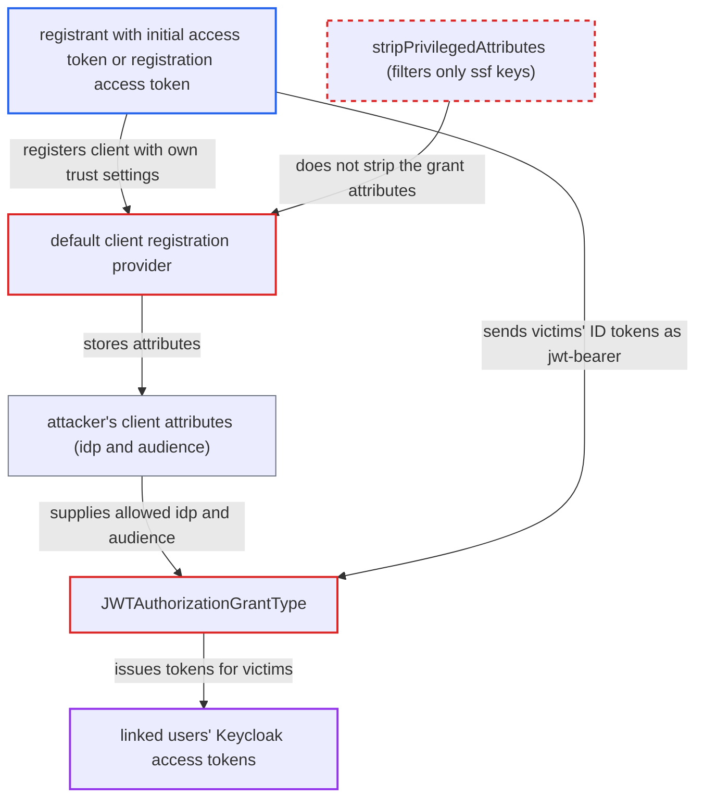

# DCR registrant can self-assign JWT authorization grant IdPs and accepted assertion audience

| Field | Value |
|---|---|
| ID | `find_01KyuDXHcrFG6JxGAKFkpQVC` |
| Severity | **High** |
| Status | open |
| CWE | CWE-285 — Improper Authorization |
| Created | 2026-10-27T21:50:53.071679Z |
| Claude Security | https://claude.ai/security/findings/find_01KyuDXHcrFG6JxGAKFkpQVC |

## Description

A client registrant can get Keycloak access tokens for other users' accounts, including admin accounts if the admin is linked to the identity provider. The attacker needs an initial access token or a registered client's registration access token, and the realm needs an identity provider with the JWT authorization grant enabled and linked users. The cause is that `stripPrivilegedAttributes` removes only `ssf.*` keys, so registrants can set `oauth2.jwt.authorization.grant.idp` and `oauth2.jwt.authorization.grant.audience` on their own client.

1. **attacker** registers a confidential client through `/clients-registrations/default`. The request sets `oauth2.jwt.authorization.grant.enabled=true`, `oauth2.jwt.authorization.grant.idp` to the provider alias, and `oauth2.jwt.authorization.grant.audience` to an audience the attacker controls, such as the attacker's own Google client id. ([`services/src/main/java/org/keycloak/services/clientregistration/DefaultClientRegistrationProvider.java:56-85`](https://github.com/cx-benchmark/keycloak/blob/1d7be35d0764060a8143fc74b0aabf2442743be4/services/src/main/java/org/keycloak/services/clientregistration/DefaultClientRegistrationProvider.java#L56-L85))
2. **`stripPrivilegedAttributes`** lets the trust attributes through. For initial-access-token, registration-access-token and anonymous callers it removes only `ssf.*` keys, so the three `oauth2.jwt.authorization.grant.*` attributes are kept. ([`services/src/main/java/org/keycloak/services/clientregistration/AbstractClientRegistrationProvider.java:409-418`](https://github.com/cx-benchmark/keycloak/blob/1d7be35d0764060a8143fc74b0aabf2442743be4/services/src/main/java/org/keycloak/services/clientregistration/AbstractClientRegistrationProvider.java#L409-L418))
3. **`RepresentationToModel.updateClientProperties`** saves the caller's attributes on the client. Every attribute except `realm_client` is written to the client model. ([`server-spi-private/src/main/java/org/keycloak/models/utils/RepresentationToModel.java:593-600`](https://github.com/cx-benchmark/keycloak/blob/1d7be35d0764060a8143fc74b0aabf2442743be4/server-spi-private/src/main/java/org/keycloak/models/utils/RepresentationToModel.java#L593-L600))
4. **victim** signs in with Google on the attacker's own site. The Google ID token is issued for the attacker's audience, and the attacker's site receives it.
5. **attacker** sends each ID token to Keycloak with `grant_type=jwt-bearer`. `JWTAuthorizationGrantType` reads the allowed providers and the accepted audience from the client's own attributes, and the custom audience replaces the provider's own accepted audience. ([`services/src/main/java/org/keycloak/protocol/oidc/grants/JWTAuthorizationGrantType.java:180-185`](https://github.com/cx-benchmark/keycloak/blob/1d7be35d0764060a8143fc74b0aabf2442743be4/services/src/main/java/org/keycloak/protocol/oidc/grants/JWTAuthorizationGrantType.java#L180-L185))
6. **`OIDCIdentityProvider.validateAuthorizationGrantAssertion`** accepts the token after checking only the provider signature. It copies `sub` and does not check anything else, so the audience is the only link between the assertion and Keycloak. ([`services/src/main/java/org/keycloak/broker/oidc/OIDCIdentityProvider.java:1092-1110`](https://github.com/cx-benchmark/keycloak/blob/1d7be35d0764060a8143fc74b0aabf2442743be4/services/src/main/java/org/keycloak/broker/oidc/OIDCIdentityProvider.java#L1092-L1110))
7. **`JWTAuthorizationGrantType`** issues an access token for the linked realm user to the attacker's client. The user is found by federated identity `(alias, sub)`, and consent is checked only if the client requires it. ([`services/src/main/java/org/keycloak/protocol/oidc/grants/JWTAuthorizationGrantType.java:146-201`](https://github.com/cx-benchmark/keycloak/blob/1d7be35d0764060a8143fc74b0aabf2442743be4/services/src/main/java/org/keycloak/protocol/oidc/grants/JWTAuthorizationGrantType.java#L146-L201))

## Assessment

The attacker holds an initial access token (for example a client developer, or a malicious or compromised client app) or the registration access token of any registered client. The realm has a Google or OIDC identity provider with the JWT authorization grant enabled and users linked to it. The attacker registers a confidential client with the grant enabled, the provider alias, and an audience mapping that names the attacker's own Google client id. Victims then use 'Sign in with Google' on the attacker's site. For Google, `GoogleIdentityProvider.isAssertionReuseAllowed` returns `true` and the maximum assertion age defaults to 3600 s, so no `jti` is needed and an ID token stays redeemable for an hour. The hosted-domain check runs only in `validateToken`, which this path does not call. Another way to enable the grant is the OIDC endpoint, where `DescriptionConverter` sets the enable flag from `grant_types`.

Impact: The attacker's client gets access tokens for other users' accounts. Those users never log in to Keycloak or authorize that client, and Keycloak's own login flow, including MFA and conditional steps, is bypassed. The tokens carry the victim's realm and client roles, including a linked admin's admin roles. They work against the Account API and any service that trusts the realm. No refresh token is issued.

## Recommendation

(1) The admin-only trust settings `oauth2.jwt.authorization.grant.idp` and `oauth2.jwt.authorization.grant.audience` are stored as ordinary client attributes. The client registration service lets non-admin registrants write them, because `stripPrivilegedAttributes` filters only `ssf.*`.

Fix criteria: Registrations and updates made with an initial access token, a registration access token or anonymously cannot create or change `oauth2.jwt.authorization.grant.idp` or `oauth2.jwt.authorization.grant.audience`. To check, register through `/clients-registrations/default` with these attributes and confirm the stored client lacks them. A jwt-bearer request with a foreign-audience assertion must then fail with 'Identity Provider is not allowed for the client' or 'Invalid token audience'.

(2) A client's custom audience mapping replaces the provider's accepted audience instead of narrowing it. Whoever controls the client attribute therefore decides which third-party tokens count as proof of a user's identity.

Fix criteria: Accepting an assertion audience other than the provider's own (issuer/token endpoint or configured IdP client id) needs explicit admin configuration that a client registrant cannot reach. A client created through client registration must not be able to redeem an ID token whose `aud` is not one the admin configured.

## Evidence

**https://github.com/cx-benchmark/keycloak**

- [`services/src/main/java/org/keycloak/services/clientregistration/AbstractClientRegistrationProvider.java:409-418`](https://github.com/cx-benchmark/keycloak/blob/1d7be35d0764060a8143fc74b0aabf2442743be4/services/src/main/java/org/keycloak/services/clientregistration/AbstractClientRegistrationProvider.java#L409-L418)
- [`services/src/main/java/org/keycloak/services/clientregistration/DefaultClientRegistrationProvider.java:56-85`](https://github.com/cx-benchmark/keycloak/blob/1d7be35d0764060a8143fc74b0aabf2442743be4/services/src/main/java/org/keycloak/services/clientregistration/DefaultClientRegistrationProvider.java#L56-L85)
- [`server-spi-private/src/main/java/org/keycloak/models/utils/RepresentationToModel.java:593-600`](https://github.com/cx-benchmark/keycloak/blob/1d7be35d0764060a8143fc74b0aabf2442743be4/server-spi-private/src/main/java/org/keycloak/models/utils/RepresentationToModel.java#L593-L600)
- [`services/src/main/java/org/keycloak/protocol/oidc/grants/JWTAuthorizationGrantType.java:180-185`](https://github.com/cx-benchmark/keycloak/blob/1d7be35d0764060a8143fc74b0aabf2442743be4/services/src/main/java/org/keycloak/protocol/oidc/grants/JWTAuthorizationGrantType.java#L180-L185)
- [`services/src/main/java/org/keycloak/protocol/oidc/grants/JWTAuthorizationGrantType.java:125-128`](https://github.com/cx-benchmark/keycloak/blob/1d7be35d0764060a8143fc74b0aabf2442743be4/services/src/main/java/org/keycloak/protocol/oidc/grants/JWTAuthorizationGrantType.java#L125-L128)
- [`services/src/main/java/org/keycloak/protocol/oidc/grants/JWTAuthorizationGrantType.java:146-201`](https://github.com/cx-benchmark/keycloak/blob/1d7be35d0764060a8143fc74b0aabf2442743be4/services/src/main/java/org/keycloak/protocol/oidc/grants/JWTAuthorizationGrantType.java#L146-L201)
- [`services/src/main/java/org/keycloak/protocol/oidc/grants/DefaultJWTAuthorizationGrantValidator.java:52-60`](https://github.com/cx-benchmark/keycloak/blob/1d7be35d0764060a8143fc74b0aabf2442743be4/services/src/main/java/org/keycloak/protocol/oidc/grants/DefaultJWTAuthorizationGrantValidator.java#L52-L60)
- [`services/src/main/java/org/keycloak/broker/oidc/OIDCIdentityProvider.java:1092-1110`](https://github.com/cx-benchmark/keycloak/blob/1d7be35d0764060a8143fc74b0aabf2442743be4/services/src/main/java/org/keycloak/broker/oidc/OIDCIdentityProvider.java#L1092-L1110)
- [`services/src/main/java/org/keycloak/social/google/GoogleIdentityProvider.java:146-148`](https://github.com/cx-benchmark/keycloak/blob/1d7be35d0764060a8143fc74b0aabf2442743be4/services/src/main/java/org/keycloak/social/google/GoogleIdentityProvider.java#L146-L148)
- [`services/src/main/java/org/keycloak/services/clientregistration/oidc/DescriptionConverter.java:124`](https://github.com/cx-benchmark/keycloak/blob/1d7be35d0764060a8143fc74b0aabf2442743be4/services/src/main/java/org/keycloak/services/clientregistration/oidc/DescriptionConverter.java#L124)

