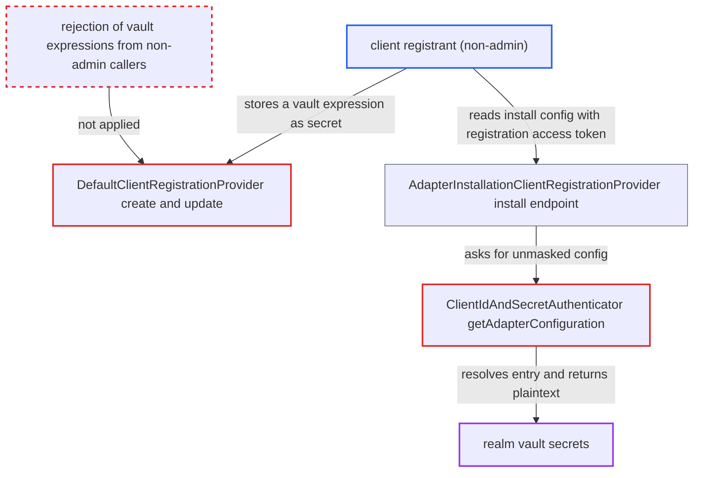

# DCR registrant reads realm vault secrets via vault-expression client secret and install endpoint

| Field | Value |
|---|---|
| ID | `find_01RTpA7LhnmTeBDRG3Gkrhdn` |
| Severity | **High** |
| Status | open |
| CWE | CWE-201 — Information exposure |
| Created | 2026-10-27T22:57:27.081863Z |
| Claude Security | https://claude.ai/security/findings/find_01RTpA7LhnmTeBDRG3Gkrhdn |

## Description

A client registrant who is not an administrator can read the realm's vault secrets in plaintext. These include the LDAP bind credential, the SMTP password, brokered IdP secrets and other clients' vault-backed secrets. The attacker needs an initial access token or a client's registration access token, and a vault provider (`--vault=file|keystore`) must be configured. The cause is that the `default` provider stores a `${vault.<key>}` client secret unchecked, and the `install` endpoint then returns it resolved and unmasked.

1. **registrant** sends a create or update request with a vault expression as the client secret. The body is `{"clientId":"x","secret":"${vault.<key>}"}`, sent to `/realms/{r}/clients-registrations/default[/x]` with an initial access token (create) or a registration access token (update). ([`services/src/main/java/org/keycloak/services/clientregistration/DefaultClientRegistrationProvider.java:56-85`](https://github.com/cx-benchmark/keycloak/blob/1d7be35d0764060a8143fc74b0aabf2442743be4/services/src/main/java/org/keycloak/services/clientregistration/DefaultClientRegistrationProvider.java#L56-L85))
2. **`RepresentationToModel.determineNewSecret`** stores the supplied secret verbatim. It saves `rep.getSecret()` for a confidential client, and `stripPrivilegedAttributes` removes only `ssf.*` attributes, so the expression is kept. ([`server-spi-private/src/main/java/org/keycloak/models/utils/RepresentationToModel.java:634-651`](https://github.com/cx-benchmark/keycloak/blob/1d7be35d0764060a8143fc74b0aabf2442743be4/server-spi-private/src/main/java/org/keycloak/models/utils/RepresentationToModel.java#L634-L651))
3. **registrant** requests the installation config of the client with its registration access token. The registrant sends GET to `/realms/{r}/clients-registrations/install/x`, and `requireView` accepts the token whose `jti` matches `client.getRegistrationToken()`, so no admin role is needed. ([`services/src/main/java/org/keycloak/services/clientregistration/ClientRegistrationAuth.java:206-254`](https://github.com/cx-benchmark/keycloak/blob/1d7be35d0764060a8143fc74b0aabf2442743be4/services/src/main/java/org/keycloak/services/clientregistration/ClientRegistrationAuth.java#L206-L254))
4. **the provider `AdapterInstallationClientRegistrationProvider`** asks for the installation representation with secrets included. `isViewOnly()` is false for a registration access token, so `toInstallationRepresentation` is called with `includeSecrets` set to true. ([`services/src/main/java/org/keycloak/services/clientregistration/AdapterInstallationClientRegistrationProvider.java:54-68`](https://github.com/cx-benchmark/keycloak/blob/1d7be35d0764060a8143fc74b0aabf2442743be4/services/src/main/java/org/keycloak/services/clientregistration/AdapterInstallationClientRegistrationProvider.java#L54-L68))
5. **`ClientInstallationUtils.getClientCredentialsAdapterConfig`** returns the authenticator's adapter configuration without masking. Masking through `getAdapterConfigurationSecretKeys` happens only when `includeSecrets` is false. ([`services/src/main/java/org/keycloak/services/managers/ClientInstallationUtils.java:38-46`](https://github.com/cx-benchmark/keycloak/blob/1d7be35d0764060a8143fc74b0aabf2442743be4/services/src/main/java/org/keycloak/services/managers/ClientInstallationUtils.java#L38-L46))
6. **`ClientIdAndSecretAuthenticator.getAdapterConfiguration`** resolves the stored expression through the vault and puts the plaintext under `secret`. If the vault has no such entry, the raw `${vault.<key>}` string comes back, which lets the attacker test which key names exist. ([`services/src/main/java/org/keycloak/authentication/authenticators/client/ClientIdAndSecretAuthenticator.java:204-210`](https://github.com/cx-benchmark/keycloak/blob/1d7be35d0764060a8143fc74b0aabf2442743be4/services/src/main/java/org/keycloak/authentication/authenticators/client/ClientIdAndSecretAuthenticator.java#L204-L210))

## Assessment

The attacker is a client registrant, not an administrator. It holds an initial access token issued for self-registration, or the registration access token of its own client. It first stores a `${vault.<key>}` expression as the client secret through the `default` provider, using a POST or PUT on `/realms/{r}/clients-registrations/default[/x]`. It then reads the install endpoint with the registration access token. The deprecated `default` and `install` providers are registered and no shipped config disables them. A vault provider must be configured, or no data is returned. Under the default `REALM_UNDERSCORE_KEY` resolver, every vault entry of the realm can be addressed. The same unmasked resolution applies to the `client-secret-jwt` authenticator (`JWTClientSecretAuthenticator`), which returns the plaintext under `secret-jwt.secret`.

Impact: The attacker reads any entry in the realm's vault namespace in plaintext. Examples are the LDAP bind credential, the SMTP password, brokered IdP client secrets and other clients' vault-backed OIDC secrets. With the last of these it can authenticate as those clients at the token endpoint. With the default `REALM_UNDERSCORE_KEY` resolver, the reach is limited to the realm's own keys. Availability is not affected.

Subsequent-system impact: The disclosed values are credentials Keycloak holds for outside systems: the LDAP federation bind account, the SMTP account and the realm's client credentials at external IdPs. With them the attacker can authenticate to those systems as Keycloak and read the directory. It can also act wherever those accounts are allowed to write.

## Recommendation

(1) `ClientIdAndSecretAuthenticator.getAdapterConfiguration` and `JWTClientSecretAuthenticator.getAdapterConfiguration` resolve a `${vault.*}` client secret. The `install` endpoint returns that result unmasked to any registration-access-token caller, so a stored reference becomes a way to read the realm vault.

Fix criteria: Adapter configuration returned to any caller never contains a vault-resolved value. A vault-backed secret appears as its placeholder or is masked. To verify, create a vault entry for key `k` and set a client's secret to `${vault.k}`. Then GET `clients-registrations/install/{clientId}` with the client's registration access token. The response must not contain the entry's plaintext.

(2) The `default` provider stores any `secret` string supplied by an initial-access-token, registration-access-token or anonymous caller, on create and update. An untrusted registrant can therefore point a client at arbitrary realm vault keys, although the project treats vault references as admin-only elsewhere (`StreamService.java:774-788`).

Fix criteria: Registration requests from non-admin callers that put vault expression syntax in `secret` are rejected, and nothing is stored. The same holds for any other field the server later resolves through the vault. To verify, POST or PUT `clients-registrations/default` with `secret: "${vault.k}"` using an initial access token or a registration access token. The request must return 400, and the client's stored secret must be unchanged.

## Evidence

**https://github.com/cx-benchmark/keycloak**

- [`services/src/main/java/org/keycloak/services/clientregistration/AdapterInstallationClientRegistrationProvider.java:54-68`](https://github.com/cx-benchmark/keycloak/blob/1d7be35d0764060a8143fc74b0aabf2442743be4/services/src/main/java/org/keycloak/services/clientregistration/AdapterInstallationClientRegistrationProvider.java#L54-L68)
- [`services/src/main/java/org/keycloak/authentication/authenticators/client/ClientIdAndSecretAuthenticator.java:204-210`](https://github.com/cx-benchmark/keycloak/blob/1d7be35d0764060a8143fc74b0aabf2442743be4/services/src/main/java/org/keycloak/authentication/authenticators/client/ClientIdAndSecretAuthenticator.java#L204-L210)
- [`services/src/main/java/org/keycloak/services/managers/ClientInstallationUtils.java:38-46`](https://github.com/cx-benchmark/keycloak/blob/1d7be35d0764060a8143fc74b0aabf2442743be4/services/src/main/java/org/keycloak/services/managers/ClientInstallationUtils.java#L38-L46)
- [`services/src/main/java/org/keycloak/services/managers/ClientManager.java:335-355`](https://github.com/cx-benchmark/keycloak/blob/1d7be35d0764060a8143fc74b0aabf2442743be4/services/src/main/java/org/keycloak/services/managers/ClientManager.java#L335-L355)
- [`services/src/main/java/org/keycloak/services/clientregistration/ClientRegistrationAuth.java:156-160`](https://github.com/cx-benchmark/keycloak/blob/1d7be35d0764060a8143fc74b0aabf2442743be4/services/src/main/java/org/keycloak/services/clientregistration/ClientRegistrationAuth.java#L156-L160)
- [`services/src/main/java/org/keycloak/services/clientregistration/ClientRegistrationAuth.java:206-254`](https://github.com/cx-benchmark/keycloak/blob/1d7be35d0764060a8143fc74b0aabf2442743be4/services/src/main/java/org/keycloak/services/clientregistration/ClientRegistrationAuth.java#L206-L254)
- [`services/src/main/java/org/keycloak/services/clientregistration/AbstractClientRegistrationProvider.java:200-261`](https://github.com/cx-benchmark/keycloak/blob/1d7be35d0764060a8143fc74b0aabf2442743be4/services/src/main/java/org/keycloak/services/clientregistration/AbstractClientRegistrationProvider.java#L200-L261)
- [`server-spi-private/src/main/java/org/keycloak/models/utils/RepresentationToModel.java:634-651`](https://github.com/cx-benchmark/keycloak/blob/1d7be35d0764060a8143fc74b0aabf2442743be4/server-spi-private/src/main/java/org/keycloak/models/utils/RepresentationToModel.java#L634-L651)
- [`services/src/main/java/org/keycloak/services/clientregistration/DefaultClientRegistrationProvider.java:56-85`](https://github.com/cx-benchmark/keycloak/blob/1d7be35d0764060a8143fc74b0aabf2442743be4/services/src/main/java/org/keycloak/services/clientregistration/DefaultClientRegistrationProvider.java#L56-L85)
- [`services/src/main/java/org/keycloak/services/clientregistration/ClientRegistrationService.java:49-64`](https://github.com/cx-benchmark/keycloak/blob/1d7be35d0764060a8143fc74b0aabf2442743be4/services/src/main/java/org/keycloak/services/clientregistration/ClientRegistrationService.java#L49-L64)
- [`services/src/main/java/org/keycloak/authentication/authenticators/client/JWTClientSecretAuthenticator.java:152-167`](https://github.com/cx-benchmark/keycloak/blob/1d7be35d0764060a8143fc74b0aabf2442743be4/services/src/main/java/org/keycloak/authentication/authenticators/client/JWTClientSecretAuthenticator.java#L152-L167)
- [`services/src/main/java/org/keycloak/vault/AbstractVaultProviderFactory.java:88-91`](https://github.com/cx-benchmark/keycloak/blob/1d7be35d0764060a8143fc74b0aabf2442743be4/services/src/main/java/org/keycloak/vault/AbstractVaultProviderFactory.java#L88-L91)
- [`ssf/transmitter/src/main/java/org/keycloak/ssf/transmitter/stream/StreamService.java:774-788`](https://github.com/cx-benchmark/keycloak/blob/1d7be35d0764060a8143fc74b0aabf2442743be4/ssf/transmitter/src/main/java/org/keycloak/ssf/transmitter/stream/StreamService.java#L774-L788)

