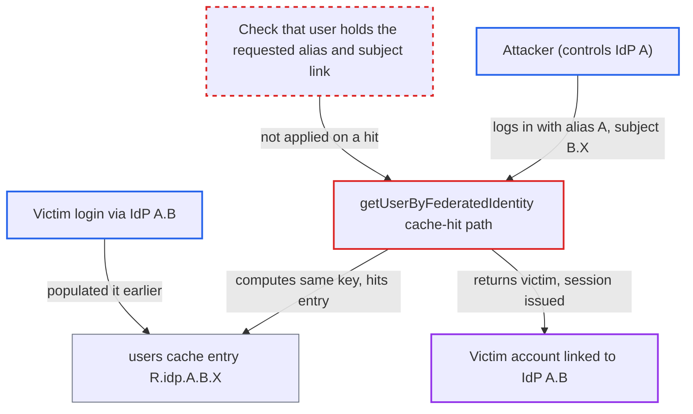

# Federated identity cache key collision lets one IdP's subject resolve to another IdP's linked user

| Field | Value |
|---|---|
| ID | `find_01JzEb69vaUXr5jBSDe4bBy1` |
| Severity | **High** |
| Status | open |
| CWE | CWE-694 — Duplicate identifier |
| Created | 2026-10-27T21:45:31.402706Z |
| Claude Security | https://claude.ai/security/findings/find_01JzEb69vaUXr5jBSDe4bBy1 |

## Description

An attacker who controls an external identity provider can sign in to Keycloak as a user who is linked to a different identity provider. This needs a realm that has two IdP aliases such that one is the other plus a dot-separated part, for example `A` and `A.B`. The cache key built in `UserCacheSession` is not escaped, so two different (alias, subject) pairs can share a key. On a cache hit, `getUserByFederatedIdentity` returns the cached user without checking that the user holds the requested link.

1. **Realm configuration** allows IdP aliases that contain a dot. Alias validation only rejects whitespace and RFC 3986 reserved characters, so a realm can have both an IdP `A` and an IdP `A.B`. ([`server-spi-private/src/main/java/org/keycloak/utils/ReservedCharValidator.java:36-63`](https://github.com/cx-benchmark/keycloak/blob/1d7be35d0764060a8143fc74b0aabf2442743be4/server-spi-private/src/main/java/org/keycloak/utils/ReservedCharValidator.java#L36-L63))
2. **Victim** logs in through IdP `A.B` with subject `X`, which caches the lookup. The cache key is realm id, alias and subject joined with `.` and no escaping, so the key is `R.idp.A.B.X`. ([`model/infinispan/src/main/java/org/keycloak/models/cache/infinispan/UserCacheSession.java:262-268`](https://github.com/cx-benchmark/keycloak/blob/1d7be35d0764060a8143fc74b0aabf2442743be4/model/infinispan/src/main/java/org/keycloak/models/cache/infinispan/UserCacheSession.java#L262-L268))
3. **Attacker** logs in through IdP `A` and asserts the subject `B.X`. The external IdP chooses the subject, and `IdentityBrokerService` passes it, with the alias, to the cached `getUserByFederatedIdentity`. ([`services/src/main/java/org/keycloak/services/resources/IdentityBrokerService.java:748-757`](https://github.com/cx-benchmark/keycloak/blob/1d7be35d0764060a8143fc74b0aabf2442743be4/services/src/main/java/org/keycloak/services/resources/IdentityBrokerService.java#L748-L757))
4. **the cache lookup in `UserCacheSession`** builds the key `R.idp.A.B.X` for the attacker's login and finds the victim's entry. Alias `A` with subject `B.X` gives the same string as alias `A.B` with subject `X`. ([`model/infinispan/src/main/java/org/keycloak/models/cache/infinispan/UserCacheSession.java:262-268`](https://github.com/cx-benchmark/keycloak/blob/1d7be35d0764060a8143fc74b0aabf2442743be4/model/infinispan/src/main/java/org/keycloak/models/cache/infinispan/UserCacheSession.java#L262-L268))
5. **`getUserByFederatedIdentity`** returns the cached user without checking the link. On a hit it only calls `getUserById` with the stored user id. It never checks that the user is linked to the requested alias and subject, and the alias kept in `FederatedIdentityUserListQuery` is used only for invalidation. The username and email lookups do re-check the cached user. ([`model/infinispan/src/main/java/org/keycloak/models/cache/infinispan/UserCacheSession.java:501-540`](https://github.com/cx-benchmark/keycloak/blob/1d7be35d0764060a8143fc74b0aabf2442743be4/model/infinispan/src/main/java/org/keycloak/models/cache/infinispan/UserCacheSession.java#L501-L540))
6. **`IdentityBrokerService.authenticated`** signs the attacker in as the victim. Only `validateUser` (enabled and brute-force checks) runs before `setAuthenticatedUser`, so first-broker-login and account linking are skipped. ([`services/src/main/java/org/keycloak/services/resources/IdentityBrokerService.java:845-854`](https://github.com/cx-benchmark/keycloak/blob/1d7be35d0764060a8143fc74b0aabf2442743be4/services/src/main/java/org/keycloak/services/resources/IdentityBrokerService.java#L845-L854))
7. **`updateFederatedIdentity`** finds no link for alias `A` on the victim and carries on. With the default settings (token storage off, sync mode not FORCE) the null link is never dereferenced, so the login completes. ([`services/src/main/java/org/keycloak/services/resources/IdentityBrokerService.java:1330-1347`](https://github.com/cx-benchmark/keycloak/blob/1d7be35d0764060a8143fc74b0aabf2442743be4/services/src/main/java/org/keycloak/services/resources/IdentityBrokerService.java#L1330-L1347))

## Assessment

The attacker controls an external IdP `A`, or holds an account there with a subject they can choose. The realm must also have an IdP `A.B`, and the victim's lookup through `A.B` must already be in the `users` cache. The attacker then logs in at `A` asserting the subject `B.X`, where `X` is the victim's subject at `A.B`. Cached entries for local users do not expire (`getLifespan` returns -1), so a warm entry stays usable until it is evicted or invalidated. The collision also works the other way: if a link the attacker controls is cached first, the victim is signed into the attacker's account. `JWTAuthorizationGrantType.lookupUserByFederatedIdentity` (line 212) calls the same cached lookup, so it is a second way in.

Impact: The attacker gets a full Keycloak session and tokens for an account linked only to the other IdP. They can read the victim's data and act as the victim toward every client. Reach is limited to users linked to IdPs whose alias or subject can collide, and to entries already in the cache. Availability is not affected.

## Recommendation

(1) The federated-identity cache key is built by joining realm id, IdP alias and external subject with `.`. Both the alias and the subject can contain `.`, so different pairs produce the same key in the shared `users` cache.

Fix criteria: Cache keys for federated-identity lookups are unique for each (realmId, alias, socialUserId). This can be done with a separator that cannot appear in either part, with length-prefixing or escaping, or by keying on the IdP internal id instead of the alias. `getUserByFederatedIdentityCacheKey(R, "A", "B.X")` and `getUserByFederatedIdentityCacheKey(R, "A.B", "X")` return different keys.

(2) On a cache hit, `getUserByFederatedIdentity` trusts the stored user id and returns the user without confirming that the user holds the requested federated link. Any key confusion can therefore be exploited directly.

Fix criteria: On a cache hit, the cached entry's identity provider alias and subject are confirmed to equal the requested ones, or the link is re-validated via `getFederatedIdentity`, before the user is returned. On a mismatch the key is invalidated and the lookup falls back to the delegate. A brokered login with a colliding subject ends in a cache miss or first-broker-login, not in the other provider's user.

## Evidence

**https://github.com/cx-benchmark/keycloak**

- [`model/infinispan/src/main/java/org/keycloak/models/cache/infinispan/UserCacheSession.java:262-268`](https://github.com/cx-benchmark/keycloak/blob/1d7be35d0764060a8143fc74b0aabf2442743be4/model/infinispan/src/main/java/org/keycloak/models/cache/infinispan/UserCacheSession.java#L262-L268)
- [`model/infinispan/src/main/java/org/keycloak/models/cache/infinispan/UserCacheSession.java:501-540`](https://github.com/cx-benchmark/keycloak/blob/1d7be35d0764060a8143fc74b0aabf2442743be4/model/infinispan/src/main/java/org/keycloak/models/cache/infinispan/UserCacheSession.java#L501-L540)
- [`model/infinispan/src/main/java/org/keycloak/models/cache/infinispan/UserCacheSession.java:316-331`](https://github.com/cx-benchmark/keycloak/blob/1d7be35d0764060a8143fc74b0aabf2442743be4/model/infinispan/src/main/java/org/keycloak/models/cache/infinispan/UserCacheSession.java#L316-L331)
- [`services/src/main/java/org/keycloak/services/resources/IdentityBrokerService.java:748-757`](https://github.com/cx-benchmark/keycloak/blob/1d7be35d0764060a8143fc74b0aabf2442743be4/services/src/main/java/org/keycloak/services/resources/IdentityBrokerService.java#L748-L757)
- [`services/src/main/java/org/keycloak/services/resources/IdentityBrokerService.java:845-854`](https://github.com/cx-benchmark/keycloak/blob/1d7be35d0764060a8143fc74b0aabf2442743be4/services/src/main/java/org/keycloak/services/resources/IdentityBrokerService.java#L845-L854)
- [`services/src/main/java/org/keycloak/services/resources/IdentityBrokerService.java:1330-1347`](https://github.com/cx-benchmark/keycloak/blob/1d7be35d0764060a8143fc74b0aabf2442743be4/services/src/main/java/org/keycloak/services/resources/IdentityBrokerService.java#L1330-L1347)
- [`server-spi-private/src/main/java/org/keycloak/utils/ReservedCharValidator.java:36-63`](https://github.com/cx-benchmark/keycloak/blob/1d7be35d0764060a8143fc74b0aabf2442743be4/server-spi-private/src/main/java/org/keycloak/utils/ReservedCharValidator.java#L36-L63)
- [`model/infinispan/src/main/java/org/keycloak/models/cache/infinispan/entities/FederatedIdentityUserListQuery.java:5-17`](https://github.com/cx-benchmark/keycloak/blob/1d7be35d0764060a8143fc74b0aabf2442743be4/model/infinispan/src/main/java/org/keycloak/models/cache/infinispan/entities/FederatedIdentityUserListQuery.java#L5-L17)

