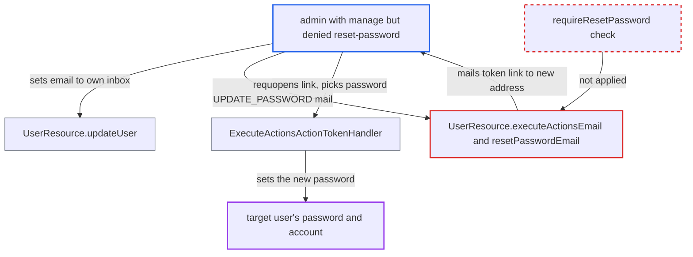

# FGAP admin denied reset-password can still set a user's password via execute-actions e-mail

| Field | Value |
|---|---|
| ID | `find_01Jm8M7GMW9rrmwsKRxtPNKz` |
| Severity | **High** |
| Status | open |
| CWE | CWE-863 — Improper authorization |
| Created | 2026-10-27T21:22:26.769442Z |
| Claude Security | https://claude.ai/security/findings/find_01Jm8M7GMW9rrmwsKRxtPNKz |

## Description

An admin who has `manage` on a user but is denied `reset-password` can still set that user's password. This includes users with higher admin roles, up to a realm administrator. It needs FGAP v2 with a `reset-password` permission that excludes the admin, and SMTP configured. `UserResource.executeActionsEmail` and `resetPasswordEmail` check only `manage` before issuing a password-setting token.

1. **the limited admin** changes the target user's email to an inbox the admin controls. `updateUser` requires only `manage`, and the `requireResetPassword` check runs only when the request carries password credentials. ([`services/src/main/java/org/keycloak/services/resources/admin/UserResource.java:198-241`](https://github.com/cx-benchmark/keycloak/blob/1d7be35d0764060a8143fc74b0aabf2442743be4/services/src/main/java/org/keycloak/services/resources/admin/UserResource.java#L198-L241))
2. **`updateUserFromRep`** sets `emailVerified` from the caller's data. The new address is therefore accepted without any verification. ([`services/src/main/java/org/keycloak/services/resources/admin/UserResource.java:315`](https://github.com/cx-benchmark/keycloak/blob/1d7be35d0764060a8143fc74b0aabf2442743be4/services/src/main/java/org/keycloak/services/resources/admin/UserResource.java#L315))
3. **the limited admin** calls `execute-actions-email` with `UPDATE_PASSWORD`, or calls `reset-password-email`. The deprecated `reset-password-email` endpoint always passes `UPDATE_PASSWORD` to `executeActionsEmail`. ([`services/src/main/java/org/keycloak/services/resources/admin/UserResource.java:1037-1041`](https://github.com/cx-benchmark/keycloak/blob/1d7be35d0764060a8143fc74b0aabf2442743be4/services/src/main/java/org/keycloak/services/resources/admin/UserResource.java#L1037-L1041))
4. **the handler `executeActionsEmail`** issues a signed `ExecuteActionsActionToken` and mails the link to `user.getEmail()`. It checks only `requireManage(user)` and never calls `requireResetPassword(user)`, so the `reset-password` denial is not applied. ([`services/src/main/java/org/keycloak/services/resources/admin/UserResource.java:1074-1104`](https://github.com/cx-benchmark/keycloak/blob/1d7be35d0764060a8143fc74b0aabf2442743be4/services/src/main/java/org/keycloak/services/resources/admin/UserResource.java#L1074-L1104))
5. **`canResetPassword`** is never consulted on this path. An admin can hold `manage` while being denied `reset-password`, but only this check expresses that denial. ([`services/src/main/java/org/keycloak/services/resources/admin/fgap/UserPermissionsV2.java:182-197`](https://github.com/cx-benchmark/keycloak/blob/1d7be35d0764060a8143fc74b0aabf2442743be4/services/src/main/java/org/keycloak/services/resources/admin/fgap/UserPermissionsV2.java#L182-L197))
6. **the limited admin** opens the mailed link. `verifyEmail` compares the token's email with the user's current email. The admin changed that email earlier, so the check passes. ([`services/src/main/java/org/keycloak/authentication/actiontoken/AbstractActionTokenHandler.java:109-114`](https://github.com/cx-benchmark/keycloak/blob/1d7be35d0764060a8143fc74b0aabf2442743be4/services/src/main/java/org/keycloak/authentication/actiontoken/AbstractActionTokenHandler.java#L109-L114))
7. **`ExecuteActionsActionTokenHandler`** runs `UPDATE_PASSWORD` for the token's subject. Whoever opens the link chooses the user's new password. ([`services/src/main/java/org/keycloak/authentication/actiontoken/execactions/ExecuteActionsActionTokenHandler.java:70-126`](https://github.com/cx-benchmark/keycloak/blob/1d7be35d0764060a8143fc74b0aabf2442743be4/services/src/main/java/org/keycloak/authentication/actiontoken/execactions/ExecuteActionsActionTokenHandler.java#L70-L126))

## Assessment

The attacker is a realm admin with FGAP v2 `manage` on a user who is denied `reset-password` on that user. For example, a `reset-password` permission may exist for a help-desk group or as an explicit deny. FGAP v2 must be enabled, and SMTP must be configured. The attacker calls the admin REST API `PUT /admin/realms/{r}/users/{id}` to set `email` to their own inbox. They then call `PUT .../users/{id}/execute-actions-email` with `["UPDATE_PASSWORD"]`, or call `reset-password-email`. Either call gets the link mailed to that inbox.

Impact: The attacker sets a password of their choice for any user they may manage, including users with higher admin roles. They can then log in as that user and get the user's roles, sessions and data. If the target is a realm administrator, the attacker gets full realm control. The victim's old password stops working, so the victim is locked out.

## Recommendation

`UserResource.executeActionsEmail` and `resetPasswordEmail` issue a password-setting `UPDATE_PASSWORD` token after checking only `manage`. The same `manage` grant controls the address the token is mailed to, so the `reset-password` scope is not enforced on this path.

Fix criteria: Issuing an actions email that includes `UPDATE_PASSWORD`, or any other credential-setting action, requires the same permission as `resetPassword`. In an FGAP v2 realm where a `reset-password` permission denies the test admin, `execute-actions-email` with `UPDATE_PASSWORD` returns 403. `reset-password-email` also returns 403 in that realm. No email or token is issued in either case. An admin granted `reset-password` still succeeds.

## Evidence

**https://github.com/cx-benchmark/keycloak**

- [`services/src/main/java/org/keycloak/services/resources/admin/UserResource.java:1074-1104`](https://github.com/cx-benchmark/keycloak/blob/1d7be35d0764060a8143fc74b0aabf2442743be4/services/src/main/java/org/keycloak/services/resources/admin/UserResource.java#L1074-L1104)
- [`services/src/main/java/org/keycloak/services/resources/admin/UserResource.java:1037-1041`](https://github.com/cx-benchmark/keycloak/blob/1d7be35d0764060a8143fc74b0aabf2442743be4/services/src/main/java/org/keycloak/services/resources/admin/UserResource.java#L1037-L1041)
- [`services/src/main/java/org/keycloak/services/resources/admin/UserResource.java:198-241`](https://github.com/cx-benchmark/keycloak/blob/1d7be35d0764060a8143fc74b0aabf2442743be4/services/src/main/java/org/keycloak/services/resources/admin/UserResource.java#L198-L241)
- [`services/src/main/java/org/keycloak/services/resources/admin/UserResource.java:315`](https://github.com/cx-benchmark/keycloak/blob/1d7be35d0764060a8143fc74b0aabf2442743be4/services/src/main/java/org/keycloak/services/resources/admin/UserResource.java#L315)
- [`services/src/main/java/org/keycloak/services/resources/admin/fgap/UserPermissionsV2.java:182-197`](https://github.com/cx-benchmark/keycloak/blob/1d7be35d0764060a8143fc74b0aabf2442743be4/services/src/main/java/org/keycloak/services/resources/admin/fgap/UserPermissionsV2.java#L182-L197)
- [`services/src/main/java/org/keycloak/authentication/actiontoken/execactions/ExecuteActionsActionTokenHandler.java:70-126`](https://github.com/cx-benchmark/keycloak/blob/1d7be35d0764060a8143fc74b0aabf2442743be4/services/src/main/java/org/keycloak/authentication/actiontoken/execactions/ExecuteActionsActionTokenHandler.java#L70-L126)
- [`services/src/main/java/org/keycloak/authentication/actiontoken/AbstractActionTokenHandler.java:109-114`](https://github.com/cx-benchmark/keycloak/blob/1d7be35d0764060a8143fc74b0aabf2442743be4/services/src/main/java/org/keycloak/authentication/actiontoken/AbstractActionTokenHandler.java#L109-L114)
- [`tests/base/src/test/java/org/keycloak/tests/admin/authz/fgap/UserResourceTypeEvaluationTest.java:535-567`](https://github.com/cx-benchmark/keycloak/blob/1d7be35d0764060a8143fc74b0aabf2442743be4/tests/base/src/test/java/org/keycloak/tests/admin/authz/fgap/UserResourceTypeEvaluationTest.java#L535-L567)
- [`docs/documentation/server_admin/topics/admin-console-permissions/fine-grain-v2.adoc:94`](https://github.com/cx-benchmark/keycloak/blob/1d7be35d0764060a8143fc74b0aabf2442743be4/docs/documentation/server_admin/topics/admin-console-permissions/fine-grain-v2.adoc#L94)

