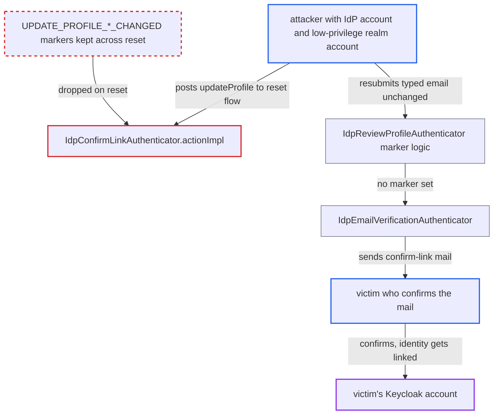

# First-broker-login review markers lost on confirm-link reset, bypassing email-verification guard

| Field | Value |
|---|---|
| ID | `find_01J4cRmAsKRn5gpHakGWa5Wi` |
| Severity | **High** |
| Status | open |
| CWE | CWE-287 — Improper Authentication |
| Created | 2026-10-27T21:29:13.467105Z |
| Claude Security | https://claude.ai/security/findings/find_01J4cRmAsKRn5gpHakGWa5Wi |

## Description

An attacker with an account at a configured identity provider and a low-privilege account in the realm can get a victim's Keycloak account linked to the attacker's external identity, if the victim clicks a genuine confirm-link email. The attacker then logs in as the victim. The flaw is that `IdpConfirmLinkAuthenticator.actionImpl` resets the flow and clears the `UPDATE_PROFILE_EMAIL_CHANGED` and `UPDATE_PROFILE_USERNAME_CHANGED` notes, while keeping the edited email or username.

1. **attacker** logs in through the identity provider and reaches the confirm-link page. This needs an initial duplicate account, for example an existing realm account whose email or username matches the attacker's IdP identity, or `update.profile.on.first.login` set to `on`.
2. **attacker** posts `submitAction=updateProfile` to the confirm-link page. `actionImpl` calls `context.resetFlow(...)`, which clears all auth notes, and re-saves the already modified serialized brokered context together with `ENFORCE_UPDATE_PROFILE`; it also ignores the `hideReviewButton` condition, so a crafted POST works. ([`services/src/main/java/org/keycloak/authentication/authenticators/broker/IdpConfirmLinkAuthenticator.java:76-83`](https://github.com/cx-benchmark/keycloak/blob/1d7be35d0764060a8143fc74b0aabf2442743be4/services/src/main/java/org/keycloak/authentication/authenticators/broker/IdpConfirmLinkAuthenticator.java#L76-L83))
3. **attacker** types the victim's email on the `idp-review-profile` page. The change is recorded in the brokered context and the changed-markers are set at this point.
4. **attacker** reaches the confirm-link page again, repeats the reset, and submits the review page unchanged. The page is pre-filled from the modified context, so `DefaultUserProfile.update` sees no change and sets no marker, although the context still holds the typed email or username. ([`services/src/main/java/org/keycloak/authentication/authenticators/broker/IdpReviewProfileAuthenticator.java:211-227`](https://github.com/cx-benchmark/keycloak/blob/1d7be35d0764060a8143fc74b0aabf2442743be4/services/src/main/java/org/keycloak/authentication/authenticators/broker/IdpReviewProfileAuthenticator.java#L211-L227))
5. **`idp-create-user-if-unique`** selects the victim's account as `EXISTING_USER_INFO`. `checkExistingUser` resolves the duplicate from the email or username in the serialized context, which is now the attacker's typed value. ([`services/src/main/java/org/keycloak/authentication/authenticators/broker/IdpCreateUserIfUniqueAuthenticator.java:158-193`](https://github.com/cx-benchmark/keycloak/blob/1d7be35d0764060a8143fc74b0aabf2442743be4/services/src/main/java/org/keycloak/authentication/authenticators/broker/IdpCreateUserIfUniqueAuthenticator.java#L158-L193))
6. **`idp-email-verification`** sends a genuine Keycloak confirm-linking mail to the victim. The check of the two changed-notes finds neither, so the authenticator goes on to `sendVerifyEmail` to `existingUser.getEmail()`. ([`services/src/main/java/org/keycloak/authentication/authenticators/broker/IdpEmailVerificationAuthenticator.java:87-92`](https://github.com/cx-benchmark/keycloak/blob/1d7be35d0764060a8143fc74b0aabf2442743be4/services/src/main/java/org/keycloak/authentication/authenticators/broker/IdpEmailVerificationAuthenticator.java#L87-L92))
7. **victim** opens the mail and confirms the link. `IdpVerifyAccountLinkActionTokenHandler` sets the proof and `afterFirstBrokerLogin` links the attacker's IdP identity to the victim's account, so the attacker can log in as the victim through that IdP.

## Assessment

The attacker holds an ordinary account at an IdP configured in the realm, plus a low-privilege realm account that produces the first duplicate. Instead of a realm account, `update.profile.on.first.login` set to `on` also gets them to the confirm-link page. Variant A needs the default first-broker-login flow and SMTP configured, and the victim must open the mail and click confirm. Variant B needs an IdP with `trustEmail=true`. The attacker creates a new account with a typed email that the IdP never asserted. Both are reached over the internet through broker callbacks and login forms.

Impact: In variant A, the attacker is linked to the victim's account and can log in as the victim, with all of that account's data and actions. This needs the victim to confirm. In variant B, a new account is saved with `emailVerified=true` for an email the IdP never asserted. The report says there is no availability impact.

## Recommendation

(1) `IdpConfirmLinkAuthenticator.actionImpl` resets the flow and drops `UPDATE_PROFILE_EMAIL_CHANGED` and `UPDATE_PROFILE_USERNAME_CHANGED`. It keeps the user-edited brokered context. `IdpReviewProfileAuthenticator` derives the markers from a diff against that edited context, not against the values the IdP asserted.

Fix criteria: After any reset of the first-broker-login flow, `idp-email-verification` and `AbstractIdentityProvider.updateEmail` still know that the email or username differs from what the IdP asserted. For example, keep the original IdP values in the serialized context and compare against them, or carry the markers across the reset. Test: do the reset and re-submit sequence with a typed email. `idp-email-verification` must still be skipped. A newly created user must have `emailVerified=false` even with `trustEmail=true`.

(2) The `updateProfile` action in `IdpConfirmLinkAuthenticator.actionImpl` is accepted regardless of the `hideReviewButton` condition computed in `authenticateImpl`.

Fix criteria: `submitAction=updateProfile` is rejected when the review execution did not succeed earlier in this flow. A crafted POST can then no longer reach the reset path when the UI would not offer it.

## Evidence

**https://github.com/cx-benchmark/keycloak**

- [`services/src/main/java/org/keycloak/authentication/authenticators/broker/IdpConfirmLinkAuthenticator.java:76-83`](https://github.com/cx-benchmark/keycloak/blob/1d7be35d0764060a8143fc74b0aabf2442743be4/services/src/main/java/org/keycloak/authentication/authenticators/broker/IdpConfirmLinkAuthenticator.java#L76-L83)
- [`services/src/main/java/org/keycloak/authentication/authenticators/broker/IdpReviewProfileAuthenticator.java:211-227`](https://github.com/cx-benchmark/keycloak/blob/1d7be35d0764060a8143fc74b0aabf2442743be4/services/src/main/java/org/keycloak/authentication/authenticators/broker/IdpReviewProfileAuthenticator.java#L211-L227)
- [`services/src/main/java/org/keycloak/authentication/authenticators/broker/IdpEmailVerificationAuthenticator.java:87-92`](https://github.com/cx-benchmark/keycloak/blob/1d7be35d0764060a8143fc74b0aabf2442743be4/services/src/main/java/org/keycloak/authentication/authenticators/broker/IdpEmailVerificationAuthenticator.java#L87-L92)
- [`services/src/main/java/org/keycloak/authentication/authenticators/broker/IdpCreateUserIfUniqueAuthenticator.java:158-193`](https://github.com/cx-benchmark/keycloak/blob/1d7be35d0764060a8143fc74b0aabf2442743be4/services/src/main/java/org/keycloak/authentication/authenticators/broker/IdpCreateUserIfUniqueAuthenticator.java#L158-L193)
- [`server-spi-private/src/main/java/org/keycloak/broker/provider/AbstractIdentityProvider.java:217-226`](https://github.com/cx-benchmark/keycloak/blob/1d7be35d0764060a8143fc74b0aabf2442743be4/server-spi-private/src/main/java/org/keycloak/broker/provider/AbstractIdentityProvider.java#L217-L226)

