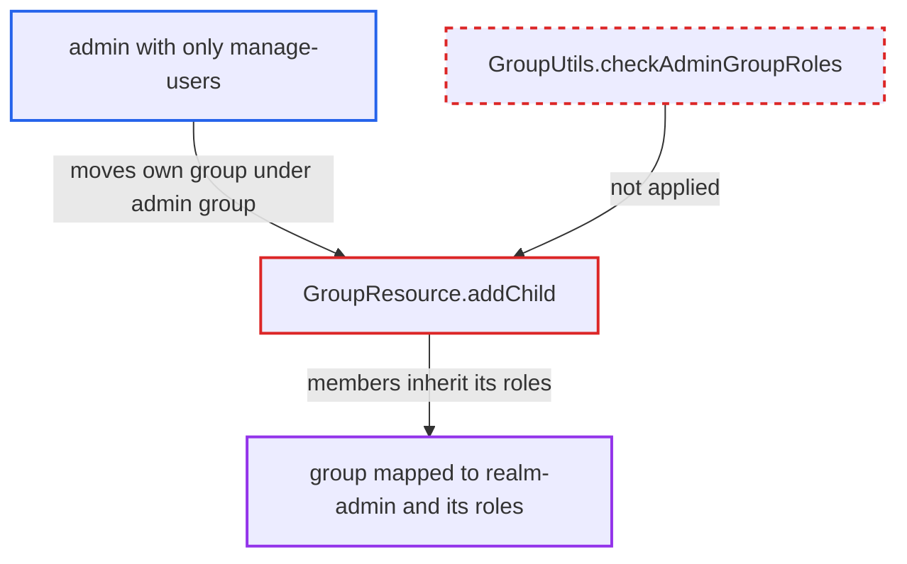

# Group move under admin-role group bypasses admin-role mapping check, lets manage-users admin inherit realm-admin

| Field | Value |
|---|---|
| ID | `find_01VeLASNKMCL5vw5ipuQhrEt` |
| Severity | **High** |
| Status | open |
| CWE | CWE-269 — Privilege escalation |
| Created | 2026-10-27T21:17:25.599512Z |
| Claude Security | https://claude.ai/security/findings/find_01VeLASNKMCL5vw5ipuQhrEt |

## Description

An admin who holds only `manage-users` can give themselves `realm-admin`, or another admin role they lack. They do it by moving a group they belong to under a group that carries that role. The attack needs a group in the realm mapped to an admin role. The cause is `GroupResource.addChild`, which re-parents a group without the admin-role check that `joinGroup` applies.

1. **attacker with `manage-users`** creates a new group X with `POST /groups`. The group is empty and has no roles mapped.
2. **attacker** joins themselves to X with `PUT /users/{self}/groups/{X}`. `joinGroup` calls `GroupUtils.checkAdminGroupRoles`, which passes because X carries no admin roles. ([`services/src/main/java/org/keycloak/services/resources/admin/UserResource.java:1275-1296`](https://github.com/cx-benchmark/keycloak/blob/1d7be35d0764060a8143fc74b0aabf2442743be4/services/src/main/java/org/keycloak/services/resources/admin/UserResource.java#L1275-L1296))
3. **attacker** posts to `/groups/{adminGroupId}/children` with a body containing the `id` of X. Both `requireManage` calls pass, because `manage-users` alone satisfies `canManage(GroupModel)`. ([`services/src/main/java/org/keycloak/services/resources/admin/fgap/GroupPermissions.java:234-276`](https://github.com/cx-benchmark/keycloak/blob/1d7be35d0764060a8143fc74b0aabf2442743be4/services/src/main/java/org/keycloak/services/resources/admin/fgap/GroupPermissions.java#L234-L276))
4. **the handler `addChild`** moves X under the admin group with `realm.moveGroup(child, group)`. It never calls `GroupUtils.checkAdminGroupRoles` on the new parent chain, so the move is accepted. ([`services/src/main/java/org/keycloak/services/resources/admin/GroupResource.java:237-263`](https://github.com/cx-benchmark/keycloak/blob/1d7be35d0764060a8143fc74b0aabf2442743be4/services/src/main/java/org/keycloak/services/resources/admin/GroupResource.java#L237-L263))
5. **`GroupAdapter.hasRole`** treats members of X as holding every role of the new parent chain. It falls back to `parent.hasRole(role)`, so the attacker now inherits the roles of the admin group, such as `realm-admin`. ([`model/jpa/src/main/java/org/keycloak/models/jpa/GroupAdapter.java:344-348`](https://github.com/cx-benchmark/keycloak/blob/1d7be35d0764060a8143fc74b0aabf2442743be4/model/jpa/src/main/java/org/keycloak/models/jpa/GroupAdapter.java#L344-L348))
6. **`AdminAuth`** authorizes the attacker's next admin request as `realm-admin`. It checks `user.hasRole(roleModel)` on the live user model, so the inherited role takes effect immediately. ([`services/src/main/java/org/keycloak/services/resources/admin/AdminAuth.java:81-86`](https://github.com/cx-benchmark/keycloak/blob/1d7be35d0764060a8143fc74b0aabf2442743be4/services/src/main/java/org/keycloak/services/resources/admin/AdminAuth.java#L81-L86))

## Assessment

The attacker is a realm admin who holds only `manage-users`, or who has the fine-grained `manage` permission on two groups, and uses the Admin REST API. At least one group in the realm must be mapped to an admin role the attacker lacks, for example `realm-admin`. The attacker needs no victim action. The calls are creating a group, joining it and posting it as a child of the admin group.

Impact: The attacker gains every role mapped on the target group chain, typically `realm-admin`. That lets them read all users, clients, client secrets and realm configuration. They can also modify or delete or disable realm settings, clients, roles, keys and users. If the admin group is in the master realm and carries master `admin`, every realm is reachable.

## Recommendation

`GroupResource.addChild` re-parents an existing group, so its members get the roles of the new ancestor chain. It does not require the caller to be allowed to map the admin roles on that chain, unlike `joinGroup`, which enforces `GroupUtils.checkAdminGroupRoles`.

Fix criteria: Moving a group under a new parent is refused with 403 unless the caller passes the same admin-role mapping check used on join. The check covers the new parent and its ancestors, including composites. Test: a `manage-users`-only admin creates a group, joins it, and posts it as a child of a group mapped to `realm-admin`. The request returns 403, and the admin is not authorized as `realm-admin` afterwards.

## Evidence

**https://github.com/cx-benchmark/keycloak**

- [`services/src/main/java/org/keycloak/services/resources/admin/GroupResource.java:237-263`](https://github.com/cx-benchmark/keycloak/blob/1d7be35d0764060a8143fc74b0aabf2442743be4/services/src/main/java/org/keycloak/services/resources/admin/GroupResource.java#L237-L263)
- [`services/src/main/java/org/keycloak/services/resources/admin/UserResource.java:1275-1296`](https://github.com/cx-benchmark/keycloak/blob/1d7be35d0764060a8143fc74b0aabf2442743be4/services/src/main/java/org/keycloak/services/resources/admin/UserResource.java#L1275-L1296)
- [`services/src/main/java/org/keycloak/utils/GroupUtils.java:251-273`](https://github.com/cx-benchmark/keycloak/blob/1d7be35d0764060a8143fc74b0aabf2442743be4/services/src/main/java/org/keycloak/utils/GroupUtils.java#L251-L273)
- [`services/src/main/java/org/keycloak/services/resources/admin/fgap/RolePermissions.java:268-282`](https://github.com/cx-benchmark/keycloak/blob/1d7be35d0764060a8143fc74b0aabf2442743be4/services/src/main/java/org/keycloak/services/resources/admin/fgap/RolePermissions.java#L268-L282)
- [`services/src/main/java/org/keycloak/services/resources/admin/fgap/GroupPermissions.java:234-276`](https://github.com/cx-benchmark/keycloak/blob/1d7be35d0764060a8143fc74b0aabf2442743be4/services/src/main/java/org/keycloak/services/resources/admin/fgap/GroupPermissions.java#L234-L276)
- [`model/jpa/src/main/java/org/keycloak/models/jpa/GroupAdapter.java:344-348`](https://github.com/cx-benchmark/keycloak/blob/1d7be35d0764060a8143fc74b0aabf2442743be4/model/jpa/src/main/java/org/keycloak/models/jpa/GroupAdapter.java#L344-L348)
- [`services/src/main/java/org/keycloak/services/resources/admin/AdminAuth.java:81-86`](https://github.com/cx-benchmark/keycloak/blob/1d7be35d0764060a8143fc74b0aabf2442743be4/services/src/main/java/org/keycloak/services/resources/admin/AdminAuth.java#L81-L86)
- [`server-spi/src/main/java/org/keycloak/models/utils/RoleUtils.java:237-247`](https://github.com/cx-benchmark/keycloak/blob/1d7be35d0764060a8143fc74b0aabf2442743be4/server-spi/src/main/java/org/keycloak/models/utils/RoleUtils.java#L237-L247)

