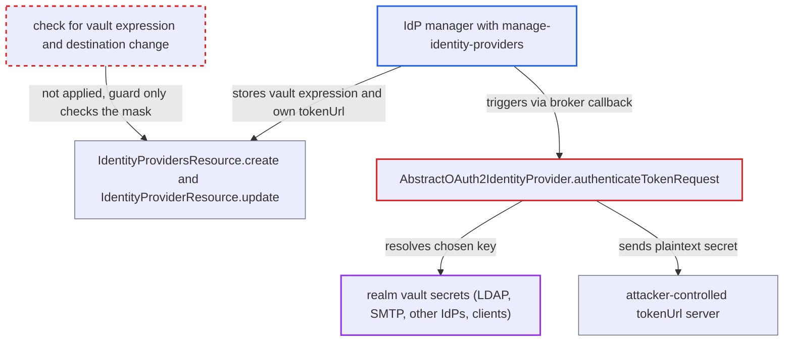

# IdP manager exfiltrates realm vault secrets via ${vault.} client secret and attacker token URL

| Field | Value |
|---|---|
| ID | `find_01ShgojwrUec9ByikmKZhd9B` |
| Severity | **High** |
| Status | open |
| CWE | CWE-862 — Missing Authorization |
| Created | 2026-10-27T23:05:49.889025Z |
| Claude Security | https://claude.ai/security/findings/find_01ShgojwrUec9ByikmKZhd9B |

## Description

An admin who only holds `manage-identity-providers` can steal secrets from the realm's vault in plaintext. These include the LDAP bind credential, the SMTP password and other identity providers' client secrets. It only works when a vault provider is configured. The cause is that `IdentityProvidersResource.create` and `IdentityProviderResource.update` accept a `${vault.<key>}` `clientSecret` together with an attacker-chosen `tokenUrl`, and `authenticateTokenRequest` then sends the resolved value to that URL.

1. **IdP manager** creates or updates an identity provider with a vault expression as secret. The manager sets `clientSecret` to `${vault.<key>}` for any key in the realm's vault and points `tokenUrl` at their own server, and `manage-identity-providers` is the only permission required. ([`services/src/main/java/org/keycloak/services/resources/admin/IdentityProvidersResource.java:311-330`](https://github.com/cx-benchmark/keycloak/blob/1d7be35d0764060a8143fc74b0aabf2442743be4/services/src/main/java/org/keycloak/services/resources/admin/IdentityProvidersResource.java#L311-L330))
2. **IdP manager** re-submits an existing vault expression with a new `tokenUrl` (second route). For an IdP that is already vault-backed, `maskNonVaultValue` returns the expression unmasked, so the manager sends it back unchanged and never meets the guard that only fires on the literal `**********`. ([`server-spi-private/src/main/java/org/keycloak/models/utils/StripSecretsUtils.java:97-104`](https://github.com/cx-benchmark/keycloak/blob/1d7be35d0764060a8143fc74b0aabf2442743be4/server-spi-private/src/main/java/org/keycloak/models/utils/StripSecretsUtils.java#L97-L104))
3. **`RepresentationToModel.toModel`** stores the submitted config as it is. The config map is copied verbatim, and validation checks only URL schemes and SSL requirements, not which vault key is named. ([`server-spi-private/src/main/java/org/keycloak/models/utils/RepresentationToModel.java:1008-1014`](https://github.com/cx-benchmark/keycloak/blob/1d7be35d0764060a8143fc74b0aabf2442743be4/server-spi-private/src/main/java/org/keycloak/models/utils/RepresentationToModel.java#L1008-L1014))
4. **IdP manager** starts a broker login in their own browser. Opening the realm auth endpoint with `kc_idp_hint=<alias>` makes Keycloak redirect to the attacker's URL and hand out a `state` value.
5. **IdP manager** calls the public callback `/realms/{realm}/broker/{alias}/endpoint` with that `state` and any `code`. The callback reaches `authResponse`, which calls `generateTokenRequest` to POST to the admin-supplied `tokenUrl`. ([`services/src/main/java/org/keycloak/broker/oidc/AbstractOAuth2IdentityProvider.java:1097-1143`](https://github.com/cx-benchmark/keycloak/blob/1d7be35d0764060a8143fc74b0aabf2442743be4/services/src/main/java/org/keycloak/broker/oidc/AbstractOAuth2IdentityProvider.java#L1097-L1143))
6. **`authenticateTokenRequest`** resolves the vault expression and sends the plaintext to the attacker's `tokenUrl`. The value goes out as `client_secret` or in a Basic `Authorization` header; if the key does not exist, the literal expression is sent instead. ([`services/src/main/java/org/keycloak/broker/oidc/AbstractOAuth2IdentityProvider.java:934-947`](https://github.com/cx-benchmark/keycloak/blob/1d7be35d0764060a8143fc74b0aabf2442743be4/services/src/main/java/org/keycloak/broker/oidc/AbstractOAuth2IdentityProvider.java#L934-L947))

## Assessment

The attacker is a realm admin who holds `manage-identity-providers` but not `manage-realm`. A vault provider must be configured (`--vault=file|keystore`); without one, the literal expression is sent. With the default `REALM_UNDERSCORE_KEY` resolver, all vault users in a realm share one namespace, so the attacker can name any key. They either create or update an IdP with `clientSecret=${vault.<key>}` and their own `tokenUrl`, or re-submit the unmasked expression of an already vault-backed IdP with a new `tokenUrl`. They then trigger the outbound request through a broker login in their own browser and the public callback. A missing key gives an existence oracle for guessed key names, because the literal expression is sent instead.

Impact: The IdP manager can read, in plaintext, any secret in the administered realm's vault, which `manage-identity-providers` does not normally grant. With a vault-backed client secret, they can also authenticate as that client at the token endpoint, which is a limited integrity effect. Reach is confined to the administered realm by the default resolver, and availability is not affected.

Subsequent-system impact: The stolen values are credentials for external systems. The LDAP bind credential gives the directory access Keycloak has. The SMTP password lets the attacker send mail as the realm. Another IdP's client secret lets the attacker act as the realm's client at that upstream provider. The damage is bounded by what those credentials allow.

## Recommendation

(1) `IdentityProvidersResource.create` and `IdentityProviderResource.update` accept a `${vault.<key>}` `clientSecret` from any `manage-identity-providers` admin. That lets a delegated IdP manager bind an IdP to any realm vault entry and send it to a destination they choose.

Fix criteria: Writing or changing a vault expression in an IdP's `clientSecret` (or any other vault-resolved IdP field) requires a privilege that already owns the realm vault, such as `manage-realm`, or the IdP vault lookup is confined to a namespace other components cannot share. Test: an admin with only `manage-identity-providers` who POSTs or PUTs an IdP with `clientSecret=${vault.x}` gets 403, and the stored config is unchanged.

(2) The masked-secret guard at `IdentityProviderResource.java:227-240` only fires when the submitted secret is the literal `**********`. A vault-backed IdP's secret can therefore be rebound to a new `tokenUrl`, `clientId` or `clientAuthMethod` by re-submitting the unmasked vault expression.

Fix criteria: The destination-change check (`canReuseMaskedClientSecret`) also applies when the submitted `clientSecret` is a vault expression equal to the stored one, or when the stored secret is a vault expression and the submitted value is unchanged. A change of `tokenUrl`, `tokenIntrospectionUrl`, `clientId`, `baseUrl` or `clientAuthMethod` is then rejected unless the caller holds realm-level privilege. Test: an IdP with `clientSecret=${vault.k}` cannot have its `tokenUrl` changed by a `manage-identity-providers` admin while the secret stays vault-bound.

## Evidence

**https://github.com/cx-benchmark/keycloak**

- [`services/src/main/java/org/keycloak/services/resources/admin/IdentityProviderResource.java:227-240`](https://github.com/cx-benchmark/keycloak/blob/1d7be35d0764060a8143fc74b0aabf2442743be4/services/src/main/java/org/keycloak/services/resources/admin/IdentityProviderResource.java#L227-L240)
- [`services/src/main/java/org/keycloak/services/resources/admin/IdentityProvidersResource.java:311-330`](https://github.com/cx-benchmark/keycloak/blob/1d7be35d0764060a8143fc74b0aabf2442743be4/services/src/main/java/org/keycloak/services/resources/admin/IdentityProvidersResource.java#L311-L330)
- [`server-spi-private/src/main/java/org/keycloak/models/utils/RepresentationToModel.java:1008-1014`](https://github.com/cx-benchmark/keycloak/blob/1d7be35d0764060a8143fc74b0aabf2442743be4/server-spi-private/src/main/java/org/keycloak/models/utils/RepresentationToModel.java#L1008-L1014)
- [`services/src/main/java/org/keycloak/broker/oidc/AbstractOAuth2IdentityProvider.java:934-947`](https://github.com/cx-benchmark/keycloak/blob/1d7be35d0764060a8143fc74b0aabf2442743be4/services/src/main/java/org/keycloak/broker/oidc/AbstractOAuth2IdentityProvider.java#L934-L947)
- [`services/src/main/java/org/keycloak/broker/oidc/AbstractOAuth2IdentityProvider.java:1097-1143`](https://github.com/cx-benchmark/keycloak/blob/1d7be35d0764060a8143fc74b0aabf2442743be4/services/src/main/java/org/keycloak/broker/oidc/AbstractOAuth2IdentityProvider.java#L1097-L1143)
- [`services/src/main/java/org/keycloak/broker/oidc/OAuth2IdentityProviderConfig.java:263-281`](https://github.com/cx-benchmark/keycloak/blob/1d7be35d0764060a8143fc74b0aabf2442743be4/services/src/main/java/org/keycloak/broker/oidc/OAuth2IdentityProviderConfig.java#L263-L281)
- [`docs/documentation/upgrading/topics/changes/changes-27_0_0.adoc:153-166`](https://github.com/cx-benchmark/keycloak/blob/1d7be35d0764060a8143fc74b0aabf2442743be4/docs/documentation/upgrading/topics/changes/changes-27_0_0.adoc#L153-L166)
- [`services/src/main/java/org/keycloak/vault/AbstractVaultProviderFactory.java:150`](https://github.com/cx-benchmark/keycloak/blob/1d7be35d0764060a8143fc74b0aabf2442743be4/services/src/main/java/org/keycloak/vault/AbstractVaultProviderFactory.java#L150)
- [`federation/ldap/src/main/java/org/keycloak/storage/ldap/idm/store/ldap/LDAPContextManager.java:143-146`](https://github.com/cx-benchmark/keycloak/blob/1d7be35d0764060a8143fc74b0aabf2442743be4/federation/ldap/src/main/java/org/keycloak/storage/ldap/idm/store/ldap/LDAPContextManager.java#L143-L146)
- [`server-spi-private/src/main/java/org/keycloak/models/utils/StripSecretsUtils.java:97-104`](https://github.com/cx-benchmark/keycloak/blob/1d7be35d0764060a8143fc74b0aabf2442743be4/server-spi-private/src/main/java/org/keycloak/models/utils/StripSecretsUtils.java#L97-L104)
- [`services/src/main/java/org/keycloak/services/resources/admin/fgap/RealmPermissions.java:44-46`](https://github.com/cx-benchmark/keycloak/blob/1d7be35d0764060a8143fc74b0aabf2442743be4/services/src/main/java/org/keycloak/services/resources/admin/fgap/RealmPermissions.java#L44-L46)

