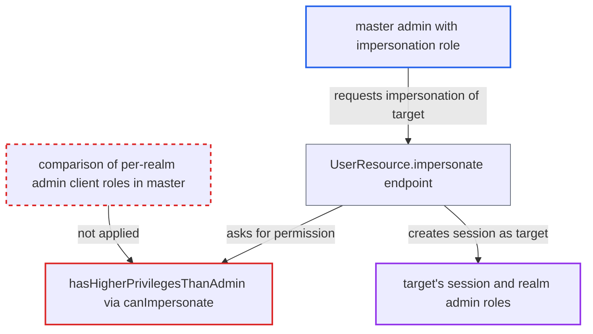

# Impersonation guard ignores target's cross-realm `<realm>-realm` admin roles in master

| Field | Value |
|---|---|
| ID | `find_01YCWcxUrxsvi8We9Voe5JTX` |
| Severity | **High** |
| Status | open |
| CWE | CWE-863 — Improper Authorization |
| Created | 2026-10-27T21:18:25.353747Z |
| Claude Security | https://claude.ai/security/findings/find_01YCWcxUrxsvi8We9Voe5JTX |

## Description

A master-realm admin who only holds the `impersonation` role can log in as another master user who administers other realms, and so gain full admin of those realms. The attacker needs `master-realm/impersonation`, and the target must hold `<realm>-realm` roles. The cause is `hasHigherPrivilegesThanAdmin`, which never compares those roles when the managed realm is master.

1. **attacker** sends a impersonation request for a target master user. The attacker is a master-realm admin with `master-realm/impersonation`, and the target holds `<realm>-realm` admin roles such as `foo-realm/*`. ([`services/src/main/java/org/keycloak/services/resources/admin/UserResource.java:401-436`](https://github.com/cx-benchmark/keycloak/blob/1d7be35d0764060a8143fc74b0aabf2442743be4/services/src/main/java/org/keycloak/services/resources/admin/UserResource.java#L401-L436))
2. **the endpoint `UserResource.impersonate`** calls `requireImpersonate(user)` to ask for permission. The request is `POST /admin/realms/master/users/{targetId}/impersonation`, and the permission check is `canImpersonate`. ([`services/src/main/java/org/keycloak/services/resources/admin/UserResource.java:401-436`](https://github.com/cx-benchmark/keycloak/blob/1d7be35d0764060a8143fc74b0aabf2442743be4/services/src/main/java/org/keycloak/services/resources/admin/UserResource.java#L401-L436))
3. **the check `canImpersonate`** grants access because the caller has the `impersonation` role and `hasHigherPrivilegesThanAdmin` returns false. With default features there is no resource server or `user-impersonated` policy, so `isImpersonatable` returns true. The V2 version of `canImpersonate` relies on the same inherited check. ([`services/src/main/java/org/keycloak/services/resources/admin/fgap/UserPermissions.java:359-367`](https://github.com/cx-benchmark/keycloak/blob/1d7be35d0764060a8143fc74b0aabf2442743be4/services/src/main/java/org/keycloak/services/resources/admin/fgap/UserPermissions.java#L359-L367))
4. **the guard `hasHigherPrivilegesThanAdmin`** compares only the `master-realm` client roles and master realm-level roles. In master, `getRealmManagementClient()` returns only the `master-realm` client, so the target's `<realm>-realm` client roles are never examined. ([`services/src/main/java/org/keycloak/services/resources/admin/fgap/UserPermissions.java:369-393`](https://github.com/cx-benchmark/keycloak/blob/1d7be35d0764060a8143fc74b0aabf2442743be4/services/src/main/java/org/keycloak/services/resources/admin/fgap/UserPermissions.java#L369-L393))
5. **the endpoint `UserResource.impersonate`** creates a master-realm user session and login cookie for the target. The caller now has the target's identity and roles. ([`services/src/main/java/org/keycloak/services/resources/admin/UserResource.java:401-436`](https://github.com/cx-benchmark/keycloak/blob/1d7be35d0764060a8143fc74b0aabf2442743be4/services/src/main/java/org/keycloak/services/resources/admin/UserResource.java#L401-L436))
6. **attacker** uses the session to get tokens and administer the other realms. Through `security-admin-console` (`fullScopeAllowed=true`), the tokens carry the target's `<realm>-realm` roles, which work against `/admin/realms/<realm>/...`.

## Assessment

The attacker is a master-realm limited admin with `master-realm/impersonation`, plus `view-users` or `query-users` to learn user ids. A target master user must hold `<realm>-realm` admin roles, which is the documented way to delegate realm administration from master. This works with default features, meaning FGAP V1 off and no admin-permissions resource server on master. A second route is V1 token-exchange subject impersonation, which reaches the same flawed check. It needs the preview `token-exchange` feature and FGAP V1, and neither is enabled by default.

Impact: The attacker gets every `<realm>-realm` admin role of the impersonated master user. In the common delegated setup that is full administration of one or more other realms. They can read users and client secrets, change users, clients and identity providers, impersonate those realms' users, and delete the realm via `manage-realm`. `master-realm` roles and master `admin`/`create-realm` stay protected.

## Recommendation

`hasHigherPrivilegesThanAdmin` only looks at the roles of `root.getRealmManagementClient()` and master realm-level roles. When the managed realm is master it ignores the other `*-realm` admin clients, so cross-realm admin privileges of the target are never compared with the impersonator's.

Fix criteria: Impersonation is denied whenever the target holds any admin role the impersonator lacks. That covers realm-level `admin`/`create-realm`, any `master-realm` or `<realm>-realm` client role in master, and any `realm-management` role, including roles reached through composites and groups. Alternatively, any target flagged by `AdminRoles.isAdminRole` or `isAdminRoleOrComposite` is non-impersonatable unless the caller is a server admin. Check: a master user with only `master-realm/impersonation` gets 403 when impersonating a master user holding `foo-realm/manage-users`. This must hold both via the admin API and via token exchange `requested_subject`.

## Evidence

**https://github.com/cx-benchmark/keycloak**

- [`services/src/main/java/org/keycloak/services/resources/admin/fgap/UserPermissions.java:369-393`](https://github.com/cx-benchmark/keycloak/blob/1d7be35d0764060a8143fc74b0aabf2442743be4/services/src/main/java/org/keycloak/services/resources/admin/fgap/UserPermissions.java#L369-L393)
- [`services/src/main/java/org/keycloak/services/resources/admin/fgap/UserPermissions.java:359-367`](https://github.com/cx-benchmark/keycloak/blob/1d7be35d0764060a8143fc74b0aabf2442743be4/services/src/main/java/org/keycloak/services/resources/admin/fgap/UserPermissions.java#L359-L367)
- [`services/src/main/java/org/keycloak/services/resources/admin/fgap/MgmtPermissions.java:467-473`](https://github.com/cx-benchmark/keycloak/blob/1d7be35d0764060a8143fc74b0aabf2442743be4/services/src/main/java/org/keycloak/services/resources/admin/fgap/MgmtPermissions.java#L467-L473)
- [`services/src/main/java/org/keycloak/services/managers/RealmManager.java:376-404`](https://github.com/cx-benchmark/keycloak/blob/1d7be35d0764060a8143fc74b0aabf2442743be4/services/src/main/java/org/keycloak/services/managers/RealmManager.java#L376-L404)
- [`server-spi-private/src/main/java/org/keycloak/models/AdminRoles.java:111-116`](https://github.com/cx-benchmark/keycloak/blob/1d7be35d0764060a8143fc74b0aabf2442743be4/server-spi-private/src/main/java/org/keycloak/models/AdminRoles.java#L111-L116)
- [`services/src/main/java/org/keycloak/services/resources/admin/fgap/RolePermissions.java:286-301`](https://github.com/cx-benchmark/keycloak/blob/1d7be35d0764060a8143fc74b0aabf2442743be4/services/src/main/java/org/keycloak/services/resources/admin/fgap/RolePermissions.java#L286-L301)
- [`services/src/main/java/org/keycloak/services/resources/admin/UserResource.java:401-436`](https://github.com/cx-benchmark/keycloak/blob/1d7be35d0764060a8143fc74b0aabf2442743be4/services/src/main/java/org/keycloak/services/resources/admin/UserResource.java#L401-L436)
- [`services/src/main/java/org/keycloak/services/resources/admin/fgap/UserPermissionsV2.java:125-141`](https://github.com/cx-benchmark/keycloak/blob/1d7be35d0764060a8143fc74b0aabf2442743be4/services/src/main/java/org/keycloak/services/resources/admin/fgap/UserPermissionsV2.java#L125-L141)

