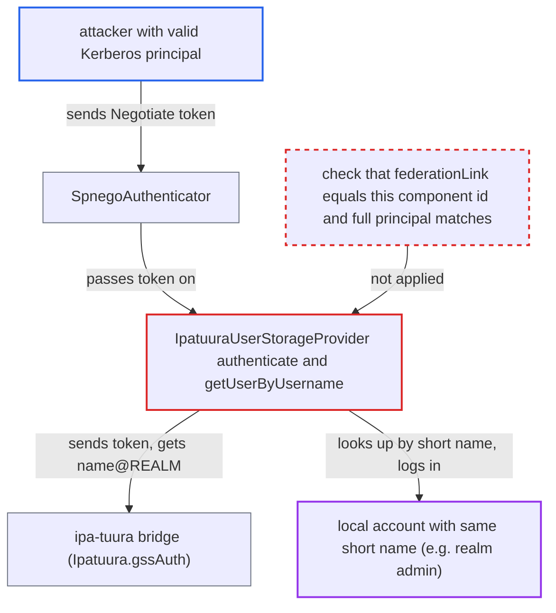

# Ipatuura SPNEGO login binds Kerberos principal to any local user by short name

| Field | Value |
|---|---|
| ID | `find_01HCPUa8jpsms8xDavFYMG5H` |
| Severity | **High** |
| Status | open |
| CWE | CWE-287 — Improper Authentication |
| Created | 2026-10-27T22:11:26.403701Z |
| Claude Security | https://claude.ai/security/findings/find_01HCPUa8jpsms8xDavFYMG5H |

## Description

A person with a valid Kerberos identity accepted by the ipa-tuura bridge can log in as any Keycloak account in the realm that has the same short name, including realm admins. This needs the experimental feature `ipa-tuura-federation`, a configured provider with SPNEGO, and a name collision. `IpatuuraUserStorageProvider.authenticate` drops the Kerberos realm and returns any local user by short name, without checking that the user belongs to this provider.

1. **attacker** opens the realm login page in a Kerberos-enabled browser. `SpnegoAuthenticator` passes the browser's Negotiate token to the user storage layer as a Kerberos credential. ([`services/src/main/java/org/keycloak/authentication/authenticators/browser/SpnegoAuthenticator.java:97-116`](https://github.com/cx-benchmark/keycloak/blob/1d7be35d0764060a8143fc74b0aabf2442743be4/services/src/main/java/org/keycloak/authentication/authenticators/browser/SpnegoAuthenticator.java#L97-L116))
2. **the provider `IpatuuraUserStorageProvider`** sends the token to the bridge through `Ipatuura.gssAuth` and reads the principal. `gssAuth` posts to `/bridge/login_kerberos/` and returns the `Remote-User` header (`user@REALM`) without checking the HTTP status. ([`federation/ipatuura/src/main/java/org/keycloak/ipatuura_user_spi/Ipatuura.java:137-152`](https://github.com/cx-benchmark/keycloak/blob/1d7be35d0764060a8143fc74b0aabf2442743be4/federation/ipatuura/src/main/java/org/keycloak/ipatuura_user_spi/Ipatuura.java#L137-L152))
3. **the handler `authenticate`** cuts the principal at the first `@` and looks up the short name. `john@REALM` becomes `john`, so the realm is lost and no full principal is stored or compared. ([`federation/ipatuura/src/main/java/org/keycloak/ipatuura_user_spi/IpatuuraUserStorageProvider.java:301-324`](https://github.com/cx-benchmark/keycloak/blob/1d7be35d0764060a8143fc74b0aabf2442743be4/federation/ipatuura/src/main/java/org/keycloak/ipatuura_user_spi/IpatuuraUserStorageProvider.java#L301-L324))
4. **the method `getUserByUsername`** returns whatever local user has that short name. It drops the realm again and never compares `user.getFederationLink()` with the component's id, so local users and users of other providers come back as if they were IPA users. ([`federation/ipatuura/src/main/java/org/keycloak/ipatuura_user_spi/IpatuuraUserStorageProvider.java:92-107`](https://github.com/cx-benchmark/keycloak/blob/1d7be35d0764060a8143fc74b0aabf2442743be4/federation/ipatuura/src/main/java/org/keycloak/ipatuura_user_spi/IpatuuraUserStorageProvider.java#L92-L107))
5. **the handler `authenticate`** returns `Status.AUTHENTICATED` for the account it found. `UserStorageManager.getUserByCredential` passes the first provider's `AUTHENTICATED` result on unchanged and does not re-check who owns the user. ([`model/storage-private/src/main/java/org/keycloak/storage/UserStorageManager.java:226-265`](https://github.com/cx-benchmark/keycloak/blob/1d7be35d0764060a8143fc74b0aabf2442743be4/model/storage-private/src/main/java/org/keycloak/storage/UserStorageManager.java#L226-L265))
6. **the authenticator `SpnegoAuthenticator`** sets the returned account as the user and completes the login. It calls `context.setUser(output.getAuthenticatedUser())` and `context.success`, so the browser is logged in as the colliding account. ([`services/src/main/java/org/keycloak/authentication/authenticators/browser/SpnegoAuthenticator.java:97-116`](https://github.com/cx-benchmark/keycloak/blob/1d7be35d0764060a8143fc74b0aabf2442743be4/services/src/main/java/org/keycloak/authentication/authenticators/browser/SpnegoAuthenticator.java#L97-L116))

## Assessment

The attacker holds a valid Kerberos principal in a realm the ipa-tuura bridge accepts, such as an IPA or AD user, or the IPA admin who can create principals. Its short name must equal a Keycloak account that this provider did not import. Local users created before or outside the federation qualify, as do realm admins and users imported by another provider such as LDAP. The bootstrap admin qualifies if the provider is configured in `master`, as the module README's walkthrough does. The experimental feature must be enabled, and the provider and SPNEGO must be configured. Principals from different Kerberos realms that the bridge accepts, for example through an AD trust, also collapse onto one account. A separate defect on the same path: `authenticate` uses `username` without a null check. A missing `Authorization` header or a bridge rejection (`gssAuth` returns `null`) throws an exception instead of failing cleanly.

Impact: The attacker gets a full browser session as the victim account in the realm. That includes realm or master administration when the account is an admin, and the ability to change the victim's profile and credentials. Service-account users are refused later by `AuthenticationProcessor.validateUser`. Password login is not affected the same way, and availability is not affected.

## Recommendation

(1) `IpatuuraUserStorageProvider.getUserByUsername` and `authenticate` tie a principal accepted by the bridge to a local account by bare short name. They also return accounts that are not linked to this provider, so an external identity can log in to an account it was never federated into.

Fix criteria: After SPNEGO, the provider returns only a user whose `federationLink` is this component's id and whose stored full principal matches the principal the bridge returned. Any other local user with that short name yields no authentication. A test confirms that a Kerberos `admin@REALM` cannot log in as a pre-existing non-federated `admin`. A second test confirms that principals of two different realms do not share one account.

(2) `authenticate` assumes it always has a token and a principal, and `gssAuth` ignores the bridge's HTTP status.

Fix criteria: A missing Negotiate token, a non-2xx bridge response or a missing `Remote-User` header produces `CredentialValidationOutput.failed()` or a fallback. It never causes an exception or a lookup with a null or empty name.

## Evidence

**https://github.com/cx-benchmark/keycloak**

- [`federation/ipatuura/src/main/java/org/keycloak/ipatuura_user_spi/IpatuuraUserStorageProvider.java:92-107`](https://github.com/cx-benchmark/keycloak/blob/1d7be35d0764060a8143fc74b0aabf2442743be4/federation/ipatuura/src/main/java/org/keycloak/ipatuura_user_spi/IpatuuraUserStorageProvider.java#L92-L107)
- [`federation/ipatuura/src/main/java/org/keycloak/ipatuura_user_spi/IpatuuraUserStorageProvider.java:301-324`](https://github.com/cx-benchmark/keycloak/blob/1d7be35d0764060a8143fc74b0aabf2442743be4/federation/ipatuura/src/main/java/org/keycloak/ipatuura_user_spi/IpatuuraUserStorageProvider.java#L301-L324)
- [`federation/ipatuura/src/main/java/org/keycloak/ipatuura_user_spi/Ipatuura.java:137-152`](https://github.com/cx-benchmark/keycloak/blob/1d7be35d0764060a8143fc74b0aabf2442743be4/federation/ipatuura/src/main/java/org/keycloak/ipatuura_user_spi/Ipatuura.java#L137-L152)
- [`services/src/main/java/org/keycloak/authentication/authenticators/browser/SpnegoAuthenticator.java:97-116`](https://github.com/cx-benchmark/keycloak/blob/1d7be35d0764060a8143fc74b0aabf2442743be4/services/src/main/java/org/keycloak/authentication/authenticators/browser/SpnegoAuthenticator.java#L97-L116)
- [`model/storage-private/src/main/java/org/keycloak/storage/UserStorageManager.java:226-265`](https://github.com/cx-benchmark/keycloak/blob/1d7be35d0764060a8143fc74b0aabf2442743be4/model/storage-private/src/main/java/org/keycloak/storage/UserStorageManager.java#L226-L265)
- [`federation/sssd/src/main/java/org/keycloak/federation/sssd/SSSDFederationProvider.java:103-111`](https://github.com/cx-benchmark/keycloak/blob/1d7be35d0764060a8143fc74b0aabf2442743be4/federation/sssd/src/main/java/org/keycloak/federation/sssd/SSSDFederationProvider.java#L103-L111)
- [`federation/kerberos/src/main/java/org/keycloak/federation/kerberos/KerberosFederationProvider.java:257-268`](https://github.com/cx-benchmark/keycloak/blob/1d7be35d0764060a8143fc74b0aabf2442743be4/federation/kerberos/src/main/java/org/keycloak/federation/kerberos/KerberosFederationProvider.java#L257-L268)

