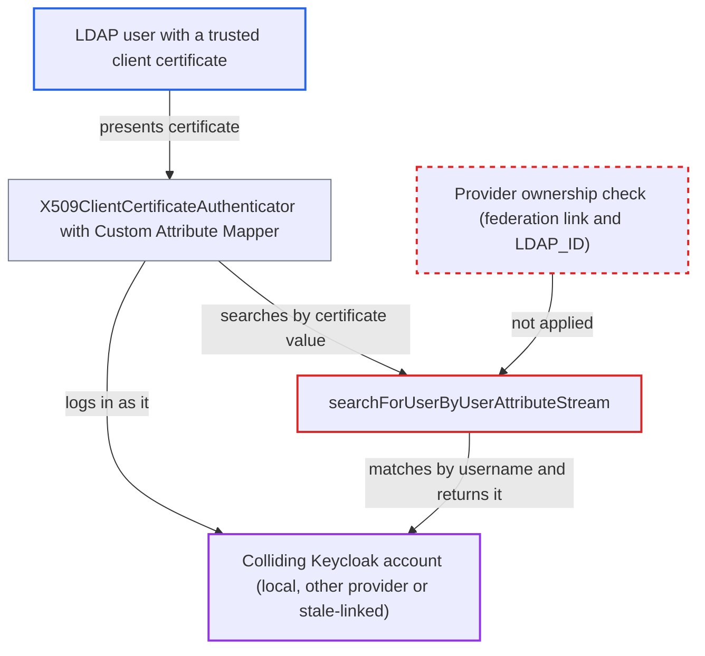

# LDAP attribute search binds matched entry to unrelated local account by username, enabling X.509 login as it

| Field | Value |
|---|---|
| ID | `find_014fPoBSnyyLw33HpuRrkKvC` |
| Severity | **High** |
| Status | open |
| CWE | CWE-287 — Authentication bypass |
| Created | 2026-10-27T22:01:05.963132Z |
| Claude Security | https://claude.ai/security/findings/find_014fPoBSnyyLw33HpuRrkKvC |

## Description

An LDAP directory user who holds a realm-trusted client certificate can log in as a different Keycloak account, such as a local admin or service account, without that account's password. It needs X.509 login with the Custom Attribute Mapper, and the attacker's LDAP entry must share its username with that other account. The cause is `searchForUserByUserAttributeStream`, which matches a local user by username only and never checks that the user belongs to this LDAP provider.

1. **attacker** presents a client certificate at the login endpoint. The certificate belongs to the attacker's own LDAP entry, and the realm uses the X.509 authenticator with the Custom Attribute Mapper. ([`services/src/main/java/org/keycloak/authentication/authenticators/x509/X509ClientCertificateAuthenticator.java:133-194`](https://github.com/cx-benchmark/keycloak/blob/1d7be35d0764060a8143fc74b0aabf2442743be4/services/src/main/java/org/keycloak/authentication/authenticators/x509/X509ClientCertificateAuthenticator.java#L133-L194))
2. **the mapper in `UserIdentityToModelMapper`** searches users by the certificate-derived value. It calls `searchForUserByUserAttributeStream`, and a single result is taken as the identity. ([`services/src/main/java/org/keycloak/authentication/authenticators/x509/UserIdentityToModelMapper.java:60-77`](https://github.com/cx-benchmark/keycloak/blob/1d7be35d0764060a8143fc74b0aabf2442743be4/services/src/main/java/org/keycloak/authentication/authenticators/x509/UserIdentityToModelMapper.java#L60-L77))
3. **the method `searchForUserByUserAttributeStream`** looks up a local user by the LDAP entry's username. It calls `getUserByUsername` and returns `proxy(realm, localUser, ldapUser, false)` when a local user with that name exists. It does not check `getFederationLink()` or that `LDAP_ID` equals `ldapUser.getUuid()`. ([`federation/ldap/src/main/java/org/keycloak/storage/ldap/LDAPStorageProvider.java:306-313`](https://github.com/cx-benchmark/keycloak/blob/1d7be35d0764060a8143fc74b0aabf2442743be4/federation/ldap/src/main/java/org/keycloak/storage/ldap/LDAPStorageProvider.java#L306-L313))
4. **the method `proxy()`** wraps the foreign local user as if it were the LDAP entry. `checkDNChanged` writes the entry's `LDAP_ENTRY_DN` onto the account, the LDAP mapper proxies are layered over it, and the entry is registered in the session's `LDAPStorageUserManager`. ([`federation/ldap/src/main/java/org/keycloak/storage/ldap/LDAPStorageProvider.java:207-262`](https://github.com/cx-benchmark/keycloak/blob/1d7be35d0764060a8143fc74b0aabf2442743be4/federation/ldap/src/main/java/org/keycloak/storage/ldap/LDAPStorageProvider.java#L207-L262))
5. **`UserStorageManager`** passes the account on without rejecting it. `validateUser` re-validates only federated users, so an unlinked local user is returned unchanged. For a stale-linked user, `loadAndValidateUser` returns the session-cached entry before any UUID comparison. ([`model/storage-private/src/main/java/org/keycloak/storage/UserStorageManager.java:118-136`](https://github.com/cx-benchmark/keycloak/blob/1d7be35d0764060a8143fc74b0aabf2442743be4/model/storage-private/src/main/java/org/keycloak/storage/UserStorageManager.java#L118-L136))
6. **`X509ClientCertificateAuthenticator`** logs the certificate holder in as the colliding account. It checks only for null, brute-force lockout and enabled status, then calls `context.setUser(user)` and `context.success(CLIENT_CERT)` without a password. ([`services/src/main/java/org/keycloak/authentication/authenticators/x509/X509ClientCertificateAuthenticator.java:133-194`](https://github.com/cx-benchmark/keycloak/blob/1d7be35d0764060a8143fc74b0aabf2442743be4/services/src/main/java/org/keycloak/authentication/authenticators/x509/X509ClientCertificateAuthenticator.java#L133-L194))

## Assessment

The attacker is an LDAP directory user with a realm-trusted client certificate for their own entry. The realm must federate LDAP and use the X.509 browser or direct-grant authenticator with the Custom Attribute Mapper. The default attribute name is `usercertificate`, paired with the LDAP certificate mapper. Another account must already share the entry's username (`uid` or `sAMAccountName`), and the attacker does not control this. That account can be a realm-local non-federated user, a user imported from another LDAP provider in the same realm, or a user linked to this provider with a different, stale `LDAP_ID`, for example after a directory uid was reused or renamed. The attacker presents the certificate at the internet-facing login endpoint. The same lookup also feeds `memberOf` member listing in `UserRolesRetrieveStrategy.java`, where unlinked local users are shown and proxied as LDAP group or role members.

Impact: The attacker gets an authenticated session and tokens for an account that is not theirs. That includes its user id and `sub`, its local roles and client data, and the LDAP entry's mapped groups and roles. The reach is limited to accounts whose username collides with an LDAP entry the attacker's certificate matches. The report names no availability impact.

## Recommendation

(1) `searchForUserByUserAttributeStream` treats username equality as proof that an existing local user is the Keycloak representation of the matched LDAP entry. `getUserByEmail`, the Kerberos path and `loadUsersByUsernames` all return only users the provider owns, and this method does not.

Fix criteria: The attribute search returns a local user only when it is linked to this provider and its `LDAP_ID` equals the entry's UUID. On a collision with an unlinked, foreign-linked or stale-linked user, it returns nothing or raises a duplicate error. An X.509 Custom Attribute Mapper login whose certificate matches such an entry does not authenticate the colliding account.

(2) `loadAndValidateUser` returns the session-cached LDAP object before the UUID comparison. A user proxied with the wrong entry therefore passes validation.

Fix criteria: Validating an imported user always confirms that the LDAP object used for it carries the user's stored `LDAP_ID`. This holds even when that object came from the session's managed cache.

## Evidence

**https://github.com/cx-benchmark/keycloak**

- [`federation/ldap/src/main/java/org/keycloak/storage/ldap/LDAPStorageProvider.java:306-313`](https://github.com/cx-benchmark/keycloak/blob/1d7be35d0764060a8143fc74b0aabf2442743be4/federation/ldap/src/main/java/org/keycloak/storage/ldap/LDAPStorageProvider.java#L306-L313)
- [`federation/ldap/src/main/java/org/keycloak/storage/ldap/LDAPStorageProvider.java:795-803`](https://github.com/cx-benchmark/keycloak/blob/1d7be35d0764060a8143fc74b0aabf2442743be4/federation/ldap/src/main/java/org/keycloak/storage/ldap/LDAPStorageProvider.java#L795-L803)
- [`federation/ldap/src/main/java/org/keycloak/storage/ldap/LDAPStorageProvider.java:1042-1047`](https://github.com/cx-benchmark/keycloak/blob/1d7be35d0764060a8143fc74b0aabf2442743be4/federation/ldap/src/main/java/org/keycloak/storage/ldap/LDAPStorageProvider.java#L1042-L1047)
- [`federation/ldap/src/main/java/org/keycloak/storage/ldap/LDAPStorageProvider.java:446-457`](https://github.com/cx-benchmark/keycloak/blob/1d7be35d0764060a8143fc74b0aabf2442743be4/federation/ldap/src/main/java/org/keycloak/storage/ldap/LDAPStorageProvider.java#L446-L457)
- [`federation/ldap/src/main/java/org/keycloak/storage/ldap/LDAPStorageProvider.java:207-262`](https://github.com/cx-benchmark/keycloak/blob/1d7be35d0764060a8143fc74b0aabf2442743be4/federation/ldap/src/main/java/org/keycloak/storage/ldap/LDAPStorageProvider.java#L207-L262)
- [`federation/ldap/src/main/java/org/keycloak/storage/ldap/LDAPStorageProvider.java:649-670`](https://github.com/cx-benchmark/keycloak/blob/1d7be35d0764060a8143fc74b0aabf2442743be4/federation/ldap/src/main/java/org/keycloak/storage/ldap/LDAPStorageProvider.java#L649-L670)
- [`model/storage-private/src/main/java/org/keycloak/storage/UserStorageManager.java:759-776`](https://github.com/cx-benchmark/keycloak/blob/1d7be35d0764060a8143fc74b0aabf2442743be4/model/storage-private/src/main/java/org/keycloak/storage/UserStorageManager.java#L759-L776)
- [`model/storage-private/src/main/java/org/keycloak/storage/UserStorageManager.java:118-136`](https://github.com/cx-benchmark/keycloak/blob/1d7be35d0764060a8143fc74b0aabf2442743be4/model/storage-private/src/main/java/org/keycloak/storage/UserStorageManager.java#L118-L136)
- [`services/src/main/java/org/keycloak/authentication/authenticators/x509/UserIdentityToModelMapper.java:60-77`](https://github.com/cx-benchmark/keycloak/blob/1d7be35d0764060a8143fc74b0aabf2442743be4/services/src/main/java/org/keycloak/authentication/authenticators/x509/UserIdentityToModelMapper.java#L60-L77)
- [`services/src/main/java/org/keycloak/authentication/authenticators/x509/X509ClientCertificateAuthenticator.java:133-194`](https://github.com/cx-benchmark/keycloak/blob/1d7be35d0764060a8143fc74b0aabf2442743be4/services/src/main/java/org/keycloak/authentication/authenticators/x509/X509ClientCertificateAuthenticator.java#L133-L194)

