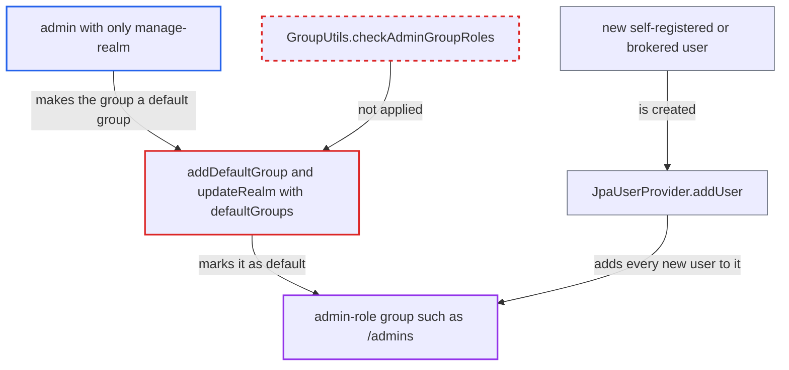

# manage-realm admin can make an admin-role group a default group and escalate through new users

| Field | Value |
|---|---|
| ID | `find_01EwiR2AA1g1APmx4xFXUsJk` |
| Severity | **High** |
| Status | open |
| CWE | CWE-863 — Improper Authorization |
| Created | 2026-10-27T21:29:13.621235Z |
| Claude Security | https://claude.ai/security/findings/find_01EwiR2AA1g1APmx4xFXUsJk |

## Description

An admin who holds only `manage-realm` on a realm can give admin rights to every user created afterwards, up to `realm-admin`. On the `master` realm this can reach the server-wide `admin` role. It needs an existing group that carries admin roles. The default-group endpoints `addDefaultGroup` and `updateRealm` with `defaultGroups` skip the admin-group check.

1. **Attacker with `manage-realm`** marks an admin-role group as a default group. The attacker sends `PUT /admin/realms/X/default-groups/{id}`, or `PUT /admin/realms/X` with `defaultGroups` such as `/admins`, and only `requireManageRealm` is checked. ([`services/src/main/java/org/keycloak/services/resources/admin/RealmAdminResource.java:1271-1282`](https://github.com/cx-benchmark/keycloak/blob/1d7be35d0764060a8143fc74b0aabf2442743be4/services/src/main/java/org/keycloak/services/resources/admin/RealmAdminResource.java#L1271-L1282))
2. **the handler `updateRealm`** applies the supplied `defaultGroups` and `registrationAllowed` without further checks. `setDefaultGroups` resolves each group path and adds it as a default group, and `registrationAllowed` is set from the request, so the attacker can also turn on self-registration. ([`model/storage-private/src/main/java/org/keycloak/storage/datastore/DefaultExportImportManager.java:823-841`](https://github.com/cx-benchmark/keycloak/blob/1d7be35d0764060a8143fc74b0aabf2442743be4/model/storage-private/src/main/java/org/keycloak/storage/datastore/DefaultExportImportManager.java#L823-L841))
3. **Attacker** self-registers a new user at `/realms/X`, or logs in through an existing identity provider. Self-registration reaches `JpaUserProvider.addUser` through `UserStorageManager.addUser`, and first-broker-login users take the same path. ([`services/src/main/java/org/keycloak/userprofile/DeclarativeUserProfileProvider.java:177`](https://github.com/cx-benchmark/keycloak/blob/1d7be35d0764060a8143fc74b0aabf2442743be4/services/src/main/java/org/keycloak/userprofile/DeclarativeUserProfileProvider.java#L177))
4. **`JpaUserProvider.addUser`** adds the new user to every default group. `joinGroupImpl` runs with no events and no admin-group check, so the user inherits the group's role mappings. ([`model/jpa/src/main/java/org/keycloak/models/jpa/JpaUserProvider.java:141-146`](https://github.com/cx-benchmark/keycloak/blob/1d7be35d0764060a8143fc74b0aabf2442743be4/model/jpa/src/main/java/org/keycloak/models/jpa/JpaUserProvider.java#L141-L146))
5. **the new user** acts with the group's admin roles. `UserAdapter.hasRole` counts roles inherited from groups, and `AdminAuth` evaluates that, so the user holds `realm-admin` or whichever admin roles the group carries.

## Assessment

The attacker is an admin with only `manage-realm` on realm X. A group that carries admin roles must already exist, for example `/admins` mapped to `realm-management/realm-admin`. The attacker can enable `registrationAllowed` in the same `updateRealm` request. A new user then self-registers at `/realms/X` or logs in through any existing identity provider. The attacker can set default groups either through `PUT /admin/realms/X/default-groups/{id}` or through `PUT /admin/realms/X` with `defaultGroups`.

Impact: The attacker gains whatever admin roles the group carries, up to `realm-admin`. That means full control of the realm's users, clients, secrets and keys. On `master`, with a group mapped to `admin`, this becomes server-wide admin across all realms. Every user created later also silently receives those rights.

## Recommendation

The default-group endpoints (`addDefaultGroup`, and `updateRealm` with `defaultGroups`) treat default-group assignment as a plain realm setting. It actually grants the group's roles to every future user. They skip the admin-group check that every other membership-granting path and the default-role path apply.

Fix criteria: Making a group a default group requires the same authorization as adding a user to it: membership permission on the group, plus passing `GroupUtils.checkAdminGroupRoles` for the group hierarchy. A `manage-realm`-only admin gets 403 from both `PUT default-groups/{id}` and `PUT /admin/realms/X` with `defaultGroups` when the group carries `realm-admin` (or the master `admin` role). No newly registered or brokered user can then acquire admin roles through default groups.

## Evidence

**https://github.com/cx-benchmark/keycloak**

- [`services/src/main/java/org/keycloak/services/resources/admin/RealmAdminResource.java:1271-1282`](https://github.com/cx-benchmark/keycloak/blob/1d7be35d0764060a8143fc74b0aabf2442743be4/services/src/main/java/org/keycloak/services/resources/admin/RealmAdminResource.java#L1271-L1282)
- [`services/src/main/java/org/keycloak/services/resources/admin/RealmAdminResource.java:484-535`](https://github.com/cx-benchmark/keycloak/blob/1d7be35d0764060a8143fc74b0aabf2442743be4/services/src/main/java/org/keycloak/services/resources/admin/RealmAdminResource.java#L484-L535)
- [`model/storage-private/src/main/java/org/keycloak/storage/datastore/DefaultExportImportManager.java:823-841`](https://github.com/cx-benchmark/keycloak/blob/1d7be35d0764060a8143fc74b0aabf2442743be4/model/storage-private/src/main/java/org/keycloak/storage/datastore/DefaultExportImportManager.java#L823-L841)
- [`server-spi-private/src/main/java/org/keycloak/models/utils/KeycloakModelUtils.java:1453-1460`](https://github.com/cx-benchmark/keycloak/blob/1d7be35d0764060a8143fc74b0aabf2442743be4/server-spi-private/src/main/java/org/keycloak/models/utils/KeycloakModelUtils.java#L1453-L1460)
- [`model/jpa/src/main/java/org/keycloak/models/jpa/JpaUserProvider.java:141-146`](https://github.com/cx-benchmark/keycloak/blob/1d7be35d0764060a8143fc74b0aabf2442743be4/model/jpa/src/main/java/org/keycloak/models/jpa/JpaUserProvider.java#L141-L146)
- [`services/src/main/java/org/keycloak/userprofile/DeclarativeUserProfileProvider.java:177`](https://github.com/cx-benchmark/keycloak/blob/1d7be35d0764060a8143fc74b0aabf2442743be4/services/src/main/java/org/keycloak/userprofile/DeclarativeUserProfileProvider.java#L177)
- [`services/src/main/java/org/keycloak/services/resources/admin/UserResource.java:1275-1286`](https://github.com/cx-benchmark/keycloak/blob/1d7be35d0764060a8143fc74b0aabf2442743be4/services/src/main/java/org/keycloak/services/resources/admin/UserResource.java#L1275-L1286)
- [`services/src/main/java/org/keycloak/services/resources/admin/fgap/RolePermissions.java:412-413`](https://github.com/cx-benchmark/keycloak/blob/1d7be35d0764060a8143fc74b0aabf2442743be4/services/src/main/java/org/keycloak/services/resources/admin/fgap/RolePermissions.java#L412-L413)
- [`services/src/main/java/org/keycloak/utils/GroupUtils.java:251-272`](https://github.com/cx-benchmark/keycloak/blob/1d7be35d0764060a8143fc74b0aabf2442743be4/services/src/main/java/org/keycloak/utils/GroupUtils.java#L251-L272)

