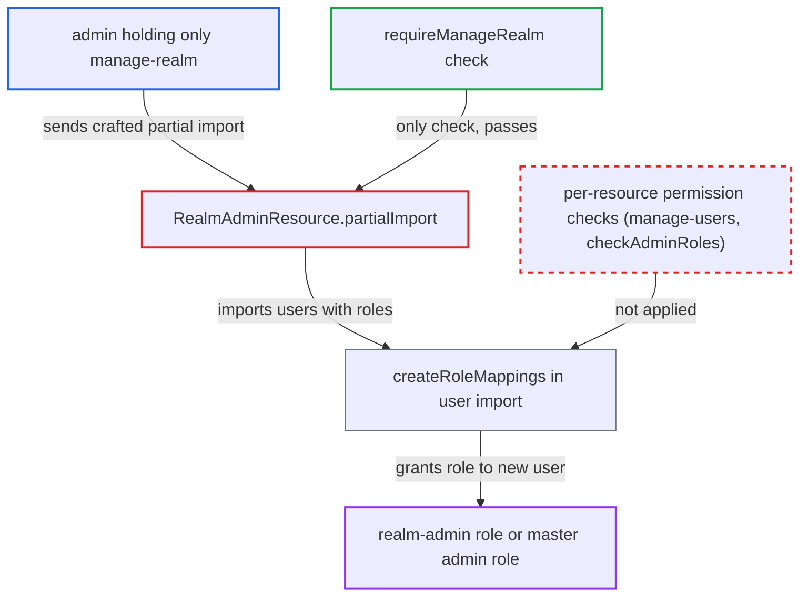

# Partial import lets manage-realm-only admin grant realm-admin or master admin roles

| Field | Value |
|---|---|
| ID | `find_01JcGko3yjmjvG2nNBwuzN35` |
| Severity | **High** |
| Status | open |
| CWE | CWE-863 — Improper Authorization |
| Created | 2026-10-27T21:27:08.032398Z |
| Claude Security | https://claude.ai/security/findings/find_01JcGko3yjmjvG2nNBwuzN35 |

## Description

An admin who holds only `manage-realm` can make themselves a full realm admin, or on the `master` realm a server-wide admin. They do this by importing a new user with a password they choose and the admin role attached. The handler `RealmAdminResource.partialImport` checks only `requireManageRealm()`, and the import code then grants every listed role without further permission checks.

1. **attacker with `manage-realm`** sends a partial import request with a new user. The request is `POST /admin/realms/X/partialImport`. The user has a password in `credentials` and `clientRoles` of `realm-management/realm-admin`, or `realmRoles` of `admin` on `master`.
2. **the handler `partialImport`** authorizes the request with `requireManageRealm()` only. No other permission is evaluated before the caller's JSON is handed to the import manager. ([`services/src/main/java/org/keycloak/services/resources/admin/RealmAdminResource.java:1349-1362`](https://github.com/cx-benchmark/keycloak/blob/1d7be35d0764060a8143fc74b0aabf2442743be4/services/src/main/java/org/keycloak/services/resources/admin/RealmAdminResource.java#L1349-L1362))
3. **`PartialImportManager`** imports clients, roles, IdPs, IdP mappers, groups and users in one job. No permission is evaluated for any imported resource. ([`services/src/main/java/org/keycloak/partialimport/PartialImportManager.java:44-72`](https://github.com/cx-benchmark/keycloak/blob/1d7be35d0764060a8143fc74b0aabf2442743be4/services/src/main/java/org/keycloak/partialimport/PartialImportManager.java#L44-L72))
4. **`UsersPartialImport`** passes each user straight to `createUser`. The `UserRepresentation` is the one the attacker supplied. ([`services/src/main/java/org/keycloak/partialimport/UsersPartialImport.java:112-119`](https://github.com/cx-benchmark/keycloak/blob/1d7be35d0764060a8143fc74b0aabf2442743be4/services/src/main/java/org/keycloak/partialimport/UsersPartialImport.java#L112-L119))
5. **`createUser` in `DefaultExportImportManager`** sets the password, grants roles and joins groups. The password comes from `credentials` and the listed groups are joined, with no permission check on any of it. ([`model/storage-private/src/main/java/org/keycloak/storage/datastore/DefaultExportImportManager.java:1020-1074`](https://github.com/cx-benchmark/keycloak/blob/1d7be35d0764060a8143fc74b0aabf2442743be4/model/storage-private/src/main/java/org/keycloak/storage/datastore/DefaultExportImportManager.java#L1020-L1074))
6. **`createRoleMappings`** grants every listed role with `user.grantRole`. This includes `realm-management/realm-admin` and the master `admin` role, and `checkAdminRoles` is never called. ([`server-spi-private/src/main/java/org/keycloak/models/utils/RepresentationToModel.java:929-971`](https://github.com/cx-benchmark/keycloak/blob/1d7be35d0764060a8143fc74b0aabf2442743be4/server-spi-private/src/main/java/org/keycloak/models/utils/RepresentationToModel.java#L929-L971))
7. **attacker** logs in as the new user. The new user now holds the admin role the attacker chose.

## Assessment

The attacker is an authenticated admin who holds only `manage-realm` on realm X, or `master-realm/manage-realm` on `master`. No victim action and no non-default setting is needed. With `ifResourceExists=OVERWRITE` the attacker can instead delete and recreate an existing user. The same request can also delete and recreate the master `admin` role (`RealmRolesPartialImport.remove`). It can also add composites to admin client roles, because `ClientRolesPartialImport.clientExists` accepts `realm-management` and the `<realm>-realm` clients. Elsewhere the project refuses these operations to this role. `RolePermissions.canMapComposite` runs `checkAdminRoles`, and `canManage(role)` excludes the master `admin` and `create-realm` roles. `InternalClientManagementTest` asserts that such an admin must not delete the `admin` role or change its composites. `UsersResource.createUser` requires `manage-users`, ignores role mappings and gates credentials and admin groups. Partial import is a documented feature and `manage-realm` is documented as high-privileged, but nothing in the project gives `realm-admin` or master `admin` to that role. Other `manage-realm` features, such as authentication flows and an LDAP `hardcoded-ldap-role-mapper`, may reach comparably far. They need an existing privileged user or an attacker-run LDAP server, and are separate concerns.

Impact: On realm X the attacker gains `realm-admin`, which covers every user, client, secret, key and session. From `master` they gain the server-wide `admin` role over every realm, which breaks realm isolation. They can read, change and delete all identity data and configuration, or delete and recreate the master `admin` role.

## Recommendation

`partialImport` authorizes the whole request with `manage-realm` only. The imported content does things that have stricter checks on their own admin endpoints. These are creating users with credentials and role mappings, mapping group roles, overwriting realm and admin roles, and creating IdPs, IdP mappers and clients.

Fix criteria: Every resource in a partial import passes the same permission checks as its dedicated endpoint. Users need `manage-users`, `requireMapRole` and `checkAdminRoles` for each role mapping, and `requireResetPassword` for credentials. Groups need group-manage and admin-role checks. Admin roles (`realm-management`, `<realm>-realm`, master `admin` and `create-realm`) cannot be created, overwritten or given composites unless the caller holds them. IdPs and mappers need `manage-identity-providers` and the admin-role mapper gate. Clients need `manage-clients`. A test confirms that a `manage-realm`-only admin importing a user with `realm-management/realm-admin` (or `admin` on `master`) gets 403 and no user or mapping is created.

## Evidence

**https://github.com/cx-benchmark/keycloak**

- [`services/src/main/java/org/keycloak/services/resources/admin/RealmAdminResource.java:1349-1362`](https://github.com/cx-benchmark/keycloak/blob/1d7be35d0764060a8143fc74b0aabf2442743be4/services/src/main/java/org/keycloak/services/resources/admin/RealmAdminResource.java#L1349-L1362)
- [`services/src/main/java/org/keycloak/partialimport/UsersPartialImport.java:112-119`](https://github.com/cx-benchmark/keycloak/blob/1d7be35d0764060a8143fc74b0aabf2442743be4/services/src/main/java/org/keycloak/partialimport/UsersPartialImport.java#L112-L119)
- [`model/storage-private/src/main/java/org/keycloak/storage/datastore/DefaultExportImportManager.java:1020-1074`](https://github.com/cx-benchmark/keycloak/blob/1d7be35d0764060a8143fc74b0aabf2442743be4/model/storage-private/src/main/java/org/keycloak/storage/datastore/DefaultExportImportManager.java#L1020-L1074)
- [`server-spi-private/src/main/java/org/keycloak/models/utils/RepresentationToModel.java:929-971`](https://github.com/cx-benchmark/keycloak/blob/1d7be35d0764060a8143fc74b0aabf2442743be4/server-spi-private/src/main/java/org/keycloak/models/utils/RepresentationToModel.java#L929-L971)
- [`services/src/main/java/org/keycloak/partialimport/RealmRolesPartialImport.java:82-86`](https://github.com/cx-benchmark/keycloak/blob/1d7be35d0764060a8143fc74b0aabf2442743be4/services/src/main/java/org/keycloak/partialimport/RealmRolesPartialImport.java#L82-L86)
- [`services/src/main/java/org/keycloak/partialimport/ClientRolesPartialImport.java:78-89`](https://github.com/cx-benchmark/keycloak/blob/1d7be35d0764060a8143fc74b0aabf2442743be4/services/src/main/java/org/keycloak/partialimport/ClientRolesPartialImport.java#L78-L89)
- [`services/src/main/java/org/keycloak/partialimport/PartialImportManager.java:44-72`](https://github.com/cx-benchmark/keycloak/blob/1d7be35d0764060a8143fc74b0aabf2442743be4/services/src/main/java/org/keycloak/partialimport/PartialImportManager.java#L44-L72)
- [`services/src/main/java/org/keycloak/services/resources/admin/fgap/RolePermissions.java:412-414`](https://github.com/cx-benchmark/keycloak/blob/1d7be35d0764060a8143fc74b0aabf2442743be4/services/src/main/java/org/keycloak/services/resources/admin/fgap/RolePermissions.java#L412-L414)
- [`tests/base/src/test/java/org/keycloak/tests/admin/authz/rbac/InternalClientManagementTest.java:137-190`](https://github.com/cx-benchmark/keycloak/blob/1d7be35d0764060a8143fc74b0aabf2442743be4/tests/base/src/test/java/org/keycloak/tests/admin/authz/rbac/InternalClientManagementTest.java#L137-L190)
- [`services/src/main/java/org/keycloak/services/resources/admin/UsersResource.java:143-185`](https://github.com/cx-benchmark/keycloak/blob/1d7be35d0764060a8143fc74b0aabf2442743be4/services/src/main/java/org/keycloak/services/resources/admin/UsersResource.java#L143-L185)

