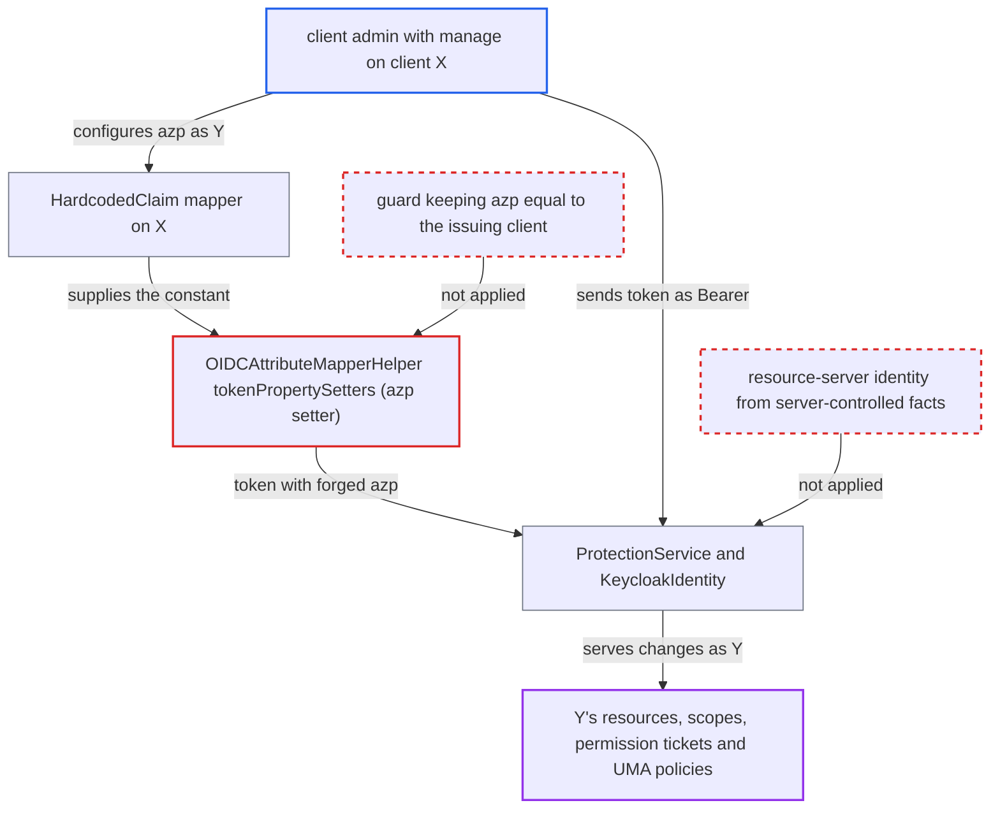

# Protocol mappers can rewrite azp, letting a client admin act as another resource server

| Field | Value |
|---|---|
| ID | `find_01BJyFz79HhYwe9ECsAzGmR2` |
| Severity | **High** |
| Status | open |
| CWE | CWE-285 — Improper Authorization |
| Created | 2026-10-27T22:15:12.571649Z |
| Claude Security | https://claude.ai/security/findings/find_01BJyFz79HhYwe9ECsAzGmR2 |

## Description

A client admin who has only `manage` on one client `X` can create, change and delete the resources, scopes, permission tickets and UMA policies of any other resource server `Y` in the realm. The admin adds a mapper that overwrites `azp` in the tokens `X` issues. `OIDCAttributeMapperHelper.tokenPropertySetters` lets a generic mapper whose `claim.name` is `azp` replace the server-set value, and the Protection API trusts that value to pick the resource server.

1. **client admin of `X`** adds mappers to `X` and enables service accounts on it. A `oidc-hardcoded-claim-mapper` sets `azp` to `Y`. It is paired with either an `oidc-hardcoded-role-mapper` for `Y.uma_protection`, or hardcoded `preferred_username=service-account-Y` with `sub` set to a non-existent id. Anyone with `manage` on the client may configure mappers. ([`services/src/main/java/org/keycloak/protocol/oidc/mappers/HardcodedClaim.java:88-93`](https://github.com/cx-benchmark/keycloak/blob/1d7be35d0764060a8143fc74b0aabf2442743be4/services/src/main/java/org/keycloak/protocol/oidc/mappers/HardcodedClaim.java#L88-L93))
2. **`TokenManager.initToken`** writes the genuine `issuedFor` for `X` before any mapper runs. `transformAccessToken` runs the mappers afterwards, so the mapper value replaces the genuine one. `generateIDToken` copies the forged value into the ID token too. ([`services/src/main/java/org/keycloak/protocol/oidc/TokenManager.java:1117`](https://github.com/cx-benchmark/keycloak/blob/1d7be35d0764060a8143fc74b0aabf2442743be4/services/src/main/java/org/keycloak/protocol/oidc/TokenManager.java#L1117))
3. **`OIDCAttributeMapperHelper.mapClaim`** applies the `azp` setter, which calls `token.issuedFor(...)`. The setter runs whenever a mapper's `claim.name` is `azp`. The token therefore says it was issued to `Y`. ([`services/src/main/java/org/keycloak/protocol/oidc/mappers/OIDCAttributeMapperHelper.java:110-112`](https://github.com/cx-benchmark/keycloak/blob/1d7be35d0764060a8143fc74b0aabf2442743be4/services/src/main/java/org/keycloak/protocol/oidc/mappers/OIDCAttributeMapperHelper.java#L110-L112))
4. **client admin of `X`** gets a client-credentials token for `X` and sends it as a Bearer token to `/realms/{realm}/authz/protection/resource_set` or `/permission/ticket`. `AuthenticationManager.verifyIdentityToken` resolves the client from `azp`. For a stateless token it creates a transient client session for `Y`, so the client-session check passes although `Y` never issued the token. ([`services/src/main/java/org/keycloak/services/managers/AuthenticationManager.java:1620-1633`](https://github.com/cx-benchmark/keycloak/blob/1d7be35d0764060a8143fc74b0aabf2442743be4/services/src/main/java/org/keycloak/services/managers/AuthenticationManager.java#L1620-L1633))
5. **`ProtectionService.getResourceServer`** selects resource server `Y` from `getIssuedFor()`. The forged `azp` makes the request count as coming from resource server `Y`. ([`services/src/main/java/org/keycloak/authorization/protection/ProtectionService.java:123-145`](https://github.com/cx-benchmark/keycloak/blob/1d7be35d0764060a8143fc74b0aabf2442743be4/services/src/main/java/org/keycloak/authorization/protection/ProtectionService.java#L123-L145))
6. **`ProtectionService.createIdentity` and `KeycloakIdentity.isResourceServer`** accept the forged claims as proof of resource-server identity. Either the forged `uma_protection` role for `Y` is read from the token, or the user resolved from `sub` or `preferred_username` equals `Y`'s service account `service-account-Y`. ([`services/src/main/java/org/keycloak/authorization/protection/ProtectionService.java:96-121`](https://github.com/cx-benchmark/keycloak/blob/1d7be35d0764060a8143fc74b0aabf2442743be4/services/src/main/java/org/keycloak/authorization/protection/ProtectionService.java#L96-L121))
7. **`ResourceService` and `PermissionTicketService`** skip the owner checks and let the caller manage `Y`'s data. The attacker can create, update, delete and list `Y`'s resources and scopes, and create and grant permission tickets to any requester. The report also lists management of `Y`'s UMA policies. ([`services/src/main/java/org/keycloak/authorization/protection/resource/ResourceService.java:64-160`](https://github.com/cx-benchmark/keycloak/blob/1d7be35d0764060a8143fc74b0aabf2442743be4/services/src/main/java/org/keycloak/authorization/protection/resource/ResourceService.java#L64-L160))

## Assessment

The attacker is a delegated admin with fine-grained `manage` permission on one client `X`. Any `manage-clients` holder who otherwise could not touch `Y`'s authorization settings also qualifies. They work over the network and need no victim interaction. They enable service accounts on `X` and add the mappers. Then they get a client-credentials token for `X` and send it as Bearer to `/realms/{realm}/authz/protection/resource_set` and `/permission/ticket`. There are two ways to be accepted as `Y`'s resource server: a forged `uma_protection` role for `Y` (`oidc-hardcoded-role-mapper`), or a forged identity equal to `Y`'s service account. The service-account username `service-account-Y` is deterministic. Remote management is on by default.

Impact: The attacker gains read and write control over the authorization data of any other resource-server client in the realm, data they have no permission for. This covers resources, scopes, permission tickets and UMA policies. Admin events for these changes are attributed to `Y`'s service account. Keycloak's own availability is not affected.

Subsequent-system impact: Resource server `Y`'s application enforces access from this authorization data. Permission tickets the attacker grants on `Y`'s owner-managed resources become RPTs for a user the attacker chooses. Deleted or rewritten resource definitions alter or break `Y`'s enforcement. The effects reach `Y` only through its reliance on the UMA and authorization services.

## Recommendation

(1) `OIDCAttributeMapperHelper.tokenPropertySetters` lets the generic `claim.name` path overwrite `azp`. Client-level mapper configuration can therefore change which client a token was issued to.

Fix criteria: A generic mapper whose `claim.name` is `azp` no longer changes `issuedFor`. It is ignored with a warning, like `iss` and `jti`. A client with such a mapper still issues tokens whose `azp` equals its own client id. A token issued to `X` and presented to `/authz/protection/*` is only ever matched to `X`'s resource server.

(2) `ProtectionService.createIdentity` accepts `uma_protection` from token role claims. `KeycloakIdentity.isResourceServer` accepts a user resolved from mapper-writable claims. The Protection API's authorization therefore rests on claims that a client admin can shape.

Fix criteria: Resource-server identity for the Protection API comes from server-controlled facts: the authenticated client's own id and its service account from the model. A token issued to `X` cannot be accepted as resource server `Y`, even if its claims say so. Presenting such a token for `Y`'s resource set is refused with 403.

## Evidence

**https://github.com/cx-benchmark/keycloak**

- [`services/src/main/java/org/keycloak/protocol/oidc/mappers/OIDCAttributeMapperHelper.java:110-112`](https://github.com/cx-benchmark/keycloak/blob/1d7be35d0764060a8143fc74b0aabf2442743be4/services/src/main/java/org/keycloak/protocol/oidc/mappers/OIDCAttributeMapperHelper.java#L110-L112)
- [`services/src/main/java/org/keycloak/protocol/oidc/mappers/HardcodedClaim.java:88-93`](https://github.com/cx-benchmark/keycloak/blob/1d7be35d0764060a8143fc74b0aabf2442743be4/services/src/main/java/org/keycloak/protocol/oidc/mappers/HardcodedClaim.java#L88-L93)
- [`services/src/main/java/org/keycloak/protocol/oidc/TokenManager.java:1117`](https://github.com/cx-benchmark/keycloak/blob/1d7be35d0764060a8143fc74b0aabf2442743be4/services/src/main/java/org/keycloak/protocol/oidc/TokenManager.java#L1117)
- [`services/src/main/java/org/keycloak/authorization/protection/ProtectionService.java:123-145`](https://github.com/cx-benchmark/keycloak/blob/1d7be35d0764060a8143fc74b0aabf2442743be4/services/src/main/java/org/keycloak/authorization/protection/ProtectionService.java#L123-L145)
- [`services/src/main/java/org/keycloak/authorization/protection/ProtectionService.java:96-121`](https://github.com/cx-benchmark/keycloak/blob/1d7be35d0764060a8143fc74b0aabf2442743be4/services/src/main/java/org/keycloak/authorization/protection/ProtectionService.java#L96-L121)
- [`services/src/main/java/org/keycloak/authorization/common/KeycloakIdentity.java:172-200`](https://github.com/cx-benchmark/keycloak/blob/1d7be35d0764060a8143fc74b0aabf2442743be4/services/src/main/java/org/keycloak/authorization/common/KeycloakIdentity.java#L172-L200)
- [`services/src/main/java/org/keycloak/services/managers/AuthenticationManager.java:1620-1633`](https://github.com/cx-benchmark/keycloak/blob/1d7be35d0764060a8143fc74b0aabf2442743be4/services/src/main/java/org/keycloak/services/managers/AuthenticationManager.java#L1620-L1633)
- [`services/src/main/java/org/keycloak/authorization/protection/resource/ResourceService.java:64-160`](https://github.com/cx-benchmark/keycloak/blob/1d7be35d0764060a8143fc74b0aabf2442743be4/services/src/main/java/org/keycloak/authorization/protection/resource/ResourceService.java#L64-L160)

