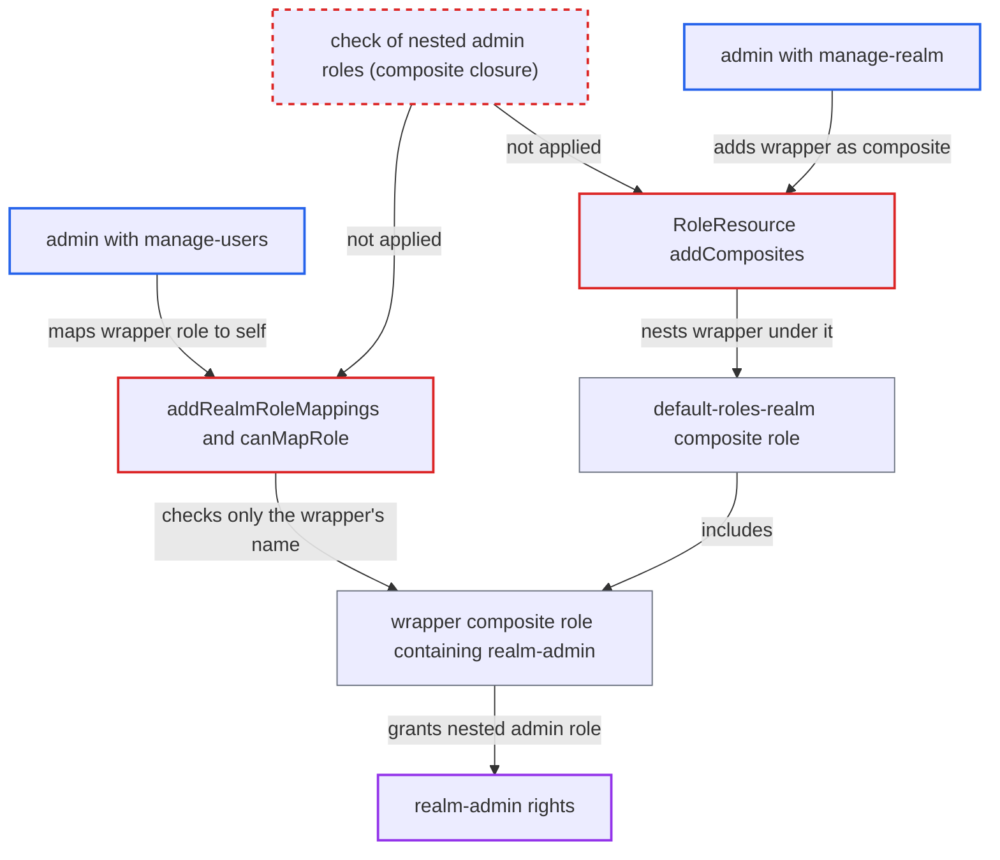

# Role mapping admin-role guard ignores admin roles nested in composite roles

| Field | Value |
|---|---|
| ID | `find_012ar4FWBKP58QpXk6XVTTjS` |
| Severity | **High** |
| Status | open |
| CWE | CWE-863 — Improper Authorization |
| Created | 2026-10-27T21:22:51.514929Z |
| Claude Security | https://claude.ai/security/findings/find_012ar4FWBKP58QpXk6XVTTjS |

## Description

A realm admin who holds only `manage-users` can give themselves full `realm-admin`, or any other admin role they lack. This works only if a full admin has already created a composite role with an ordinary name that contains that admin role. The role-mapping checks `RolePermissionsV2.canMapRole` and `RolePermissions.checkAdminRoles` judge a role by its own name and container, and never look at its composites.

1. **Full admin** creates a composite role R with an ordinary name. R contains an admin role such as `realm-admin`. This is the precondition. A limited admin cannot create it, because adding `realm-admin` as a composite hits `checkAdminRoles`.
2. **Attacker with `manage-users`** sends `POST /admin/realms/{r}/users/{self}/role-mappings/realm` with R. The attacker targets their own user and names the wrapper role R, not the admin role inside it. ([`services/src/main/java/org/keycloak/services/resources/admin/RoleMapperResource.java:281-294`](https://github.com/cx-benchmark/keycloak/blob/1d7be35d0764060a8143fc74b0aabf2442743be4/services/src/main/java/org/keycloak/services/resources/admin/RoleMapperResource.java#L281-L294))
3. **the handler `addRealmRoleMappings`** checks permission on R only, then grants it. `requireMapRoles(user)` passes for `manage-users`, and `requireMapRole(R)` is run on the wrapper alone. The admin roles nested inside R are never checked before `grantRole`. ([`services/src/main/java/org/keycloak/services/resources/admin/RoleMapperResource.java:281-294`](https://github.com/cx-benchmark/keycloak/blob/1d7be35d0764060a8143fc74b0aabf2442743be4/services/src/main/java/org/keycloak/services/resources/admin/RoleMapperResource.java#L281-L294))
4. **`RolePermissionsV2.canMapRole`** returns `true` for R. `isRealmAdminRole` looks only at R's own container and name. It sees a non-admin role, so lines 59-61 allow the mapping without looking at R's composites. ([`services/src/main/java/org/keycloak/services/resources/admin/fgap/RolePermissionsV2.java:49-71`](https://github.com/cx-benchmark/keycloak/blob/1d7be35d0764060a8143fc74b0aabf2442743be4/services/src/main/java/org/keycloak/services/resources/admin/fgap/RolePermissionsV2.java#L49-L71))
5. **`isRealmAdminRole`** classifies R as a non-admin role. It checks only the role's own container and whether its name is in `AdminRoles.ALL_ROLES`. ([`services/src/main/java/org/keycloak/services/resources/admin/fgap/RolePermissionsV2.java:183-196`](https://github.com/cx-benchmark/keycloak/blob/1d7be35d0764060a8143fc74b0aabf2442743be4/services/src/main/java/org/keycloak/services/resources/admin/fgap/RolePermissionsV2.java#L183-L196))
6. **`AdminAuth`** authorizes the attacker as `realm-admin` on the next request. `user.hasRole` expands composites, so the nested admin role counts as held. ([`services/src/main/java/org/keycloak/services/resources/admin/AdminAuth.java:81-89`](https://github.com/cx-benchmark/keycloak/blob/1d7be35d0764060a8143fc74b0aabf2442743be4/services/src/main/java/org/keycloak/services/resources/admin/AdminAuth.java#L81-L89))

## Assessment

The attacker is a realm admin holding `realm-management/manage-users`. A full admin must already have created a composite role with a non-admin name that contains an admin role the attacker lacks, for example `realm-admin`. The default `admin-fine-grained-authz:v2` mode is affected, and the V1 guard `checkAdminRoles` has the same gap. A second route exists for an admin holding `manage-realm`. That admin can add the wrapper to `default-roles-<realm>` with `POST /roles-by-id/{id}/composites`, or via `RoleContainerResource.createRole`. For client roles, `manage-clients` is enough to nest the wrapper, and `ClientRoleMappingsResource.addClientRoleMapping` is a second mapping entry point.

Impact: The limited admin gains every admin role nested in the wrapper, typically `realm-admin`. That allows reading users, clients, client secrets and IdP configuration, and changing realm settings, keys and roles. It also allows creating further admins and deleting the realm. A wrapper in the master realm that contains master `admin` would give server-wide administration. The gain is limited to the admin roles reachable through existing composite roles.

## Recommendation

`RolePermissionsV2.canMapRole`, `canMapComposite` (through `isRealmAdminRole`) and V1 `RolePermissions.checkAdminRoles` judge a role only by its own name and container. The decision is made on the wrapper, not on the roles the grant actually confers.

Fix criteria: Mapping a role to a user or group, or adding it as a composite, is refused unless the caller may map every admin role in the role's composite closure. This is the same rule `GroupUtils.checkAdminGroupRoles` applies on group join, and it holds in both V1 and V2. Test: with a realm role `wrapper` composed of `realm-management/realm-admin`, a `manage-users`-only admin gets 403 on `POST .../users/{id}/role-mappings/realm [wrapper]`. A `manage-realm`-only admin gets 403 on `POST /roles-by-id/{default-roles}/composites [wrapper]`.

## Evidence

**https://github.com/cx-benchmark/keycloak**

- [`services/src/main/java/org/keycloak/services/resources/admin/fgap/RolePermissionsV2.java:49-71`](https://github.com/cx-benchmark/keycloak/blob/1d7be35d0764060a8143fc74b0aabf2442743be4/services/src/main/java/org/keycloak/services/resources/admin/fgap/RolePermissionsV2.java#L49-L71)
- [`services/src/main/java/org/keycloak/services/resources/admin/fgap/RolePermissionsV2.java:183-196`](https://github.com/cx-benchmark/keycloak/blob/1d7be35d0764060a8143fc74b0aabf2442743be4/services/src/main/java/org/keycloak/services/resources/admin/fgap/RolePermissionsV2.java#L183-L196)
- [`services/src/main/java/org/keycloak/services/resources/admin/fgap/RolePermissionsV2.java:74-103`](https://github.com/cx-benchmark/keycloak/blob/1d7be35d0764060a8143fc74b0aabf2442743be4/services/src/main/java/org/keycloak/services/resources/admin/fgap/RolePermissionsV2.java#L74-L103)
- [`services/src/main/java/org/keycloak/services/resources/admin/fgap/RolePermissions.java:154-156`](https://github.com/cx-benchmark/keycloak/blob/1d7be35d0764060a8143fc74b0aabf2442743be4/services/src/main/java/org/keycloak/services/resources/admin/fgap/RolePermissions.java#L154-L156)
- [`services/src/main/java/org/keycloak/services/resources/admin/RoleMapperResource.java:281-294`](https://github.com/cx-benchmark/keycloak/blob/1d7be35d0764060a8143fc74b0aabf2442743be4/services/src/main/java/org/keycloak/services/resources/admin/RoleMapperResource.java#L281-L294)
- [`services/src/main/java/org/keycloak/services/resources/admin/RoleResource.java:124-131`](https://github.com/cx-benchmark/keycloak/blob/1d7be35d0764060a8143fc74b0aabf2442743be4/services/src/main/java/org/keycloak/services/resources/admin/RoleResource.java#L124-L131)
- [`services/src/main/java/org/keycloak/services/resources/admin/AdminAuth.java:81-89`](https://github.com/cx-benchmark/keycloak/blob/1d7be35d0764060a8143fc74b0aabf2442743be4/services/src/main/java/org/keycloak/services/resources/admin/AdminAuth.java#L81-L89)
- [`services/src/main/java/org/keycloak/utils/GroupUtils.java:251-272`](https://github.com/cx-benchmark/keycloak/blob/1d7be35d0764060a8143fc74b0aabf2442743be4/services/src/main/java/org/keycloak/utils/GroupUtils.java#L251-L272)
- [`tests/base/src/test/java/org/keycloak/tests/admin/authz/rbac/RealmAdminAccessTest.java:1674-1704`](https://github.com/cx-benchmark/keycloak/blob/1d7be35d0764060a8143fc74b0aabf2442743be4/tests/base/src/test/java/org/keycloak/tests/admin/authz/rbac/RealmAdminAccessTest.java#L1674-L1704)

