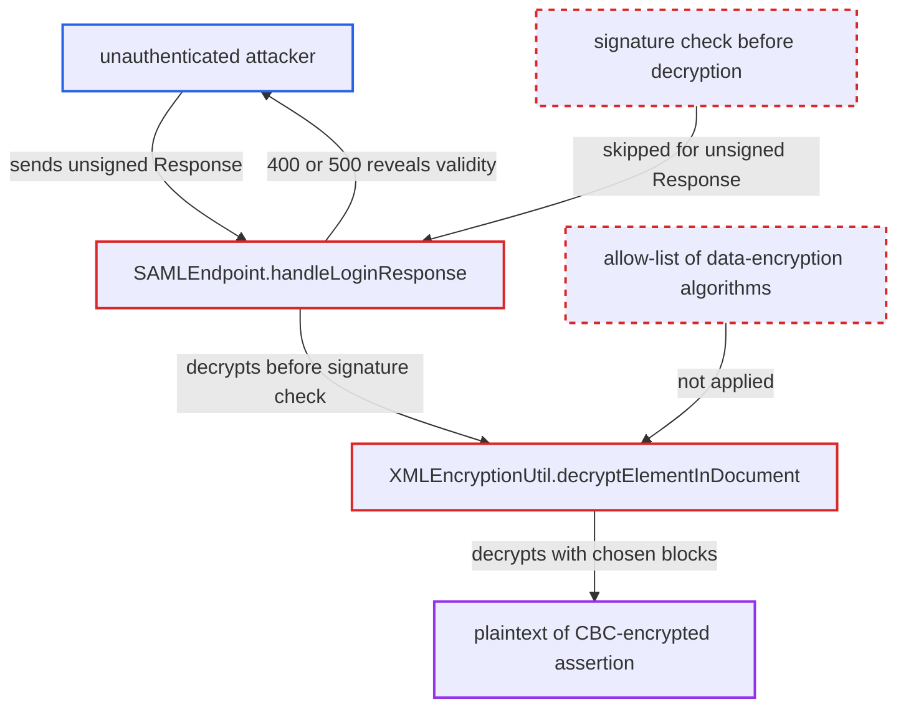

# SAML broker leaks XML-Encryption CBC decryption validity via 400/500 responses before signature check

| Field | Value |
|---|---|
| ID | `find_01LL12vYfthi3tfz1M3Mq7iq` |
| Severity | **High** |
| Status | open |
| CWE | CWE-204 — Padding oracle |
| Created | 2026-10-27T21:51:52.084592Z |
| Claude Security | https://claude.ai/security/findings/find_01LL12vYfthi3tfz1M3Mq7iq |

## Description

An unauthenticated internet client can recover the plaintext of a captured SAML assertion that the IdP encrypted with an AES-CBC algorithm. That plaintext includes the NameID and attributes. The attacker needs a captured encrypted Response and can then query the broker endpoint repeatedly. The cause is `SAMLEndpoint.handleLoginResponse`, which decrypts unsigned input before any signature check and answers 400 or 500 depending on how decryption fails.

1. **attacker** captures a CBC-encrypted SAML Response sent to the realm. The report gives proxy logs or a HAR file as examples of where it can come from.
2. **attacker** starts their own broker login for each query. This gives a fresh RelayState and auth-session cookie, because `CodeGenerateUtil.verifyCode` removes the code at line 143, so each query needs a new one.
3. **attacker** POSTs an unsigned Response to `/realms/{realm}/broker/{alias}/endpoint`. The Response carries the original `EncryptedKey`, an `aes*-cbc` algorithm and a chosen IV and ciphertext block. `PostBinding.verifySignature` returns without checking anything when the Response has no plaintext `ds:Signature` and contains an assertion. ([`services/src/main/java/org/keycloak/broker/saml/SAMLEndpoint.java:957-967`](https://github.com/cx-benchmark/keycloak/blob/1d7be35d0764060a8143fc74b0aabf2442743be4/services/src/main/java/org/keycloak/broker/saml/SAMLEndpoint.java#L957-L967))
4. **the handler `handleLoginResponse`** decrypts the `EncryptedAssertion` before any signature check. The signature checks only come later, at lines 621-631. ([`services/src/main/java/org/keycloak/broker/saml/SAMLEndpoint.java:587-594`](https://github.com/cx-benchmark/keycloak/blob/1d7be35d0764060a8143fc74b0aabf2442743be4/services/src/main/java/org/keycloak/broker/saml/SAMLEndpoint.java#L587-L594))
5. **the method `decryptElementInDocument`** uses the algorithm named in the message and unwraps the content key. The symmetric algorithm comes from the attacker's `EncryptionMethod` with no allow-list. The default `rsa-enc-generated` RSA-OAEP key unwraps the captured key, because `SAMLDecryptionKeysLocator` filters only by key-transport algorithm. ([`saml-core/src/main/java/org/keycloak/saml/processing/core/util/XMLEncryptionUtil.java:328-357`](https://github.com/cx-benchmark/keycloak/blob/1d7be35d0764060a8143fc74b0aabf2442743be4/saml-core/src/main/java/org/keycloak/saml/processing/core/util/XMLEncryptionUtil.java#L328-L357))
6. **the handler `handleLoginResponse`** answers 400 for bad padding or unparseable plaintext. These failures become a `ProcessingException`, which is mapped to an empty 400 response. ([`services/src/main/java/org/keycloak/broker/saml/SAMLEndpoint.java:587-594`](https://github.com/cx-benchmark/keycloak/blob/1d7be35d0764060a8143fc74b0aabf2442743be4/services/src/main/java/org/keycloak/broker/saml/SAMLEndpoint.java#L587-L594))
7. **the error path** answers 500 when the plaintext has valid padding and parses as well-formed XML. This raises `nullValueError`, a `ParsingException` or a `ClassCastException`. None of these is a `ProcessingException`, so they become an `IdentityBrokerException`, which `KeycloakErrorHandler.getResponseStatus` renders as HTTP 500. ([`services/src/main/java/org/keycloak/services/error/KeycloakErrorHandler.java:120-138`](https://github.com/cx-benchmark/keycloak/blob/1d7be35d0764060a8143fc74b0aabf2442743be4/services/src/main/java/org/keycloak/services/error/KeycloakErrorHandler.java#L120-L138))
8. **attacker** repeats the queries and reads each 400 or 500 as invalid or valid. This is the Jager-Somorovsky XML Encryption CBC attack, which recovers the assertion plaintext byte by byte.

## Assessment

The attacker is an unauthenticated client on the internet. They hold a captured SAML Response that the IdP encrypted with an AES-CBC algorithm. They can reach the broker endpoint `/realms/{realm}/broker/{alias}/endpoint` and can start a broker login to get a fresh RelayState and auth-session cookie for each query. No special setting is needed, because every realm has a default `rsa-enc-generated` RSA-OAEP ENC key. Assertions encrypted with RSA-1.5 key transport are not part of this finding. That route needs an admin-created `RSA1_5` ENC key and gives no distinct error outcome.

Impact: The attacker can recover the plaintext of captured CBC-encrypted assertions, such as NameID, attributes and authentication context. This is the user data that assertion encryption is meant to hide from intermediaries. They gain no signing key, private key or session and cannot forge an assertion that passes signature checks. Assertions encrypted with AES-GCM are not shown to be recoverable this way, and Keycloak's own SAML IdP defaults to AES-256-GCM.

## Recommendation

(1) `SAMLEndpoint.handleLoginResponse` answers decryption failures (`ProcessingException`) with an empty 400. Failures after decryption become an `IdentityBrokerException` and a 500. The response therefore tells the sender whether the decrypted bytes had valid padding and were well-formed XML.

Fix criteria: Every failure from the start of decryption until the assertion is fully validated gives the same response, with identical status, body and headers. A ciphertext with bad padding and one that decrypts to well-formed garbage get byte-identical answers. Where the IdP configuration allows it, authenticity is established before decryption, or ciphertexts in unauthenticated modes are rejected before any cipher operation.

(2) `XMLEncryptionUtil.decryptElementInDocument` lets the untrusted message choose the symmetric data algorithm. Unauthenticated, malleable CBC ciphertexts are therefore decrypted for every brokered IdP, whatever algorithm that IdP is configured or expected to use.

Fix criteria: Decryption proceeds only for an allow-listed set of data-encryption algorithms. Authenticated modes such as AES-GCM are the default, and CBC is allowed only where an administrator has enabled it for that IdP. An `EncryptedData` naming a non-allowed algorithm is rejected before the content key is unwrapped. An unsigned Response carrying a captured `EncryptedKey` and an `aes256-cbc` `EncryptedData` is rejected identically, whatever its ciphertext.

## Evidence

**https://github.com/cx-benchmark/keycloak**

- [`saml-core/src/main/java/org/keycloak/saml/processing/core/util/XMLEncryptionUtil.java:328-357`](https://github.com/cx-benchmark/keycloak/blob/1d7be35d0764060a8143fc74b0aabf2442743be4/saml-core/src/main/java/org/keycloak/saml/processing/core/util/XMLEncryptionUtil.java#L328-L357)
- [`services/src/main/java/org/keycloak/broker/saml/SAMLEndpoint.java:587-594`](https://github.com/cx-benchmark/keycloak/blob/1d7be35d0764060a8143fc74b0aabf2442743be4/services/src/main/java/org/keycloak/broker/saml/SAMLEndpoint.java#L587-L594)
- [`services/src/main/java/org/keycloak/broker/saml/SAMLEndpoint.java:957-967`](https://github.com/cx-benchmark/keycloak/blob/1d7be35d0764060a8143fc74b0aabf2442743be4/services/src/main/java/org/keycloak/broker/saml/SAMLEndpoint.java#L957-L967)
- [`saml-core/src/main/java/org/keycloak/saml/processing/core/saml/v2/util/AssertionUtil.java:639-646`](https://github.com/cx-benchmark/keycloak/blob/1d7be35d0764060a8143fc74b0aabf2442743be4/saml-core/src/main/java/org/keycloak/saml/processing/core/saml/v2/util/AssertionUtil.java#L639-L646)
- [`services/src/main/java/org/keycloak/services/error/KeycloakErrorHandler.java:120-138`](https://github.com/cx-benchmark/keycloak/blob/1d7be35d0764060a8143fc74b0aabf2442743be4/services/src/main/java/org/keycloak/services/error/KeycloakErrorHandler.java#L120-L138)
- [`services/src/main/java/org/keycloak/protocol/saml/SAMLDecryptionKeysLocator.java:110-156`](https://github.com/cx-benchmark/keycloak/blob/1d7be35d0764060a8143fc74b0aabf2442743be4/services/src/main/java/org/keycloak/protocol/saml/SAMLDecryptionKeysLocator.java#L110-L156)
- [`server-spi-private/src/main/java/org/keycloak/models/utils/DefaultKeyProviders.java:41-74`](https://github.com/cx-benchmark/keycloak/blob/1d7be35d0764060a8143fc74b0aabf2442743be4/server-spi-private/src/main/java/org/keycloak/models/utils/DefaultKeyProviders.java#L41-L74)

