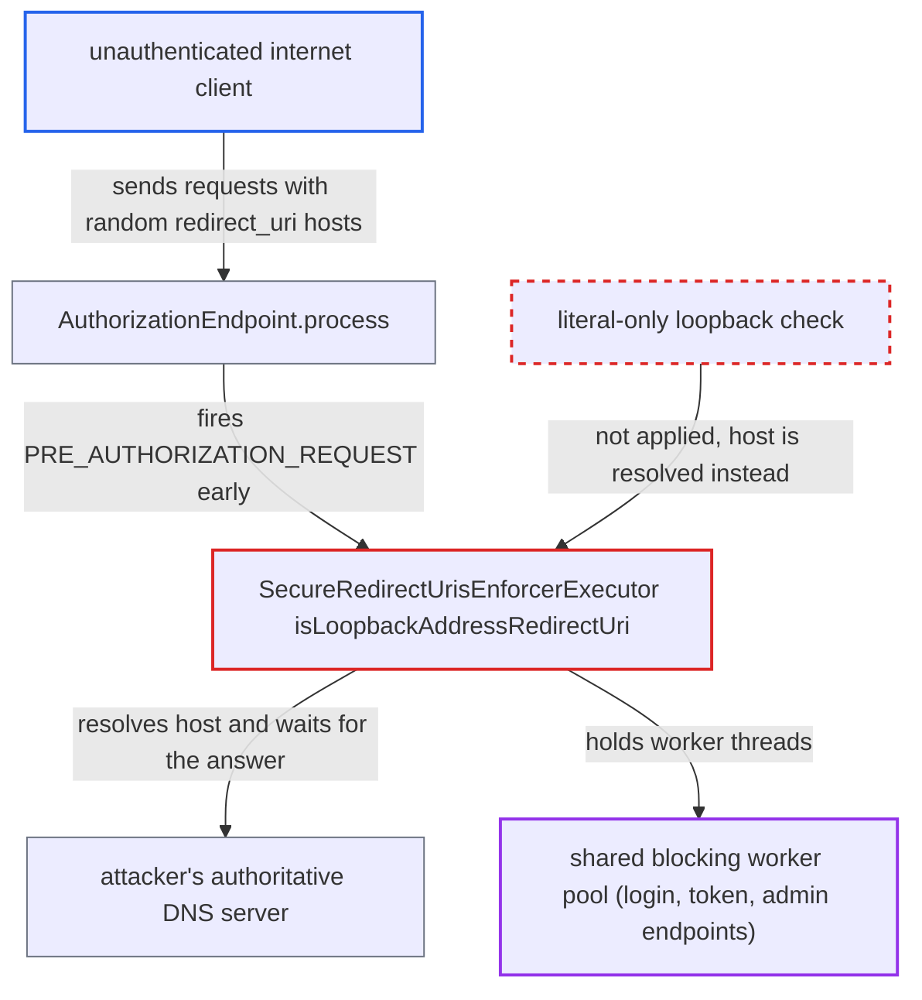

# secure-redirect-uris-enforcer does blocking DNS lookups of unauthenticated redirect_uri hosts

| Field | Value |
|---|---|
| ID | `find_012XdPB5s44zV1Xzwy59hfc2` |
| Severity | **High** |
| Status | open |
| CWE | CWE-400 — Uncontrolled resource consumption |
| Created | 2026-10-27T21:28:26.917175Z |
| Claude Security | https://claude.ai/security/findings/find_012XdPB5s44zV1Xzwy59hfc2 |

## Description

An unauthenticated internet client can make a Keycloak server stop answering login, token and admin requests for every realm, for as long as the attack lasts. It works only when a realm has an enabled client policy that applies a profile with `secure-redirect-uris-enforcer`, for example the built-in OAuth 2.1 profiles with an `any-client` condition. The cause is `isLoopbackAddressRedirectUri()`, which runs a blocking DNS lookup on the attacker's `redirect_uri` host before any client check.

1. **Attacker** sends many authorization requests with a fresh random host in `redirect_uri`. Each request looks like `GET .../auth?client_id=account-console&response_type=code&redirect_uri=https://<random>.attacker.example/`, and the random label means no lookup result is ever cached. ([`services/src/main/java/org/keycloak/services/clientpolicy/executor/SecureRedirectUrisEnforcerExecutor.java:189-200`](https://github.com/cx-benchmark/keycloak/blob/1d7be35d0764060a8143fc74b0aabf2442743be4/services/src/main/java/org/keycloak/services/clientpolicy/executor/SecureRedirectUrisEnforcerExecutor.java#L189-L200))
2. **the endpoint `AuthorizationEndpoint.process()`** fires `PRE_AUTHORIZATION_REQUEST` early. This happens before the client is checked and before `redirect_uri` is compared with the client's registered URIs, so no login is needed. ([`services/src/main/java/org/keycloak/protocol/oidc/endpoints/AuthorizationEndpoint.java:138-166`](https://github.com/cx-benchmark/keycloak/blob/1d7be35d0764060a8143fc74b0aabf2442743be4/services/src/main/java/org/keycloak/protocol/oidc/endpoints/AuthorizationEndpoint.java#L138-L166))
3. **the client policy manager** selects a policy whose profile includes the executor. A policy applies when at least one condition votes YES and none votes NO. `any-client` always votes YES, and `client-roles` and `client-attributes` also evaluate this event. ([`services/src/main/java/org/keycloak/services/clientpolicy/DefaultClientPolicyManager.java:84-133`](https://github.com/cx-benchmark/keycloak/blob/1d7be35d0764060a8143fc74b0aabf2442743be4/services/src/main/java/org/keycloak/services/clientpolicy/DefaultClientPolicyManager.java#L84-L133))
4. **the executor `SecureRedirectUrisEnforcerExecutor`** validates the raw `redirect_uri` and classifies it through `identifyUriType()`. `identifyUriType()` always tries the IPv4 and then the IPv6 loopback check, whatever the `allow-ipv4/6-loopback-address` settings say. ([`services/src/main/java/org/keycloak/services/clientpolicy/executor/SecureRedirectUrisEnforcerExecutor.java:308-321`](https://github.com/cx-benchmark/keycloak/blob/1d7be35d0764060a8143fc74b0aabf2442743be4/services/src/main/java/org/keycloak/services/clientpolicy/executor/SecureRedirectUrisEnforcerExecutor.java#L308-L321))
5. **the method `isLoopbackAddressRedirectUri()`** calls `InetAddress.getByName(uri.getHost())` on the attacker's host. For a host that is not an IP literal this is a blocking system name lookup, and Keycloak sets no timeout on it. ([`services/src/main/java/org/keycloak/services/clientpolicy/executor/SecureRedirectUrisEnforcerExecutor.java:333-350`](https://github.com/cx-benchmark/keycloak/blob/1d7be35d0764060a8143fc74b0aabf2442743be4/services/src/main/java/org/keycloak/services/clientpolicy/executor/SecureRedirectUrisEnforcerExecutor.java#L333-L350))
6. **Attacker's DNS server** delays or withholds its answers. Each request keeps a worker thread busy until the OS resolver's timeout and retry settings end the lookup. The default pool has `max(50, 4*cores)` threads and an unbounded queue, so other requests wait or fail. ([`quarkus/config-api/src/main/java/org/keycloak/config/HttpOptions.java:132-144`](https://github.com/cx-benchmark/keycloak/blob/1d7be35d0764060a8143fc74b0aabf2442743be4/quarkus/config-api/src/main/java/org/keycloak/config/HttpOptions.java#L132-L144))

## Assessment

The attacker is an unauthenticated client on the internet who can reach `/realms/{realm}/protocol/openid-connect/*`. No victim action is needed. The realm must have an enabled client policy that applies a profile with `secure-redirect-uris-enforcer`, such as the built-in `oauth-2-1-for-public-client` or `oauth-2-1-for-confidential-client`. The policy's conditions must vote YES for `PRE_AUTHORIZATION_REQUEST`. `any-client` always does, and `client-roles` and `client-attributes` look up the named client. The admin guide recommends the Any Client and Client Role conditions together with the OAuth 2.1 profiles. The attacker also needs a DNS name whose authoritative server they control, and `client_id` must name an existing client with standard or implicit flow enabled, such as `account-console`. The shipped `lax` and `strict` security-profile policies (conditions `client-type` and `client-access-type`) abstain at this event and do not expose this path. A second, weaker effect exists. A hostname that resolves to `127.0.0.1` for Keycloak's resolver is checked under `isValidLoopbackAddress()`, which never applies `allow-permitted-domains`. If an admin enables both that option and loopback addresses, a client registrant who controls split-horizon DNS can register a redirect host outside the permitted domains.

Impact: The attacker can use up the shared worker pool, 50 threads by default, with stalled DNS lookups. Login, token and admin endpoints of every realm then queue or stop responding while the attack lasts. No data is disclosed. The permitted-domains bypass needs a different actor (a client registrant) and extra settings.

## Recommendation

`UriValidation.isLoopbackAddressRedirectUri()` resolves the untrusted redirect-URI host with `InetAddress.getByName`. Its cost, a blocking network lookup per request, and its security classification both depend on an attacker-controlled DNS server.

Fix criteria: Loopback classification is a pure literal check: IPv4 `127.0.0.0/8` literals, `[::1]`, and `localhost` if allowed. No name resolution happens for hosts supplied in a request or by a registrant. Any other hostname is validated by the normal-URI rules, including `allow-permitted-domains`. An authorization request with `redirect_uri=https://<unresolvable>.example/` under an `any-client` OAuth 2.1 policy makes no resolver call. A public host that resolves to `127.0.0.1` is rejected by `allow-permitted-domains`.

## Evidence

**https://github.com/cx-benchmark/keycloak**

- [`services/src/main/java/org/keycloak/services/clientpolicy/executor/SecureRedirectUrisEnforcerExecutor.java:333-350`](https://github.com/cx-benchmark/keycloak/blob/1d7be35d0764060a8143fc74b0aabf2442743be4/services/src/main/java/org/keycloak/services/clientpolicy/executor/SecureRedirectUrisEnforcerExecutor.java#L333-L350)
- [`services/src/main/java/org/keycloak/services/clientpolicy/executor/SecureRedirectUrisEnforcerExecutor.java:308-321`](https://github.com/cx-benchmark/keycloak/blob/1d7be35d0764060a8143fc74b0aabf2442743be4/services/src/main/java/org/keycloak/services/clientpolicy/executor/SecureRedirectUrisEnforcerExecutor.java#L308-L321)
- [`services/src/main/java/org/keycloak/services/clientpolicy/executor/SecureRedirectUrisEnforcerExecutor.java:189-200`](https://github.com/cx-benchmark/keycloak/blob/1d7be35d0764060a8143fc74b0aabf2442743be4/services/src/main/java/org/keycloak/services/clientpolicy/executor/SecureRedirectUrisEnforcerExecutor.java#L189-L200)
- [`services/src/main/java/org/keycloak/protocol/oidc/endpoints/AuthorizationEndpoint.java:138-166`](https://github.com/cx-benchmark/keycloak/blob/1d7be35d0764060a8143fc74b0aabf2442743be4/services/src/main/java/org/keycloak/protocol/oidc/endpoints/AuthorizationEndpoint.java#L138-L166)
- [`services/src/main/java/org/keycloak/services/clientpolicy/DefaultClientPolicyManager.java:84-133`](https://github.com/cx-benchmark/keycloak/blob/1d7be35d0764060a8143fc74b0aabf2442743be4/services/src/main/java/org/keycloak/services/clientpolicy/DefaultClientPolicyManager.java#L84-L133)
- [`quarkus/config-api/src/main/java/org/keycloak/config/HttpOptions.java:132-144`](https://github.com/cx-benchmark/keycloak/blob/1d7be35d0764060a8143fc74b0aabf2442743be4/quarkus/config-api/src/main/java/org/keycloak/config/HttpOptions.java#L132-L144)
- [`services/src/main/java/org/keycloak/services/clientpolicy/executor/SecureRedirectUrisEnforcerExecutor.java:282-306`](https://github.com/cx-benchmark/keycloak/blob/1d7be35d0764060a8143fc74b0aabf2442743be4/services/src/main/java/org/keycloak/services/clientpolicy/executor/SecureRedirectUrisEnforcerExecutor.java#L282-L306)

