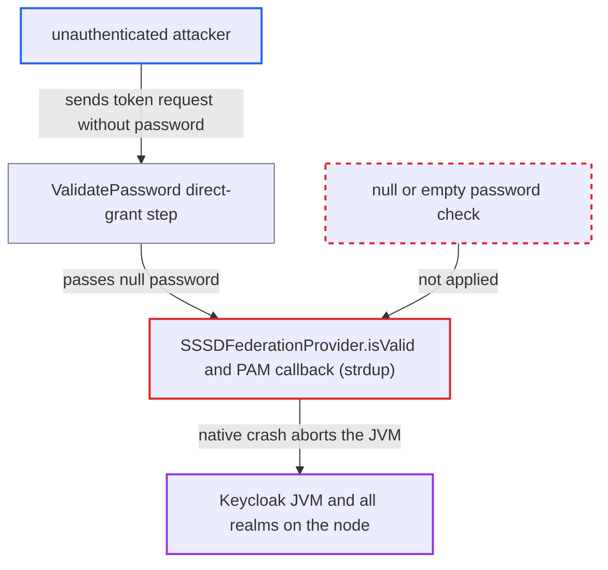

# SSSD provider passes null password to native strdup, crashing the JVM

| Field | Value |
|---|---|
| ID | `find_01ER1djpJrhJAtUrGwb5BjRq` |
| Severity | **High** |
| Status | open |
| CWE | CWE-476 — NULL Pointer Dereference |
| Created | 2026-10-27T22:03:26.040897Z |
| Claude Security | https://claude.ai/security/findings/find_01ER1djpJrhJAtUrGwb5BjRq |

## Description

An unauthenticated attacker can crash the whole Keycloak node, and every realm on it, with one request. The attacker needs the username of a user linked to the SSSD provider and a realm with SSSD federation configured. The request is a direct-grant token request with the `password` parameter left out. `SSSDFederationProvider.isValid` passes that `null` to native code through JNA, where `strdup` faults and the JVM aborts.

1. **Attacker** sends a password-grant token request with no password. The request is `POST /realms/{realm}/protocol/openid-connect/token` with `grant_type=password`, `client_id=admin-cli` and a `username` of an SSSD-resolvable user. The public `admin-cli` client needs no client secret. ([`services/src/main/java/org/keycloak/services/managers/RealmManager.java:227-237`](https://github.com/cx-benchmark/keycloak/blob/1d7be35d0764060a8143fc74b0aabf2442743be4/services/src/main/java/org/keycloak/services/managers/RealmManager.java#L227-L237))
2. **the authenticator `ValidatePassword`** builds the credential from the missing parameter and passes it on unchecked. `inputData.getFirst("password")` returns `null` when the parameter is absent, and `UserCredentialModel.password(password)` wraps that `null`. `ValidatePassword` is REQUIRED in the default direct-grant flow. ([`services/src/main/java/org/keycloak/authentication/authenticators/directgrant/ValidatePassword.java:48-50`](https://github.com/cx-benchmark/keycloak/blob/1d7be35d0764060a8143fc74b0aabf2442743be4/services/src/main/java/org/keycloak/authentication/authenticators/directgrant/ValidatePassword.java#L48-L50))
3. **`UserCredentialManager.isValid`** hands the raw input to the SSSD provider. The user's federation link is the SSSD component, so its credential validator is called. Nothing on the way rejects a `null` challenge response. ([`model/storage/src/main/java/org/keycloak/credential/UserCredentialManager.java:79-86`](https://github.com/cx-benchmark/keycloak/blob/1d7be35d0764060a8143fc74b0aabf2442743be4/model/storage/src/main/java/org/keycloak/credential/UserCredentialManager.java#L79-L86))
4. **`SSSDFederationProvider.isValid`** passes the `null` challenge response to the PAM authenticator. It checks only the credential type and class. Java varargs turn the `null` into `factors = [null]`, so the array itself is not `null`. ([`federation/sssd/src/main/java/org/keycloak/federation/sssd/SSSDFederationProvider.java:195-201`](https://github.com/cx-benchmark/keycloak/blob/1d7be35d0764060a8143fc74b0aabf2442743be4/federation/sssd/src/main/java/org/keycloak/federation/sssd/SSSDFederationProvider.java#L195-L201))
5. **the PAM callback in `PAM.java`** answers the password prompt with a `null` element. The callback returns `PAM_CONV_ERR` only when the `factors` array is `null`. The shipped `keycloak` PAM service uses `pam_sss.so`, which asks for the password with `PAM_PROMPT_ECHO_OFF`, so `r.setResp(factors[i])` runs with `null`. ([`federation/sssd/src/main/java/org/jvnet/libpam/PAM.java:83-98`](https://github.com/cx-benchmark/keycloak/blob/1d7be35d0764060a8143fc74b0aabf2442743be4/federation/sssd/src/main/java/org/jvnet/libpam/PAM.java#L83-L98))
6. **`pam_response.setResp`** calls `libc.strdup(null)`. JNA passes the `null` `String` as a NULL pointer, and glibc `strdup` faults in `strlen` with SIGSEGV. ([`federation/sssd/src/main/java/org/jvnet/libpam/impl/PAMLibrary.java:101-103`](https://github.com/cx-benchmark/keycloak/blob/1d7be35d0764060a8143fc74b0aabf2442743be4/federation/sssd/src/main/java/org/jvnet/libpam/impl/PAMLibrary.java#L101-L103))
7. **the JVM** aborts with a fatal native error. `PAMAuthenticator.authenticate()` catches only `PAMException`, and HotSpot cannot turn a SIGSEGV in foreign code into a Java exception. The whole process dies. ([`federation/sssd/src/main/java/org/keycloak/federation/sssd/impl/PAMAuthenticator.java:48-63`](https://github.com/cx-benchmark/keycloak/blob/1d7be35d0764060a8143fc74b0aabf2442743be4/federation/sssd/src/main/java/org/keycloak/federation/sssd/impl/PAMAuthenticator.java#L48-L63))

## Assessment

The attacker is unauthenticated and works over the network. They need the username of a user that SSSD can resolve, for example FreeIPA's default `admin`. The realm must have the SSSD federation provider configured, which is a deployment condition the attacker does not control. The attack goes through the token endpoint with the public `admin-cli` client, which every realm has with direct access grants enabled. The browser login form is not an entry point, because `AbstractUsernameFormAuthenticator` rejects a `null` or empty password. The disabled-user branch of `ValidateUsername` has no such check either. The report assumes JNA 5.x from the Quarkus BOM (version not pinned in the repo) marshals a `null` `String` as NULL.

Impact: The Keycloak JVM aborts. Every realm, the admin console and all token endpoints on that node stay down until it is restarted. One request per restart keeps it down. No data is disclosed or modified.

## Recommendation

`SSSDFederationProvider.isValid` and the `PAM.authenticate`/`pam_conv` callback let an attacker-controlled, possibly `null` password cross the JNA boundary into `strdup`, which does not accept NULL. The result is a native crash of the whole server.

Fix criteria: A `null` or empty challenge response is rejected as an invalid credential (`isValid` returns `false`) before any native PAM call is made. The conversation callback never hands a `null` string to `strdup`; it responds with `PAM_CONV_ERR` or an empty string instead. Sending the direct-grant request without a `password` parameter for an SSSD-federated user returns `invalid_grant`, and the server process keeps running.

## Evidence

**https://github.com/cx-benchmark/keycloak**

- [`federation/sssd/src/main/java/org/keycloak/federation/sssd/SSSDFederationProvider.java:195-201`](https://github.com/cx-benchmark/keycloak/blob/1d7be35d0764060a8143fc74b0aabf2442743be4/federation/sssd/src/main/java/org/keycloak/federation/sssd/SSSDFederationProvider.java#L195-L201)
- [`federation/sssd/src/main/java/org/jvnet/libpam/PAM.java:83-98`](https://github.com/cx-benchmark/keycloak/blob/1d7be35d0764060a8143fc74b0aabf2442743be4/federation/sssd/src/main/java/org/jvnet/libpam/PAM.java#L83-L98)
- [`federation/sssd/src/main/java/org/jvnet/libpam/impl/PAMLibrary.java:101-103`](https://github.com/cx-benchmark/keycloak/blob/1d7be35d0764060a8143fc74b0aabf2442743be4/federation/sssd/src/main/java/org/jvnet/libpam/impl/PAMLibrary.java#L101-L103)
- [`federation/sssd/src/main/java/org/jvnet/libpam/impl/CLibrary.java:113`](https://github.com/cx-benchmark/keycloak/blob/1d7be35d0764060a8143fc74b0aabf2442743be4/federation/sssd/src/main/java/org/jvnet/libpam/impl/CLibrary.java#L113)
- [`federation/sssd/src/main/java/org/keycloak/federation/sssd/impl/PAMAuthenticator.java:48-63`](https://github.com/cx-benchmark/keycloak/blob/1d7be35d0764060a8143fc74b0aabf2442743be4/federation/sssd/src/main/java/org/keycloak/federation/sssd/impl/PAMAuthenticator.java#L48-L63)
- [`quarkus/dist/src/main/content/bin/federation-sssd-setup.sh:37-43`](https://github.com/cx-benchmark/keycloak/blob/1d7be35d0764060a8143fc74b0aabf2442743be4/quarkus/dist/src/main/content/bin/federation-sssd-setup.sh#L37-L43)
- [`services/src/main/java/org/keycloak/authentication/authenticators/directgrant/ValidatePassword.java:48-50`](https://github.com/cx-benchmark/keycloak/blob/1d7be35d0764060a8143fc74b0aabf2442743be4/services/src/main/java/org/keycloak/authentication/authenticators/directgrant/ValidatePassword.java#L48-L50)
- [`model/storage/src/main/java/org/keycloak/credential/UserCredentialManager.java:79-86`](https://github.com/cx-benchmark/keycloak/blob/1d7be35d0764060a8143fc74b0aabf2442743be4/model/storage/src/main/java/org/keycloak/credential/UserCredentialManager.java#L79-L86)
- [`services/src/main/java/org/keycloak/authentication/authenticators/browser/AbstractUsernameFormAuthenticator.java:219-223`](https://github.com/cx-benchmark/keycloak/blob/1d7be35d0764060a8143fc74b0aabf2442743be4/services/src/main/java/org/keycloak/authentication/authenticators/browser/AbstractUsernameFormAuthenticator.java#L219-L223)
- [`services/src/main/java/org/keycloak/services/managers/RealmManager.java:227-237`](https://github.com/cx-benchmark/keycloak/blob/1d7be35d0764060a8143fc74b0aabf2442743be4/services/src/main/java/org/keycloak/services/managers/RealmManager.java#L227-L237)

