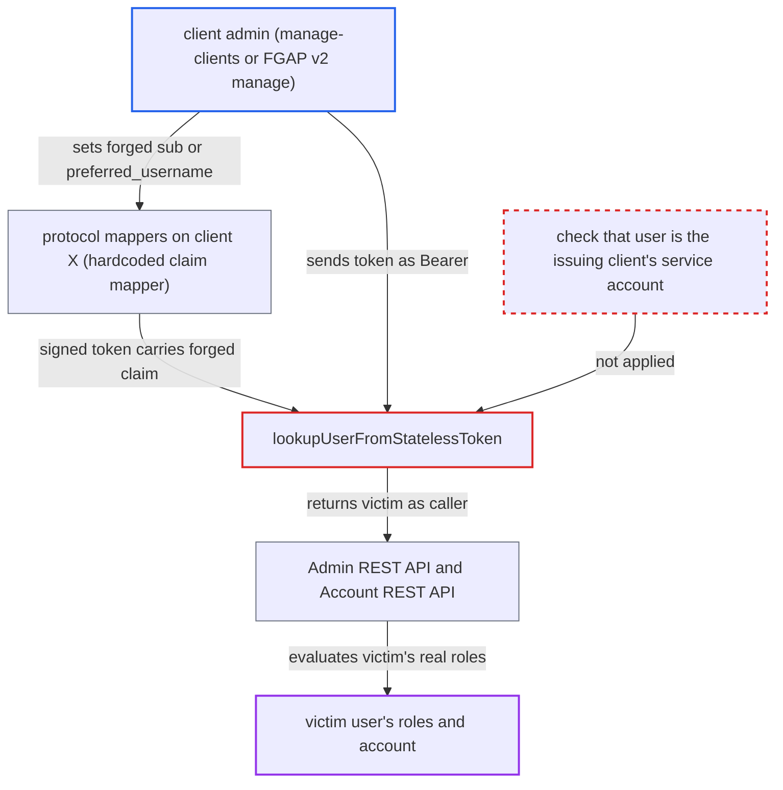

# Stateless token user lookup trusts mapper-writable sub, letting client admins authenticate as any user

| Field | Value |
|---|---|
| ID | `find_0177sQq3FhkyqLAWFX9oXc24` |
| Severity | **High** |
| Status | open |
| CWE | CWE-290 — Authentication bypass by spoofing |
| Created | 2026-10-27T22:13:06.941678Z |
| Claude Security | https://claude.ai/security/findings/find_0177sQq3FhkyqLAWFX9oXc24 |

## Description

A user who can manage protocol mappers on one confidential client can get Keycloak-signed tokens that log them in as any enabled realm user whose id or username they know. That includes a realm admin, which gives full realm administration. It needs `manage-clients` or an FGAP v2 `manage` permission on the client. The cause is `TokenManager.lookupUserFromStatelessToken`, which picks the user from the mapper-writable `sub` or `preferred_username` claim.

1. **attacker with `manage-clients`** configures a client and adds a claim mapper. Through the Admin REST API the attacker makes client `X` confidential with service accounts and full scope, reads its secret, and adds an `oidc-hardcoded-claim-mapper` for access tokens with `sub` set to the victim's id, or `sub=x` plus `preferred_username` set to the victim's username. ([`services/src/main/java/org/keycloak/protocol/oidc/mappers/HardcodedClaim.java:88-93`](https://github.com/cx-benchmark/keycloak/blob/1d7be35d0764060a8143fc74b0aabf2442743be4/services/src/main/java/org/keycloak/protocol/oidc/mappers/HardcodedClaim.java#L88-L93))
2. **mapper helper `OIDCAttributeMapperHelper`** lets the generic mapper overwrite the subject. `tokenPropertySetters` maps `claim.name=sub` to `token.setSubject`, and the mapper's default priority 0 makes it run after `initToken` and `SubMapper` (priority -10) have set the real service-account id. ([`services/src/main/java/org/keycloak/protocol/oidc/mappers/OIDCAttributeMapperHelper.java:104-109`](https://github.com/cx-benchmark/keycloak/blob/1d7be35d0764060a8143fc74b0aabf2442743be4/services/src/main/java/org/keycloak/protocol/oidc/mappers/OIDCAttributeMapperHelper.java#L104-L109))
3. **attacker** requests a token with `grant_type=client_credentials`. With the default settings the session is TRANSIENT and `sid` is removed, so the signed token has no `sid` and its server-set `jti` encodes the TRANSIENT type. ([`services/src/main/java/org/keycloak/protocol/oidc/grants/OAuth2GrantTypeBase.java:141-148`](https://github.com/cx-benchmark/keycloak/blob/1d7be35d0764060a8143fc74b0aabf2442743be4/services/src/main/java/org/keycloak/protocol/oidc/grants/OAuth2GrantTypeBase.java#L141-L148))
4. **attacker** sends the token as a Bearer token to `/admin/realms/R/...` or `/realms/R/account`. `findValidSession` sends any token without `sid` whose `jti` encodes TRANSIENT to `createTransientSessionForClient`. ([`services/src/main/java/org/keycloak/services/util/UserSessionUtil.java:219-233`](https://github.com/cx-benchmark/keycloak/blob/1d7be35d0764060a8143fc74b0aabf2442743be4/services/src/main/java/org/keycloak/services/util/UserSessionUtil.java#L219-L233))
5. **the method `lookupUserFromStatelessToken`** resolves the victim from the token claims. It looks up the user by `sub` and falls back to `preferred_username`, and nothing checks that this user is the issuing client's service account. ([`services/src/main/java/org/keycloak/protocol/oidc/TokenManager.java:306-319`](https://github.com/cx-benchmark/keycloak/blob/1d7be35d0764060a8143fc74b0aabf2442743be4/services/src/main/java/org/keycloak/protocol/oidc/TokenManager.java#L306-L319))
6. **the method `verifyIdentityToken`** accepts the token and returns the victim as the authenticated user. The client check passes because a client session for the `azp` client was just attached, and the user check only tests that the user is enabled and the not-before time. ([`services/src/main/java/org/keycloak/services/managers/AuthenticationManager.java:1620-1646`](https://github.com/cx-benchmark/keycloak/blob/1d7be35d0764060a8143fc74b0aabf2442743be4/services/src/main/java/org/keycloak/services/managers/AuthenticationManager.java#L1620-L1646))
7. **the class `AdminAuth`** grants the victim's real roles to the attacker's request. `hasRealmRole` and `hasAppRole` check `user.hasRole(role) && client.hasScope(role)`, and the attacker's full-scope client passes for every admin role the victim holds. ([`services/src/main/java/org/keycloak/services/resources/admin/AdminAuth.java:60-90`](https://github.com/cx-benchmark/keycloak/blob/1d7be35d0764060a8143fc74b0aabf2442743be4/services/src/main/java/org/keycloak/services/resources/admin/AdminAuth.java#L60-L90))

## Assessment

The attacker holds `manage-clients` in the realm, or an FGAP v2 `manage` permission on a client. They need to know the victim's id or username. The victim must exist and be enabled. No credentials or action from the victim are needed. The default client-credentials token is enough, because the setting `use refresh tokens for client credentials` is off by default and so the session is TRANSIENT. The token can be sent to the Admin REST API, to the Account REST API at `/realms/R/account`, or to userinfo. `KeycloakIdentity.getUserFromToken` and `AuthorizationTokenService` use the same lookup. A pairwise-sub mapper also replaces `sub`, and then the `preferred_username` fallback decides who the caller is.

Impact: The attacker authenticates to Keycloak as any enabled realm user they can name. Choosing a `realm-admin` holder gives full realm administration: users, credentials, client secrets, keys, IdPs and realm deletion. Choosing the master `admin` gives control of every realm. Choosing an ordinary user gives that user's Account API (profile and email changes, credentials, sessions) and userinfo. Admin events record the victim as the actor. The attacker could not otherwise grant admin roles or impersonate users without the `impersonation` role.

## Recommendation

(1) `TokenManager.lookupUserFromStatelessToken` picks the user of a session-less token from `sub` or `preferred_username`. It is used by `UserSessionUtil.createTransientSessionForClient`, `KeycloakIdentity.getUserFromToken` and `AuthorizationTokenService`. Protocol mappers on the issuing client write those claims, so client configuration decides who the caller is.

Fix criteria: For a stateless (TRANSIENT) token, the resolved user is one the server bound at issuance through a reference mappers cannot change. For client credentials that user is the service account of the client that actually authenticated. Neither `sub`, `preferred_username` nor the mapper-writable `azp` decides it. A token whose `sub` or `preferred_username` names another user is rejected. To verify, send a client-credentials token with a hardcoded `sub` or `preferred_username` of another user to the Admin REST, Account REST, userinfo and UMA endpoints. Each must refuse it.

(2) `OIDCAttributeMapperHelper.tokenPropertySetters` lets generic mappers (`HardcodedClaim`, user attribute/property, session note) overwrite `sub`. A client admin can therefore choose the subject that Keycloak signs.

Fix criteria: A generic claim mapper configured with `claim.name=sub` does not change the token subject, the same way `jti` and `iss` assignments are ignored. The dedicated subject and pairwise mappers still work. Issued access tokens still carry the real subject. This fix alone is not sufficient, because the pairwise mapper plus a forged `preferred_username` still reaches the lookup fallback.

## Evidence

**https://github.com/cx-benchmark/keycloak**

- [`services/src/main/java/org/keycloak/protocol/oidc/TokenManager.java:306-319`](https://github.com/cx-benchmark/keycloak/blob/1d7be35d0764060a8143fc74b0aabf2442743be4/services/src/main/java/org/keycloak/protocol/oidc/TokenManager.java#L306-L319)
- [`services/src/main/java/org/keycloak/services/util/UserSessionUtil.java:219-233`](https://github.com/cx-benchmark/keycloak/blob/1d7be35d0764060a8143fc74b0aabf2442743be4/services/src/main/java/org/keycloak/services/util/UserSessionUtil.java#L219-L233)
- [`services/src/main/java/org/keycloak/protocol/oidc/mappers/OIDCAttributeMapperHelper.java:104-109`](https://github.com/cx-benchmark/keycloak/blob/1d7be35d0764060a8143fc74b0aabf2442743be4/services/src/main/java/org/keycloak/protocol/oidc/mappers/OIDCAttributeMapperHelper.java#L104-L109)
- [`services/src/main/java/org/keycloak/protocol/oidc/mappers/HardcodedClaim.java:88-93`](https://github.com/cx-benchmark/keycloak/blob/1d7be35d0764060a8143fc74b0aabf2442743be4/services/src/main/java/org/keycloak/protocol/oidc/mappers/HardcodedClaim.java#L88-L93)
- [`services/src/main/java/org/keycloak/protocol/oidc/TokenManager.java:1105-1118`](https://github.com/cx-benchmark/keycloak/blob/1d7be35d0764060a8143fc74b0aabf2442743be4/services/src/main/java/org/keycloak/protocol/oidc/TokenManager.java#L1105-L1118)
- [`services/src/main/java/org/keycloak/protocol/oidc/grants/ClientCredentialsGrantType.java:116-122`](https://github.com/cx-benchmark/keycloak/blob/1d7be35d0764060a8143fc74b0aabf2442743be4/services/src/main/java/org/keycloak/protocol/oidc/grants/ClientCredentialsGrantType.java#L116-L122)
- [`services/src/main/java/org/keycloak/protocol/oidc/grants/OAuth2GrantTypeBase.java:141-148`](https://github.com/cx-benchmark/keycloak/blob/1d7be35d0764060a8143fc74b0aabf2442743be4/services/src/main/java/org/keycloak/protocol/oidc/grants/OAuth2GrantTypeBase.java#L141-L148)
- [`services/src/main/java/org/keycloak/services/managers/AuthenticationManager.java:1620-1646`](https://github.com/cx-benchmark/keycloak/blob/1d7be35d0764060a8143fc74b0aabf2442743be4/services/src/main/java/org/keycloak/services/managers/AuthenticationManager.java#L1620-L1646)
- [`services/src/main/java/org/keycloak/services/resources/admin/AdminRoot.java:188-221`](https://github.com/cx-benchmark/keycloak/blob/1d7be35d0764060a8143fc74b0aabf2442743be4/services/src/main/java/org/keycloak/services/resources/admin/AdminRoot.java#L188-L221)
- [`services/src/main/java/org/keycloak/services/resources/admin/AdminAuth.java:60-90`](https://github.com/cx-benchmark/keycloak/blob/1d7be35d0764060a8143fc74b0aabf2442743be4/services/src/main/java/org/keycloak/services/resources/admin/AdminAuth.java#L60-L90)
- [`services/src/main/java/org/keycloak/services/resources/account/AccountLoader.java:118-146`](https://github.com/cx-benchmark/keycloak/blob/1d7be35d0764060a8143fc74b0aabf2442743be4/services/src/main/java/org/keycloak/services/resources/account/AccountLoader.java#L118-L146)
- [`docs/documentation/upgrading/topics/changes/changes-25_0_0.adoc:321-323`](https://github.com/cx-benchmark/keycloak/blob/1d7be35d0764060a8143fc74b0aabf2442743be4/docs/documentation/upgrading/topics/changes/changes-25_0_0.adoc#L321-L323)

