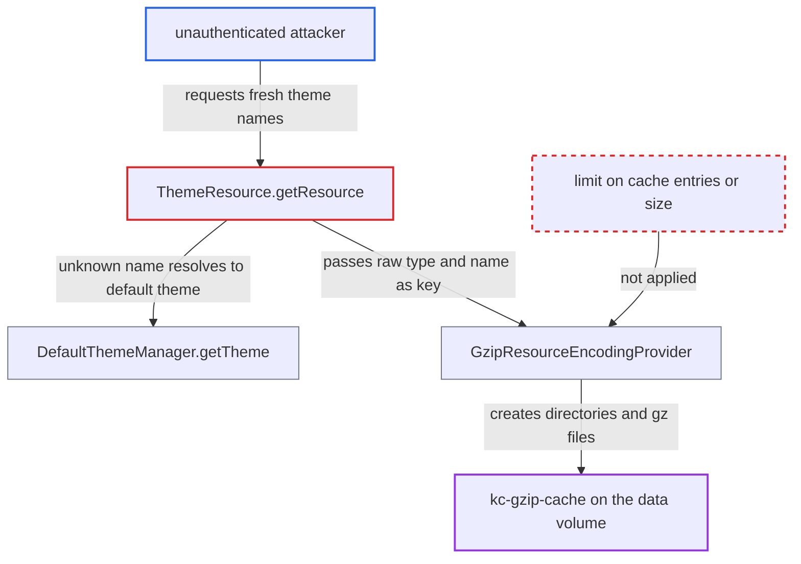

# Theme resource gzip cache keyed by attacker-chosen theme name allows unbounded disk growth

| Field | Value |
|---|---|
| ID | `find_018okNJFrLZn9axdLFPPxUG6` |
| Severity | **High** |
| Status | open |
| CWE | CWE-770 — Resource exhaustion |
| Created | 2026-10-27T21:18:25.265036Z |
| Claude Security | https://claude.ai/security/findings/find_018okNJFrLZn9axdLFPPxUG6 |

## Description

An unauthenticated remote attacker can fill the Keycloak server's data disk, which can degrade or stop the login service. The attack needs no login and works with the default configuration, where theme caching is on and the client sends `Accept-Encoding: gzip`. `ThemeResource.getResource` builds the on-disk gzip cache path from the raw `themeType` and `themeName` URL values, and the cache has no size limit.

1. **attacker** sends a GET request to the theme resource endpoint with a fresh random theme name. The request is `GET /resources/abcde/login/<random-N>/<existing-resource-path>` with `Accept-Encoding: gzip`, and the endpoint needs no authentication. ([`services/src/main/java/org/keycloak/services/resources/ThemeResource.java:90-114`](https://github.com/cx-benchmark/keycloak/blob/1d7be35d0764060a8143fc74b0aabf2442743be4/services/src/main/java/org/keycloak/services/resources/ThemeResource.java#L90-L114))
2. **the handler `ThemeResource.getResource`** resolves the requested name with `getTheme(themeName, type)` and skips the redirect. Only `version` is pattern-checked (five characters of `[0-9a-z]`), and the redirect at line 114 runs only when the resolved name equals the requested name, so an unknown name is served directly. ([`services/src/main/java/org/keycloak/services/resources/ThemeResource.java:90-114`](https://github.com/cx-benchmark/keycloak/blob/1d7be35d0764060a8143fc74b0aabf2442743be4/services/src/main/java/org/keycloak/services/resources/ThemeResource.java#L90-L114))
3. **`DefaultThemeManager.getTheme`** falls back to the built-in default theme for the unknown name. It returns the default theme instead of null and does not cache the name, so any string resolves to a servable theme. ([`services/src/main/java/org/keycloak/theme/DefaultThemeManager.java:80-97`](https://github.com/cx-benchmark/keycloak/blob/1d7be35d0764060a8143fc74b0aabf2442743be4/services/src/main/java/org/keycloak/theme/DefaultThemeManager.java#L80-L97))
4. **the handler `ThemeResource.getResource`** passes the raw `themeType` and `themeName` to `GzipResourceEncodingProvider.getEncodedStream`. This happens when theme caching is enabled and the client accepts gzip. The resolved `theme.getType()` and `theme.getName()` are not used for the key. ([`services/src/main/java/org/keycloak/services/resources/ThemeResource.java:161-168`](https://github.com/cx-benchmark/keycloak/blob/1d7be35d0764060a8143fc74b0aabf2442743be4/services/src/main/java/org/keycloak/services/resources/ThemeResource.java#L161-L168))
5. **`GzipResourceEncodingProvider`** creates new directories and writes a new `.gz` file for the unseen key. It builds `cacheDir/<themeType>/<themeName>/<path>.gz`, calls `mkdirs()` on the parents, writes a temp file and renames it into place, with no limit on entry count or size. ([`services/src/main/java/org/keycloak/encoding/GzipResourceEncodingProvider.java:29-90`](https://github.com/cx-benchmark/keycloak/blob/1d7be35d0764060a8143fc74b0aabf2442743be4/services/src/main/java/org/keycloak/encoding/GzipResourceEncodingProvider.java#L29-L90))
6. **attacker** repeats the request with new names until the volume is full. The cache root is wiped only at startup by `initCacheDir` or by an explicit `clearCache()`, so every entry stays on disk and uses space and inodes. ([`services/src/main/java/org/keycloak/encoding/GzipResourceEncodingProviderFactory.java:88-111`](https://github.com/cx-benchmark/keycloak/blob/1d7be35d0764060a8143fc74b0aabf2442743be4/services/src/main/java/org/keycloak/encoding/GzipResourceEncodingProviderFactory.java#L88-L111))

## Assessment

Any unauthenticated client that can reach the server over the network can attack. It sends requests with `Accept-Encoding: gzip` and a new `themeName` each time. Case variants of a type such as `login` also work, up to 32 of them. The path is enabled by default because `cacheThemes` defaults to true. Only the `%dev` profile in `application.properties` turns it off. The report names no rate limit or size limit in the way, and the attacker can repeat the attack after a restart.

Impact: The attacker can use up disk space and inodes on the Keycloak data volume, and the cache files stay until a restart or an admin cache clear. Once the volume is full, Keycloak's own writes to its data directory fail, including the transaction object store in `data/transaction-logs`. That degrades or stops the login service until an operator steps in. No data is disclosed or modified.

## Recommendation

(1) The on-disk gzip cache key is built from the unvalidated request strings `themeType` and `themeName` instead of the resolved theme. The attacker controls an unbounded key space, and every new value adds a directory tree and a file.

Fix criteria: The cache key comes only from the resolved theme's canonical type and name and a normalized resource path, or the gzip cache is skipped when the requested name or type does not exactly match the resolved theme. Requests with many distinct unknown theme names, or case variants of the type, produce at most one cache entry per real (theme, resource) pair and create no new directories.

(2) The gzip cache has no limit on entry count or total size. Any remaining key variability can still grow it without bound until restart.

Fix criteria: The cache enforces a maximum number of entries or total bytes, either by evicting entries or by serving uncached once the limit is reached. After the limit is hit, further distinct requests are still served and the cache directory stops growing.

## Evidence

**https://github.com/cx-benchmark/keycloak**

- [`services/src/main/java/org/keycloak/services/resources/ThemeResource.java:161-168`](https://github.com/cx-benchmark/keycloak/blob/1d7be35d0764060a8143fc74b0aabf2442743be4/services/src/main/java/org/keycloak/services/resources/ThemeResource.java#L161-L168)
- [`services/src/main/java/org/keycloak/services/resources/ThemeResource.java:90-114`](https://github.com/cx-benchmark/keycloak/blob/1d7be35d0764060a8143fc74b0aabf2442743be4/services/src/main/java/org/keycloak/services/resources/ThemeResource.java#L90-L114)
- [`services/src/main/java/org/keycloak/theme/DefaultThemeManager.java:80-97`](https://github.com/cx-benchmark/keycloak/blob/1d7be35d0764060a8143fc74b0aabf2442743be4/services/src/main/java/org/keycloak/theme/DefaultThemeManager.java#L80-L97)
- [`services/src/main/java/org/keycloak/encoding/GzipResourceEncodingProvider.java:29-90`](https://github.com/cx-benchmark/keycloak/blob/1d7be35d0764060a8143fc74b0aabf2442743be4/services/src/main/java/org/keycloak/encoding/GzipResourceEncodingProvider.java#L29-L90)
- [`services/src/main/java/org/keycloak/encoding/GzipResourceEncodingProviderFactory.java:88-111`](https://github.com/cx-benchmark/keycloak/blob/1d7be35d0764060a8143fc74b0aabf2442743be4/services/src/main/java/org/keycloak/encoding/GzipResourceEncodingProviderFactory.java#L88-L111)
- [`services/src/main/java/org/keycloak/theme/DefaultThemeManagerFactory.java:45-47`](https://github.com/cx-benchmark/keycloak/blob/1d7be35d0764060a8143fc74b0aabf2442743be4/services/src/main/java/org/keycloak/theme/DefaultThemeManagerFactory.java#L45-L47)
- [`quarkus/runtime/src/main/resources/application.properties:93`](https://github.com/cx-benchmark/keycloak/blob/1d7be35d0764060a8143fc74b0aabf2442743be4/quarkus/runtime/src/main/resources/application.properties#L93)

