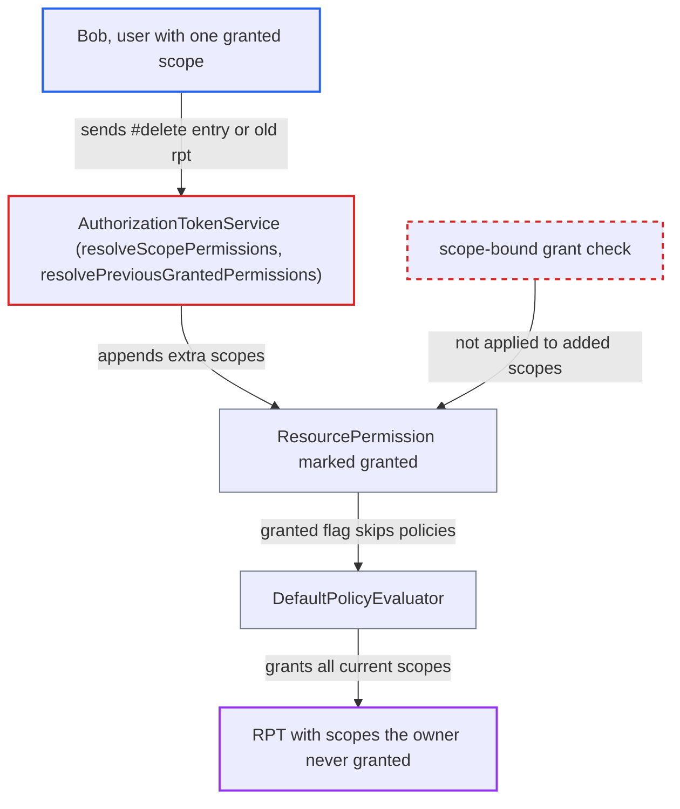

# UMA owner-granted permission flag not scope-bound: merged scopes skip policy evaluation

| Field | Value |
|---|---|
| ID | `find_01UyRLREDYEvm8Gy8HMmd3pZ` |
| Severity | **High** |
| Status | open |
| CWE | CWE-285 — Authorization Bypass |
| Created | 2026-10-27T21:55:08.081127Z |
| Claude Security | https://claude.ai/security/findings/find_01UyRLREDYEvm8Gy8HMmd3pZ |

## Description

A logged-in user who has been granted one scope on another user's shared UMA resource can get a token (RPT) that also lists scopes the owner never granted, or has since revoked, such as `delete`. The attack needs only that one granted scope and a token request. The cause is the `granted` flag on `ResourcePermission`: `DefaultPolicyEvaluator` trusts it for every scope in the permission, even scopes added after the flag was set.

1. **Attacker (user Bob)** sends a UMA ticket token request with two permission entries. The request uses `grant_type=urn:ietf:params:oauth:grant-type:uma-ticket`, `permission=<resourceName>#view` and `permission=#delete`. The owner granted Bob only `view`.
2. **`AuthorizationTokenService.resolveResourcePermission`** trims the scopes to the ticket-granted ones and marks the permission granted. The permission for the shared resource ends up with `{view}` and `granted` set to true. The code assumes the scope set will not change afterwards. ([`services/src/main/java/org/keycloak/authorization/authorization/AuthorizationTokenService.java:696-708`](https://github.com/cx-benchmark/keycloak/blob/1d7be35d0764060a8143fc74b0aabf2442743be4/services/src/main/java/org/keycloak/authorization/authorization/AuthorizationTokenService.java#L696-L708))
3. **`resolveScopePermissions`** adds the extra scope to the already granted permission. The entry `#delete` has a null resource id, so it is treated as scope-only. `perm.addScope(scope)` then runs for every resource that has the scope, including the shared one, and it does not check the granted flag. ([`services/src/main/java/org/keycloak/authorization/authorization/AuthorizationTokenService.java:594-611`](https://github.com/cx-benchmark/keycloak/blob/1d7be35d0764060a8143fc74b0aabf2442743be4/services/src/main/java/org/keycloak/authorization/authorization/AuthorizationTokenService.java#L594-L611))
4. **`resolvePreviousGrantedPermissions`** adds the scopes from a presented `rpt` to the granted permission. This is a second route. It appends each scope found in an old `rpt` through `permission.getScopes().add(scope)`, so revoked scopes come back. ([`services/src/main/java/org/keycloak/authorization/authorization/AuthorizationTokenService.java:552-580`](https://github.com/cx-benchmark/keycloak/blob/1d7be35d0764060a8143fc74b0aabf2442743be4/services/src/main/java/org/keycloak/authorization/authorization/AuthorizationTokenService.java#L552-L580))
5. **`DefaultPolicyEvaluator.evaluate`** skips policy evaluation and grants everything in `getScopes()`. The `granted` flag makes it call `grantAndComplete`. It grants whatever scopes the permission holds at that moment, including the added ones. ([`server-spi-private/src/main/java/org/keycloak/authorization/policy/evaluation/DefaultPolicyEvaluator.java:55-59`](https://github.com/cx-benchmark/keycloak/blob/1d7be35d0764060a8143fc74b0aabf2442743be4/server-spi-private/src/main/java/org/keycloak/authorization/policy/evaluation/DefaultPolicyEvaluator.java#L55-L59))
6. **`DecisionPermissionCollector.onComplete`** writes all of the permission's scopes into the issued RPT. The RPT lists `{view, delete}` although the owner granted only `view`. ([`server-spi-private/src/main/java/org/keycloak/authorization/policy/evaluation/DecisionPermissionCollector.java:62-66`](https://github.com/cx-benchmark/keycloak/blob/1d7be35d0764060a8143fc74b0aabf2442743be4/server-spi-private/src/main/java/org/keycloak/authorization/policy/evaluation/DecisionPermissionCollector.java#L62-L66))

## Assessment

The attacker is any authenticated user of the realm. They need at least one scope granted by the owner, through a granted UMA permission ticket, on another user's owner-managed resource. They send a request to `/realms/{r}/protocol/openid-connect/token` with `audience=<resource server>`, `permission=<resourceName>#view` and `permission=#delete`. Another route is to present an old `rpt` that carries scopes the owner has since revoked. The new RPT can be chained again, so the revoked scopes can be re-issued repeatedly.

Impact: The attacker gets an RPT that claims scopes of the shared resource which the owner never granted or has revoked. It is limited to resources where the attacker already holds at least one granted scope, and to scopes the resource defines. Keycloak's authorization decision is therefore wrong for those resources.

Subsequent-system impact: The resource server that relies on the RPT will accept the extra scopes. With forged `delete` or `write`-class scopes, Bob can read, modify or remove the owner's protected data on every resource partly shared with him. This is limited to resources he already has some access to.

## Recommendation

(1) `ResourcePermission.granted` is one boolean for the whole permission, while the scope collection stays mutable and is exposed by `getScopes()`. `DefaultPolicyEvaluator` therefore grants scopes added after the owner-grant mark without evaluating them.

Fix criteria: The evaluator skips policy evaluation only for the exact scopes the owner granted. Scopes added after the permission was marked granted are policy-evaluated or rejected, for example by snapshotting the granted scopes or making the scope set immutable once granted. A request with `permission=<name>#view` plus `permission=#delete`, and one that also presents an old `rpt` carrying `delete`, returns an RPT with only `view` when the owner granted only `view`.

(2) `resolveScopePermissions` and `resolvePreviousGrantedPermissions` merge scopes into an existing permission even when it is already marked granted.

Fix criteria: Scope-only entries and scopes from a previously issued RPT never widen a ticket-granted permission. They are either evaluated as separate permissions or intersected with the ticket-granted scopes. With the requests above, no scope outside the granted tickets appears in the RPT for the shared resource.

## Evidence

**https://github.com/cx-benchmark/keycloak**

- [`server-spi-private/src/main/java/org/keycloak/authorization/permission/ResourcePermission.java:147-172`](https://github.com/cx-benchmark/keycloak/blob/1d7be35d0764060a8143fc74b0aabf2442743be4/server-spi-private/src/main/java/org/keycloak/authorization/permission/ResourcePermission.java#L147-L172)
- [`server-spi-private/src/main/java/org/keycloak/authorization/policy/evaluation/DefaultPolicyEvaluator.java:55-59`](https://github.com/cx-benchmark/keycloak/blob/1d7be35d0764060a8143fc74b0aabf2442743be4/server-spi-private/src/main/java/org/keycloak/authorization/policy/evaluation/DefaultPolicyEvaluator.java#L55-L59)
- [`server-spi-private/src/main/java/org/keycloak/authorization/policy/evaluation/DecisionPermissionCollector.java:62-66`](https://github.com/cx-benchmark/keycloak/blob/1d7be35d0764060a8143fc74b0aabf2442743be4/server-spi-private/src/main/java/org/keycloak/authorization/policy/evaluation/DecisionPermissionCollector.java#L62-L66)
- [`services/src/main/java/org/keycloak/authorization/authorization/AuthorizationTokenService.java:696-708`](https://github.com/cx-benchmark/keycloak/blob/1d7be35d0764060a8143fc74b0aabf2442743be4/services/src/main/java/org/keycloak/authorization/authorization/AuthorizationTokenService.java#L696-L708)
- [`services/src/main/java/org/keycloak/authorization/authorization/AuthorizationTokenService.java:594-611`](https://github.com/cx-benchmark/keycloak/blob/1d7be35d0764060a8143fc74b0aabf2442743be4/services/src/main/java/org/keycloak/authorization/authorization/AuthorizationTokenService.java#L594-L611)
- [`services/src/main/java/org/keycloak/authorization/authorization/AuthorizationTokenService.java:552-580`](https://github.com/cx-benchmark/keycloak/blob/1d7be35d0764060a8143fc74b0aabf2442743be4/services/src/main/java/org/keycloak/authorization/authorization/AuthorizationTokenService.java#L552-L580)
- [`core/src/main/java/org/keycloak/representations/idm/authorization/Permission.java:65-70`](https://github.com/cx-benchmark/keycloak/blob/1d7be35d0764060a8143fc74b0aabf2442743be4/core/src/main/java/org/keycloak/representations/idm/authorization/Permission.java#L65-L70)

