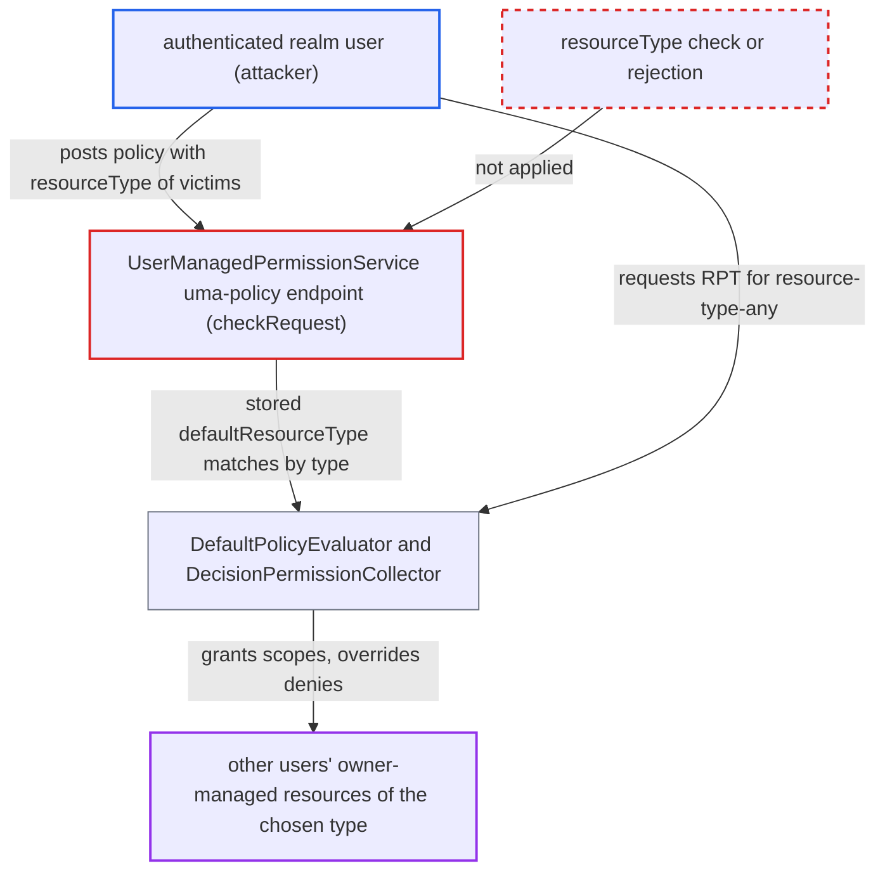

# UMA policy API stores caller-supplied resourceType, extending a user's grant to all resources of that type

| Field | Value |
|---|---|
| ID | `find_01E7p5kxupDbkawN1kfhv33v` |
| Severity | **High** |
| Status | open |
| CWE | CWE-915 — Mass assignment |
| Created | 2026-10-27T21:12:40.410969Z |
| Claude Security | https://claude.ai/security/findings/find_01E7p5kxupDbkawN1kfhv33v |

## Description

A logged-in realm user can get access to other users' owner-managed resources of a chosen type, and can override admin-defined denies. The grant is limited to the scopes the attacker's own resource shares. The attacker needs an access token for the resource-server client, one owner-managed resource of their own, and the exact type string. The cause is that `checkRequest` in `UserManagedPermissionService` never checks the `resourceType` field from the request body, so it is stored on the policy.

1. **attacker** posts a sharing policy for their own resource to `/uma-policy/{resourceId}` with `resourceType` set to the victims' type. Any access token issued for the resource-server client is enough, and no `uma_protection` role is required. ([`services/src/main/java/org/keycloak/authorization/protection/ProtectionService.java:88-93`](https://github.com/cx-benchmark/keycloak/blob/1d7be35d0764060a8143fc74b0aabf2442743be4/services/src/main/java/org/keycloak/authorization/protection/ProtectionService.java#L88-L93))
2. **`checkRequest`** validates the request but ignores `resourceType`. It checks ownership, owner-managed access, `scopes` and `resources`, and lets the inherited `resourceType` field through unchanged. ([`services/src/main/java/org/keycloak/authorization/protection/policy/UserManagedPermissionService.java:162-201`](https://github.com/cx-benchmark/keycloak/blob/1d7be35d0764060a8143fc74b0aabf2442743be4/services/src/main/java/org/keycloak/authorization/protection/policy/UserManagedPermissionService.java#L162-L201))
3. **`RepresentationToModel.toModel`** copies `resourceType` into the policy. `setResourceType` stores it as the `defaultResourceType` config entry, which is the key used to match type-level permissions. ([`server-spi-private/src/main/java/org/keycloak/models/utils/RepresentationToModel.java:1396-1401`](https://github.com/cx-benchmark/keycloak/blob/1d7be35d0764060a8143fc74b0aabf2442743be4/server-spi-private/src/main/java/org/keycloak/models/utils/RepresentationToModel.java#L1396-L1401))
4. **attacker** requests an RPT with `permission=resource-type-any:<type>`. This evaluates every resource of the type whatever its owner, so the attacker needs no individual resource ids. ([`services/src/main/java/org/keycloak/authorization/authorization/AuthorizationTokenService.java:643-647`](https://github.com/cx-benchmark/keycloak/blob/1d7be35d0764060a8143fc74b0aabf2442743be4/services/src/main/java/org/keycloak/authorization/authorization/AuthorizationTokenService.java#L643-L647))
5. **`DefaultPolicyEvaluator.evaluateResourceTypePolicies`** loads every policy whose `defaultResourceType` matches the type of each evaluated resource. The attacker's `uma` policy matches, whoever owns it and whatever resource it is attached to. ([`server-spi-private/src/main/java/org/keycloak/authorization/policy/evaluation/DefaultPolicyEvaluator.java:93-111`](https://github.com/cx-benchmark/keycloak/blob/1d7be35d0764060a8143fc74b0aabf2442743be4/server-spi-private/src/main/java/org/keycloak/authorization/policy/evaluation/DefaultPolicyEvaluator.java#L93-L111))
6. **`UMAPolicyProvider.evaluate`** evaluates the attacker's own user or role policy for resources the attacker does not own. It never checks that the policy is attached to the evaluated resource or belongs to that resource's owner. ([`authz/policy/common/src/main/java/org/keycloak/authorization/policy/provider/permission/UMAPolicyProvider.java:34-51`](https://github.com/cx-benchmark/keycloak/blob/1d7be35d0764060a8143fc74b0aabf2442743be4/authz/policy/common/src/main/java/org/keycloak/authorization/policy/provider/permission/UMAPolicyProvider.java#L34-L51))
7. **`DecisionPermissionCollector.onComplete`** treats the granted `uma` policy as a user-managed grant. It adds the policy's scopes after denied scopes are removed and clears `anyDeny`, so the grant overrides other permissions' denies. ([`server-spi-private/src/main/java/org/keycloak/authorization/policy/evaluation/DecisionPermissionCollector.java:95-157`](https://github.com/cx-benchmark/keycloak/blob/1d7be35d0764060a8143fc74b0aabf2442743be4/server-spi-private/src/main/java/org/keycloak/authorization/policy/evaluation/DecisionPermissionCollector.java#L95-L157))

## Assessment

The attacker is an authenticated realm user with an access token issued for an authorization-enabled client. They own one owner-managed resource there, as in normal UMA sharing. They need the exact type string of the victims' resources, because the stored value is the left operand of `LIKE` and the resource's type is the pattern, so `resourceType` set to `%` does not match every type. They can create one policy per type on the same owned resource. The `PUT` on the same endpoint is another way in. Only owner-managed resources are affected, because the `uma` branch needs `resource.isOwnerManagedAccess()`. Resource-server-owned resources that are not owner-managed are not granted this way.

Impact: Keycloak issues RPTs and permission decisions that grant the attacker other users' owner-managed resources of the chosen type, overriding admin-defined denies. With `response_mode=permissions`, it also discloses the ids and names of those resources. The grant is limited to the scopes the attacker's own resource shares with the targets.

Subsequent-system impact: The protected application enforces access with the RPT Keycloak issues. The attacker's RPT carries the granted scopes for every other user's owner-managed resource of the type, so the application lets them read and act on that data within those scopes.

## Recommendation

(1) `UserManagedPermissionService` binds the full `UmaPermissionRepresentation` from the request, including `resourceType`. `RepresentationToModel.toModel` then stores it as `defaultResourceType`, which widens a policy from one owned resource to every resource of a type.

Fix criteria: A policy created or updated through `/uma-policy` never has a `defaultResourceType` and applies only to the single resource the caller owns. A request carrying `resourceType` is rejected, or the field is discarded before `toModel`. After posting `resourceType` set to another user's resource type, an RPT request for `resource-type-any:<type>` grants nothing on resources the attacker does not own.

(2) `DefaultPolicyEvaluator.evaluateResourceTypePolicies` and `DecisionPermissionCollector` treat any `uma` policy matched by type as an overriding user-managed grant. They do not check that the policy is attached to the evaluated resource.

Fix criteria: A `uma` policy counts as a user-managed grant only for a resource it is directly associated with and whose owner is the policy's owner. A `uma` policy owned by one user never grants access to a resource owned by another user.

## Evidence

**https://github.com/cx-benchmark/keycloak**

- [`services/src/main/java/org/keycloak/authorization/protection/policy/UserManagedPermissionService.java:162-201`](https://github.com/cx-benchmark/keycloak/blob/1d7be35d0764060a8143fc74b0aabf2442743be4/services/src/main/java/org/keycloak/authorization/protection/policy/UserManagedPermissionService.java#L162-L201)
- [`services/src/main/java/org/keycloak/authorization/protection/policy/UserManagedPermissionService.java:66-123`](https://github.com/cx-benchmark/keycloak/blob/1d7be35d0764060a8143fc74b0aabf2442743be4/services/src/main/java/org/keycloak/authorization/protection/policy/UserManagedPermissionService.java#L66-L123)
- [`server-spi-private/src/main/java/org/keycloak/models/utils/RepresentationToModel.java:1396-1401`](https://github.com/cx-benchmark/keycloak/blob/1d7be35d0764060a8143fc74b0aabf2442743be4/server-spi-private/src/main/java/org/keycloak/models/utils/RepresentationToModel.java#L1396-L1401)
- [`server-spi-private/src/main/java/org/keycloak/authorization/model/Policy.java:203-213`](https://github.com/cx-benchmark/keycloak/blob/1d7be35d0764060a8143fc74b0aabf2442743be4/server-spi-private/src/main/java/org/keycloak/authorization/model/Policy.java#L203-L213)
- [`server-spi-private/src/main/java/org/keycloak/authorization/policy/evaluation/DefaultPolicyEvaluator.java:93-111`](https://github.com/cx-benchmark/keycloak/blob/1d7be35d0764060a8143fc74b0aabf2442743be4/server-spi-private/src/main/java/org/keycloak/authorization/policy/evaluation/DefaultPolicyEvaluator.java#L93-L111)
- [`model/jpa/src/main/java/org/keycloak/authorization/jpa/entities/PolicyEntity.java:68`](https://github.com/cx-benchmark/keycloak/blob/1d7be35d0764060a8143fc74b0aabf2442743be4/model/jpa/src/main/java/org/keycloak/authorization/jpa/entities/PolicyEntity.java#L68)
- [`authz/policy/common/src/main/java/org/keycloak/authorization/policy/provider/permission/UMAPolicyProvider.java:34-51`](https://github.com/cx-benchmark/keycloak/blob/1d7be35d0764060a8143fc74b0aabf2442743be4/authz/policy/common/src/main/java/org/keycloak/authorization/policy/provider/permission/UMAPolicyProvider.java#L34-L51)
- [`server-spi-private/src/main/java/org/keycloak/authorization/policy/evaluation/DecisionPermissionCollector.java:95-157`](https://github.com/cx-benchmark/keycloak/blob/1d7be35d0764060a8143fc74b0aabf2442743be4/server-spi-private/src/main/java/org/keycloak/authorization/policy/evaluation/DecisionPermissionCollector.java#L95-L157)
- [`services/src/main/java/org/keycloak/authorization/authorization/AuthorizationTokenService.java:643-647`](https://github.com/cx-benchmark/keycloak/blob/1d7be35d0764060a8143fc74b0aabf2442743be4/services/src/main/java/org/keycloak/authorization/authorization/AuthorizationTokenService.java#L643-L647)
- [`services/src/main/java/org/keycloak/authorization/protection/ProtectionService.java:88-93`](https://github.com/cx-benchmark/keycloak/blob/1d7be35d0764060a8143fc74b0aabf2442743be4/services/src/main/java/org/keycloak/authorization/protection/ProtectionService.java#L88-L93)

