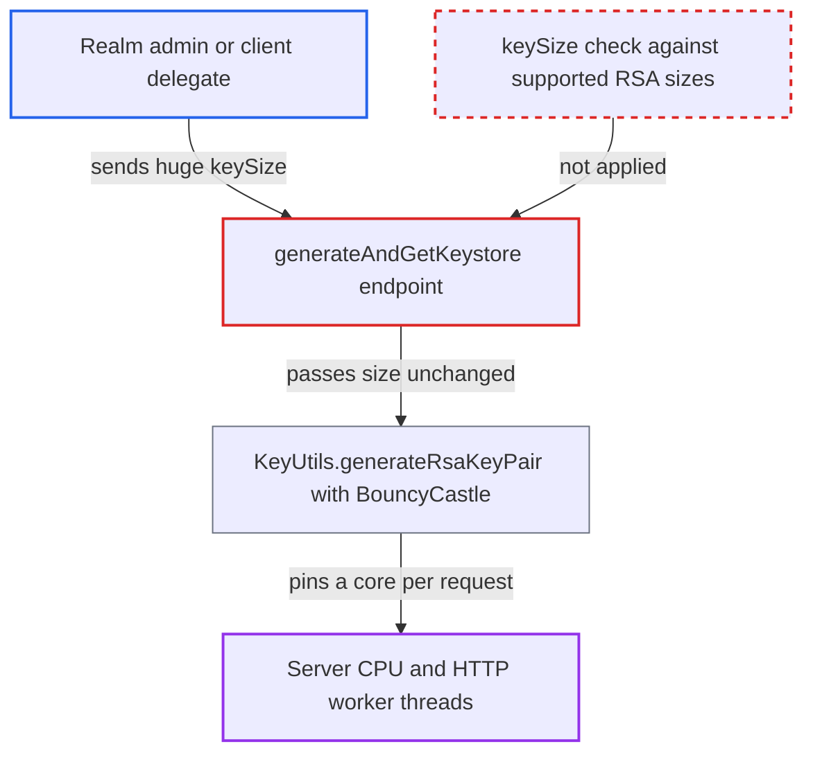

# Unbounded caller-supplied RSA key size in client generate-and-download pins server CPU

| Field | Value |
|---|---|
| ID | `find_015GWyxA85j1zHbUDbKbPMF4` |
| Severity | **High** |
| Status | open |
| CWE | CWE-770 — Uncontrolled resource consumption |
| Created | 2026-10-27T21:20:44.921455Z |
| Claude Security | https://claude.ai/security/findings/find_015GWyxA85j1zHbUDbKbPMF4 |

## Description

A realm admin with `manage-clients`, or a delegate scoped to a single client, can make the server burn CPU for as long as they like and slow or stop service for every realm on the node. The attacker sends a huge `keySize` to the generate-and-download endpoint. `generateAndGetKeystore()` only checks that `keySize` is positive, then generates the RSA key on the request thread.

1. **Realm admin or client delegate** sends a POST to the generate-and-download endpoint with a huge keySize. The body is a `KeyStoreConfig` such as `{"keyPassword":"x","storePassword":"x","keySize":65536}`, sent to `POST /admin/realms/{realm}/clients/{id}/certificates/jwt.credential/generate-and-download`. ([`services/src/main/java/org/keycloak/services/resources/admin/ClientAttributeCertificateResource.java:268-289`](https://github.com/cx-benchmark/keycloak/blob/1d7be35d0764060a8143fc74b0aabf2442743be4/services/src/main/java/org/keycloak/services/resources/admin/ClientAttributeCertificateResource.java#L268-L289))
2. **the handler `generateAndGetKeystore`** accepts the request after only a permission check and a positive-number check. `requireConfigure(client)` passes for the `manage-clients` role or a per-client MANAGE permission, and `keySize` only has to be above zero. ([`services/src/main/java/org/keycloak/services/resources/admin/fgap/ClientPermissionsV2.java:51-72`](https://github.com/cx-benchmark/keycloak/blob/1d7be35d0764060a8143fc74b0aabf2442743be4/services/src/main/java/org/keycloak/services/resources/admin/fgap/ClientPermissionsV2.java#L51-L72))
3. **the handler `generateAndGetKeystore`** passes the size to `KeycloakModelUtils.generateKeyPairCertificate`. The size is handed on unchanged, before the keystore is built and before `format` is validated, so the key is generated even if the request fails later. ([`server-spi-private/src/main/java/org/keycloak/models/utils/KeycloakModelUtils.java:246-248`](https://github.com/cx-benchmark/keycloak/blob/1d7be35d0764060a8143fc74b0aabf2442743be4/server-spi-private/src/main/java/org/keycloak/models/utils/KeycloakModelUtils.java#L246-L248))
4. **`KeyUtils.generateRsaKeyPair`** initializes the key pair generator with the raw size and generates the key. There is no upper bound on the size here. ([`common/src/main/java/org/keycloak/common/util/KeyUtils.java:51-60`](https://github.com/cx-benchmark/keycloak/blob/1d7be35d0764060a8143fc74b0aabf2442743be4/common/src/main/java/org/keycloak/common/util/KeyUtils.java#L51-L60))
5. **BouncyCastle RSA `KeyPairGenerator`** searches for RSA primes on the HTTP worker thread. It only rejects very small sizes (below 12). The work cannot be interrupted, and its cost grows roughly with the fourth power of the modulus size, so 65536 bits or more effectively never finishes. ([`crypto/default/src/main/java/org/keycloak/crypto/def/DefaultCryptoProvider.java:130-132`](https://github.com/cx-benchmark/keycloak/blob/1d7be35d0764060a8143fc74b0aabf2442743be4/crypto/default/src/main/java/org/keycloak/crypto/def/DefaultCryptoProvider.java#L130-L132))
6. **Attacker** repeats the request concurrently. About one request per CPU core saturates the node, and the busy threads stay busy until restart.

## Assessment

The attacker is a tenant-realm admin with `manage-clients`, or a fine-grained delegate with MANAGE permission on a single client (under FGAP v2, `requireConfigure` falls through to `canManage(client)`). They need only the admin API and a few concurrent requests. No setting has to be changed or bypassed. The default (non-FIPS) distribution uses BouncyCastle, whose only limit is a lower bound. The report assumes the shipped `bcprov-jdk18on` behaves like the 1.77 version it checked. The deprecated `generate` endpoint uses the fixed `DEFAULT_RSA_KEY_SIZE` and is not affected.

Impact: Each request holds one CPU core and one HTTP worker thread, so login, token and admin service for every realm on the node, master included, degrade or stop. This lasts until restart, and the attacker can repeat it. No data is disclosed or modified.

## Recommendation

`generateAndGetKeystore` takes `keySize` from the request and uses it with no upper bound for slow, CPU-heavy key generation on a request thread. Realm key providers already limit sizes with `getSupportedRsaKeySizes()`, but this endpoint does not.

Fix criteria: Before any key generation, the server rejects a `keySize` that is not one of the provider's supported RSA sizes (`getSupportedRsaKeySizes()`) and returns a 400. A request with `keySize` 8192, 65536 or 1000000 returns an error at once and does no `KeyPairGenerator` work. Requests with 2048, 3072 and 4096 still succeed.

## Evidence

**https://github.com/cx-benchmark/keycloak**

- [`services/src/main/java/org/keycloak/services/resources/admin/ClientAttributeCertificateResource.java:268-289`](https://github.com/cx-benchmark/keycloak/blob/1d7be35d0764060a8143fc74b0aabf2442743be4/services/src/main/java/org/keycloak/services/resources/admin/ClientAttributeCertificateResource.java#L268-L289)
- [`server-spi-private/src/main/java/org/keycloak/models/utils/KeycloakModelUtils.java:246-248`](https://github.com/cx-benchmark/keycloak/blob/1d7be35d0764060a8143fc74b0aabf2442743be4/server-spi-private/src/main/java/org/keycloak/models/utils/KeycloakModelUtils.java#L246-L248)
- [`common/src/main/java/org/keycloak/common/util/KeyUtils.java:51-60`](https://github.com/cx-benchmark/keycloak/blob/1d7be35d0764060a8143fc74b0aabf2442743be4/common/src/main/java/org/keycloak/common/util/KeyUtils.java#L51-L60)
- [`crypto/default/src/main/java/org/keycloak/crypto/def/DefaultCryptoProvider.java:130-132`](https://github.com/cx-benchmark/keycloak/blob/1d7be35d0764060a8143fc74b0aabf2442743be4/crypto/default/src/main/java/org/keycloak/crypto/def/DefaultCryptoProvider.java#L130-L132)
- [`services/src/main/java/org/keycloak/services/resources/admin/fgap/ClientPermissionsV2.java:51-72`](https://github.com/cx-benchmark/keycloak/blob/1d7be35d0764060a8143fc74b0aabf2442743be4/services/src/main/java/org/keycloak/services/resources/admin/fgap/ClientPermissionsV2.java#L51-L72)
- [`services/src/main/java/org/keycloak/keys/AbstractGeneratedRsaKeyProviderFactory.java:97-99`](https://github.com/cx-benchmark/keycloak/blob/1d7be35d0764060a8143fc74b0aabf2442743be4/services/src/main/java/org/keycloak/keys/AbstractGeneratedRsaKeyProviderFactory.java#L97-L99)
- [`js/apps/admin-ui/src/clients/keys/GenerateKeyDialog.tsx:63`](https://github.com/cx-benchmark/keycloak/blob/1d7be35d0764060a8143fc74b0aabf2442743be4/js/apps/admin-ui/src/clients/keys/GenerateKeyDialog.tsx#L63)

