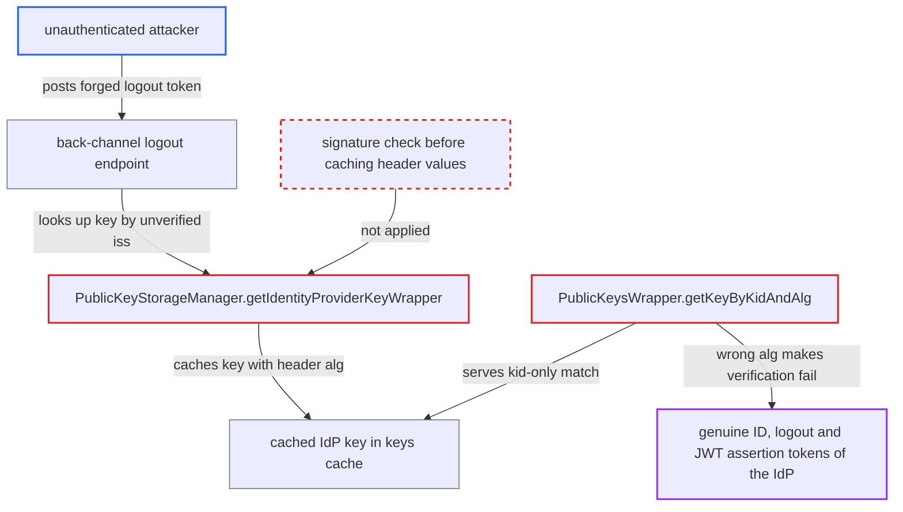

# Unsigned JWT header kid/alg poisons cached hardcoded IdP key, blocking brokered logins

| Field | Value |
|---|---|
| ID | `find_018SquFQtjXwCxQWFetg5f89` |
| Severity | **High** |
| Status | open |
| CWE | CWE-349 — Cache poisoning |
| Created | 2026-10-27T21:45:31.566930Z |
| Claude Security | https://claude.ai/security/findings/find_018SquFQtjXwCxQWFetg5f89 |

## Description

An unauthenticated attacker can make an OIDC identity provider (IdP) reject every genuine ID token, logout token and JWT assertion on a node. This blocks brokered logins through that IdP. It only works for IdPs that verify with a hardcoded PEM public key, not a JWKS URL or JWKS JSON. `PublicKeyStorageManager.getIdentityProviderKeyWrapper` copies `alg` and `kid` from the unverified token header into a long-lived cached key.

1. **attacker** posts a forged logout token to the back-channel logout endpoint. The token has header alg PS256 and some kid, the payload names the IdP's issuer in `iss`, and there is no valid signature; the endpoint needs no login. ([`services/src/main/java/org/keycloak/protocol/oidc/endpoints/LogoutEndpoint.java:583-600`](https://github.com/cx-benchmark/keycloak/blob/1d7be35d0764060a8143fc74b0aabf2442743be4/services/src/main/java/org/keycloak/protocol/oidc/endpoints/LogoutEndpoint.java#L583-L600))
2. **`TokenManager.verifyLogoutToken`** picks the IdP from the unverified `iss` claim and calls `validateLogoutToken`. The token is decoded without any signature check, so the forged token reaches the key lookup. ([`services/src/main/java/org/keycloak/protocol/oidc/TokenManager.java:1643-1660`](https://github.com/cx-benchmark/keycloak/blob/1d7be35d0764060a8143fc74b0aabf2442743be4/services/src/main/java/org/keycloak/protocol/oidc/TokenManager.java#L1643-L1660))
3. **`OIDCIdentityProvider.verifySignature`** asks for the IdP's key before the signature is checked. The logout validation path leads to this lookup, so the poisoning happens before the token can be rejected. ([`services/src/main/java/org/keycloak/broker/oidc/OIDCIdentityProvider.java:721-740`](https://github.com/cx-benchmark/keycloak/blob/1d7be35d0764060a8143fc74b0aabf2442743be4/services/src/main/java/org/keycloak/broker/oidc/OIDCIdentityProvider.java#L721-L740))
4. **`PublicKeyStorageManager.getIdentityProviderKeyWrapper`** builds a `HardcodedPublicKeyLoader` using `alg` and `kid` from the token header. `alg` is always taken from the header, and `kid` is taken from it when `publicKeySignatureVerifierKeyId` is unset. ([`services/src/main/java/org/keycloak/keys/loader/PublicKeyStorageManager.java:74-96`](https://github.com/cx-benchmark/keycloak/blob/1d7be35d0764060a8143fc74b0aabf2442743be4/services/src/main/java/org/keycloak/keys/loader/PublicKeyStorageManager.java#L74-L96))
5. **`HardcodedPublicKeyLoader`** stores the header's algorithm on the admin's PEM key. Any algorithm of the same family is accepted: RS\* or PS\* for an RSA key, ES\* for an EC key. ([`services/src/main/java/org/keycloak/keys/loader/HardcodedPublicKeyLoader.java:43-62`](https://github.com/cx-benchmark/keycloak/blob/1d7be35d0764060a8143fc74b0aabf2442743be4/services/src/main/java/org/keycloak/keys/loader/HardcodedPublicKeyLoader.java#L43-L62))
6. **`InfinispanPublicKeyStorageProvider`** reloads through this loader and caches the result with no expiration. A reload happens at most once per `minTimeBetweenRequests` (default 10 s), and the entry stays under `realmId::idp::internalId`. ([`model/infinispan/src/main/java/org/keycloak/keys/infinispan/InfinispanPublicKeyStorageProvider.java:300-316`](https://github.com/cx-benchmark/keycloak/blob/1d7be35d0764060a8143fc74b0aabf2442743be4/model/infinispan/src/main/java/org/keycloak/keys/infinispan/InfinispanPublicKeyStorageProvider.java#L300-L316))
7. **`PublicKeysWrapper.getKeyByKidAndAlg`** returns the cached key for a genuine token with kid K and alg RS256. It falls back to a kid-only match, so the cached (K, PS256) key is served and no reload is triggered. ([`core/src/main/java/org/keycloak/crypto/PublicKeysWrapper.java:70-81`](https://github.com/cx-benchmark/keycloak/blob/1d7be35d0764060a8143fc74b0aabf2442743be4/core/src/main/java/org/keycloak/crypto/PublicKeysWrapper.java#L70-L81))
8. **`checkKeyForVerification`** throws because the key's algorithm differs from the provider's. Every genuine token of that IdP is therefore rejected, including brokered logins. ([`server-spi-private/src/main/java/org/keycloak/crypto/SignatureProvider.java:31-36`](https://github.com/cx-benchmark/keycloak/blob/1d7be35d0764060a8143fc74b0aabf2442743be4/server-spi-private/src/main/java/org/keycloak/crypto/SignatureProvider.java#L31-L36))

## Assessment

The attacker is an unauthenticated internet user who knows the realm and the issuer of an IdP that uses a hardcoded PEM key. The IdP must have `useJwksUrl` off and `publicKeySignatureVerifier` not a JWKS JSON. No victim action is needed. The delivery path is the OIDC back-channel logout endpoint. With a configured key id C, one forged token with any other kid leaves (C, attacker-alg) cached. With no configured key id and a genuine (K, RS256) entry already cached, two tokens at least 10 s apart are needed: a foreign kid to force a reload, then kid K with the wrong alg. One token is enough when the entry is empty, after a restart or idle expiry. The `keys` cache is local to each node, so in a cluster the attacker must repeat this until every node is poisoned.

Impact: Genuine tokens from the affected IdP that carry the poisoned kid are rejected on the poisoned node. Brokered logins and JWT grants or client assertions through that IdP fail, which is a login outage for a realm that depends on it. The entry stays until an admin updates or removes the IdP, the node restarts, or the entry sits idle for an hour. Genuine tokens with no kid recover once the 10 s reload window reopens. The forged token never verifies, so nothing is read or forged.

## Recommendation

(1) `PublicKeyStorageManager.getIdentityProviderKeyWrapper` takes the algorithm, and the kid when none is configured, from the unverified token header. These untrusted values end up in a long-lived shared cache entry used for all later verifications of that IdP.

Fix criteria: The cached hardcoded key is derived only from admin configuration and the PEM key type, with per-request algorithm handling applied only to the returned copy. Test: send an unsigned logout token with a wrong same-family alg and a foreign or genuine kid. Later genuine RS256 tokens of that IdP must still verify.

(2) `PublicKeysWrapper.getKeyByKidAndAlg` returns a kid-only match even when the key's algorithm contradicts the requested one. `InfinispanPublicKeyStorageProvider.getPublicKey` then never reloads, so a bad cached entry stays.

Fix criteria: A cached key whose set algorithm differs from the requested algorithm is not served as a match. The lookup treats it as a miss, subject to `minTimeBetweenRequests`. An entry with a mismatched algorithm is then refreshed on the next genuine lookup.

## Evidence

**https://github.com/cx-benchmark/keycloak**

- [`services/src/main/java/org/keycloak/keys/loader/PublicKeyStorageManager.java:74-96`](https://github.com/cx-benchmark/keycloak/blob/1d7be35d0764060a8143fc74b0aabf2442743be4/services/src/main/java/org/keycloak/keys/loader/PublicKeyStorageManager.java#L74-L96)
- [`services/src/main/java/org/keycloak/keys/loader/HardcodedPublicKeyLoader.java:43-62`](https://github.com/cx-benchmark/keycloak/blob/1d7be35d0764060a8143fc74b0aabf2442743be4/services/src/main/java/org/keycloak/keys/loader/HardcodedPublicKeyLoader.java#L43-L62)
- [`model/infinispan/src/main/java/org/keycloak/keys/infinispan/InfinispanPublicKeyStorageProvider.java:134-164`](https://github.com/cx-benchmark/keycloak/blob/1d7be35d0764060a8143fc74b0aabf2442743be4/model/infinispan/src/main/java/org/keycloak/keys/infinispan/InfinispanPublicKeyStorageProvider.java#L134-L164)
- [`model/infinispan/src/main/java/org/keycloak/keys/infinispan/InfinispanPublicKeyStorageProvider.java:300-316`](https://github.com/cx-benchmark/keycloak/blob/1d7be35d0764060a8143fc74b0aabf2442743be4/model/infinispan/src/main/java/org/keycloak/keys/infinispan/InfinispanPublicKeyStorageProvider.java#L300-L316)
- [`core/src/main/java/org/keycloak/crypto/PublicKeysWrapper.java:70-81`](https://github.com/cx-benchmark/keycloak/blob/1d7be35d0764060a8143fc74b0aabf2442743be4/core/src/main/java/org/keycloak/crypto/PublicKeysWrapper.java#L70-L81)
- [`server-spi-private/src/main/java/org/keycloak/crypto/SignatureProvider.java:31-36`](https://github.com/cx-benchmark/keycloak/blob/1d7be35d0764060a8143fc74b0aabf2442743be4/server-spi-private/src/main/java/org/keycloak/crypto/SignatureProvider.java#L31-L36)
- [`services/src/main/java/org/keycloak/broker/oidc/OIDCIdentityProvider.java:590-612`](https://github.com/cx-benchmark/keycloak/blob/1d7be35d0764060a8143fc74b0aabf2442743be4/services/src/main/java/org/keycloak/broker/oidc/OIDCIdentityProvider.java#L590-L612)
- [`services/src/main/java/org/keycloak/broker/oidc/OIDCIdentityProvider.java:721-740`](https://github.com/cx-benchmark/keycloak/blob/1d7be35d0764060a8143fc74b0aabf2442743be4/services/src/main/java/org/keycloak/broker/oidc/OIDCIdentityProvider.java#L721-L740)
- [`services/src/main/java/org/keycloak/protocol/oidc/TokenManager.java:1643-1660`](https://github.com/cx-benchmark/keycloak/blob/1d7be35d0764060a8143fc74b0aabf2442743be4/services/src/main/java/org/keycloak/protocol/oidc/TokenManager.java#L1643-L1660)
- [`services/src/main/java/org/keycloak/protocol/oidc/endpoints/LogoutEndpoint.java:583-600`](https://github.com/cx-benchmark/keycloak/blob/1d7be35d0764060a8143fc74b0aabf2442743be4/services/src/main/java/org/keycloak/protocol/oidc/endpoints/LogoutEndpoint.java#L583-L600)
- [`services/src/main/java/org/keycloak/broker/oidc/OIDCIdentityProvider.java:322`](https://github.com/cx-benchmark/keycloak/blob/1d7be35d0764060a8143fc74b0aabf2442743be4/services/src/main/java/org/keycloak/broker/oidc/OIDCIdentityProvider.java#L322)

