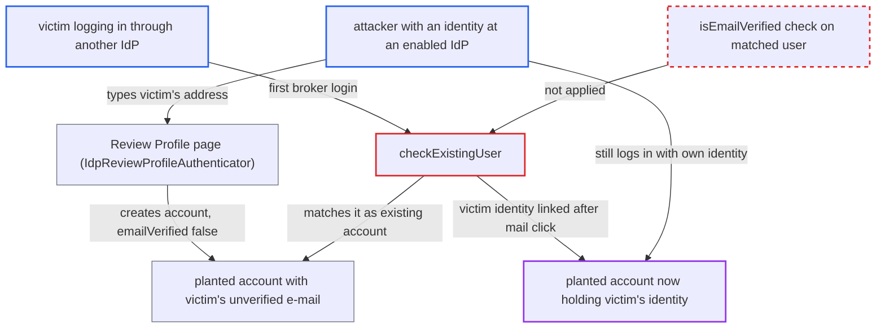

# Unverified stored e-mail drives broker account matching, enabling pre-hijacking merge

| Field | Value |
|---|---|
| ID | `find_018n6aYfJugmrCyYiVQESmxu` |
| Severity | **High** |
| Status | open |
| CWE | CWE-304 — Missing authentication step |
| Created | 2026-10-27T21:57:30.664326Z |
| Claude Security | https://claude.ai/security/findings/find_018n6aYfJugmrCyYiVQESmxu |

## Description

An attacker can pre-hijack an account so that a victim's later first login through an identity provider is merged into an account the attacker can still enter. The attacker needs an identity at any enabled identity provider, and the victim must not yet have an account. Realm SMTP must also be configured. The cause is `checkExistingUser`, which matches on a stored e-mail without checking `isEmailVerified()`.

1. **attacker** puts the victim's e-mail on a new account. On the Review Profile page the broker user can type any e-mail, because the `IDP_REVIEW` profile puts no edit restriction on `email`. ([`services/src/main/java/org/keycloak/authentication/authenticators/broker/IdpReviewProfileAuthenticator.java:205-242`](https://github.com/cx-benchmark/keycloak/blob/1d7be35d0764060a8143fc74b0aabf2442743be4/services/src/main/java/org/keycloak/authentication/authenticators/broker/IdpReviewProfileAuthenticator.java#L205-L242))
2. **`IdpCreateUserIfUniqueAuthenticator`** creates the user with the typed address. `AbstractIdentityProvider.updateEmail` stores the address with `emailVerified=false`, but it is still stored and so takes part in later duplicate lookups. ([`services/src/main/java/org/keycloak/authentication/authenticators/broker/IdpCreateUserIfUniqueAuthenticator.java:95-121`](https://github.com/cx-benchmark/keycloak/blob/1d7be35d0764060a8143fc74b0aabf2442743be4/services/src/main/java/org/keycloak/authentication/authenticators/broker/IdpCreateUserIfUniqueAuthenticator.java#L95-L121))
3. **victim** logs in for the first time through another identity provider. The victim has no account yet, and the identity provider reports the victim's address.
4. **the method `checkExistingUser`** returns the planted account as the existing user. It compares only the stored e-mail or username with the brokered value and never reads `isEmailVerified()` on the matched user. The match is saved as `EXISTING_USER_INFO`. ([`services/src/main/java/org/keycloak/authentication/authenticators/broker/IdpCreateUserIfUniqueAuthenticator.java:158-195`](https://github.com/cx-benchmark/keycloak/blob/1d7be35d0764060a8143fc74b0aabf2442743be4/services/src/main/java/org/keycloak/authentication/authenticators/broker/IdpCreateUserIfUniqueAuthenticator.java#L158-L195))
5. **`IdpConfirmLinkAuthenticator`** offers 'Add to existing account' to the victim. The page says only that a user with that e-mail already exists. It does not say the address is unverified or that another identity is linked. ([`services/src/main/java/org/keycloak/authentication/authenticators/broker/IdpConfirmLinkAuthenticator.java:62-68`](https://github.com/cx-benchmark/keycloak/blob/1d7be35d0764060a8143fc74b0aabf2442743be4/services/src/main/java/org/keycloak/authentication/authenticators/broker/IdpConfirmLinkAuthenticator.java#L62-L68))
6. **`IdpEmailVerificationAuthenticator`** mails a confirmation link to `existingUser.getEmail()`. The mailbox is really the victim's, so a click is taken as proof of owning the account. Nothing checks that the address was ever verified. ([`services/src/main/java/org/keycloak/authentication/authenticators/broker/IdpEmailVerificationAuthenticator.java:76-127`](https://github.com/cx-benchmark/keycloak/blob/1d7be35d0764060a8143fc74b0aabf2442743be4/services/src/main/java/org/keycloak/authentication/authenticators/broker/IdpEmailVerificationAuthenticator.java#L76-L127))
7. **victim** clicks the mailed link. `IdpVerifyAccountLinkActionTokenHandler` sets `VERIFY_ACCOUNT_IDP_USERNAME` and resumes the broker flow. ([`services/src/main/java/org/keycloak/authentication/actiontoken/idpverifyemail/IdpVerifyAccountLinkActionTokenHandler.java:136-162`](https://github.com/cx-benchmark/keycloak/blob/1d7be35d0764060a8143fc74b0aabf2442743be4/services/src/main/java/org/keycloak/authentication/actiontoken/idpverifyemail/IdpVerifyAccountLinkActionTokenHandler.java#L136-L162))
8. **`IdentityBrokerService.afterFirstBrokerLogin`** adds the victim's federated identity to the planted account. The attacker's own federated link on that account stays in place, so the attacker can still log in to it. ([`services/src/main/java/org/keycloak/services/resources/IdentityBrokerService.java:931-943`](https://github.com/cx-benchmark/keycloak/blob/1d7be35d0764060a8143fc74b0aabf2442743be4/services/src/main/java/org/keycloak/services/resources/IdentityBrokerService.java#L931-L943))

## Assessment

The attacker is unauthenticated at Keycloak and holds an identity at any enabled identity provider. Through the default first broker login flow the attacker creates an account with the victim's address, typed on the Review Profile page. Another way in is to set that address later through update-email. A logged-in user can do this without confirmation while realm e-mail verification is off, which is the default. The victim must later log in for the first time through an identity provider that reports that address, and must not already have an account. The victim must click 'Add to existing account' and then the mailed link. Realm SMTP must be configured.

Impact: After the merge the attacker's external identity and the victim's log in to the same Keycloak account, so every client sees the attacker as the victim with the same `sub`. The attacker can read and change the victim's profile, consents, linked identities and anything the victim later stores in that account. Availability is not affected.

## Recommendation

(1) `checkExistingUser` and `IdpEmailVerificationAuthenticator` treat control of an account's stored e-mail as proof of account ownership, even when that address was never verified. An account planted with someone else's address is therefore offered and linked as theirs.

Fix criteria: Linking a brokered identity to an existing account through e-mail confirmation is possible only when the matched account's e-mail is verified. Otherwise the flow requires re-authentication as that account, or treats the address as a conflict. To verify, create an account with an unverified address and then do a first broker login with that address. The flow must not link the identity to that account through the e-mail confirmation path.

(2) Broker-created and self-edited accounts can hold attacker-chosen, unverified addresses. These addresses take part in duplicate detection, so they reserve the victim's address.

Fix criteria: Unverified addresses do not take part in the duplicate lookup that routes a later broker login to an existing account, or they are excluded until verified. To verify, run a later first login that reports the same address. It must create a separate account or be blocked, and it must not propose a merge.

(3) The confirm-link page and the confirmation e-mail give the victim no way to recognise a planted account.

Fix criteria: When the matched account's e-mail is unverified or the account is already linked to another identity, the confirm page and the e-mail say so. Check the rendered page and e-mail in that scenario.

## Evidence

**https://github.com/cx-benchmark/keycloak**

- [`services/src/main/java/org/keycloak/authentication/authenticators/broker/IdpCreateUserIfUniqueAuthenticator.java:158-195`](https://github.com/cx-benchmark/keycloak/blob/1d7be35d0764060a8143fc74b0aabf2442743be4/services/src/main/java/org/keycloak/authentication/authenticators/broker/IdpCreateUserIfUniqueAuthenticator.java#L158-L195)
- [`services/src/main/java/org/keycloak/authentication/authenticators/broker/IdpCreateUserIfUniqueAuthenticator.java:122-154`](https://github.com/cx-benchmark/keycloak/blob/1d7be35d0764060a8143fc74b0aabf2442743be4/services/src/main/java/org/keycloak/authentication/authenticators/broker/IdpCreateUserIfUniqueAuthenticator.java#L122-L154)
- [`services/src/main/java/org/keycloak/authentication/authenticators/broker/IdpEmailVerificationAuthenticator.java:76-127`](https://github.com/cx-benchmark/keycloak/blob/1d7be35d0764060a8143fc74b0aabf2442743be4/services/src/main/java/org/keycloak/authentication/authenticators/broker/IdpEmailVerificationAuthenticator.java#L76-L127)
- [`services/src/main/java/org/keycloak/authentication/actiontoken/idpverifyemail/IdpVerifyAccountLinkActionTokenHandler.java:136-162`](https://github.com/cx-benchmark/keycloak/blob/1d7be35d0764060a8143fc74b0aabf2442743be4/services/src/main/java/org/keycloak/authentication/actiontoken/idpverifyemail/IdpVerifyAccountLinkActionTokenHandler.java#L136-L162)
- [`services/src/main/java/org/keycloak/services/resources/IdentityBrokerService.java:931-943`](https://github.com/cx-benchmark/keycloak/blob/1d7be35d0764060a8143fc74b0aabf2442743be4/services/src/main/java/org/keycloak/services/resources/IdentityBrokerService.java#L931-L943)
- [`services/src/main/java/org/keycloak/authentication/authenticators/broker/IdpConfirmLinkAuthenticator.java:62-68`](https://github.com/cx-benchmark/keycloak/blob/1d7be35d0764060a8143fc74b0aabf2442743be4/services/src/main/java/org/keycloak/authentication/authenticators/broker/IdpConfirmLinkAuthenticator.java#L62-L68)
- [`services/src/main/java/org/keycloak/authentication/authenticators/broker/IdpReviewProfileAuthenticator.java:205-242`](https://github.com/cx-benchmark/keycloak/blob/1d7be35d0764060a8143fc74b0aabf2442743be4/services/src/main/java/org/keycloak/authentication/authenticators/broker/IdpReviewProfileAuthenticator.java#L205-L242)
- [`services/src/main/java/org/keycloak/userprofile/DeclarativeUserProfileProviderFactory.java:425-436`](https://github.com/cx-benchmark/keycloak/blob/1d7be35d0764060a8143fc74b0aabf2442743be4/services/src/main/java/org/keycloak/userprofile/DeclarativeUserProfileProviderFactory.java#L425-L436)
- [`services/src/main/java/org/keycloak/authentication/authenticators/broker/IdpCreateUserIfUniqueAuthenticator.java:95-121`](https://github.com/cx-benchmark/keycloak/blob/1d7be35d0764060a8143fc74b0aabf2442743be4/services/src/main/java/org/keycloak/authentication/authenticators/broker/IdpCreateUserIfUniqueAuthenticator.java#L95-L121)
- [`server-spi-private/src/main/java/org/keycloak/broker/provider/AbstractIdentityProvider.java:194-226`](https://github.com/cx-benchmark/keycloak/blob/1d7be35d0764060a8143fc74b0aabf2442743be4/server-spi-private/src/main/java/org/keycloak/broker/provider/AbstractIdentityProvider.java#L194-L226)
- [`services/src/main/java/org/keycloak/authentication/requiredactions/UpdateEmail.java:210-215`](https://github.com/cx-benchmark/keycloak/blob/1d7be35d0764060a8143fc74b0aabf2442743be4/services/src/main/java/org/keycloak/authentication/requiredactions/UpdateEmail.java#L210-L215)

