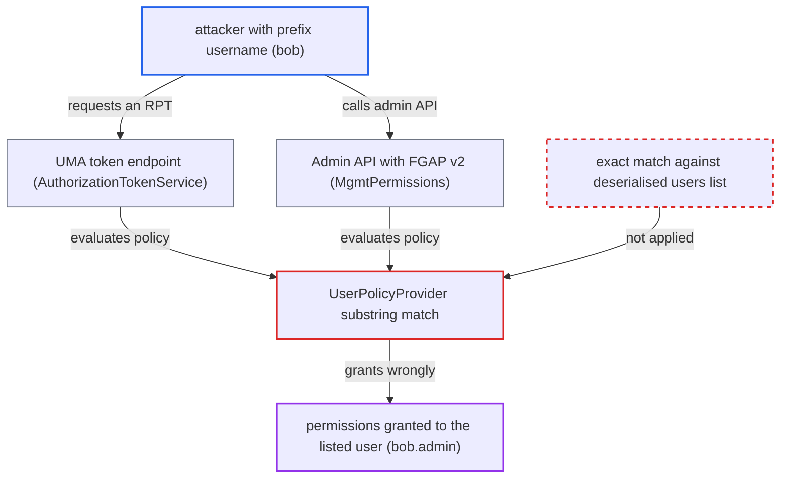

# User policy grants by substring match of requester id in serialised users list

| Field | Value |
|---|---|
| ID | `find_01TPxaPkU7bXNQB29CaKfZsj` |
| Severity | **High** |
| Status | open |
| CWE | CWE-187 — Partial string comparison |
| Created | 2026-10-27T22:06:14.348536Z |
| Claude Security | https://claude.ai/security/findings/find_01TPxaPkU7bXNQB29CaKfZsj |

## Description

A user in a realm that federates LDAP with Import Users off can be granted the permissions of a different user named in a user policy. The attacker needs a username that is a prefix of a listed user's username, such as `bob` against `bob.admin`. `UserPolicyProvider` checks membership with `String.contains` on the serialised `users` string, so any id that appears inside it passes.

1. **administrator** creates a user policy that names a user such as `bob.admin`. `updateUsers` stores the resolved user ids as one JSON-array string under the `users` config key. ([`authz/policy/common/src/main/java/org/keycloak/authorization/policy/provider/user/UserPolicyProviderFactory.java:144-161`](https://github.com/cx-benchmark/keycloak/blob/1d7be35d0764060a8143fc74b0aabf2442743be4/authz/policy/common/src/main/java/org/keycloak/authorization/policy/provider/user/UserPolicyProviderFactory.java#L144-L161))
2. **LDAP provider** builds user ids from usernames when Import Users is off. Every id has the form `f:<componentId>:<ldapUsername>`, so a shorter username gives an id that is a substring of a longer user's id. ([`federation/ldap/src/main/java/org/keycloak/storage/ldap/LDAPStorageProvider.java:749-753`](https://github.com/cx-benchmark/keycloak/blob/1d7be35d0764060a8143fc74b0aabf2442743be4/federation/ldap/src/main/java/org/keycloak/storage/ldap/LDAPStorageProvider.java#L749-L753))
3. **attacker** gets an account whose username is a prefix of the listed one. This is an existing directory account such as `jsmith` against `jsmith2`, or a self-registered name such as `adm` when registration is open and Sync Registrations writes to a WRITABLE LDAP. ([`federation/ldap/src/main/java/org/keycloak/storage/ldap/LDAPStorageProvider.java:317-333`](https://github.com/cx-benchmark/keycloak/blob/1d7be35d0764060a8143fc74b0aabf2442743be4/federation/ldap/src/main/java/org/keycloak/storage/ldap/LDAPStorageProvider.java#L317-L333))
4. **`KeycloakIdentity`** takes the attacker's real user id as the identity id. The id is `user.getId()` unchanged, so it still has the federated `f:<componentId>:<username>` form. ([`services/src/main/java/org/keycloak/authorization/common/KeycloakIdentity.java:181-187`](https://github.com/cx-benchmark/keycloak/blob/1d7be35d0764060a8143fc74b0aabf2442743be4/services/src/main/java/org/keycloak/authorization/common/KeycloakIdentity.java#L181-L187))
5. **attacker** requests an RPT at the token endpoint, or calls the Admin API in an FGAP v2 realm. The UMA grant evaluates the audience resource server's policies with this identity. ([`services/src/main/java/org/keycloak/authorization/authorization/AuthorizationTokenService.java:138-140`](https://github.com/cx-benchmark/keycloak/blob/1d7be35d0764060a8143fc74b0aabf2442743be4/services/src/main/java/org/keycloak/authorization/authorization/AuthorizationTokenService.java#L138-L140))
6. **`UserPolicyProvider`** grants because the attacker's id is a substring of the serialised `users` string. `contains` tests for a substring, not for equality with one element, and the partial-evaluation path repeats the same test for FGAP v2. ([`authz/policy/common/src/main/java/org/keycloak/authorization/policy/provider/user/UserPolicyProvider.java:55-59`](https://github.com/cx-benchmark/keycloak/blob/1d7be35d0764060a8143fc74b0aabf2442743be4/authz/policy/common/src/main/java/org/keycloak/authorization/policy/provider/user/UserPolicyProvider.java#L55-L59))

## Assessment

The attacker is a user in a realm that federates LDAP with Import Users off. Their username must be a prefix of a username named in a user policy. It can be an existing directory account (`jsmith` against `jsmith2`). It can also be an account they self-register (`adm` against `admin`) when registration is open and Sync Registrations writes to a WRITABLE LDAP. They log in, then either request an RPT at `/protocol/openid-connect/token` (UMA grant with `audience` set to the resource server) or call the Admin API in an FGAP v2 realm. Custom storage providers based on `AbstractUserAdapter.getId()` have the same id shape. Local users and LDAP with Import Users on use generated UUIDs, where the two tests give the same result.

Impact: The attacker gets every permission a user policy gives the user whose username extends theirs. That includes RPTs for the resource server's protected resources and scopes. In FGAP v2 realms it can include `view`, `manage`, `reset-password`, `impersonate` or `map-roles` over users, clients, groups and roles, which allows reading user PII, resetting credentials, taking over accounts or deleting entities. The limit is the set of permissions delegated through user policies to users whose usernames extend the attacker's.

## Recommendation

Both `evaluate` methods of `UserPolicyProvider` test the requester with `String.contains` on the serialised JSON `users` array. Any id that is a substring of a listed id counts as listed.

Fix criteria: The policy grants only when the requester's id exactly equals an element of the deserialised `users` collection, in both runtime and partial evaluation. To verify, set up a realm with LDAP and Import Users off, with users `bob` and `bob.admin`, and a user policy that names only `bob.admin`. An RPT request by `bob` and an FGAP v2 admin request by `bob` must both be denied. `bob.admin` must still be granted.

## Evidence

**https://github.com/cx-benchmark/keycloak**

- [`authz/policy/common/src/main/java/org/keycloak/authorization/policy/provider/user/UserPolicyProvider.java:55-59`](https://github.com/cx-benchmark/keycloak/blob/1d7be35d0764060a8143fc74b0aabf2442743be4/authz/policy/common/src/main/java/org/keycloak/authorization/policy/provider/user/UserPolicyProvider.java#L55-L59)
- [`authz/policy/common/src/main/java/org/keycloak/authorization/policy/provider/user/UserPolicyProvider.java:78-81`](https://github.com/cx-benchmark/keycloak/blob/1d7be35d0764060a8143fc74b0aabf2442743be4/authz/policy/common/src/main/java/org/keycloak/authorization/policy/provider/user/UserPolicyProvider.java#L78-L81)
- [`authz/policy/common/src/main/java/org/keycloak/authorization/policy/provider/user/UserPolicyProviderFactory.java:144-161`](https://github.com/cx-benchmark/keycloak/blob/1d7be35d0764060a8143fc74b0aabf2442743be4/authz/policy/common/src/main/java/org/keycloak/authorization/policy/provider/user/UserPolicyProviderFactory.java#L144-L161)
- [`federation/ldap/src/main/java/org/keycloak/storage/ldap/LDAPStorageProvider.java:749-753`](https://github.com/cx-benchmark/keycloak/blob/1d7be35d0764060a8143fc74b0aabf2442743be4/federation/ldap/src/main/java/org/keycloak/storage/ldap/LDAPStorageProvider.java#L749-L753)
- [`federation/ldap/src/main/java/org/keycloak/storage/ldap/LDAPStorageProvider.java:317-333`](https://github.com/cx-benchmark/keycloak/blob/1d7be35d0764060a8143fc74b0aabf2442743be4/federation/ldap/src/main/java/org/keycloak/storage/ldap/LDAPStorageProvider.java#L317-L333)
- [`model/storage-private/src/main/java/org/keycloak/storage/UserStorageManager.java:524-535`](https://github.com/cx-benchmark/keycloak/blob/1d7be35d0764060a8143fc74b0aabf2442743be4/model/storage-private/src/main/java/org/keycloak/storage/UserStorageManager.java#L524-L535)
- [`services/src/main/java/org/keycloak/authorization/common/KeycloakIdentity.java:181-187`](https://github.com/cx-benchmark/keycloak/blob/1d7be35d0764060a8143fc74b0aabf2442743be4/services/src/main/java/org/keycloak/authorization/common/KeycloakIdentity.java#L181-L187)
- [`services/src/main/java/org/keycloak/authorization/authorization/AuthorizationTokenService.java:138-140`](https://github.com/cx-benchmark/keycloak/blob/1d7be35d0764060a8143fc74b0aabf2442743be4/services/src/main/java/org/keycloak/authorization/authorization/AuthorizationTokenService.java#L138-L140)
- [`services/src/main/java/org/keycloak/services/resources/admin/fgap/MgmtPermissions.java:106-109`](https://github.com/cx-benchmark/keycloak/blob/1d7be35d0764060a8143fc74b0aabf2442743be4/services/src/main/java/org/keycloak/services/resources/admin/fgap/MgmtPermissions.java#L106-L109)
- [`server-spi-private/src/main/java/org/keycloak/authorization/fgap/evaluation/partial/PartialEvaluator.java:120-141`](https://github.com/cx-benchmark/keycloak/blob/1d7be35d0764060a8143fc74b0aabf2442743be4/server-spi-private/src/main/java/org/keycloak/authorization/fgap/evaluation/partial/PartialEvaluator.java#L120-L141)
- [`model/storage/src/main/java/org/keycloak/storage/adapter/AbstractUserAdapter.java:285-291`](https://github.com/cx-benchmark/keycloak/blob/1d7be35d0764060a8143fc74b0aabf2442743be4/model/storage/src/main/java/org/keycloak/storage/adapter/AbstractUserAdapter.java#L285-L291)

