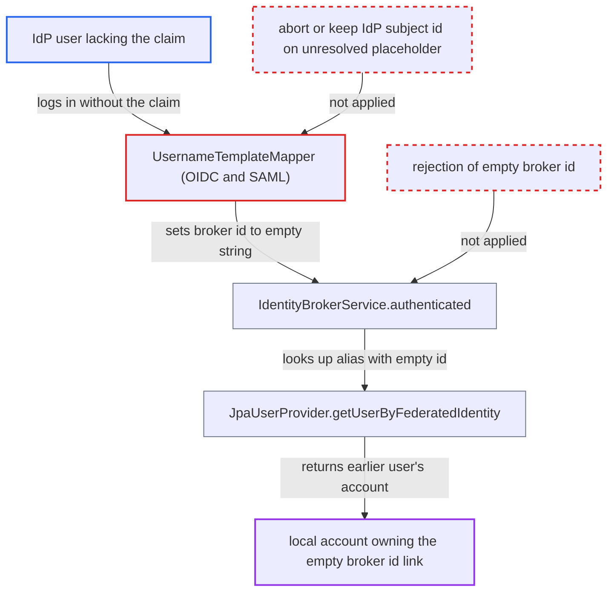

# Username template mapper collapses broker ID to empty string on missing claim, merging IdP users

| Field | Value |
|---|---|
| ID | `find_0117NhBaTJpQ9bUmboqxbUzT` |
| Severity | **High** |
| Status | open |
| CWE | CWE-290 — Authentication Bypass |
| Created | 2026-10-27T21:22:51.450197Z |
| Claude Security | https://claude.ai/security/findings/find_0117NhBaTJpQ9bUmboqxbUzT |

## Description

A user of an upstream identity provider who lacks a certain claim can be logged in as another local user, possibly a privileged one, without that user's credentials. This needs a realm admin to have set up a Username Template mapper with `Target.BROKER_ID` whose template uses a claim that not every user has. The mappers write an empty string as the broker id when a placeholder is unresolved, and `IdentityBrokerService.authenticated` accepts that empty id.

1. **realm admin** configures a Username Template mapper with `Target.BROKER_ID`. The template references a `${CLAIM.x}` or `${ATTRIBUTE.x}` placeholder that the IdP does not send for every user.
2. **first IdP user without the claim** logs in through the broker. The mapper sets `hasUnresolvedVariable` and writes an empty string to the target, so `context.setId("")` runs. This replaces the IdP's subject identifier. ([`services/src/main/java/org/keycloak/broker/oidc/mappers/UsernameTemplateMapper.java:178-204`](https://github.com/cx-benchmark/keycloak/blob/1d7be35d0764060a8143fc74b0aabf2442743be4/services/src/main/java/org/keycloak/broker/oidc/mappers/UsernameTemplateMapper.java#L178-L204))
3. **the SAML mapper `saml-username-idp-mapper`** does the same for a missing `${ATTRIBUTE.x}`. `Target.BROKER_ID.set` calls `context.setId(value)`, so the empty value becomes the federated-identity user id. ([`services/src/main/java/org/keycloak/broker/saml/mappers/UsernameTemplateMapper.java:194-217`](https://github.com/cx-benchmark/keycloak/blob/1d7be35d0764060a8143fc74b0aabf2442743be4/services/src/main/java/org/keycloak/broker/saml/mappers/UsernameTemplateMapper.java#L194-L217))
4. **`IdentityBrokerService.authenticated`** links the first user's local account to the empty broker id. On first broker login, `addFederatedIdentity` stores the link `(alias, "")`, and nothing rejects the empty id. ([`services/src/main/java/org/keycloak/services/resources/IdentityBrokerService.java:932-942`](https://github.com/cx-benchmark/keycloak/blob/1d7be35d0764060a8143fc74b0aabf2442743be4/services/src/main/java/org/keycloak/services/resources/IdentityBrokerService.java#L932-L942))
5. **attacker with an account at the same IdP** logs in with a token that also lacks the claim. The attacker's own subject id is discarded and replaced by the empty string, just as for the first user. ([`services/src/main/java/org/keycloak/broker/oidc/mappers/UsernameTemplateMapper.java:178-204`](https://github.com/cx-benchmark/keycloak/blob/1d7be35d0764060a8143fc74b0aabf2442743be4/services/src/main/java/org/keycloak/broker/oidc/mappers/UsernameTemplateMapper.java#L178-L204))
6. **`IdentityBrokerService.authenticated`** builds `FederatedIdentityModel(alias, "")` and looks up the user. The lookup finds the first user's account, and a hit leads straight to `setAuthenticatedUser(federatedUser)`. ([`services/src/main/java/org/keycloak/services/resources/IdentityBrokerService.java:740-757`](https://github.com/cx-benchmark/keycloak/blob/1d7be35d0764060a8143fc74b0aabf2442743be4/services/src/main/java/org/keycloak/services/resources/IdentityBrokerService.java#L740-L757))
7. **`JpaUserProvider.getUserByFederatedIdentity`** returns the stored account. The lookup is an exact match on realm, identity provider and user id, so the empty string matches the stored empty string. ([`model/jpa/src/main/java/org/keycloak/models/jpa/JpaUserProvider.java:747-762`](https://github.com/cx-benchmark/keycloak/blob/1d7be35d0764060a8143fc74b0aabf2442743be4/model/jpa/src/main/java/org/keycloak/models/jpa/JpaUserProvider.java#L747-L762))

## Assessment

A realm admin must have set up an OIDC/social or SAML identity provider with a Username Template mapper (`oidc-username-idp-mapper` or `saml-username-idp-mapper`) using `Target.BROKER_ID`. The template must reference a claim or attribute that is not sent for every user, and an earlier user must already have logged in without it. The attacker is any user with an account at that IdP who lacks the claim or removes it. Whether the claim is present depends on the upstream user's data, such as an optional profile attribute, a hidden or unset e-mail, or an attribute a user-attribute mapper emits only when set. The attacker only logs in through the broker, and no victim action is needed. A template with a unique part, such as `${CLAIM.sub}-${CLAIM.tenant}`, still collapses to an empty string when any one placeholder is missing.

Impact: The attacker is logged in as the local user who owns the `(alias, "")` link. That gives the attacker the user's roles, sessions, tokens for every client and account data, and the attacker can change the account's profile. Reach is limited to the one account holding the colliding link per identity provider, but that account can be any user, including a privileged one.

## Recommendation

(1) When a placeholder is unresolved, the mapper writes a constant empty string to a target that must uniquely identify the upstream subject. Distinct IdP users then map to one federated identity.

Fix criteria: An unresolved placeholder in a template whose target is `BROKER_ID` never yields a shared constant. The brokered login fails with an identity-provider error, or the broker id stays the IdP's own subject id. Two IdP users lacking the templated claim never end up in the same local account.

(2) `IdentityBrokerService.authenticated` and `afterFirstBrokerLogin` accept an empty broker user id for federated-identity lookup and linking.

Fix criteria: A blank `context.getId()` after the mappers run is rejected before `getUserByFederatedIdentity` and `addFederatedIdentity`. No `(alias, "")` link is created or matched by any mapper or provider.

## Evidence

**https://github.com/cx-benchmark/keycloak**

- [`services/src/main/java/org/keycloak/broker/oidc/mappers/UsernameTemplateMapper.java:178-204`](https://github.com/cx-benchmark/keycloak/blob/1d7be35d0764060a8143fc74b0aabf2442743be4/services/src/main/java/org/keycloak/broker/oidc/mappers/UsernameTemplateMapper.java#L178-L204)
- [`services/src/main/java/org/keycloak/broker/saml/mappers/UsernameTemplateMapper.java:194-217`](https://github.com/cx-benchmark/keycloak/blob/1d7be35d0764060a8143fc74b0aabf2442743be4/services/src/main/java/org/keycloak/broker/saml/mappers/UsernameTemplateMapper.java#L194-L217)
- [`services/src/main/java/org/keycloak/broker/saml/mappers/UsernameTemplateMapper.java:64-69`](https://github.com/cx-benchmark/keycloak/blob/1d7be35d0764060a8143fc74b0aabf2442743be4/services/src/main/java/org/keycloak/broker/saml/mappers/UsernameTemplateMapper.java#L64-L69)
- [`services/src/main/java/org/keycloak/services/resources/IdentityBrokerService.java:740-757`](https://github.com/cx-benchmark/keycloak/blob/1d7be35d0764060a8143fc74b0aabf2442743be4/services/src/main/java/org/keycloak/services/resources/IdentityBrokerService.java#L740-L757)
- [`services/src/main/java/org/keycloak/services/resources/IdentityBrokerService.java:932-942`](https://github.com/cx-benchmark/keycloak/blob/1d7be35d0764060a8143fc74b0aabf2442743be4/services/src/main/java/org/keycloak/services/resources/IdentityBrokerService.java#L932-L942)
- [`model/jpa/src/main/java/org/keycloak/models/jpa/JpaUserProvider.java:747-762`](https://github.com/cx-benchmark/keycloak/blob/1d7be35d0764060a8143fc74b0aabf2442743be4/model/jpa/src/main/java/org/keycloak/models/jpa/JpaUserProvider.java#L747-L762)

