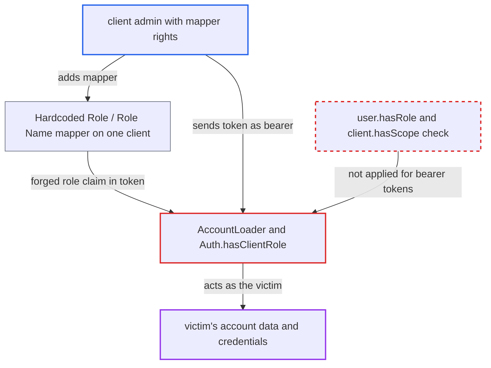

# Account REST API authorizes from token role claims that protocol mappers can forge

| Field | Value |
|---|---|
| ID | `find_018wNHB6jcBkWj9MxHJBmWgc` |
| Severity | **Medium** |
| Status | open |
| CWE | CWE-863 — Improper Authorization |
| Created | 2026-10-27T21:45:31.478318Z |
| Claude Security | https://claude.ai/security/findings/find_018wNHB6jcBkWj9MxHJBmWgc |

## Description

An admin who can add a protocol mapper to one client can act as any user of that client with Account API roles the user was never granted. That includes rewriting the profile, deleting MFA credentials, unlinking identity providers and logging out sessions. The cause is `Auth.hasClientRole`/`hasRealmRole`, which accept role names from the bearer token's claims without checking that the user holds the role.

1. **client admin** adds a mapper to one client. A Hardcoded Role mapper (`oidc-hardcoded-role-mapper`) adds `account.manage-account`, or a Role Name mapper (`oidc-role-name-mapper`) renames a role the user holds, such as `offline_access`, into that role. ([`services/src/main/java/org/keycloak/protocol/oidc/mappers/HardcodedRole.java:100-113`](https://github.com/cx-benchmark/keycloak/blob/1d7be35d0764060a8143fc74b0aabf2442743be4/services/src/main/java/org/keycloak/protocol/oidc/mappers/HardcodedRole.java#L100-L113))
2. **victim user** logs into that client, or uses an existing SSO session with it. The default `roles` scope mappers put the forged role under `resource_access.account` and add `account` to `aud`, so the signed access token carries the role although the user was never granted it. ([`services/src/main/java/org/keycloak/protocol/oidc/mappers/HardcodedRole.java:100-113`](https://github.com/cx-benchmark/keycloak/blob/1d7be35d0764060a8143fc74b0aabf2442743be4/services/src/main/java/org/keycloak/protocol/oidc/mappers/HardcodedRole.java#L100-L113))
3. **client admin** sends the token as a bearer token to `/realms/{realm}/account/...`. The client receives the victim's access token, and `AccountLoader` accepts any realm token whose `aud` includes `account`. ([`services/src/main/java/org/keycloak/services/resources/account/AccountLoader.java:118-160`](https://github.com/cx-benchmark/keycloak/blob/1d7be35d0764060a8143fc74b0aabf2442743be4/services/src/main/java/org/keycloak/services/resources/account/AccountLoader.java#L118-L160))
4. **`Auth.hasClientRole`** accepts the role from the token claim. With `cookie` false, it reads `token.getResourceAccess(...)` and never calls `user.hasRole` or `client.hasScope`; those checks run only in cookie mode. ([`services/src/main/java/org/keycloak/services/managers/Auth.java:96-121`](https://github.com/cx-benchmark/keycloak/blob/1d7be35d0764060a8143fc74b0aabf2442743be4/services/src/main/java/org/keycloak/services/managers/Auth.java#L96-L121))
5. **Account REST API operation** runs as the victim. Operations such as `updateAccount` are gated only by `auth.require(AccountRoles.MANAGE_ACCOUNT)`, so the forged claim is enough. ([`services/src/main/java/org/keycloak/services/resources/account/AccountRestService.java:158`](https://github.com/cx-benchmark/keycloak/blob/1d7be35d0764060a8143fc74b0aabf2442743be4/services/src/main/java/org/keycloak/services/resources/account/AccountRestService.java#L158))

## Assessment

The attacker is an admin who can add protocol mappers to one client in the realm. That means realm `manage-clients`, or a fine-grained admin with `manage`, or `configure` through the inline `protocolMappers` of `PUT /admin/realms/{realm}/clients/{id}`. A victim user must log into that client, or already have an SSO session used by it. The attacker's client then receives the token. With `configure` the attacker can also point redirect URIs at themselves. The attack only matters where the victim lacks the role, for example when `manage-account` was removed from `default-roles-<realm>` to make self-service read-only, or when non-default roles were never granted.

Impact: The attacker can act as the victim through the Account API. They can rewrite user-editable profile attributes, delete stored credentials including OTP and WebAuthn, unlink identity-provider accounts, grant or revoke consent, log out all sessions, share UMA resources, and revoke verifiable credentials. They can also read groups, sessions with IP addresses, consents and linked accounts. The step-up guard reads `acr` from the same token, which mappers may also set. The `DeleteAccount` required action is not affected, because it checks `user.hasRole` on the model.

## Recommendation

(1) `Auth.hasRealmRole` and `Auth.hasClientRole` treat role names in the bearer token's `realm_access` and `resource_access` claims as grants. Protocol mappers can fill those claims without any role mapping.

Fix criteria: An Account REST API operation succeeds only when the user actually holds the required `account` role, resolved via `RoleModel` and `UserModel.hasRole`, and the token's client has that role in scope. A token whose `resource_access.account.roles` was filled by a Hardcoded Role or Role Name mapper for a user without the grant gets 403 on `POST /account`, `DELETE /account/credentials/{id}`, and the consent, linked-account, session, resource-sharing and verifiable-credential endpoints.

(2) Token issuance lets mappers mint `account.*` and other non-admin role claims without a grant. `AdminRoleTokenPostProcessor` sanitizes only admin roles, so other role-gated consumers of token claims stay exposed.

Fix criteria: Either role claims written by mappers without a user role mapping are removed or never emitted for roles Keycloak itself consumes (`account.*`, `broker.read-token`), or every Keycloak-internal consumer resolves grants from the model. To verify, issue a token to a client carrying a Hardcoded Role mapper for `account.manage-account` for a user without that role. Confirm the Account API rejects it.

## Evidence

**https://github.com/cx-benchmark/keycloak**

- [`services/src/main/java/org/keycloak/services/managers/Auth.java:96-121`](https://github.com/cx-benchmark/keycloak/blob/1d7be35d0764060a8143fc74b0aabf2442743be4/services/src/main/java/org/keycloak/services/managers/Auth.java#L96-L121)
- [`services/src/main/java/org/keycloak/services/resources/account/AccountLoader.java:118-160`](https://github.com/cx-benchmark/keycloak/blob/1d7be35d0764060a8143fc74b0aabf2442743be4/services/src/main/java/org/keycloak/services/resources/account/AccountLoader.java#L118-L160)
- [`services/src/main/java/org/keycloak/services/resources/account/AccountRestService.java:158`](https://github.com/cx-benchmark/keycloak/blob/1d7be35d0764060a8143fc74b0aabf2442743be4/services/src/main/java/org/keycloak/services/resources/account/AccountRestService.java#L158)
- [`services/src/main/java/org/keycloak/protocol/oidc/mappers/HardcodedRole.java:100-113`](https://github.com/cx-benchmark/keycloak/blob/1d7be35d0764060a8143fc74b0aabf2442743be4/services/src/main/java/org/keycloak/protocol/oidc/mappers/HardcodedRole.java#L100-L113)
- [`services/src/main/java/org/keycloak/services/resources/admin/AdminRoleTokenPostProcessor.java:48-76`](https://github.com/cx-benchmark/keycloak/blob/1d7be35d0764060a8143fc74b0aabf2442743be4/services/src/main/java/org/keycloak/services/resources/admin/AdminRoleTokenPostProcessor.java#L48-L76)
- [`services/src/main/java/org/keycloak/services/resources/account/AccountConsole.java:338-365`](https://github.com/cx-benchmark/keycloak/blob/1d7be35d0764060a8143fc74b0aabf2442743be4/services/src/main/java/org/keycloak/services/resources/account/AccountConsole.java#L338-L365)

