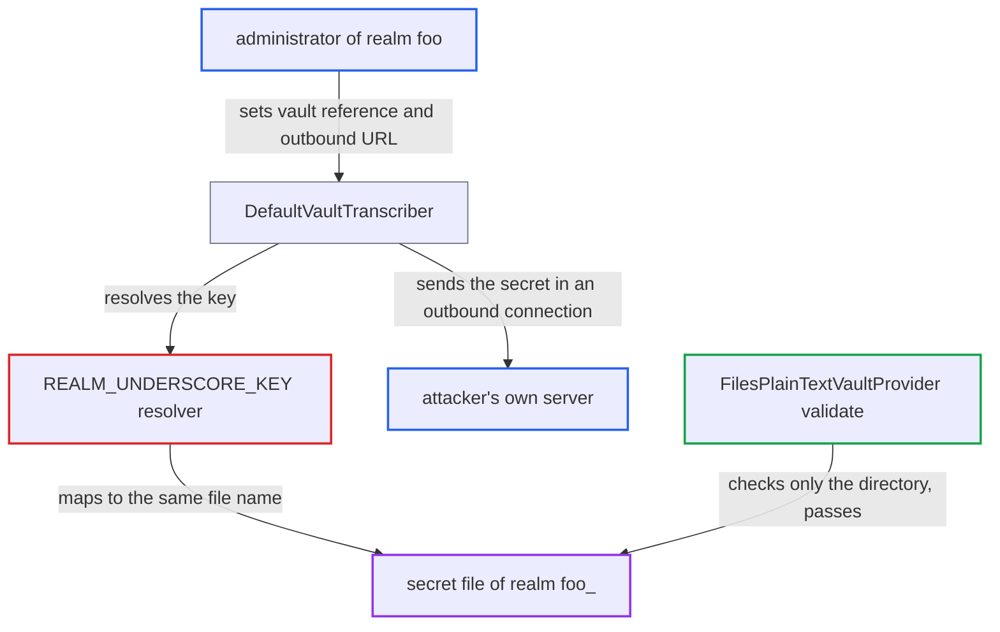

# Ambiguous realm/key escaping in vault REALM_UNDERSCORE_KEY resolver allows cross-realm secret read

| Field | Value |
|---|---|
| ID | `find_018epbEgY9jJWHSvSKkZVtJN` |
| Severity | **Medium** |
| Status | open |
| CWE | CWE-653 — Improper Isolation |
| Created | 2026-10-27T21:51:05.337994Z |
| Claude Security | https://claude.ai/security/findings/find_018epbEgY9jJWHSvSKkZVtJN |

## Description

An administrator of one realm can read vault secrets that belong to a different realm, such as LDAP bind credentials, SMTP passwords, IdP client secrets and keystore passwords. This needs a realm named like their own with trailing underscores (`foo` and `foo_`) and the default `REALM_UNDERSCORE_KEY` resolver. The resolver's underscore escaping in `AbstractVaultProviderFactory` lets two different realm and key pairs produce the same file name.

1. **administrator of realm `foo`** sets a realm setting to a vault reference and points the matching outbound connection at their own server. For example, the LDAP bind credential becomes `${vault._<key>}` and the LDAP URL points to a server the attacker runs.
2. **the transcriber `DefaultVaultTranscriber`** resolves the admin-set `${vault.<key>}` string through the vault provider. The realm part comes from the session realm and the key part comes from the admin, so the admin controls only the key. ([`services/src/main/java/org/keycloak/vault/DefaultVaultTranscriber.java:88-97`](https://github.com/cx-benchmark/keycloak/blob/1d7be35d0764060a8143fc74b0aabf2442743be4/services/src/main/java/org/keycloak/vault/DefaultVaultTranscriber.java#L88-L97))
3. **the resolver `REALM_UNDERSCORE_KEY`** builds the storage key by doubling underscores in realm and key and joining them with `_`. Realm `foo` with key `_smtp` gives `foo___smtp`, and realm `foo_` with key `smtp` gives the same `foo___smtp`. ([`services/src/main/java/org/keycloak/vault/AbstractVaultProviderFactory.java:150`](https://github.com/cx-benchmark/keycloak/blob/1d7be35d0764060a8143fc74b0aabf2442743be4/services/src/main/java/org/keycloak/vault/AbstractVaultProviderFactory.java#L150))
4. **the method `obtainSecret`** accepts the resolved key because it only rejects keys containing the file separator. The colliding name has no file separator, so it passes. ([`services/src/main/java/org/keycloak/vault/AbstractVaultProvider.java:63-80`](https://github.com/cx-benchmark/keycloak/blob/1d7be35d0764060a8143fc74b0aabf2442743be4/services/src/main/java/org/keycloak/vault/AbstractVaultProvider.java#L63-L80))
5. **the method `validate`** accepts the path because it only checks that the file sits directly in the vault directory. The other realm's file is a sibling in that same directory, so the check passes and `obtainSecretInternal` returns its contents. ([`services/src/main/java/org/keycloak/vault/FilesPlainTextVaultProvider.java:52-86`](https://github.com/cx-benchmark/keycloak/blob/1d7be35d0764060a8143fc74b0aabf2442743be4/services/src/main/java/org/keycloak/vault/FilesPlainTextVaultProvider.java#L52-L86))
6. **the server** uses the secret in the outbound connection the attacker controls. The plaintext reaches the attacker's LDAP listener, or an SMTP host or OIDC token endpoint, with no user interaction.

## Assessment

The attacker is an administrator of a realm such as `foo`. Another realm named `foo_` (or `foo__`, and so on) must exist in the same deployment and hold vault secrets. The vault must use the default `REALM_UNDERSCORE_KEY` resolver, with either files-plaintext or files-keystore storage. The attacker puts `${vault._<key>}` into a realm setting that is later used in an outbound connection they control, then triggers it. Examples are an LDAP connection URL with bind credential (followed by a sync), an SMTP host with password, or an OIDC IdP token endpoint with client secret. The reverse also works: from realm `foo_`, an administrator can reach secrets of realm `foo` whose key starts with underscores. `FilesKeystoreVaultProvider` has the same collision for alias names.

Impact: The attacker obtains the plaintext of other realms' vault secrets. This breaks the isolation between realms. It needs the specific relationship between the two realm names. The report names no integrity or availability impact on Keycloak itself.

Subsequent-system impact: The stolen secrets are credentials for the victim realm's external systems, such as a directory server, a mail relay or an upstream IdP. With them the attacker can read directory data or act as the victim realm against the upstream IdP. How far this goes depends on the deployment, and the report rates it low.

## Recommendation

The escaping in the `REALM_UNDERSCORE_KEY` resolver (`_` becomes `__`, with `_` as the separator) does not map each (realm, key) pair to a unique storage key. Different realms' keys can therefore collide, which breaks per-realm isolation.

Fix criteria: The mapping from realm and key to storage key is unambiguous. This can be done with a separator or escape character that cannot appear in escaped names, by forbidding ambiguous combinations, or by checking at resolve time that decoding the resolved key gives exactly the current realm. `("foo", "_k")` and `("foo_", "k")` no longer resolve to the same storage key. Realm `foo` cannot obtain a secret stored for realm `foo_`.

## Evidence

**https://github.com/cx-benchmark/keycloak**

- [`services/src/main/java/org/keycloak/vault/AbstractVaultProviderFactory.java:150`](https://github.com/cx-benchmark/keycloak/blob/1d7be35d0764060a8143fc74b0aabf2442743be4/services/src/main/java/org/keycloak/vault/AbstractVaultProviderFactory.java#L150)
- [`services/src/main/java/org/keycloak/vault/AbstractVaultProvider.java:63-80`](https://github.com/cx-benchmark/keycloak/blob/1d7be35d0764060a8143fc74b0aabf2442743be4/services/src/main/java/org/keycloak/vault/AbstractVaultProvider.java#L63-L80)
- [`services/src/main/java/org/keycloak/vault/FilesPlainTextVaultProvider.java:52-86`](https://github.com/cx-benchmark/keycloak/blob/1d7be35d0764060a8143fc74b0aabf2442743be4/services/src/main/java/org/keycloak/vault/FilesPlainTextVaultProvider.java#L52-L86)
- [`services/src/main/java/org/keycloak/vault/DefaultVaultTranscriber.java:88-97`](https://github.com/cx-benchmark/keycloak/blob/1d7be35d0764060a8143fc74b0aabf2442743be4/services/src/main/java/org/keycloak/vault/DefaultVaultTranscriber.java#L88-L97)

