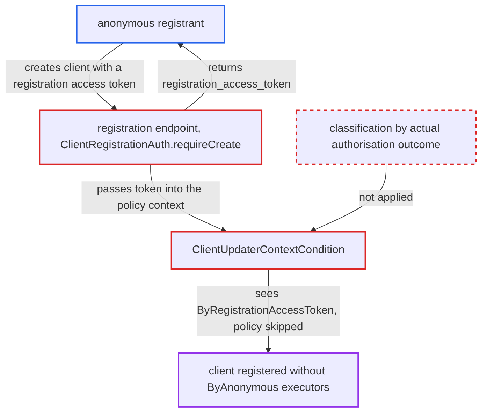

# Anonymous client registration with a registration access token evades ByAnonymous client policies

| Field | Value |
|---|---|
| ID | `find_0146cncPFthXVqpioMDXivQs` |
| Severity | **Medium** |
| Status | open |
| CWE | CWE-863 — Improper Authorization |
| Created | 2026-10-27T21:22:51.384503Z |
| Claude Security | https://claude.ai/security/findings/find_0146cncPFthXVqpioMDXivQs |

## Description

An unauthenticated internet client can register an OIDC client that skips the realm's `ByAnonymous` client policy and its executors, such as secure redirect URIs or PKCE enforcement. The attacker first registers anonymously, then repeats the registration with the returned registration access token. This works only where anonymous dynamic registration is allowed and a `client-updater-context` policy for `ByAnonymous` exists. The cause is that `ClientUpdaterContextCondition` picks the actor from the token type, while `ClientRegistrationAuth.requireCreate` still treats the request as anonymous.

1. **attacker** registers a client anonymously with no token. The `ByAnonymous` policy applies to this first request, and the response contains a `registration_access_token`. ([`services/src/main/java/org/keycloak/services/clientregistration/AbstractClientRegistrationProvider.java:135-143`](https://github.com/cx-benchmark/keycloak/blob/1d7be35d0764060a8143fc74b0aabf2442743be4/services/src/main/java/org/keycloak/services/clientregistration/AbstractClientRegistrationProvider.java#L135-L143))
2. **attacker** posts the same create request again with `Authorization: Bearer <registration_access_token>`. The request goes to `/realms/{r}/clients-registrations/openid-connect` and carries the non-compliant client metadata the attacker wants.
3. **`requireCreate` in `ClientRegistrationAuth`** accepts the token but leaves the request as `ANONYMOUS`. A registration access token grants no create authority, so nothing is escalated. The parsed token is still passed into `DynamicClientRegisterContext`, and `verifyToken` accepts any realm-signed registration access token without tying it to a client. ([`services/src/main/java/org/keycloak/services/clientregistration/ClientRegistrationAuth.java:162-192`](https://github.com/cx-benchmark/keycloak/blob/1d7be35d0764060a8143fc74b0aabf2442743be4/services/src/main/java/org/keycloak/services/clientregistration/ClientRegistrationAuth.java#L162-L192))
4. **`isAuthMethodMatched` in `ClientUpdaterContextCondition`** classifies the request as `ByRegistrationAccessToken`. It looks only at the token type, and only a null token gives `ByAnonymous`, so the `ByAnonymous` condition votes `NO`. ([`services/src/main/java/org/keycloak/services/clientpolicy/condition/ClientUpdaterContextCondition.java:102-120`](https://github.com/cx-benchmark/keycloak/blob/1d7be35d0764060a8143fc74b0aabf2442743be4/services/src/main/java/org/keycloak/services/clientpolicy/condition/ClientUpdaterContextCondition.java#L102-L120))
5. **client policy engine** skips the policy and its executors, and the client is created. The same misclassification repeats on the `REGISTERED` event, because it uses the same `auth.getJwt()`. ([`services/src/main/java/org/keycloak/services/clientregistration/AbstractClientRegistrationProvider.java:135-143`](https://github.com/cx-benchmark/keycloak/blob/1d7be35d0764060a8143fc74b0aabf2442743be4/services/src/main/java/org/keycloak/services/clientregistration/AbstractClientRegistrationProvider.java#L135-L143))

## Assessment

The attacker is an unauthenticated internet client. The realm must allow anonymous OIDC dynamic registration (trusted hosts configured) and must have a client policy using `client-updater-context=ByAnonymous` to restrict such registrations. The attacker needs any registration access token. The one returned by their own earlier anonymous registration is enough. Such tokens carry `exp=0` and are not revoked on rotation, so even an old one works.

Impact: The attacker can register clients whose configuration escapes the mandatory `ByAnonymous` client-policy executors. Examples are secure redirect URIs, PKCE/DPoP/HoK enforcement, secure client authenticator, rejecting implicit or direct grants, and consent or full-scope executors. Only the client-policies layer is bypassed. The legacy `ClientRegistrationPolicy` chain still runs as anonymous, which limits the impact to what the client policies alone enforced. Later token flows for users of that client are weakened.

## Recommendation

(1) `ClientUpdaterContextCondition.isAuthMethodMatched` maps a `RegistrationAccessToken` to `ByRegistrationAccessToken` on REGISTER/REGISTERED events, although such a token never authorises a create. The policy's view of the actor therefore differs from the endpoint's authorisation decision.

Fix criteria: On REGISTER/REGISTERED events, a request carrying a registration access token (or any token that did not authenticate the create) is classified as `ByAnonymous`, so a `ByAnonymous` policy applies. To verify, register anonymously, then re-register with the returned `registration_access_token`. The `ByAnonymous` policy's executors must be applied exactly as for the token-less request, with the request rejected or auto-configured.

(2) `ClientRegistrationAuth.requireCreate` accepts a registration access token, leaves the request anonymous, and still passes the token into the client-policy context. Downstream code cannot tell an anonymous create from an authenticated one.

Fix criteria: A create request with a token that grants no create authority is either rejected (401/403) or given to the client-policy contexts without that token (null token means anonymous), so `getToken()` reflects the effective authorisation. To verify, a create with a registration access token is either refused or evaluated identically to a token-less anonymous create by all `client-updater-*` conditions.

## Evidence

**https://github.com/cx-benchmark/keycloak**

- [`services/src/main/java/org/keycloak/services/clientpolicy/condition/ClientUpdaterContextCondition.java:102-120`](https://github.com/cx-benchmark/keycloak/blob/1d7be35d0764060a8143fc74b0aabf2442743be4/services/src/main/java/org/keycloak/services/clientpolicy/condition/ClientUpdaterContextCondition.java#L102-L120)
- [`services/src/main/java/org/keycloak/services/clientregistration/ClientRegistrationAuth.java:162-192`](https://github.com/cx-benchmark/keycloak/blob/1d7be35d0764060a8143fc74b0aabf2442743be4/services/src/main/java/org/keycloak/services/clientregistration/ClientRegistrationAuth.java#L162-L192)
- [`services/src/main/java/org/keycloak/services/clientregistration/AbstractClientRegistrationProvider.java:135-143`](https://github.com/cx-benchmark/keycloak/blob/1d7be35d0764060a8143fc74b0aabf2442743be4/services/src/main/java/org/keycloak/services/clientregistration/AbstractClientRegistrationProvider.java#L135-L143)
- [`services/src/main/java/org/keycloak/services/clientpolicy/context/AbstractDynamicClientCRUDContext.java:1-60`](https://github.com/cx-benchmark/keycloak/blob/1d7be35d0764060a8143fc74b0aabf2442743be4/services/src/main/java/org/keycloak/services/clientpolicy/context/AbstractDynamicClientCRUDContext.java#L1-L60)

