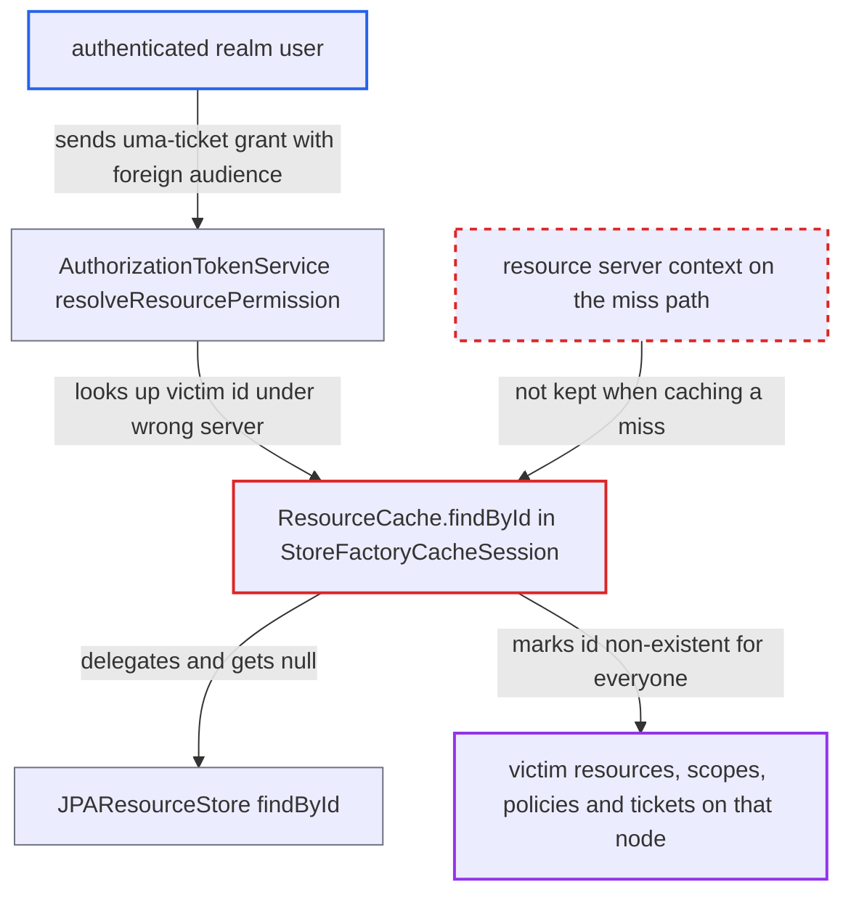

# Authorization cache negative entries keyed by id only allow cross-resource-server poisoning

| Field | Value |
|---|---|
| ID | `find_01N854x8yYezSzqYiy7RenpZ` |
| Severity | **Medium** |
| Status | open |
| CWE | CWE-706 — Cache poisoning |
| Created | 2026-10-27T22:20:06.492715Z |
| Claude Security | https://claude.ai/security/findings/find_01N854x8yYezSzqYiy7RenpZ |

## Description

Any logged-in realm user can make one node treat another resource server's resources, scopes, policies or permission tickets as non-existent, with no expiry. The user needs a valid access token, a second resource server and a victim id that is not yet cached on that node. `StoreFactoryCacheSession` stores a miss under the bare id, although the database lookup also returns `null` when the entity belongs to a different resource server.

1. **the attacker (any authenticated realm user)** collects the id of a victim resource. Ids appear as `rsid` in an RPT or in the Account API `shared-with-me` list, so an ordinary user can get them. ([`services/src/main/java/org/keycloak/services/resources/account/resources/ResourcesService.java:88-95`](https://github.com/cx-benchmark/keycloak/blob/1d7be35d0764060a8143fc74b0aabf2442743be4/services/src/main/java/org/keycloak/services/resources/account/resources/ResourcesService.java#L88-L95))
2. **the attacker** posts an uma-ticket grant with their bearer token. The request sets `audience` to another resource-server client and `permission` to the victim id. The grant accepts a bearer access token of the realm instead of client authentication. ([`services/src/main/java/org/keycloak/protocol/oidc/grants/PermissionGrantType.java:60-95`](https://github.com/cx-benchmark/keycloak/blob/1d7be35d0764060a8143fc74b0aabf2442743be4/services/src/main/java/org/keycloak/protocol/oidc/grants/PermissionGrantType.java#L60-L95))
3. **the method `resolveResourcePermission`** calls `resourceStore.findById(resourceServer, resourceId)` with the wrong resource server. `resourceId` comes from the `permission` parameter and `resourceServer` from the `audience` parameter. ([`services/src/main/java/org/keycloak/authorization/authorization/AuthorizationTokenService.java:624-632`](https://github.com/cx-benchmark/keycloak/blob/1d7be35d0764060a8143fc74b0aabf2442743be4/services/src/main/java/org/keycloak/authorization/authorization/AuthorizationTokenService.java#L624-L632))
4. **the JPA store `JPAResourceStore`** returns `null` for the id. It returns `null` both when the id does not exist and when the entity belongs to a different resource server, so the cache cannot tell the cases apart. ([`model/jpa/src/main/java/org/keycloak/authorization/jpa/store/JPAResourceStore.java:92-104`](https://github.com/cx-benchmark/keycloak/blob/1d7be35d0764060a8143fc74b0aabf2442743be4/model/jpa/src/main/java/org/keycloak/authorization/jpa/store/JPAResourceStore.java#L92-L104))
5. **the cache method `ResourceCache.findById`** calls `setModelDoesNotExists(id, loaded)` for the bare id. This stores a `NonExistentItem` keyed only by id. The positive path compares resource servers, but the miss path drops that context. ([`model/infinispan/src/main/java/org/keycloak/models/cache/infinispan/authorization/StoreFactoryCacheSession.java:612-644`](https://github.com/cx-benchmark/keycloak/blob/1d7be35d0764060a8143fc74b0aabf2442743be4/model/infinispan/src/main/java/org/keycloak/models/cache/infinispan/authorization/StoreFactoryCacheSession.java#L612-L644))
6. **the check `modelMightExist(id)`** returns false for that id for every later caller. Every later `findById` returns `null` without querying the database, whatever resource server is given, including `null`. ([`model/infinispan/src/main/java/org/keycloak/models/cache/infinispan/authorization/StoreFactoryCacheSession.java:416-424`](https://github.com/cx-benchmark/keycloak/blob/1d7be35d0764060a8143fc74b0aabf2442743be4/model/infinispan/src/main/java/org/keycloak/models/cache/infinispan/authorization/StoreFactoryCacheSession.java#L416-L424))
7. **the cache** keeps the entry although the attacker's request fails. The rollback only runs registered invalidations, so the entry outlives the `invalid_resource` error. The entry is stored with no lifespan. ([`model/infinispan/src/main/java/org/keycloak/models/cache/infinispan/authorization/StoreFactoryCacheSession.java:200-251`](https://github.com/cx-benchmark/keycloak/blob/1d7be35d0764060a8143fc74b0aabf2442743be4/model/infinispan/src/main/java/org/keycloak/models/cache/infinispan/authorization/StoreFactoryCacheSession.java#L200-L251))

## Assessment

The attacker is any authenticated realm user with a valid access token. They need a second resource server to use as `audience`, and the victim id must not already be cached positively on that node. A cached `CachedResource` hit takes the branch that compares resource servers, so it is not poisoned. The cache is per node. The same flaw exists in `ScopeCache`, `PolicyCache` and `PermissionTicketCache`. Another route in is `/authz/protection/uma-policy/{policyId}`, which calls `policyStore.findById(resourceServer, policyId)` before any ownership check. `AbstractPermissionService` does the same for resource ids. Ids are resolved with no realm filter, so a resource server in one realm can poison ids in another realm.

Impact: On that node the chosen resources, scopes, tickets or policies are treated as non-existent, with no expiry. RPT and entitlement requests fail with `invalid_resource` or leave them out, protection-API and admin lookups return 404, and listings drop them. The owner cannot repair it, because the update that would invalidate the entry also gets 404. Only eviction, an admin realm-cache clear or a restart removes the entry, and the id can be poisoned again afterwards. Integrity loss is limited to this corrupted view, and nothing is disclosed. If the attacker knows a policy id, a denying policy could stop voting, because `PolicyAdapter.getAssociatedPolicies()` skips ids it cannot resolve. That fail-open is conditional, since policy ids are not normally shown to end users.

## Recommendation

`StoreFactoryCacheSession` negative-caches by bare id after a lookup whose `null` result depends on the requested resource server. `setModelDoesNotExists` is called from the `findById` miss paths of the resource, scope, policy and permission-ticket caches. A miss that applies to one context is recorded as global non-existence.

Fix criteria: A `findById(resourceServer, id)` that returns null because the entity belongs to another resource server does not make later lookups of that id return null. This holds under its real resource server and with a null server. To verify, look up a resource, scope, policy or ticket id under a foreign resource server on a fresh node, then under its own. The second lookup must return the entity. An uma-ticket request with a foreign `audience` must leave the entity resolvable for its owner's resource server.

## Evidence

**https://github.com/cx-benchmark/keycloak**

- [`model/infinispan/src/main/java/org/keycloak/models/cache/infinispan/authorization/StoreFactoryCacheSession.java:612-644`](https://github.com/cx-benchmark/keycloak/blob/1d7be35d0764060a8143fc74b0aabf2442743be4/model/infinispan/src/main/java/org/keycloak/models/cache/infinispan/authorization/StoreFactoryCacheSession.java#L612-L644)
- [`model/infinispan/src/main/java/org/keycloak/models/cache/infinispan/authorization/StoreFactoryCacheSession.java:416-424`](https://github.com/cx-benchmark/keycloak/blob/1d7be35d0764060a8143fc74b0aabf2442743be4/model/infinispan/src/main/java/org/keycloak/models/cache/infinispan/authorization/StoreFactoryCacheSession.java#L416-L424)
- [`model/jpa/src/main/java/org/keycloak/authorization/jpa/store/JPAResourceStore.java:92-104`](https://github.com/cx-benchmark/keycloak/blob/1d7be35d0764060a8143fc74b0aabf2442743be4/model/jpa/src/main/java/org/keycloak/authorization/jpa/store/JPAResourceStore.java#L92-L104)
- [`services/src/main/java/org/keycloak/authorization/authorization/AuthorizationTokenService.java:624-632`](https://github.com/cx-benchmark/keycloak/blob/1d7be35d0764060a8143fc74b0aabf2442743be4/services/src/main/java/org/keycloak/authorization/authorization/AuthorizationTokenService.java#L624-L632)
- [`services/src/main/java/org/keycloak/protocol/oidc/grants/PermissionGrantType.java:60-95`](https://github.com/cx-benchmark/keycloak/blob/1d7be35d0764060a8143fc74b0aabf2442743be4/services/src/main/java/org/keycloak/protocol/oidc/grants/PermissionGrantType.java#L60-L95)
- [`model/infinispan/src/main/java/org/keycloak/models/cache/infinispan/authorization/StoreFactoryCacheSession.java:200-251`](https://github.com/cx-benchmark/keycloak/blob/1d7be35d0764060a8143fc74b0aabf2442743be4/model/infinispan/src/main/java/org/keycloak/models/cache/infinispan/authorization/StoreFactoryCacheSession.java#L200-L251)
- [`model/infinispan/src/main/java/org/keycloak/models/cache/infinispan/CacheManager.java:142-205`](https://github.com/cx-benchmark/keycloak/blob/1d7be35d0764060a8143fc74b0aabf2442743be4/model/infinispan/src/main/java/org/keycloak/models/cache/infinispan/CacheManager.java#L142-L205)
- [`model/infinispan/src/main/java/org/keycloak/spi/infinispan/impl/embedded/CacheConfigurator.java:623-627`](https://github.com/cx-benchmark/keycloak/blob/1d7be35d0764060a8143fc74b0aabf2442743be4/model/infinispan/src/main/java/org/keycloak/spi/infinispan/impl/embedded/CacheConfigurator.java#L623-L627)
- [`model/infinispan/src/main/java/org/keycloak/models/cache/infinispan/authorization/StoreFactoryCacheSession.java:513-540`](https://github.com/cx-benchmark/keycloak/blob/1d7be35d0764060a8143fc74b0aabf2442743be4/model/infinispan/src/main/java/org/keycloak/models/cache/infinispan/authorization/StoreFactoryCacheSession.java#L513-L540)
- [`model/infinispan/src/main/java/org/keycloak/models/cache/infinispan/authorization/StoreFactoryCacheSession.java:867-895`](https://github.com/cx-benchmark/keycloak/blob/1d7be35d0764060a8143fc74b0aabf2442743be4/model/infinispan/src/main/java/org/keycloak/models/cache/infinispan/authorization/StoreFactoryCacheSession.java#L867-L895)
- [`model/infinispan/src/main/java/org/keycloak/models/cache/infinispan/authorization/StoreFactoryCacheSession.java:1122-1150`](https://github.com/cx-benchmark/keycloak/blob/1d7be35d0764060a8143fc74b0aabf2442743be4/model/infinispan/src/main/java/org/keycloak/models/cache/infinispan/authorization/StoreFactoryCacheSession.java#L1122-L1150)
- [`services/src/main/java/org/keycloak/services/resources/account/resources/ResourcesService.java:88-95`](https://github.com/cx-benchmark/keycloak/blob/1d7be35d0764060a8143fc74b0aabf2442743be4/services/src/main/java/org/keycloak/services/resources/account/resources/ResourcesService.java#L88-L95)
- [`services/src/main/java/org/keycloak/authorization/protection/policy/UserManagedPermissionService.java:152-160`](https://github.com/cx-benchmark/keycloak/blob/1d7be35d0764060a8143fc74b0aabf2442743be4/services/src/main/java/org/keycloak/authorization/protection/policy/UserManagedPermissionService.java#L152-L160)
- [`services/src/main/java/org/keycloak/authorization/admin/ResourceSetService.java:179-188`](https://github.com/cx-benchmark/keycloak/blob/1d7be35d0764060a8143fc74b0aabf2442743be4/services/src/main/java/org/keycloak/authorization/admin/ResourceSetService.java#L179-L188)
- [`model/infinispan/src/main/java/org/keycloak/models/cache/infinispan/authorization/InfinispanCacheStoreFactoryProviderFactory.java:65-67`](https://github.com/cx-benchmark/keycloak/blob/1d7be35d0764060a8143fc74b0aabf2442743be4/model/infinispan/src/main/java/org/keycloak/models/cache/infinispan/authorization/InfinispanCacheStoreFactoryProviderFactory.java#L65-L67)
- [`model/infinispan/src/main/java/org/keycloak/models/cache/infinispan/authorization/PolicyAdapter.java:206-227`](https://github.com/cx-benchmark/keycloak/blob/1d7be35d0764060a8143fc74b0aabf2442743be4/model/infinispan/src/main/java/org/keycloak/models/cache/infinispan/authorization/PolicyAdapter.java#L206-L227)

