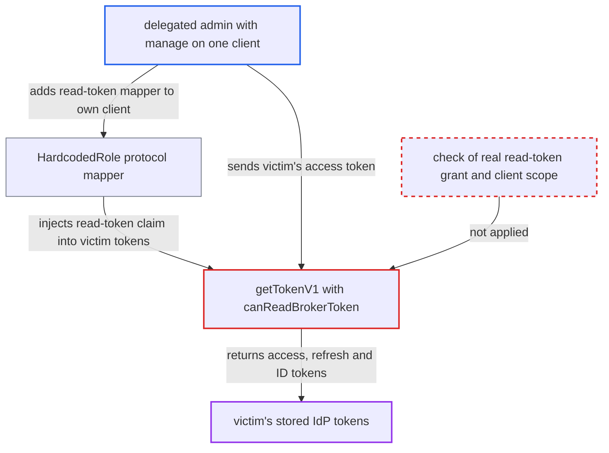

# Broker token API v1 releases stored IdP tokens on a mapper-injectable read-token claim

| Field | Value |
|---|---|
| ID | `find_01NcEcGm1v726MaYKhxiecmb` |
| Severity | **Medium** |
| Status | open |
| CWE | CWE-863 — Incorrect authorization |
| Created | 2026-10-27T21:31:50.429188Z |
| Claude Security | https://claude.ai/security/findings/find_01NcEcGm1v726MaYKhxiecmb |

## Description

A delegated admin who can manage only one client can read the stored external identity provider tokens (access, refresh and ID tokens) of users who log in to that client. The attack needs fine-grained admin permissions (FGAP v2) `manage` on that client, plus a victim whose linked identity provider has `storeToken=true`. The cause is `canReadBrokerToken`, which trusts the token's `resource_access.broker.roles` claim instead of checking a real role grant.

1. **delegated admin** creates an `oidc-hardcoded-role-mapper` for `broker.read-token` on their client. Creating protocol mappers needs only `requireManage(client)`, which the per-client FGAP v2 `manage` permission satisfies without the realm-wide `manage-clients` role. ([`services/src/main/java/org/keycloak/services/resources/admin/ClientResource.java:142-147`](https://github.com/cx-benchmark/keycloak/blob/1d7be35d0764060a8143fc74b0aabf2442743be4/services/src/main/java/org/keycloak/services/resources/admin/ClientResource.java#L142-L147))
2. **mapper `HardcodedRole`** adds the configured role to every token issued for the client. `setClaim` does not check that the user holds the role, and `AdminRoleTokenPostProcessor` removes only admin roles, so the `broker` role stays in the token. ([`services/src/main/java/org/keycloak/protocol/oidc/mappers/HardcodedRole.java:116-130`](https://github.com/cx-benchmark/keycloak/blob/1d7be35d0764060a8143fc74b0aabf2442743be4/services/src/main/java/org/keycloak/protocol/oidc/mappers/HardcodedRole.java#L116-L130))
3. **victim user** logs in to the delegate's client as usual. The victim's account must be linked to an identity provider with `storeToken=true`. The issued access token now carries `read-token` in `resource_access.broker.roles`.
4. **delegated admin** sends the victim's access token to `GET /realms/{r}/broker/{alias}/token`. `getTokenV1` accepts any valid bearer access token of the realm, and `canReadBrokerToken` passes because the claim is present, even though the user was never granted the role. ([`services/src/main/java/org/keycloak/services/resources/IdentityBrokerService.java:624-628`](https://github.com/cx-benchmark/keycloak/blob/1d7be35d0764060a8143fc74b0aabf2442743be4/services/src/main/java/org/keycloak/services/resources/IdentityBrokerService.java#L624-L628))
5. **the handler `getTokenV1`** returns the victim's stored identity provider token JSON. After the `storeToken` check it returns `identityProvider.retrieveToken(session, identity)`, which includes the refresh token. ([`services/src/main/java/org/keycloak/services/resources/IdentityBrokerService.java:630-700`](https://github.com/cx-benchmark/keycloak/blob/1d7be35d0764060a8143fc74b0aabf2442743be4/services/src/main/java/org/keycloak/services/resources/IdentityBrokerService.java#L630-L700))

## Assessment

The attacker is a delegated admin in a realm with admin permissions enabled. They hold FGAP v2 `manage` on one client but not `manage-clients`. The Identity Brokering API V1 endpoint is deprecated but enabled by default. The IdP's 'Stored Tokens Readable' switch is not needed. The victim must log in to the attacker's client with an account linked to an identity provider that has `storeToken=true`. A realm-wide `manage-clients` holder gains nothing extra, because they can already add `broker.read-token` as a composite of a default role such as `account.manage-account`. The deprecated V1 `configure`-only route to protocol mappers needs a non-default feature, so the finding concerns per-client delegated admins.

Impact: The attacker obtains the external access, refresh and ID tokens that Keycloak stores for each user who logs in to the delegate's client and has a linked identity with stored tokens. The reach is limited to that realm and to users of that client. The only write is Keycloak's own refresh-and-persist of the token, which the attacker does not direct.

Subsequent-system impact: The stolen tokens are bearer credentials at the external identity provider, for example Google or GitHub. The attacker can call that provider's APIs as the victim within the granted scopes. The refresh token extends this access past the access token's lifetime. What the attacker can change depends on the scopes the provider granted.

## Recommendation

`canReadBrokerToken` decides whether to release stored identity provider tokens from the `resource_access.broker.roles` claim. Mappers such as Hardcoded Role can fill that claim without any role grant, so anyone who can define mappers on a client bypasses the `read-token` grant.

Fix criteria: The V1 token endpoint releases a stored identity provider token only when the authenticated user really holds `broker.read-token`, directly or by composite, and the authenticated client has that role in scope. This matches `AdminAuth.hasAppRole` and `SsfAuthUtil.hasRole`. A token for a user without the grant, issued by a client that has a Hardcoded Role mapper for `broker.read-token`, gets 403. A user with a real grant still succeeds.

## Evidence

**https://github.com/cx-benchmark/keycloak**

- [`services/src/main/java/org/keycloak/services/resources/IdentityBrokerService.java:624-628`](https://github.com/cx-benchmark/keycloak/blob/1d7be35d0764060a8143fc74b0aabf2442743be4/services/src/main/java/org/keycloak/services/resources/IdentityBrokerService.java#L624-L628)
- [`services/src/main/java/org/keycloak/services/resources/IdentityBrokerService.java:630-700`](https://github.com/cx-benchmark/keycloak/blob/1d7be35d0764060a8143fc74b0aabf2442743be4/services/src/main/java/org/keycloak/services/resources/IdentityBrokerService.java#L630-L700)
- [`services/src/main/java/org/keycloak/protocol/oidc/mappers/HardcodedRole.java:116-130`](https://github.com/cx-benchmark/keycloak/blob/1d7be35d0764060a8143fc74b0aabf2442743be4/services/src/main/java/org/keycloak/protocol/oidc/mappers/HardcodedRole.java#L116-L130)
- [`services/src/main/java/org/keycloak/services/resources/admin/ClientResource.java:142-147`](https://github.com/cx-benchmark/keycloak/blob/1d7be35d0764060a8143fc74b0aabf2442743be4/services/src/main/java/org/keycloak/services/resources/admin/ClientResource.java#L142-L147)
- [`services/src/main/java/org/keycloak/services/resources/admin/fgap/RolePermissionsV2.java:74-103`](https://github.com/cx-benchmark/keycloak/blob/1d7be35d0764060a8143fc74b0aabf2442743be4/services/src/main/java/org/keycloak/services/resources/admin/fgap/RolePermissionsV2.java#L74-L103)
- [`docs/documentation/server_development/topics/identity-brokering/tokens.adoc:25-29`](https://github.com/cx-benchmark/keycloak/blob/1d7be35d0764060a8143fc74b0aabf2442743be4/docs/documentation/server_development/topics/identity-brokering/tokens.adoc#L25-L29)
- [`ssf/transmitter/src/main/java/org/keycloak/ssf/transmitter/support/SsfAuthUtil.java:165-171`](https://github.com/cx-benchmark/keycloak/blob/1d7be35d0764060a8143fc74b0aabf2442743be4/ssf/transmitter/src/main/java/org/keycloak/ssf/transmitter/support/SsfAuthUtil.java#L165-L171)

