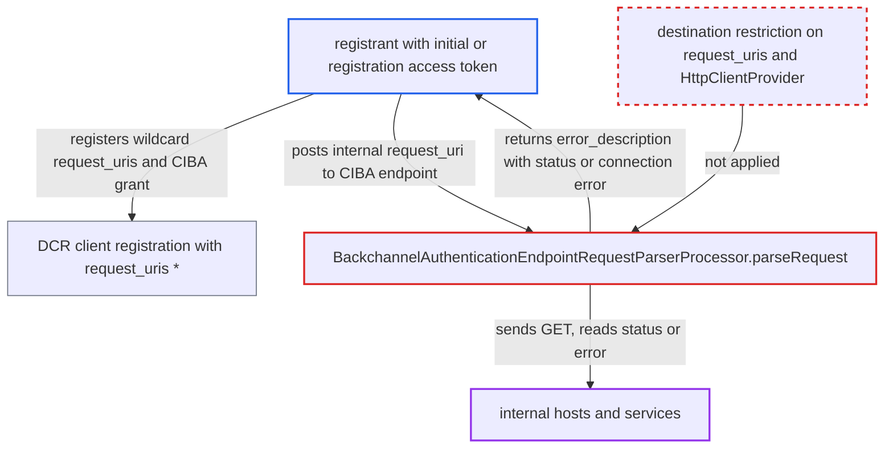

# CIBA backchannel authentication fetches client-registered request_uri and reflects upstream HTTP status and connection errors

| Field | Value |
|---|---|
| ID | `find_014hZkx9xzi3Ah7JiEAobGQ3` |
| Severity | **Medium** |
| Status | open |
| CWE | CWE-918 — Server-side request forgery |
| Created | 2026-10-27T21:48:55.155548Z |
| Claude Security | https://claude.ai/security/findings/find_014hZkx9xzi3Ah7JiEAobGQ3 |

## Description

A party who can register an OIDC client can make Keycloak send GET requests to internal URLs. It also reports back whether each host and port is open, closed or filtered, and the HTTP status code and reason phrase. The attacker needs an initial or registration access token. The cause is `parseRequest` in `BackchannelAuthenticationEndpointRequestParserProcessor`. It fetches a `request_uri` matched against attacker-registered `request_uris`, with no destination limit, and returns `e.getMessage()` in `error_description`.

1. **attacker** registers or updates a client through dynamic client registration. The body sets `request_uris` to `["*"]` and adds the CIBA grant type to `grant_types`, which `DescriptionConverter` copies verbatim and uses to set `oidc.ciba.grant.enabled`. ([`services/src/main/java/org/keycloak/services/clientregistration/oidc/DescriptionConverter.java:207-209`](https://github.com/cx-benchmark/keycloak/blob/1d7be35d0764060a8143fc74b0aabf2442743be4/services/src/main/java/org/keycloak/services/clientregistration/oidc/DescriptionConverter.java#L207-L209))
2. **validator `DefaultClientValidationProvider`** accepts the registered `request_uris`. With `checkValidUrl=false` it rejects only `data:` and `javascript:` schemes, so `*` and internal `http://` URLs pass. ([`services/src/main/java/org/keycloak/validation/DefaultClientValidationProvider.java:315-318`](https://github.com/cx-benchmark/keycloak/blob/1d7be35d0764060a8143fc74b0aabf2442743be4/services/src/main/java/org/keycloak/validation/DefaultClientValidationProvider.java#L315-L318))
3. **attacker** posts to `/realms/{realm}/protocol/openid-connect/ext/ciba/auth` with the client's credentials and an internal `request_uri`. `authenticateClient` checks only client authentication and `oidc.ciba.grant.enabled`, and the fetch runs before any user hint or authentication channel is used, so no CIBA deployment is needed. ([`services/src/main/java/org/keycloak/protocol/oidc/grants/ciba/endpoints/AbstractCibaEndpoint.java:47-68`](https://github.com/cx-benchmark/keycloak/blob/1d7be35d0764060a8143fc74b0aabf2442743be4/services/src/main/java/org/keycloak/protocol/oidc/grants/ciba/endpoints/AbstractCibaEndpoint.java#L47-L68))
4. **the method `parseRequest`** checks `request_uri` against the registered `request_uris` and fetches it. `RedirectUtils.matchesRedirects` treats a registered `*` as matching anything, and `HttpClientProvider.getString` sends the GET with no destination restriction. ([`services/src/main/java/org/keycloak/protocol/oidc/grants/ciba/endpoints/request/BackchannelAuthenticationEndpointRequestParserProcessor.java:68-86`](https://github.com/cx-benchmark/keycloak/blob/1d7be35d0764060a8143fc74b0aabf2442743be4/services/src/main/java/org/keycloak/protocol/oidc/grants/ciba/endpoints/request/BackchannelAuthenticationEndpointRequestParserProcessor.java#L68-L86))
5. **Keycloak** returns the upstream status or the error text in `error_description`. The catch block returns `e.getMessage()`, which carries the HTTP status and reason phrase, a connection error such as `Connection refused`, or a base64 or JWT parse error for a 2xx non-JWT body. ([`services/src/main/java/org/keycloak/protocol/oidc/grants/ciba/endpoints/request/BackchannelAuthenticationEndpointRequestParserProcessor.java:68-86`](https://github.com/cx-benchmark/keycloak/blob/1d7be35d0764060a8143fc74b0aabf2442743be4/services/src/main/java/org/keycloak/protocol/oidc/grants/ciba/endpoints/request/BackchannelAuthenticationEndpointRequestParserProcessor.java#L68-L86))
6. **attacker** repeats the request with different hosts, ports and paths. Each response shows whether the target is open, closed, filtered or speaks HTTP, and which status it returns for that path.

## Assessment

The attacker needs an initial access token to register a confidential client, or a registration access token to update one. The client is given the CIBA grant type and `request_uris` of `["*"]` or an internal URL prefix. The attacker then posts to `/realms/{realm}/protocol/openid-connect/ext/ciba/auth` with the client's credentials and a `request_uri` such as `http://10.0.0.5:9200/_cluster/health` or `http://169.254.169.254/latest/meta-data/`. No CIBA authentication channel, device or user is needed. The CIBA endpoints and the `CIBA` feature are on by default. The opt-in client-policy executor `secure-client-uris-pattern` can restrict `requestUris`, but it is in no default profile or policy. The authorization endpoint shares the same `request_uris` allow-list and fetch in `AuthorizationEndpointRequestParserProcessor`. It reports only a generic error there, so it leaks nothing through errors.

Impact: Keycloak becomes an internal port and service scanner for the attacker. For each target the attacker learns whether the host and port is open, closed or filtered, whether it speaks HTTP, and its status code and reason phrase. Response bodies are not returned, only fixed GETs are sent, and Keycloak's own data and availability are not affected.

Subsequent-system impact: Services behind Keycloak, such as metadata endpoints, management ports and databases with HTTP APIs, can be reached from Keycloak's network position. Their existence, open ports and per-path status codes are disclosed to the external registrant. Those GET requests might also trigger side effects on the target, but the attacker controls neither headers nor body.

## Recommendation

(1) The CIBA request parser returns the raw exception messages from the outbound fetch and from JWT parsing to the caller in `error_description`. This turns a blind outbound request into an informative one.

Fix criteria: Errors from fetching or parsing a `request_uri` return a fixed, generic `error_description` and are logged on the server. The response from `.../ext/ciba/auth` is identical whether the target was unreachable, refused, timed out, or answered with any status code or body.

(2) `request_uris` supplied by a non-administrative registrant are accepted with no scheme or destination restriction, including `*`, and the server fetches whatever matches them.

Fix criteria: Registrant-supplied `request_uris` are limited to `https` URLs whose hosts do not resolve to loopback, link-local, site-local, unique-local, multicast or unspecified addresses, or they match an administrator allow-list. The bare `*` wildcard is not accepted from dynamic registration. A client registered with `request_uris: ["*"]` or `["http://10.0.0.0/*"]` is rejected. A `request_uri` pointing at an internal address produces no outbound request at either the CIBA or the authorization endpoint.

(3) `HttpClientProvider` has no default destination policy, so every code path that passes it a client-influenced URL can reach internal networks.

Fix criteria: A default-on outbound destination policy at the `HttpClientProvider` layer denies private, loopback, link-local and metadata ranges unless configured otherwise. `getString` then refuses internal targets whichever code calls it.

## Evidence

**https://github.com/cx-benchmark/keycloak**

- [`services/src/main/java/org/keycloak/protocol/oidc/grants/ciba/endpoints/request/BackchannelAuthenticationEndpointRequestParserProcessor.java:68-86`](https://github.com/cx-benchmark/keycloak/blob/1d7be35d0764060a8143fc74b0aabf2442743be4/services/src/main/java/org/keycloak/protocol/oidc/grants/ciba/endpoints/request/BackchannelAuthenticationEndpointRequestParserProcessor.java#L68-L86)
- [`services/src/main/java/org/keycloak/services/clientregistration/oidc/DescriptionConverter.java:207-209`](https://github.com/cx-benchmark/keycloak/blob/1d7be35d0764060a8143fc74b0aabf2442743be4/services/src/main/java/org/keycloak/services/clientregistration/oidc/DescriptionConverter.java#L207-L209)
- [`services/src/main/java/org/keycloak/validation/DefaultClientValidationProvider.java:315-318`](https://github.com/cx-benchmark/keycloak/blob/1d7be35d0764060a8143fc74b0aabf2442743be4/services/src/main/java/org/keycloak/validation/DefaultClientValidationProvider.java#L315-L318)
- [`services/src/main/java/org/keycloak/protocol/oidc/utils/RedirectUtils.java:248-253`](https://github.com/cx-benchmark/keycloak/blob/1d7be35d0764060a8143fc74b0aabf2442743be4/services/src/main/java/org/keycloak/protocol/oidc/utils/RedirectUtils.java#L248-L253)
- [`services/src/main/java/org/keycloak/protocol/oidc/grants/ciba/endpoints/AbstractCibaEndpoint.java:47-68`](https://github.com/cx-benchmark/keycloak/blob/1d7be35d0764060a8143fc74b0aabf2442743be4/services/src/main/java/org/keycloak/protocol/oidc/grants/ciba/endpoints/AbstractCibaEndpoint.java#L47-L68)
- [`services/src/main/java/org/keycloak/protocol/oidc/grants/ciba/endpoints/BackchannelAuthenticationEndpoint.java:170-179`](https://github.com/cx-benchmark/keycloak/blob/1d7be35d0764060a8143fc74b0aabf2442743be4/services/src/main/java/org/keycloak/protocol/oidc/grants/ciba/endpoints/BackchannelAuthenticationEndpoint.java#L170-L179)
- [`services/src/main/java/org/keycloak/connections/httpclient/DefaultHttpClientFactory.java:126-135`](https://github.com/cx-benchmark/keycloak/blob/1d7be35d0764060a8143fc74b0aabf2442743be4/services/src/main/java/org/keycloak/connections/httpclient/DefaultHttpClientFactory.java#L126-L135)
- [`services/src/main/java/org/keycloak/protocol/oidc/endpoints/request/AuthorizationEndpointRequestParserProcessor.java:96-103`](https://github.com/cx-benchmark/keycloak/blob/1d7be35d0764060a8143fc74b0aabf2442743be4/services/src/main/java/org/keycloak/protocol/oidc/endpoints/request/AuthorizationEndpointRequestParserProcessor.java#L96-L103)

