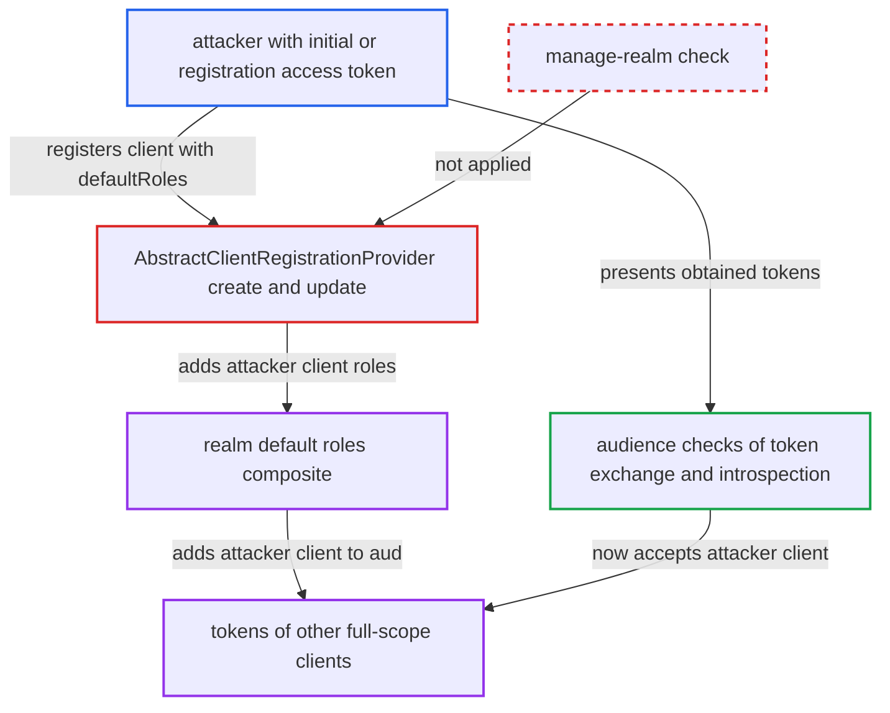

# Client registration lets IAT/RAT holders add their client roles to realm default roles

| Field | Value |
|---|---|
| ID | `find_017dUkeZRqRqBRYBSs7Uf8qs` |
| Severity | **Medium** |
| Status | open |
| CWE | CWE-285 — Improper Authorization |
| Created | 2026-10-27T21:50:53.241120Z |
| Claude Security | https://claude.ai/security/findings/find_017dUkeZRqRqBRYBSs7Uf8qs |

## Description

A holder of an initial access token, or of the registration access token of a client it registered, can add roles of its own client to the realm's default roles. Every realm user then gets those roles, so the attacker's client can pass audience checks on other clients' tokens that it obtains. The cause is `create` and `update` in `AbstractClientRegistrationProvider`, which apply the caller's `defaultRoles` with no `manage-realm` check.

1. **attacker** posts a confidential client with `defaultRoles` and `standard.token.exchange.enabled=true`. The shipped `default` provider binds the whole `ClientRepresentation`, including `defaultRoles` and `attributes`, for POST and PUT. ([`services/src/main/java/org/keycloak/services/clientregistration/DefaultClientRegistrationProvider.java:55-86`](https://github.com/cx-benchmark/keycloak/blob/1d7be35d0764060a8143fc74b0aabf2442743be4/services/src/main/java/org/keycloak/services/clientregistration/DefaultClientRegistrationProvider.java#L55-L86))
2. **`ClientRegistrationAuth.requireCreate`** accepts the initial access token and lets the request through. It checks only the token's count and expiry plus the registration policies, and the default authenticated policies never look at `defaultRoles`. ([`services/src/main/java/org/keycloak/services/clientregistration/ClientRegistrationAuth.java:162-200`](https://github.com/cx-benchmark/keycloak/blob/1d7be35d0764060a8143fc74b0aabf2442743be4/services/src/main/java/org/keycloak/services/clientregistration/ClientRegistrationAuth.java#L162-L200))
3. **the handler `create()`** calls `addDefaultRole` for every name in `defaultRoles`. The number of names is not limited. ([`services/src/main/java/org/keycloak/services/clientregistration/AbstractClientRegistrationProvider.java:113-117`](https://github.com/cx-benchmark/keycloak/blob/1d7be35d0764060a8143fc74b0aabf2442743be4/services/src/main/java/org/keycloak/services/clientregistration/AbstractClientRegistrationProvider.java#L113-L117))
4. **`addDefaultRole`** creates each role on the new client and adds it to the realm's `default-roles-<realm>` composite. This is a realm-level change that the Admin API reserves for `manage-realm`, but here it runs for a non-admin caller. ([`services/src/main/java/org/keycloak/services/clientregistration/AbstractClientRegistrationProvider.java:347-357`](https://github.com/cx-benchmark/keycloak/blob/1d7be35d0764060a8143fc74b0aabf2442743be4/services/src/main/java/org/keycloak/services/clientregistration/AbstractClientRegistrationProvider.java#L347-L357))
5. **realm users** receive the new roles at once. Every user holds `default-roles-<realm>`, and it is a composite, so a role added to it reaches existing users too. ([`model/jpa/src/main/java/org/keycloak/models/jpa/JpaUserProvider.java:141-142`](https://github.com/cx-benchmark/keycloak/blob/1d7be35d0764060a8143fc74b0aabf2442743be4/model/jpa/src/main/java/org/keycloak/models/jpa/JpaUserProvider.java#L141-L142))
6. **`TokenManager.getAccess`** puts the attacker's client roles in tokens of full-scope clients. Full scope is the default for new clients, and these tokens now carry `resource_access.<attacker-client>`. ([`services/src/main/java/org/keycloak/protocol/oidc/TokenManager.java:572-579`](https://github.com/cx-benchmark/keycloak/blob/1d7be35d0764060a8143fc74b0aabf2442743be4/services/src/main/java/org/keycloak/protocol/oidc/TokenManager.java#L572-L579))
7. **`AudienceResolveProtocolMapper.setAudience`** adds the attacker's clientId to `aud` of those tokens. The mapper adds every client in which the user holds a resolved role. ([`services/src/main/java/org/keycloak/protocol/oidc/mappers/AudienceResolveProtocolMapper.java:142-156`](https://github.com/cx-benchmark/keycloak/blob/1d7be35d0764060a8143fc74b0aabf2442743be4/services/src/main/java/org/keycloak/protocol/oidc/mappers/AudienceResolveProtocolMapper.java#L142-L156))
8. **attacker's client** exchanges or introspects another client's token that it has obtained. The audience checks in standard token exchange and introspection now pass, so it can get fresh tokens issued to itself for that user. ([`services/src/main/java/org/keycloak/protocol/oidc/tokenexchange/StandardTokenExchangeProvider.java:251-254`](https://github.com/cx-benchmark/keycloak/blob/1d7be35d0764060a8143fc74b0aabf2442743be4/services/src/main/java/org/keycloak/protocol/oidc/tokenexchange/StandardTokenExchangeProvider.java#L251-L254))

## Assessment

The attacker needs an initial access token issued for self-registration. A registration access token of a client it already registered also works, and this can be one issued by the `openid-connect` endpoint, because the `default` endpoint applies no protocol check. With an initial access token it posts to `/realms/{realm}/clients-registrations/default`. With a registration access token it sends a PUT, which runs `updateDefaultRoles`. The report also lists an anonymous or `create-client` bearer caller as another source of the same request. The attacker can enable standard token exchange on its own confidential client, because `stripPrivilegedAttributes` does not remove `standard.token.exchange.enabled`, and OIDC DCR `grant_types` also sets it. No victim action is needed. The attacker still has to obtain a token of another full-scope client to use the exchange or introspection step. The `defaultRoles` field is deprecated but still supported, and an upstream test uses it.

Impact: A non-admin changes realm configuration reserved for `manage-realm`: the effective roles of every realm user. Tokens of other full-scope clients gain an attacker-chosen audience and `resource_access` entry, and the attacker's client can exchange or introspect tokens it obtains. This is limited to tokens it obtains and to roles of the attacker's own client, so realm roles, other clients' roles and admin roles are not affected. The unbounded number of role names can also bloat every affected token.

## Recommendation

`create()` and `update()` apply the caller-supplied `defaultRoles` to the realm `default-roles-<realm>` composite without checking realm-management authority. Initial-access-token, registration-access-token and anonymous registrants can therefore change realm-wide role assignments and token audiences.

Fix criteria: A registration or update made with an initial access token, a registration access token or anonymously does not add to or remove from the realm default-role composite. It is refused or ignored unless the caller is an admin bearer with authority equivalent to the Admin API's `manage-realm` check. To verify, register through `/clients-registrations/default` with an initial access token and `defaultRoles`, then update with the registration access token. Confirm that `default-roles-<realm>` is unchanged and that other clients' tokens do not list the new client in `aud`.

## Evidence

**https://github.com/cx-benchmark/keycloak**

- [`services/src/main/java/org/keycloak/services/clientregistration/AbstractClientRegistrationProvider.java:113-117`](https://github.com/cx-benchmark/keycloak/blob/1d7be35d0764060a8143fc74b0aabf2442743be4/services/src/main/java/org/keycloak/services/clientregistration/AbstractClientRegistrationProvider.java#L113-L117)
- [`services/src/main/java/org/keycloak/services/clientregistration/AbstractClientRegistrationProvider.java:347-357`](https://github.com/cx-benchmark/keycloak/blob/1d7be35d0764060a8143fc74b0aabf2442743be4/services/src/main/java/org/keycloak/services/clientregistration/AbstractClientRegistrationProvider.java#L347-L357)
- [`services/src/main/java/org/keycloak/services/clientregistration/AbstractClientRegistrationProvider.java:255-257`](https://github.com/cx-benchmark/keycloak/blob/1d7be35d0764060a8143fc74b0aabf2442743be4/services/src/main/java/org/keycloak/services/clientregistration/AbstractClientRegistrationProvider.java#L255-L257)
- [`services/src/main/java/org/keycloak/services/clientregistration/ClientRegistrationAuth.java:162-200`](https://github.com/cx-benchmark/keycloak/blob/1d7be35d0764060a8143fc74b0aabf2442743be4/services/src/main/java/org/keycloak/services/clientregistration/ClientRegistrationAuth.java#L162-L200)
- [`services/src/main/java/org/keycloak/services/clientregistration/policy/DefaultClientRegistrationPolicies.java:101-120`](https://github.com/cx-benchmark/keycloak/blob/1d7be35d0764060a8143fc74b0aabf2442743be4/services/src/main/java/org/keycloak/services/clientregistration/policy/DefaultClientRegistrationPolicies.java#L101-L120)
- [`services/src/main/java/org/keycloak/services/clientregistration/DefaultClientRegistrationProvider.java:55-86`](https://github.com/cx-benchmark/keycloak/blob/1d7be35d0764060a8143fc74b0aabf2442743be4/services/src/main/java/org/keycloak/services/clientregistration/DefaultClientRegistrationProvider.java#L55-L86)
- [`services/src/main/java/org/keycloak/services/resources/admin/fgap/RolePermissions.java:491-499`](https://github.com/cx-benchmark/keycloak/blob/1d7be35d0764060a8143fc74b0aabf2442743be4/services/src/main/java/org/keycloak/services/resources/admin/fgap/RolePermissions.java#L491-L499)
- [`model/jpa/src/main/java/org/keycloak/models/jpa/JpaUserProvider.java:141-142`](https://github.com/cx-benchmark/keycloak/blob/1d7be35d0764060a8143fc74b0aabf2442743be4/model/jpa/src/main/java/org/keycloak/models/jpa/JpaUserProvider.java#L141-L142)
- [`services/src/main/java/org/keycloak/protocol/oidc/TokenManager.java:572-579`](https://github.com/cx-benchmark/keycloak/blob/1d7be35d0764060a8143fc74b0aabf2442743be4/services/src/main/java/org/keycloak/protocol/oidc/TokenManager.java#L572-L579)
- [`services/src/main/java/org/keycloak/protocol/oidc/mappers/AudienceResolveProtocolMapper.java:142-156`](https://github.com/cx-benchmark/keycloak/blob/1d7be35d0764060a8143fc74b0aabf2442743be4/services/src/main/java/org/keycloak/protocol/oidc/mappers/AudienceResolveProtocolMapper.java#L142-L156)
- [`services/src/main/java/org/keycloak/protocol/oidc/tokenexchange/StandardTokenExchangeProvider.java:251-254`](https://github.com/cx-benchmark/keycloak/blob/1d7be35d0764060a8143fc74b0aabf2442743be4/services/src/main/java/org/keycloak/protocol/oidc/tokenexchange/StandardTokenExchangeProvider.java#L251-L254)
- [`services/src/main/java/org/keycloak/protocol/oidc/AccessTokenIntrospectionProvider.java:326-333`](https://github.com/cx-benchmark/keycloak/blob/1d7be35d0764060a8143fc74b0aabf2442743be4/services/src/main/java/org/keycloak/protocol/oidc/AccessTokenIntrospectionProvider.java#L326-L333)

