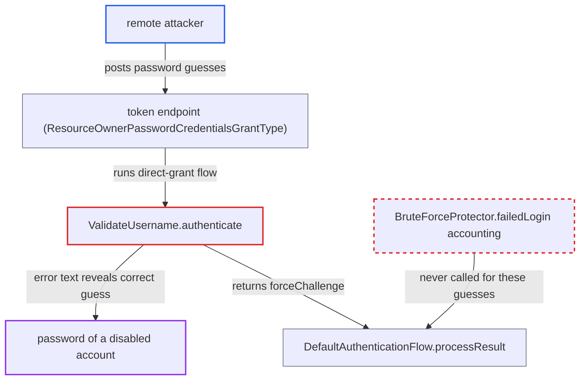

# Direct grant verifies disabled account's password and reports result without brute-force accounting

| Field | Value |
|---|---|
| ID | `find_01RiFUD2y4zF9DsBDe9x5N4u` |
| Severity | **Medium** |
| Status | open |
| CWE | CWE-204 — Observable Discrepancy |
| Created | 2026-10-27T21:28:26.851401Z |
| Claude Security | https://claude.ai/security/findings/find_01RiFUD2y4zF9DsBDe9x5N4u |

## Description

A remote attacker with no login can guess the password of an administratively disabled account through the token endpoint. The response says `Account disabled` only when the guess is correct, and the guesses are never counted, so there is no lockout. This works only for accounts that are disabled. The cause is `ValidateUsername.authenticate`, which checks the password for disabled users and reports the result with `forceChallenge`.

1. **attacker** posts a password guess for a disabled user to the token endpoint. The request uses `grant_type=password` with the victim's username, through any client that allows direct access grants, such as the default public `admin-cli`. ([`services/src/main/java/org/keycloak/protocol/oidc/grants/ResourceOwnerPasswordCredentialsGrantType.java:107-124`](https://github.com/cx-benchmark/keycloak/blob/1d7be35d0764060a8143fc74b0aabf2442743be4/services/src/main/java/org/keycloak/protocol/oidc/grants/ResourceOwnerPasswordCredentialsGrantType.java#L107-L124))
2. **the handler `ValidateUsername.authenticate`** verifies the submitted password even though the user is disabled. In the `!user.isEnabled()` branch it calls `user.credentialManager().isValid(UserCredentialModel.password(password))` on the attacker's guess. ([`services/src/main/java/org/keycloak/authentication/authenticators/directgrant/ValidateUsername.java:120-130`](https://github.com/cx-benchmark/keycloak/blob/1d7be35d0764060a8143fc74b0aabf2442743be4/services/src/main/java/org/keycloak/authentication/authenticators/directgrant/ValidateUsername.java#L120-L130))
3. **the handler `ValidateUsername.authenticate`** puts the result into the `error_description` of the response. A correct password gives `Account disabled` and a wrong one gives `Invalid user credentials`, so the attacker can tell them apart. ([`services/src/main/java/org/keycloak/authentication/authenticators/directgrant/ValidateUsername.java:120-130`](https://github.com/cx-benchmark/keycloak/blob/1d7be35d0764060a8143fc74b0aabf2442743be4/services/src/main/java/org/keycloak/authentication/authenticators/directgrant/ValidateUsername.java#L120-L130))
4. **the method `DefaultAuthenticationFlow.processResult`** returns the `forceChallenge` response without recording a failure. It calls `processor.logFailure(...)` only for `FAILED` and `FAILURE_CHALLENGE`, not for `FORCE_CHALLENGE`. ([`services/src/main/java/org/keycloak/authentication/DefaultAuthenticationFlow.java:554-572`](https://github.com/cx-benchmark/keycloak/blob/1d7be35d0764060a8143fc74b0aabf2442743be4/services/src/main/java/org/keycloak/authentication/DefaultAuthenticationFlow.java#L554-L572))
5. **the method `AuthenticationProcessor.logFailure`** is never reached, so `BruteForceProtector.failedLogin` is not called. `logFailure` is the only path from the flow engine into `BruteForceProtector.failedLogin`, so no temporary or permanent lockout is triggered. ([`services/src/main/java/org/keycloak/authentication/AuthenticationProcessor.java:768-777`](https://github.com/cx-benchmark/keycloak/blob/1d7be35d0764060a8143fc74b0aabf2442743be4/services/src/main/java/org/keycloak/authentication/AuthenticationProcessor.java#L768-L777))
6. **attacker** repeats guesses without limit until the response reads `Account disabled`. Nothing throttles or locks the attempts, so the password can be brute-forced online.

## Assessment

The attacker is remote and unauthenticated. They need the token endpoint to be reachable and must know the username of an account an administrator has disabled. They also need a client with direct access grants enabled, such as the default public `admin-cli`. The account must be disabled without the `DISABLED_BY_PERMANENT_LOCKOUT` reason, because that case is caught earlier, at lines 110-117. The browser flow checks the password in a similar way, but its wrong-password branch uses `failureChallenge`, so it is counted and protected. Only the direct-grant path is unprotected.

Impact: The attacker can find out whether a guessed password is the current password of a disabled account, and can brute-force it online with no lockout. This also confirms that the account exists. The account stays disabled, so no session or token is obtained, and only disabled accounts are affected.

## Recommendation

`ValidateUsername` reveals whether the password is correct for disabled accounts, and it reports the outcome with `forceChallenge`, so the attempt bypasses brute-force accounting.

Fix criteria: For a disabled account, the direct-grant response does not depend on the submitted password. Alternatively, if the `Account disabled` hint is kept for a correct password, every incorrect guess is recorded through the brute-force protector so lockout applies. To check, send many wrong passwords for a disabled user to the token endpoint. The responses should be indistinguishable from the unknown-user response, and/or the user's login-failure counter should increase and temporary lockout should trigger.

## Evidence

**https://github.com/cx-benchmark/keycloak**

- [`services/src/main/java/org/keycloak/authentication/authenticators/directgrant/ValidateUsername.java:120-130`](https://github.com/cx-benchmark/keycloak/blob/1d7be35d0764060a8143fc74b0aabf2442743be4/services/src/main/java/org/keycloak/authentication/authenticators/directgrant/ValidateUsername.java#L120-L130)
- [`services/src/main/java/org/keycloak/authentication/DefaultAuthenticationFlow.java:554-572`](https://github.com/cx-benchmark/keycloak/blob/1d7be35d0764060a8143fc74b0aabf2442743be4/services/src/main/java/org/keycloak/authentication/DefaultAuthenticationFlow.java#L554-L572)
- [`services/src/main/java/org/keycloak/authentication/AuthenticationProcessor.java:768-777`](https://github.com/cx-benchmark/keycloak/blob/1d7be35d0764060a8143fc74b0aabf2442743be4/services/src/main/java/org/keycloak/authentication/AuthenticationProcessor.java#L768-L777)
- [`services/src/main/java/org/keycloak/protocol/oidc/grants/ResourceOwnerPasswordCredentialsGrantType.java:107-124`](https://github.com/cx-benchmark/keycloak/blob/1d7be35d0764060a8143fc74b0aabf2442743be4/services/src/main/java/org/keycloak/protocol/oidc/grants/ResourceOwnerPasswordCredentialsGrantType.java#L107-L124)
- [`services/src/main/java/org/keycloak/authentication/authenticators/browser/AbstractUsernameFormAuthenticator.java:228-248`](https://github.com/cx-benchmark/keycloak/blob/1d7be35d0764060a8143fc74b0aabf2442743be4/services/src/main/java/org/keycloak/authentication/authenticators/browser/AbstractUsernameFormAuthenticator.java#L228-L248)

