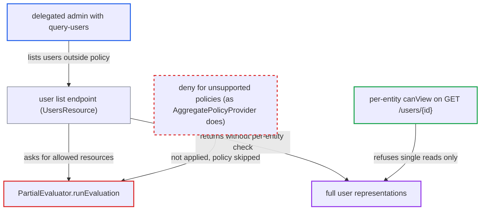

# FGAP v2 list filtering ignores unsupported policies inside a permission, listing entities runtime denies

| Field | Value |
|---|---|
| ID | `find_01RcQR7bHpvwfmRMPtU49jQD` |
| Severity | **Medium** |
| Status | open |
| CWE | CWE-863 — Incorrect Authorization |
| Created | 2026-10-27T22:02:10.703233Z |
| Claude Security | https://claude.ai/security/findings/find_01RcQR7bHpvwfmRMPtU49jQD |

## Description

A delegated admin can list users, clients or groups that the realm's policy currently denies them, and receives full representations. The admin needs the `query-users` (or `query-clients` / `query-groups`) role, plus a match on a supported policy in a `view` permission that also holds an unsupported policy such as Time, Client, Client Scope, Regex or JavaScript. The cause is `PartialEvaluator.runEvaluation`, which skips unsupported policies with `continue` instead of denying.

1. **delegated admin** calls the list endpoint `GET /admin/realms/{r}/users` while the restricting policy would deny. The admin holds `query-users` and matches the supported Role, User or Group policy of a `view` permission that also has, for example, a Time policy outside its window. ([`services/src/main/java/org/keycloak/services/resources/admin/UsersResource.java:578-593`](https://github.com/cx-benchmark/keycloak/blob/1d7be35d0764060a8143fc74b0aabf2442743be4/services/src/main/java/org/keycloak/services/resources/admin/UsersResource.java#L578-L593))
2. **`PartialEvaluator.runEvaluation`** skips each associated policy that has no `PartialEvaluationPolicyProvider`. For Time, Client, Client Scope, Regex and JavaScript policies the code runs `if (provider == null) continue;`, so the restricting policy counts as neutral. ([`server-spi-private/src/main/java/org/keycloak/authorization/fgap/evaluation/partial/PartialEvaluator.java:112-146`](https://github.com/cx-benchmark/keycloak/blob/1d7be35d0764060a8143fc74b0aabf2442743be4/server-spi-private/src/main/java/org/keycloak/authorization/fgap/evaluation/partial/PartialEvaluator.java#L112-L146))
3. **`PartialEvaluator.runEvaluation`** adds the permission's resource ids, or the type resource name, to `allowedResources`. The matching supported sibling policy is enough to do this, even though the skipped policy would deny at runtime. ([`server-spi-private/src/main/java/org/keycloak/authorization/fgap/evaluation/partial/PartialEvaluator.java:112-146`](https://github.com/cx-benchmark/keycloak/blob/1d7be35d0764060a8143fc74b0aabf2442743be4/server-spi-private/src/main/java/org/keycloak/authorization/fgap/evaluation/partial/PartialEvaluator.java#L112-L146))
4. **`buildPredicates`** turns the over-wide set into the only filter on the storage query. When the permission targets the `Users` type, no id filter is emitted at all, so the whole realm matches. ([`server-spi-private/src/main/java/org/keycloak/authorization/fgap/evaluation/partial/PartialEvaluator.java:150-207`](https://github.com/cx-benchmark/keycloak/blob/1d7be35d0764060a8143fc74b0aabf2442743be4/server-spi-private/src/main/java/org/keycloak/authorization/fgap/evaluation/partial/PartialEvaluator.java#L150-L207))
5. **the list endpoint** returns full representations of every matching entity. With admin permissions enabled, `UsersResource.toRepresentation` does not call `canView` per entity, so nothing removes the entities the policy denies. ([`services/src/main/java/org/keycloak/services/resources/admin/UsersResource.java:578-593`](https://github.com/cx-benchmark/keycloak/blob/1d7be35d0764060a8143fc74b0aabf2442743be4/services/src/main/java/org/keycloak/services/resources/admin/UsersResource.java#L578-L593))
6. **runtime evaluation** would deny the same entities one by one. FGAP v2 permissions are forced to `UNANIMOUS`, so one denying policy denies the whole permission, and `GET /users/{id}` is refused for each listed entry. ([`server-spi-private/src/main/java/org/keycloak/authorization/policy/evaluation/AbstractDecisionCollector.java:99-131`](https://github.com/cx-benchmark/keycloak/blob/1d7be35d0764060a8143fc74b0aabf2442743be4/server-spi-private/src/main/java/org/keycloak/authorization/policy/evaluation/AbstractDecisionCollector.java#L99-L131))

## Assessment

The attacker is a delegated admin in the same realm. The admin holds `query-users` (or `query-clients` / `query-groups`). A supported policy of an FGAP `view` permission must match the admin's role, group or identity. That permission must also carry a restricting Time, Client, Client Scope, Regex or JavaScript policy. Examples are time-boxed access, or a regex that narrows which admins qualify. The attacker calls `GET /admin/realms/{r}/users`, or the `/clients` or `/groups` endpoint, while the restricting policy would deny them. The report names no other precondition.

Impact: The admin reads full user representations (PII and attributes), client configurations or group trees for every resource the permission names. For a type-level permission this is the entire realm. These are read-only list paths, with no modification or availability impact.

## Recommendation

`PartialEvaluator.runEvaluation` treats a permission's unsupported associated policies as neutral (`continue`) instead of withholding the permission's resources from `allowedResources`. The list filter is therefore more permissive than runtime evaluation.

Fix criteria: The pre-computed allowed set never exceeds what runtime evaluation of the same permission can grant. A permission containing any associated policy that cannot be partially evaluated adds nothing to `allowedResources`; it is treated as deny or `FORCE_DENY`, as `AggregatePolicyProvider` does. Test: an admin whose only view permission is `[Role(match), Time(deny now)]` gets an empty list from `GET /admin/realms/{r}/users`, and `GET /users/{id}` stays denied.

## Evidence

**https://github.com/cx-benchmark/keycloak**

- [`server-spi-private/src/main/java/org/keycloak/authorization/fgap/evaluation/partial/PartialEvaluator.java:112-146`](https://github.com/cx-benchmark/keycloak/blob/1d7be35d0764060a8143fc74b0aabf2442743be4/server-spi-private/src/main/java/org/keycloak/authorization/fgap/evaluation/partial/PartialEvaluator.java#L112-L146)
- [`server-spi-private/src/main/java/org/keycloak/authorization/fgap/evaluation/partial/PartialEvaluator.java:150-207`](https://github.com/cx-benchmark/keycloak/blob/1d7be35d0764060a8143fc74b0aabf2442743be4/server-spi-private/src/main/java/org/keycloak/authorization/fgap/evaluation/partial/PartialEvaluator.java#L150-L207)
- [`server-spi-private/src/main/java/org/keycloak/authorization/fgap/AdminPermissionsSchema.java:304-306`](https://github.com/cx-benchmark/keycloak/blob/1d7be35d0764060a8143fc74b0aabf2442743be4/server-spi-private/src/main/java/org/keycloak/authorization/fgap/AdminPermissionsSchema.java#L304-L306)
- [`server-spi-private/src/main/java/org/keycloak/authorization/policy/evaluation/AbstractDecisionCollector.java:99-131`](https://github.com/cx-benchmark/keycloak/blob/1d7be35d0764060a8143fc74b0aabf2442743be4/server-spi-private/src/main/java/org/keycloak/authorization/policy/evaluation/AbstractDecisionCollector.java#L99-L131)
- [`services/src/main/java/org/keycloak/services/resources/admin/fgap/UserPermissionsV2.java:49-67`](https://github.com/cx-benchmark/keycloak/blob/1d7be35d0764060a8143fc74b0aabf2442743be4/services/src/main/java/org/keycloak/services/resources/admin/fgap/UserPermissionsV2.java#L49-L67)
- [`services/src/main/java/org/keycloak/services/resources/admin/UsersResource.java:578-593`](https://github.com/cx-benchmark/keycloak/blob/1d7be35d0764060a8143fc74b0aabf2442743be4/services/src/main/java/org/keycloak/services/resources/admin/UsersResource.java#L578-L593)
- [`authz/policy/common/src/main/java/org/keycloak/authorization/policy/provider/aggregated/AggregatePolicyProvider.java:167-187`](https://github.com/cx-benchmark/keycloak/blob/1d7be35d0764060a8143fc74b0aabf2442743be4/authz/policy/common/src/main/java/org/keycloak/authorization/policy/provider/aggregated/AggregatePolicyProvider.java#L167-L187)
- [`docs/documentation/server_admin/topics/admin-console-permissions/fine-grain-v2.adoc:326-362`](https://github.com/cx-benchmark/keycloak/blob/1d7be35d0764060a8143fc74b0aabf2442743be4/docs/documentation/server_admin/topics/admin-console-permissions/fine-grain-v2.adoc#L326-L362)

