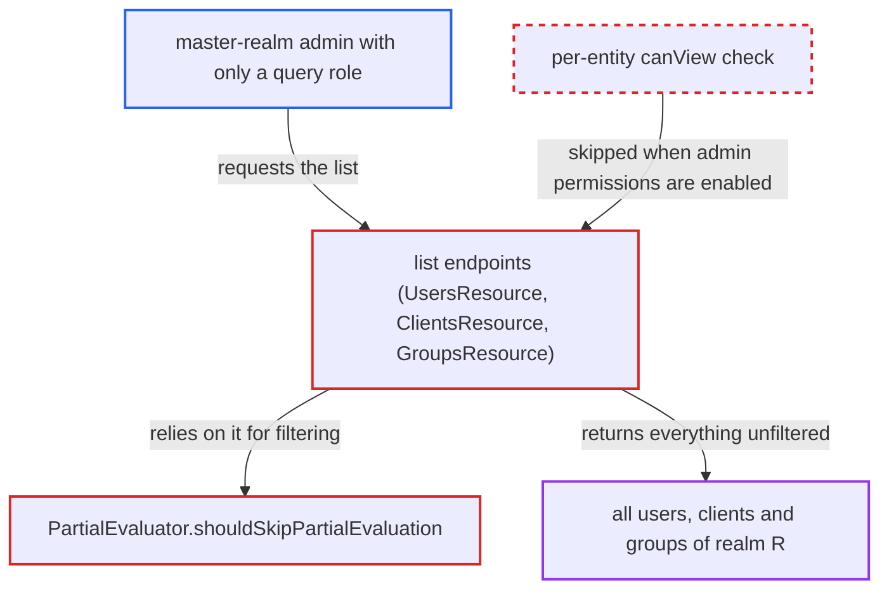

# FGAP v2 list filtering skipped for master-realm admins holding only query-* roles

| Field | Value |
|---|---|
| ID | `find_01HrfboD2wCEcQr1oqBBDhf3` |
| Severity | **Medium** |
| Status | open |
| CWE | CWE-863 — Incorrect Authorization |
| Created | 2026-10-27T22:00:11.194397Z |
| Claude Security | https://claude.ai/security/findings/find_01HrfboD2wCEcQr1oqBBDhf3 |

## Description

A master-realm admin whose only right over realm `R` is a query role such as `R-realm/query-users` can list every user, client and group of `R`. Users come back with full attributes, and client secrets are stripped. This works only when `R` has Admin Permissions (FGAP v2) enabled. `PartialEvaluator.shouldSkipPartialEvaluation` wrongly skips filtering for such callers, and the list endpoints do no per-entity check of their own.

1. **master-realm admin** calls a list endpoint of realm `R`. The admin holds only `R-realm/query-users` (or `query-clients`/`query-groups`) and calls `GET /admin/realms/R/users`, `/clients`, or `/groups?populateHierarchy=false`.
2. **`MgmtPermissions.hasOneAdminRole`** accepts the master client role as enough to query. For a master-realm admin it checks the roles of the master `<realm>-realm` client, so `query-users` satisfies `requireQuery()`. ([`services/src/main/java/org/keycloak/services/resources/admin/fgap/MgmtPermissions.java:167-179`](https://github.com/cx-benchmark/keycloak/blob/1d7be35d0764060a8143fc74b0aabf2442743be4/services/src/main/java/org/keycloak/services/resources/admin/fgap/MgmtPermissions.java#L167-L179))
3. **`DefaultKeycloakContext.getUser()`** resolves the caller as a master user. It uses the issuer realm of the bearer token, so `PartialEvaluator` tests a master user against `R`'s `realm-management` roles. ([`services/src/main/java/org/keycloak/services/DefaultKeycloakContext.java:307-319`](https://github.com/cx-benchmark/keycloak/blob/1d7be35d0764060a8143fc74b0aabf2442743be4/services/src/main/java/org/keycloak/services/DefaultKeycloakContext.java#L307-L319))
4. **`getRealmManagementClient`** picks `R`'s own `realm-management` client. The client comes from the context realm, so the caller's master `R-realm` roles are never considered. ([`server-spi-private/src/main/java/org/keycloak/authorization/fgap/evaluation/partial/PartialEvaluator.java:297-309`](https://github.com/cx-benchmark/keycloak/blob/1d7be35d0764060a8143fc74b0aabf2442743be4/server-spi-private/src/main/java/org/keycloak/authorization/fgap/evaluation/partial/PartialEvaluator.java#L297-L309))
5. **`shouldSkipPartialEvaluation`** returns true because no `query-*` role is found. A master user can never hold `R`'s `realm-management` roles, so `hasAnyQueryAdminRole` is false and the method treats the caller as needing no filtering. ([`server-spi-private/src/main/java/org/keycloak/authorization/fgap/evaluation/partial/PartialEvaluator.java:271-295`](https://github.com/cx-benchmark/keycloak/blob/1d7be35d0764060a8143fc74b0aabf2442743be4/server-spi-private/src/main/java/org/keycloak/authorization/fgap/evaluation/partial/PartialEvaluator.java#L271-L295))
6. **`PartialEvaluator.getPredicates`** returns an empty predicate list. The user and client searches in the JPA providers then run without restriction. ([`server-spi-private/src/main/java/org/keycloak/authorization/fgap/evaluation/partial/PartialEvaluator.java:57-80`](https://github.com/cx-benchmark/keycloak/blob/1d7be35d0764060a8143fc74b0aabf2442743be4/server-spi-private/src/main/java/org/keycloak/authorization/fgap/evaluation/partial/PartialEvaluator.java#L57-L80))
7. **the list endpoints** skip the per-entity `canView` check. With admin permissions enabled, `UsersResource.toRepresentation` does not apply `canView`, and `ClientsResource.getClientModels` forces `canView` to true. `GroupsResource.getGroups` does the same when `populateHierarchy=false`. So the unfiltered result is returned as is. ([`services/src/main/java/org/keycloak/services/resources/admin/UsersResource.java:578-585`](https://github.com/cx-benchmark/keycloak/blob/1d7be35d0764060a8143fc74b0aabf2442743be4/services/src/main/java/org/keycloak/services/resources/admin/UsersResource.java#L578-L585))
8. **master-realm admin** receives the full list of users, clients or groups. The same admin gets 403 on `GET /users/{id}`, because per-entity FGAP v2 checks deny every cross-realm admin. The list path bypasses that denial. ([`services/src/main/java/org/keycloak/services/resources/admin/fgap/FineGrainedAdminPermissionEvaluator.java:89-95`](https://github.com/cx-benchmark/keycloak/blob/1d7be35d0764060a8143fc74b0aabf2442743be4/services/src/main/java/org/keycloak/services/resources/admin/fgap/FineGrainedAdminPermissionEvaluator.java#L89-L95))

## Assessment

The attacker is an authenticated master-realm account whose only right over realm `R` is `R-realm/query-users`, `query-clients` or `query-groups`. Realm `R` must have Admin Permissions (FGAP v2) enabled. The attacker calls `GET /admin/realms/R/users`, `GET /admin/realms/R/clients`, or `GET /admin/realms/R/groups?populateHierarchy=false`. The report notes no network restriction on the Admin API. Same-realm delegated admins who pass `canQuery()` through a type-level FGAP `view` grant are also affected by the same heuristic, which drops resource-specific deny permissions from their list results.

Impact: The query-only admin gets realm `R`'s full user directory: usernames, emails, names, attributes and the access map. The admin also gets all client configurations with secrets stripped, and the group list when `populateHierarchy=false`. The flaw gives no write access and does not affect availability.

## Recommendation

(1) `PartialEvaluator.shouldSkipPartialEvaluation` treats a caller with no `query-*` role on the managed realm's `realm-management` client as needing no filtering. This ignores cross-realm admins, whose roles live on the master `<realm>-realm` client. It also ignores callers who pass `canQuery()` through FGAP grants.

Fix criteria: Filtering in FGAP-v2 realms is skipped only for callers who really hold a `view-*` or `manage-*` right for the resource type. That right is resolved through the same role mapping the endpoint layer uses, including master `<realm>-realm` roles. Every other caller gets a restrictive predicate, and deny-all when no permission applies. A master user with only `R-realm/query-users` gets an empty list from `GET /admin/realms/R/users`, and likewise for clients and groups. A master user with `R-realm/view-users` still sees all users.

(2) When admin permissions are enabled, the list endpoints drop per-entity `canView` filtering. This makes the storage predicate the only access control.

Fix criteria: With admin permissions enabled, the list endpoints keep a per-entity authorization check or an equivalent guaranteed predicate. A missing or skipped storage filter then cannot widen what an admin sees. Verify this with the master-realm admin who holds only `R-realm/query-users`.

## Evidence

**https://github.com/cx-benchmark/keycloak**

- [`server-spi-private/src/main/java/org/keycloak/authorization/fgap/evaluation/partial/PartialEvaluator.java:271-295`](https://github.com/cx-benchmark/keycloak/blob/1d7be35d0764060a8143fc74b0aabf2442743be4/server-spi-private/src/main/java/org/keycloak/authorization/fgap/evaluation/partial/PartialEvaluator.java#L271-L295)
- [`server-spi-private/src/main/java/org/keycloak/authorization/fgap/evaluation/partial/PartialEvaluator.java:297-309`](https://github.com/cx-benchmark/keycloak/blob/1d7be35d0764060a8143fc74b0aabf2442743be4/server-spi-private/src/main/java/org/keycloak/authorization/fgap/evaluation/partial/PartialEvaluator.java#L297-L309)
- [`server-spi-private/src/main/java/org/keycloak/authorization/fgap/evaluation/partial/PartialEvaluator.java:57-80`](https://github.com/cx-benchmark/keycloak/blob/1d7be35d0764060a8143fc74b0aabf2442743be4/server-spi-private/src/main/java/org/keycloak/authorization/fgap/evaluation/partial/PartialEvaluator.java#L57-L80)
- [`services/src/main/java/org/keycloak/services/resources/admin/UsersResource.java:578-585`](https://github.com/cx-benchmark/keycloak/blob/1d7be35d0764060a8143fc74b0aabf2442743be4/services/src/main/java/org/keycloak/services/resources/admin/UsersResource.java#L578-L585)
- [`services/src/main/java/org/keycloak/services/resources/admin/ClientsResource.java:145-186`](https://github.com/cx-benchmark/keycloak/blob/1d7be35d0764060a8143fc74b0aabf2442743be4/services/src/main/java/org/keycloak/services/resources/admin/ClientsResource.java#L145-L186)
- [`services/src/main/java/org/keycloak/services/resources/admin/fgap/UserPermissionsV2.java:48-67`](https://github.com/cx-benchmark/keycloak/blob/1d7be35d0764060a8143fc74b0aabf2442743be4/services/src/main/java/org/keycloak/services/resources/admin/fgap/UserPermissionsV2.java#L48-L67)
- [`services/src/main/java/org/keycloak/services/resources/admin/fgap/FineGrainedAdminPermissionEvaluator.java:89-95`](https://github.com/cx-benchmark/keycloak/blob/1d7be35d0764060a8143fc74b0aabf2442743be4/services/src/main/java/org/keycloak/services/resources/admin/fgap/FineGrainedAdminPermissionEvaluator.java#L89-L95)
- [`services/src/main/java/org/keycloak/services/resources/admin/fgap/MgmtPermissions.java:167-179`](https://github.com/cx-benchmark/keycloak/blob/1d7be35d0764060a8143fc74b0aabf2442743be4/services/src/main/java/org/keycloak/services/resources/admin/fgap/MgmtPermissions.java#L167-L179)
- [`services/src/main/java/org/keycloak/services/DefaultKeycloakContext.java:307-319`](https://github.com/cx-benchmark/keycloak/blob/1d7be35d0764060a8143fc74b0aabf2442743be4/services/src/main/java/org/keycloak/services/DefaultKeycloakContext.java#L307-L319)

